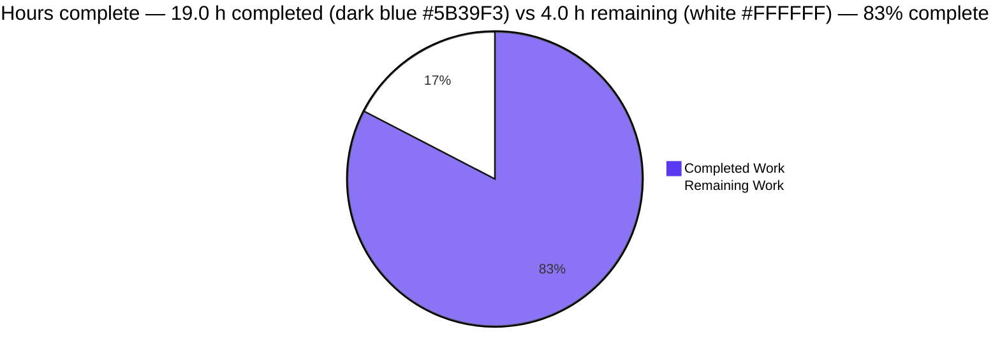
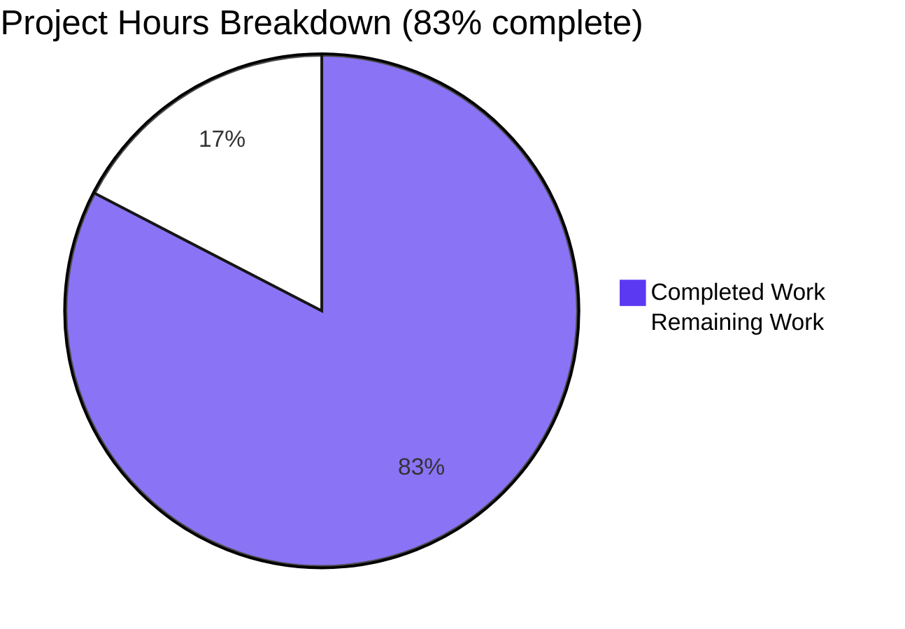

# 1. Executive Summary

Where this project stands: what the repository contains, how it was verified, and what remains.

## 1.1 Project Overview

A single-file Node.js console program that prints one line, plus the three-line README that says how to run it. It exists so anyone evaluating this repository can run one command and see exactly `Welcome to Blitzy` — no formatting, arguments, configuration, dependency or install step. Scope was deliberately minimal: two new files at the repository root, five added lines in total. The repository also carries a pre-existing, unrelated one-file HTTP server at the root, left byte-identical and undocumented. The target users are developers and reviewers who need a runnable program end to end.

## 1.2 Completion Status

Completion is measured over the hours the agreed scope and the path to production account for: **19.0 completed + 4.0 remaining = 23.0 total hours**, so **19.0 ÷ 23.0 = 82.6%, reported as 83% complete**.

| Metric | Hours |
|---|---|
| Total Hours | 23.0 |
| Completed Hours (AI + Manual) | 19.0 |
| Remaining Hours | 4.0 |
| Completion | 83% |



## 1.3 Key Accomplishments

- ✅ Exact output: 18 unformatted bytes, `Welcome to Blitzy`.
- ✅ Clean exit: status 0 in every invocation, including 200 consecutive and 10 concurrent runs.
- ✅ Minimal shape: two lines, one statement, no wrapper, export or variable.
- ✅ Zero dependencies: no manifest, lockfile or install step; it runs on a bare runtime.
- ✅ Determinism: identical bytes from every directory, locale and environment tested.
- ✅ No input surface: arguments and standard input are never read.
- ✅ Documentation that holds: the README's command and quoted message both verify against the program.
- ✅ Clean boundary: two root files added; no other path created, modified or renamed.

## 1.4 Critical Unresolved Issues

Three items remain open, all release or decision items rather than unfinished work: **every one of the 36 requirement entries the agreed scope defines is met**.

| Issue | Impact | Owner | ETA |
|---|---|---|---|
| The change sits on a feature branch; the default branch does not carry it | Users of the default branch cannot see the program | Repository owner | 1 day |
| No automated guard exists for the printed line, its newline or the README's quoted message | A future edit to either string can drift unnoticed; adding a guard means lifting the no-test-artifact constraint | Repository owner | 1 week |
| The README does not qualify its command with a working directory, and the repository's other entry point (a one-file HTTP server on port 3000) is undocumented | A reader can run the wrong file, or the right file from the wrong directory | Repository owner | 1 week |

## 1.5 Access Issues

No access issues identified. Nothing needs a credential, service, database, network route or third-party access: every verification step runs locally.

## 1.6 Recommended Next Steps

1. [High] Merge the branch and confirm the landed files match the delivered digests (0.5 h).
2. [Medium] Decide whether to permit a test artifact; if so, add a guard asserting the 18-byte output and the README's quoted message (2 h).
3. [Low] Qualify the README's command with its directory, and decide whether to document the root's other entry point (1.5 h).
4. [Low] Resolve the two untracked smoke captures so a broad staging command cannot sweep them in.

# 2. Project Hours Breakdown

Requirement references below are the reference numbers of the agreed scope: F1–F3 functional, N1–N5 non-functional, P product and stack, A acceptance content, T tree and creation order, S scope boundary, R rules and attachments, C the request's own constraints, Implied the behaviors the request implies. Section 5.1 states each of them in full.

## 2.1 Completed Work Detail

Every component below traces to a specific requirement of the agreed scope. Hours are the effort the delivered work represents, verification included.

| Component | Hours | Description |
|---|---|---|
| `index.js` — the welcome program (F1, F2, F3, N1, N4, N5) | 2.0 | The two-line console program: one statement printing the exact line, with no input, argument, file, network, logging, error-handling or configuration construct |
| `README.md` — run instruction and message (A2, Implied-4, P2) | 1.0 | The three-line README: project name, the message the program prints, the single install-free command that runs it |
| Entry-point documentation — one-line JSDoc summary (Implied-3, C3) | 0.5 | The single `/** ... */` summary above the statement, with no tag, example or second paragraph |
| Byte-exact acceptance and static analysis of both files (A1, A2, N1) | 3.0 | Character-for-character comparison with the agreed content, parse gate on both JavaScript files, encoding and line-ending inspection, placeholder sweep |
| Runtime verification of output, exit status and determinism (F1, F3, N4) | 6.0 | Byte-level capture and comparison across repeated, concurrent, adverse-sink and multi-directory runs, plus the 200-run exit-status vector |
| Behavioural and adverse-invocation verification (F2, N2, N5, Implied-1) | 4.0 | Argument, standard-input, environment, locale, timezone and permission-model exercises, and a lone-copy run with nothing installed |
| Scope-boundary, placement and creation-order verification (T1, T2, S1, S2, S3) | 2.0 | Change-set and tree inspection, the forbidden-artifact sweep, and confirmation that no other path was touched |
| Classification, documentation-claim and rules/attachments checks (P1, P2, R1, R2) | 0.5 | Product classification, claim-by-claim verification of the README, and confirmation that no user rules or attachments exist |
| **Total** | **19.0** | |

## 2.2 Remaining Work Detail

| Category | Hours | Priority |
|---|---|---|
| Release to the default branch (path to production) | 0.5 | High |
| Automated regression guard for the printed line, its newline and the README's quoted message | 2.0 | Medium |
| Repository documentation and housekeeping decisions | 1.5 | Low |
| **Total** | **4.0** | |

The guard cannot be delivered inside the current agreement, which forbids adding a test artifact to this repository; the first step is a decision to lift that constraint. The documentation row covers three decisions with the same owner: the run command does not state the directory it must be run from, the repository's other entry point at the root is undocumented, and two untracked captures need a disposition.

**Hours basis:** completed 19.0 h + remaining 4.0 h = **23.0 total hours**; completion = 19.0 ÷ 23.0 = **82.6%, reported as 83%**. Nothing outside the agreed scope and the path to production is counted.

# 3. Test Results

Every number below was produced by executing the delivered program in this repository and comparing its output, exit status and files byte for byte. The project ships no test framework and permits none, so the verification is direct execution rather than framework-based: 55 checks in total, 55 passed, 0 failed.

| Area / Category | Framework | Tests | Passed | Failed | Coverage | What This Proves |
|---|---|---|---|---|---|---|
| Program output — exact, unformatted line | Node.js v22, byte capture and digest comparison | 11 | 11 | 0 | — | The program writes exactly `Welcome to Blitzy` as 18 bytes with one newline and no quote, label, escape, control byte or trailing space, and is unchanged under colour-forcing and colour-suppressing environments |
| Exit status | Shell exit-code capture | 6 | 6 | 0 | — | Every invocation completes with status 0, including a 200-run vector, ten concurrent runs, a closed output descriptor, a full device and an early-closing reader |
| Input independence — arguments and standard input | Direct invocation and shell redirection | 10 | 10 | 0 | — | Arguments from `--help` to 5,000 operands, and empty, closed, piped or endless standard input, change nothing that is printed and are never consumed |
| Environment and locale independence | Runs under controlled environments | 6 | 6 | 0 | — | A bare environment, added variables, locales, timezone and runtime options all produce byte-identical output, so no configuration influences the program |
| Determinism across runs and working directories | Repeated, concurrent and multi-directory runs with hash comparison | 6 | 6 | 0 | — | Output is byte-identical on every run and from every working directory exercised, including a directory-form invocation |
| Documented run instruction | Command extracted from the README and executed verbatim | 6 | 6 | 0 | — | The README's single command runs and its quoted message matches the program's literal, and the file stays within its length ceiling with no excluded section |
| Artifact shape, static gate and scope boundary | Node.js parse gate, byte comparison, git change-set inspection | 10 | 10 | 0 | — | Both files parse, match the agreed content byte for byte, and the change adds exactly the two intended root files while leaving every other path untouched |
| **Total** | | **55** | **55** | **0** | — | |

Coverage is not measured: the project carries no coverage tooling and the agreed scope permits none.

**Not Covered**

- No automated suite exists anywhere in this repository, so nothing re-checks the printed line, its trailing newline, the README's quoted message or the exit status when either file changes. Before release, a human should run `node index.js` from the repository root and confirm the output is exactly the 18 bytes `Welcome to Blitzy` followed by one newline, with exit status 0.
- The repository's second entry point at the root — the pre-existing one-file HTTP server — is not part of this change and is covered by no check here. Its behaviour was observed from a copy run on a private port, which answered HTTP 200 with the body `Hello, World!`. A human should decide whether that file belongs in the released repository and, if it does, verify the committed file directly.
- Nothing browser-, UI- or endpoint-related is covered, because the delivered program renders no page and exposes no service: there is no surface for those checks to exercise.

# 4. Runtime Validation & UI Verification

- ✅ **Program start-up** — `node index.js` from the repository root prints the line and exits 0 with an empty error stream.
- ✅ **Primary journey** — capturing the line to a pipe or file yields exactly 18 bytes, identical on every run and from every directory exercised.
- ✅ **Arguments** — absent by design: `--help`, an empty operand, a unicode operand and 5,000 operands all print the same line and nothing else.
- ✅ **Standard input** — never read or awaited: closed, empty, piped and endless inputs all return immediately with the same bytes.
- ✅ **Exit status** — 0 in every invocation, including a 200-run vector, ten concurrent runs and the adverse output sinks.
- ✅ **Documented command** — the README's command executed verbatim from the repository root prints the line the README quotes.
- ⚠ **Documented command from another directory** — the instruction is relative to the repository root and does not say so; run elsewhere it fails with a module-resolution error rather than printing.
- ⚠ **Output-sink failure** — a closed descriptor, a full device or a reader that closes early still exits 0 with nothing on the error stream, so a consumer cannot tell delivery from loss.
- ⚠ **Repository's second entry point** — the pre-existing one-file HTTP server at the root is undocumented and was not run from the committed file; a copy run on a private port answered HTTP 200 with `Hello, World!`.
- ⚠ **Runtime version** — the program was exercised on Node.js v22.23.3; the repository pins no floor because the scope permits no manifest.

No failing flow was observed. The delivered change has no page, screen, endpoint or rendered surface, so no browser-based or UI validation applies to it: nothing in the delivered work presents a route, a view or a stylesheet to exercise. Beyond the checks above, nothing else was exercised at runtime — the committed HTTP server file was never executed, no load or performance testing applies to a program that prints one line and exits, and no coverage measurement exists because the project permits no coverage tooling.

# 5. Compliance & Quality Review

Status indicators: ✅ complete — shown in the Blitzy brand colour for delivered work, dark blue (#5B39F3); work that is not complete appears white (#FFFFFF) in Section 7.

## 5.1 Compliance Matrix

| # | Deliverable | Verified Status | Evidence |
|---|---|---|---|
| 1 | F1 — exactly one unformatted line, `Welcome to Blitzy` | ✅ PASS | `index.js:2`; captured output is 18 bytes with one newline and no escape, control or quote byte |
| 2 | F2 — does nothing else: no input, argument, file, network, logging, error handling, configuration or abstraction | ✅ PASS | Whole file is 2 lines and 1 statement; 0 matching constructs; empty error stream in every run |
| 3 | F3 — runs to completion and exits 0 | ✅ PASS | Exit status 0 across direct, piped, concurrent, 200-run and adverse-sink invocations |
| 4 | N1 — fewest lines and tokens: a single statement | ✅ PASS | 69 bytes, 2 lines, 1 statement, no wrapper, export or variable |
| 5 | N2 — zero dependencies, no manifest, no lockfile, no install step | ✅ PASS | No package manifest, lockfile or module tree exists; a lone copy runs in an empty directory |
| 6 | N3 — no test artifact, fixture or coverage target | ✅ PASS | Tree holds no test, spec or coverage path; the absence is required by the scope |
| 7 | N4 — deterministic output across runs, directories and platforms | ✅ PASS | One distinct output hash over repeated runs; identical concurrently and from every directory exercised |
| 8 | N5 — no configuration influences the program | ✅ PASS | Byte-identical output under a bare environment and under every variable, locale and timezone variation tested |
| 9 | Documentation — message and one run command, under the length ceiling, no excluded section | ✅ PASS | `README.md` is 3 lines; the command runs verbatim and the quoted message matches the program's literal |
| 10 | Entry-point documentation — one-line summary, no tags or examples | ✅ PASS | `index.js:1` is a single `/** ... */` line with no tag, example or second paragraph |
| 11 | Scope boundary — exactly two root files added, no other path touched, no forbidden artifact | ✅ PASS | Change set is `index.js` and `README.md` only; no modified, deleted, renamed or copied path; artifact sweep empty |
| 12 | Acceptance content and end-to-end integrity | ✅ PASS | Both files match the agreed content byte for byte; every requirement of the agreed scope is met; 19.0 of 23.0 hours complete (83%) |

## 5.2 AAP & Rule Divergences and Gaps

| # | What the AAP/Rule Required | What Was Delivered Instead | Why It Diverged | Impact | Remediation |
|---|---|---|---|---|---|
| D1 | Validation artifacts written beside the code under test | Checks ran with their artifacts held outside the repository and discarded; the repository holds no test file | The request and the plan forbid adding any test suite, test file, framework or coverage target here (Sanctioned — higher source) | The verification stands, but it is not reproducible from the repository | Lift the constraint and add one guard (Medium, 2.0 h) |
| D2 | Legitimate files left in the working tree are committed | `blitzy/screenshots/server_smoke.png` and `server_smoke_viewport.png` left untracked | They are not outputs of this change, and the scope excludes artifacts the request did not ask for (Sanctioned — higher source) | A broad staging command would sweep two unrelated binaries into a later commit | Delete, ignore or commit them (Low, part of 1.5 h) |
| D3 | Default comment practice questions a comment on a self-evident one-line literal | `index.js:1` keeps `/** Prints the welcome message. */` | The request requires exactly that one-line summary above the statement (Sanctioned — higher source) | None; a reviewer applying only the general rule may read it as redundant | None — the agreement mandates it |
| D4 | The plan states its checkout held no repository content | The root already carried `server.js`, a one-file HTTP server on port 3000 printing `Hello, World!`; the change left it byte-identical and the README never mentions it | The scope fixes the two delivered files and forbids touching any other path | A reader can run the other entry point, see different output and bind a port the documentation never explains | Decide whether to document it (Low, part of 1.5 h) |
| D5 | Lint and static-analysis gates applied to changed files | No linter was run on `README.md`; conformance was established by direct byte and content inspection | The repository carries no lint configuration and the scope forbids adding tooling (Sanctioned — higher source) | Conformance holds today, but no automated check will catch future drift | Fold into the guard decision (Medium, 2.0 h) |

**D1 — validation artifacts held outside the repository.** The working convention is to write validation artifacts beside the code under test. Here every check ran with its artifacts outside the repository and discarded afterwards, and the repository contains no test file at all. The agreement requires that: the request adds no test suite, test file, lockfile or dependency, and the plan excludes test coverage of any kind, so the convention gave way to the written scope. Nothing about the delivered behaviour changes — the checks were performed and passed — but the verification itself is not reproducible from the repository. Anyone who wants a repeatable check must first lift that constraint; that is the Medium task in Section 2.2.

**D2 — two pre-existing smoke captures left untracked.** The convention for this work is to commit legitimate files a change leaves in the working tree. Two untracked captures sit under `blitzy/screenshots` — `server_smoke.png` and `server_smoke_viewport.png` — and were deliberately left out: they are not outputs of this change, and the agreed scope excludes every artifact the request did not ask for, so committing them would put unrelated binaries in the diff. They remain untracked today, which means a broad staging command such as `git add -A` would sweep them into a later commit. The owner should decide whether to delete them, ignore them or commit them.

**D3 — the single JSDoc summary kept.** Default comment practice questions a comment on a self-evident one-line literal, and `index.js:1` carries exactly that: `/** Prints the welcome message. */` above `console.log("Welcome to Blitzy");`. It is kept because the request requires it — the entry point's documentation is specified as exactly one one-line `/** ... */` summary, with no `@param`, no `@returns`, no multi-paragraph description and no usage example — and that explicit instruction outranks the general preference. No action is needed. A reviewer applying only the general rule may read the line as redundant; this is the reason it is not.

**D4 — the plan assumed an empty checkout.** The plan's research section states that its checkout held no repository content. It did: the root already carried `server.js`, a 142-byte one-file HTTP server that answers on a hard-coded port 3000 with `Hello, World!`. The change was scoped to two files and the request forbade touching any other path, so `server.js` was left byte-identical (sha256 `7ea2abcb…8ccaa`) and referenced nowhere — the README documents only `node index.js`. The delivered files are correct as written, but a reader who runs the repository's other entry point sees different output and a bound port, with nothing in the documentation to explain it. The owner should decide whether to document it.

**D5 — no lint or static-analysis gate.** No linter was run against `README.md`. The repository carries no lint configuration, no manifest to declare one, and the agreed scope forbids adding tooling, so the tool gate was replaced by direct inspection: the file's bytes, line count, heading count, trailing whitespace and excluded-section vocabulary were each checked explicitly, and `node --check` covers the JavaScript. Conformance is established, but no automated check will notice future drift in the documentation. Anyone who wants such a gate should fold it into the guard decision in Section 2.2.

# 6. Risk Assessment

| Risk | Category | Severity | Probability | Mitigation | Status |
|---|---|---|---|---|---|
| The message and the run command are duplicated between `index.js:2` and `README.md:3`, with nothing enforcing that they stay aligned | Technical | Low | Medium | Add a guard asserting both strings, or review both whenever either one changes | Open — accepted for now |
| No automated test, lint or CI gate exists, so a regression in the output, the file shape or the documentation is caught only by running the command by hand | Technical | Medium | Medium | Deliver the guard from Section 2.2 once the no-test-artifact constraint is lifted | Open |
| The runtime version is unpinned — no manifest `engines` field, no `.nvmrc`, no version note | Technical | Low | Low | Record the exercised version in the documentation if its content may change | Accepted |
| A failed output write (closed descriptor, full device, reader closing early) exits 0 with no message | Technical | Medium | Low | Have the consumer verify the captured bytes; the scope forbids adding error handling | Accepted |
| No vulnerability, dependency or secret scanning runs anywhere in this repository | Security | Low | Low | None required: no dependency, no input, no socket and no secret, so the only surface is the runtime — keep it patched | Accepted |
| The documented command is relative to the repository root and does not say so | Operational | Low | Medium | Qualify the instruction with its working directory, or document the absolute-path form | Open |
| Two untracked binary captures remain in the working tree | Operational | Low | Medium | Delete, ignore or commit them so a broad staging command cannot pick them up | Open |
| The repository's other entry point binds a fixed port 3000 | Integration | Low | Medium | Ensure the port is free before running it, or make the port configurable if that file is ever revived | Accepted |

No integration risk arises from the delivered change itself: it makes no outbound call, exposes no endpoint and reads no external system, so its only coupling is the textual reference from `README.md:3` to `index.js` — verified consistent with the file that exists.

# 7. Visual Project Status



Completed work is the dark blue slice (#5B39F3); remaining work is the white slice (#FFFFFF).

**Remaining hours by category**

| Category | Hours | Priority |
|---|---|---|
| Release to the default branch | 0.5 | High |
| Automated regression guard | 2.0 | Medium |
| Documentation and housekeeping decisions | 1.5 | Low |
| **Total** | **4.0** | |

**Priority distribution of remaining work:** High 0.5 h (13%), Medium 2.0 h (50%), Low 1.5 h (38%) — a total of 4.0 h against 19.0 h of completed work, or 83% complete.

# 8. Summary & Recommendations

**What was delivered and verified.** The repository gains a runnable Node.js console program that prints exactly `Welcome to Blitzy` and a three-line README that tells a reader how to run it. Verification was direct: 55 checks executed against the delivered files, all passing. The output is byte-exact at 18 bytes with a single newline and no escape, control or quote byte; the process exits 0 in every invocation, including a 200-run vector, ten concurrent runs, a closed output descriptor, a full device and an early-closing reader; arguments and standard input are never read or awaited; a bare environment, added variables, locales and timezones change nothing; and a lone copy of the file runs in an empty directory with nothing installed. The README's command and the message it quotes both hold against the running program, and the change adds only the two intended root files — five lines in total, no other path touched.

**What remains.** Three items, 4.0 hours: release the change to the default branch (0.5 h), decide whether to permit a test artifact and add one automated guard for the printed line and its quoted copy in the README (2.0 h), and settle the documentation and housekeeping decisions — the root-relative run command, the undocumented second entry point at the root, and the two untracked smoke captures (1.5 h). The critical path is short and sequential: merge, then the guard decision, then the documentation pass. None of the three changes what the program prints.

**Production readiness.** The delivered program is ready for its stated purpose. It is a prototype CLI with no state, no input, no configuration, no socket and no failure path, so the residual concerns are the ones its minimal shape creates: a failed output write is silent, nothing automated guards the message or its newline against a future edit, the runtime version is unpinned, and the documented command assumes the repository root. One further gap belongs to the repository rather than to this change: the pre-existing one-file HTTP server at the root is undocumented and binds a fixed port 3000, so a reader can run it without warning.

| Metric | Value |
|---|---|
| Requirement entries met | 36 of 36 |
| Files added / lines changed | 2 files / 5 insertions, 0 deletions |
| Verification checks passed | 55 of 55 |
| Completed / remaining / total hours | 19.0 / 4.0 / 23.0 |
| Completion | 83% |
| Open items | 3 (release and decisions only) |

**Recommendation.** Merge the branch after confirming the landed files match the delivered digests, then decide the guard question — one small script asserting the exact 18-byte output and the message the README quotes would close the only structural gap in this project, at the cost of relaxing a constraint that was written for a two-file change. Treat the documentation pass as low priority but not optional if the repository is to be shared: a reader should be told which directory the command runs from and what else sits at the root. Nothing here blocks the deliverable itself; 19.0 of the 23.0 scoped hours are complete, and the remainder is release and stewardship work rather than unfinished code.

# 9. Development Guide

**System prerequisites**

- Node.js on `PATH`. This project was exercised on Node.js v22.23.3; the program uses only `console.log` on a string literal, which exists in every Node.js release, and no version is pinned anywhere, so any current release runs it.
- A POSIX shell for the copy-paste steps below. No build tool, compiler, package manager or container runtime is involved.
- No hardware requirement beyond a machine that runs Node.js, and no operating-system requirement beyond the shell above.

**Environment setup**

- Change into the repository root before running anything: every command below is written for that directory.
- Nothing else to configure. No environment variable, secret, configuration file or flag influences the program, and Node.js has no virtual-environment mechanism, so there is no environment to create or activate.

```bash
cd /path/to/repository        # the repository root, containing index.js
node --version                # v22.23.3 in the environment used for verification
```

**Dependency installation**

- None. This is a zero-dependency project: there is no package manifest, no lockfile and no module tree, and the program imports nothing.
- Do not run `npm install`. There is nothing to install, and `npm pkg get name` fails with `ENOENT` against the absent manifest — that failure is expected, not a setup problem. Adding a manifest or dependency is outside the scope this project was delivered under.

**Application startup**

```bash
cd /path/to/repository
node index.js
```

Expected output, exactly one line and nothing else:

```text
Welcome to Blitzy
```

The process exits immediately with status 0. It is not a server: it binds no port, opens no file and waits on no input.

**Verification steps**

```bash
node --check index.js          # no output, exit status 0 — the file parses
node index.js                  # prints Welcome to Blitzy
node index.js | wc -c          # 18 — the message plus its newline
node index.js | od -c          # W e l c o m e   t o   B l i t z y \n
node index.js; echo "exit=$?"  # exit=0
```

Expected results: the parse gate prints nothing and exits 0; the program prints the single line; the byte count is 18; the octal dump ends in `y  \n` with nothing after it; the exit status is 0. Running the command several times yields identical bytes every time, from any working directory, under any environment.

**Example usage**

```bash
cd /path/to/repository
cmp <(node index.js) <(printf 'Welcome to Blitzy\n') && echo "byte-identical to the expected line"
node index.js 2>&1 >/dev/null | wc -c   # 0 — nothing is written to the error stream
```

The comparison prints `byte-identical to the expected line` and the error stream measures zero bytes: together they are the complete acceptance check for this program. Neither step writes a temporary file.

**Troubleshooting**

| Symptom | Cause | Resolution |
|---|---|---|
| `Error: Cannot find module '.../index.js'`, code `MODULE_NOT_FOUND`, exit 1 | The command was run outside the repository root; the documented instruction is relative | Change into the repository root, or invoke the file by absolute path: `node /path/to/repository/index.js` |
| `npm pkg get name` fails with `ENOENT` | There is no package manifest, by design | Expected — no installation step exists |
| A terminal shows the line followed by a carriage return and newline (19 bytes instead of 18) | The terminal driver translates the newline; the program itself emits a single LF | Compare bytes from a file or pipe, not from a terminal: `node index.js \| od -c` |
| The program exits 0 but prints nothing | Its output sink is broken — a closed descriptor, a full device, or a reader that closes early | Verify the consumer and the capture; the scope forbids the program from reporting this itself |
| Port 3000 is already in use | The repository's other entry point binds that port | Check before running it: `(exec 3<>/dev/tcp/127.0.0.1/3000) 2>/dev/null && echo in use \|\| echo free` |

# 10. Appendices

## A. Command Reference

| Command | Purpose | Observed result |
|---|---|---|
| `node index.js` | Run the program from the repository root | Prints `Welcome to Blitzy`; exit status 0 |
| `node --check index.js` | Syntax gate on the program file | No output; exit status 0 |
| `node --check server.js` | Syntax gate on the repository's other root file | No output; exit status 0 |
| `node index.js \| od -c` | Inspect the output bytes | 18 bytes ending in a single `\n` |
| `node index.js \| wc -c` | Count output bytes | `18` |
| `cmp <(node index.js) <(printf 'Welcome to Blitzy\n')` | Compare the output with the expected line | No output and exit status 0 when identical |
| `node index.js 2>&1 >/dev/null \| wc -c` | Count the bytes written to the error stream | `0` |
| `node /path/to/repository/index.js` | Run from any other directory | Identical output; exit status 0 |
| `git diff --name-status <base>..HEAD` | Inspect the change set | `A README.md`, `A index.js` — nothing else |
| `(exec 3<>/dev/tcp/127.0.0.1/3000) 2>/dev/null && echo in use \|\| echo free` | Test port 3000 occupancy (`lsof` is not installed) | `free` on this host |
| `npm pkg get name` | Confirm no package manifest exists | `ENOENT`, exit status 254 — expected |

## B. Port Reference

| Port | Bound by | Notes |
|---|---|---|
| 3000 | `server.js` — the pre-existing one-file HTTP server at the root, not part of this change | Hard-coded in that file; the delivered program binds nothing at all. Free the port before running it, and use the `/dev/tcp` recipe above to check, since `lsof` and `ss` are not relied on here |

## C. Key File Locations

| Path | Purpose | Size |
|---|---|---|
| `index.js` | The console program: one statement printing the exact line | 2 lines / 69 bytes |
| `README.md` | States the message and the single command that runs it | 3 lines / 64 bytes |
| `server.js` | Pre-existing one-file HTTP server; left byte-identical and undocumented by this change | 1 line / 142 bytes |
| `blitzy/screenshots/server_smoke.png`, `blitzy/screenshots/server_smoke_viewport.png` | Untracked smoke captures present in the working tree; not outputs of this change | 2 files |

## D. Technology Versions

| Component | Version | Notes |
|---|---|---|
| Node.js | v22.23.3 | The runtime the program was exercised on; nothing in the repository pins a version |
| JavaScript language features used | `console.log` on a string literal only | Present in every Node.js release, so no compatibility floor applies |
| Frameworks, libraries, databases | None | Zero dependencies by design; no manifest, lockfile or module tree exists |
| Git base and change commits | `70e3ee8` base; `84a8929` adds the program; `f6e7c1e` adds the README | Both change commits precede the current branch tip |

## F. Developer Tools Guide

- **Runtime:** Node.js on `PATH` is the only prerequisite; there is nothing to install, build or activate.
- **Static check available:** `node --check <file>` on any JavaScript file. No linter, test runner, coverage tool or CI pipeline is configured anywhere in this repository, and the delivered scope permits none, so this is the complete static gate.
- **Byte-level inspection:** `od -c`, `wc -c`, `cmp`, `printf` and `sha256sum` are the tools used to confirm the output and the files; they are part of any POSIX environment and need no installation.
- **Port check:** `lsof` is not installed here; use the `/dev/tcp` recipe in Appendix A to see whether port 3000 is occupied.
- **Suggested habit:** after any edit to `index.js` or `README.md`, run `node --check index.js` and then `node index.js | od -c`, and confirm the 18 bytes and the message the README quotes still agree.

## G. Glossary

| Term | Meaning in this project |
|---|---|
| Standard output (stdout) | The stream the program writes its one line to; the message is the only thing it ever writes |
| Exit status | The number the process returns to the shell; 0 means it completed normally |
| Byte-exact | Matching the agreed content or output character for character, verified with byte dumps and digests |
| Acceptance content | The exact file contents fixed by the scope; what the files contain is what those contents state |
| JSDoc summary | The single `/** ... */` line documenting the entry point, above the statement it describes |
| LF / CRLF | Line-feed (`\n`), which the program emits, versus carriage-return-plus-line-feed, which a terminal may display |
| ONLCR | The terminal driver setting that turns a program's LF into CRLF on screen, so a terminal shows 19 bytes while a file or pipe receives 18 |
| EPIPE | The error raised when a reader closes the pipe early; the program neither reports nor acts on it |
| `/dev/full` | A device whose writes always fail, used to exercise the silent-failure behaviour |
| `MODULE_NOT_FOUND` | The error Node.js reports when the file named on the command line cannot be resolved, typically because the command was run outside the repository root |
| Smoke capture | A screenshot or recording taken while exercising the repository's HTTP server; the two untracked files under `blitzy/screenshots` are of this kind |
