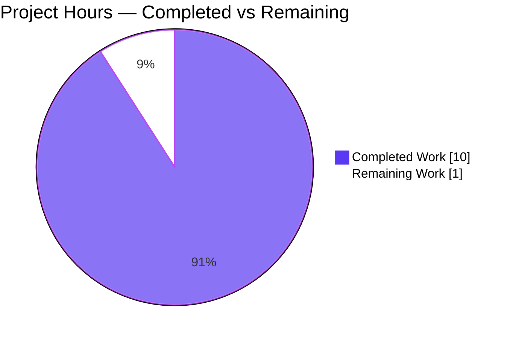
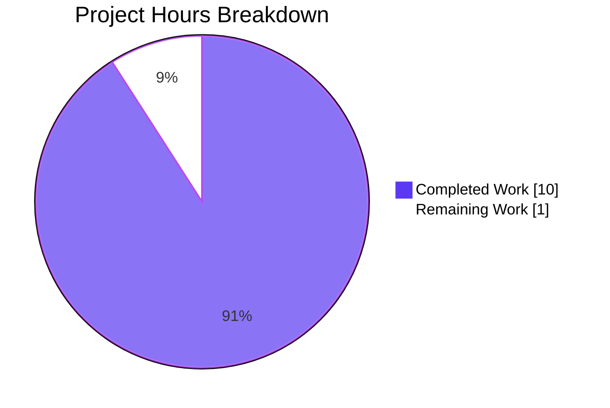
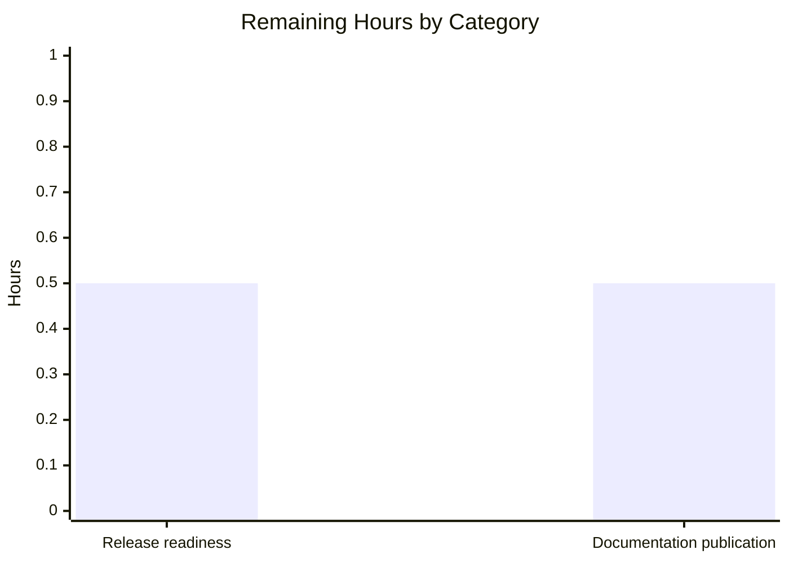

# 1. Executive Summary

## 1.1 Project Overview

SimpleJS is a dependency-free Node.js HTTP server in a single source file, delivered with the repository's entry document. The server answers every request on port 3000 with the fixed body `Hello, World!`, and the entry document gives the project name, the no-install answer and the command that runs it. The work was documentation-scoped: a summary comment above the request handler in `server.js` and a new eleven-line `README.md`, both byte-verified against their fixed contents, with the documented command executed and the live endpoint exercised.

## 1.2 Completion Status



| Metric | Hours |
|---|---|
| Total Hours | 11.0 |
| Completed Hours (AI + Manual) | 10.0 |
| Remaining Hours | 1.0 |

**91% complete** — 10.0 completed hours of 11.0 total (10.0 / (10.0 + 1.0) = 90.9%, rounded to 91%), counting only the delivered scope and its path to production.

## 1.3 Key Accomplishments

- Request handler documented by a single one-line summary directly above it (`server.js:1`)
- Pre-existing handler statement preserved exactly, proven byte-identical to the base revision
- Entry document created: project name, the no-install answer and the run command (`README.md`)
- Entry document held to 11 lines, with no badge and none of the excluded sections
- Documented command executed end to end: it starts the server, which answers `200` with a 14-byte body
- Response contract verified across five paths, six methods and HEAD, with `Content-Length: 14`
- Start-up, shutdown (exit 143, port released), second-start failure and 40-request concurrency exercised
- Change set confined to the two planned files: 12 insertions, 0 deletions, nothing added

## 1.4 Critical Unresolved Issues

**0 of 5 requested deliverables remain open.** Eight accepted constraints are carried into release knowingly; none blocks it.

| Issue | Impact | Owner | ETA |
|---|---|---|---|
| Port 3000 is hardcoded and host-global; a second instance on one host exits 1 with `EADDRINUSE` | One server per host; no way to run two instances or move the port without changing code | Maintainer | Before release |
| Documented command is repository-root relative (`MODULE_NOT_FOUND` from any other directory) | A reader pasting the command elsewhere sees a load error | Documentation owner | Next document revision |
| Entry document names no runtime prerequisite, no port and no served URL | A first-time reader cannot learn the URL from the document alone | Documentation owner | Next document revision |
| No test suite, linter, formatter, type checker, coverage tool or CI configuration exists | Future changes are guarded only by a parse check plus a live request | Maintainer | Next change |
| Responses carry no `Content-Type` | Clients must guess or sniff the 14 bytes of plain text | Maintainer | When the endpoint is exposed beyond localhost |
| HEAD and HTTP/1.0 responses carry no `Content-Length` (framing by close/keep-alive) | A client requiring `Content-Length` on HEAD needs a code change | Maintainer | When the endpoint is exposed beyond localhost |
| No request logging, metrics or health endpoint; only the single start-up line is emitted | A runtime failure leaves no server-side trace; liveness is observable only via the socket | Maintainer | Before release |
| The entry document's rendered display has never been viewed (no renderer exists in the project) | Published appearance of the H4 headings under the single H1 is unconfirmed | Documentation owner | Before release |

## 1.5 Access Issues

No access issues identified. The server needs no credential, environment variable or configuration, no permission beyond the checkout, and calls no external service.

## 1.6 Recommended Next Steps

1. **[High]** Run the documented command on the release host; confirm port 3000 is free there and the service answers `200` with a 14-byte body, and record the fixed-port constraint for operators.
2. **[Medium]** View the published entry document through the platform's markdown renderer and confirm the headings display as intended.
3. **[Medium]** Decide whether the port should become configurable if a second server must ever run on the same host; that is a code change needing its own authorisation.
4. **[Low]** Add a `Content-Type`, a request log or a health endpoint if the endpoint will be exposed beyond localhost.
5. **[Low]** Add a smoke test that runs the documented command and asserts `200` with a 14-byte body, so future edits are guarded beyond the parse check.

# 2. Project Hours Breakdown

## 2.1 Completed Work Detail

| Component | Hours | Description |
|---|---|---|
| Request-handler summary comment | 2.0 | Reading the single-statement handler, deriving the one-line summary, making the minimal comment-only edit, and proving the pre-existing statement byte-identical (`server.js:1–2`) |
| Repository entry document | 2.0 | Deriving the three facts from the code, authoring the eleven fixed lines, and confirming the documented command starts the service (`README.md:1–11`) |
| Scope, quality and dependency-surface verification | 2.5 | Sweeping the tree for manifests, lockfiles, dependency declarations, added tooling and documentation configuration; the excluded-artefact, secret and placeholder sweeps; the plain-text format checks |
| Runtime verification of the endpoint and documented command | 3.5 | The 41-check battery over start-up, five paths × six methods, response bytes and metadata, lifecycle, port release, second-start failure, concurrency and environment independence |
| **Total** | **10.0** | |

## 2.2 Remaining Work Detail

| Category | Hours | Priority |
|---|---|---|
| Release readiness — confirm the documented command starts the service on the release host (port 3000 free) and record the fixed-port constraint for operators | 0.5 | Medium |
| Documentation publication — view the entry document as rendered by the hosting platform and confirm the section display | 0.5 | Low |
| **Total** | **1.0** | |

## 2.3 Human Task List

| Task | Priority | Hours | Traces To |
|---|---|---|---|
| T-1 Run the documented command on the release host; confirm port 3000 is free, the start-up line appears and the service answers `200` with a 14-byte body; record the fixed-port constraint in the operator run book | Medium | 0.5 | Path-to-production check of the delivered run command |
| T-2 Open the published entry document in the hosting platform's markdown view; confirm the `#### Install` and `#### Run` headings under the `# SimpleJS` title display as intended | Low | 0.5 | Path-to-production confirmation of the entry document |
| **Total** | | **1.0** | |

**No immediate-fix tasks exist.** Nothing blocks compilation, start-up or delivered behaviour: the parse gate exits 0, the service starts and answers as specified on every method and path exercised, and both files are byte-identical to their fixed contents.

**Knowingly accepted, needing no further work:** the H4 section headings under the single H1 are deliberate and a later change to heading depth should be a conscious one; the project intentionally ships no test suite, linter, formatter or CI configuration, so a future change is guarded by `node --check` plus a live request; two response screenshots and two empty artefact directories sit untracked outside version control, leaving the tracked tree at two files; and the entry document is a standalone deliverable reviewed as its own change.

**Optional, outside this work's scope** (authorising them requires a new request): a configurable port, request logging or a health endpoint, a `Content-Type` on responses, and an automated test or CI safety net. None is counted in the remaining hours above.

# 3. Test Results

**Verification basis.** 41 checks were executed against the delivered tree from the repository root on Node.js v22.23.3: 15 static checks over the source file, the entry document, the change set and the tree, and 26 runtime checks over start-up, the HTTP response contract, process lifecycle, concurrency and environment independence. 41 passed, 0 failed. The project carries no coverage tooling, so no coverage percentage is reported, and its only automated gate is the parse check below.

| Area / Category | Framework | Tests | Passed | Failed | Coverage | What This Proves |
|---|---|---|---|---|---|---|
| Static syntax gate (`server.js`) | Node.js built-in (`node --check`) | 1 | 1 | 0 | n/a — no coverage tooling | The delivered source parses and loads cleanly under the installed runtime |
| Source-file edit integrity | None — `sha256`, `cmp`, `git numstat` | 5 | 5 | 0 | n/a | The summary comment is byte-exact to its fixed text and the pre-existing statement is unchanged from the base revision |
| Entry-document content and limits | None — `wc`, `cmp`, `grep` | 6 | 6 | 0 | n/a | The document is byte-identical to its fixed contents, at 11 lines, with no badge and none of the excluded sections |
| Repository scope and hygiene | None — `git ls-files`, `find`, `grep` | 3 | 3 | 0 | n/a | The change set is exactly the two planned files and every out-of-scope artefact is absent |
| HTTP response contract | None — `curl` against the live process | 15 | 15 | 0 | n/a | Every path and method tried answers `200` with the fixed 14-byte `Hello, World!\n` and `Content-Length: 14` |
| Process lifecycle and port | None — shell, `lsof`, `curl` | 8 | 8 | 0 | n/a | Clean start with a single start-up line, port 3000 bound by that process, `SIGTERM` exit 143 with the port released, and a second start failing fast with `EADDRINUSE` |
| Load handling | None — `xargs` + `curl` | 1 | 1 | 0 | n/a | 40 concurrent requests all answered `200` by one process |
| Environment independence and invocation | None — `env`, `curl` | 2 | 2 | 0 | n/a | The server starts under an empty environment and when launched by absolute path from another directory |

**Not Covered**

- **Rendered display of the entry document** — the document's structure was verified as parsed text (line count, headings, fences, exclusions); no markdown renderer exists in the project, so its published appearance is unconfirmed. A human should view it once before release.
- **IPv6 clients** — reachability over IPv6 was never exercised; IPv6 is disabled host-wide, so no IPv6 interface exists for the server to serve.
- **Non-standard HTTP method tokens** — a custom or lowercase method token is rejected by the Node.js HTTP parser before the handler runs; the handler's own response was exercised for the standard methods, and no code path in the delivered file handles or is meant to handle those requests.
- **Concurrency beyond the exercised load** — 40 simultaneous requests were verified; no sustained-load, soak or memory-profile test exists or is in scope.
- **Any behaviour other than the single fixed response** — there is no second code path, no configuration branch, no error handler and no data access in the delivered source, so nothing else in the program is left uncovered.

# 4. Runtime Validation & UI Verification

The delivered program was driven live from the repository root, and the documented command was executed exactly as written in the entry document.

- ✅ **Start-up and port binding** — `node server.js` prints a single 41-byte line (`Server running at http://127.0.0.1:3000/`), writes nothing to stderr, and owns the listening socket on port 3000.
- ✅ **Primary request flow** — `GET /` returns `HTTP/1.1 200 OK` with the 14-byte body `Hello, World!\n`.
- ✅ **Method and path spectrum** — five distinct paths and six methods (GET, POST, PUT, DELETE, PATCH, OPTIONS) plus HEAD all answered `200` with the same 14-byte body; request bodies are ignored.
- ✅ **Documented entry point** — the run command extracted verbatim from `README.md` and executed from the repository root started the service that answered `200 14`.
- ✅ **Response metadata** — `Content-Length: 14`, Node.js default `Date`, `Connection` and `Keep-Alive`, and no `Content-Type`.
- ✅ **Shutdown and contention** — `SIGTERM` exits 143 and releases the port immediately; a second start while the port is held exits 1 with `EADDRINUSE`.
- ✅ **Concurrency** — 40 simultaneous requests were all answered `200` by the single process.
- ✅ **Environment independence** — the server starts and serves under an empty environment (`env -i`) and when launched by absolute path from another directory.
- ➖ **Entry-document rendering** — never exercised: no markdown renderer exists in the project, so the document's published appearance was not viewed.
- ➖ **External integrations and IPv6 clients** — the program makes no outbound call, reads no database, queue, file or environment variable, so there is no integration surface to drive; IPv6 reachability was not exercised because the host has IPv6 disabled.

Nothing in the delivered scope was left undriven at runtime other than the two items above, and no flow, endpoint or process behaviour failed.

# 5. Compliance & Quality Review

## 5.1 Compliance Matrix

| # | Deliverable | Quality / Compliance Benchmark | Status | Progress |
|---|---|---|---|---|
| 1 | Summary comment placement and form (`server.js:1`) | One brief `/** ... */` summary immediately above the handler; no `@param`, `@returns`, paragraph or example | ✅ Pass | 100% |
| 2 | Source-file preservation (`server.js:2`) | No logic change, refactoring, reformatting or renaming; statement characters unchanged | ✅ Pass | 100% |
| 3 | Comment text (`server.js:1`) | Byte-exact to the specified text (96 bytes) at the specified placement | ✅ Pass | 100% |
| 4 | Entry-document facts (`README.md:1,5,10`) | Project name, the install answer and the run command, and nothing else | ✅ Pass | 100% |
| 5 | Entry-document limits (`README.md`) | Under 15 lines, no badge, none of the excluded sections | ✅ Pass | 100% |
| 6 | Entry-document contents (`README.md`) | Byte-identical to the specified eleven lines | ✅ Pass | 100% |
| 7 | Change set | Exactly one source-file update and one document created; nothing deleted or replaced | ✅ Pass | 100% |
| 8 | Dependency and tooling surface | No dependency, package manifest, lockfile, version pin or documentation tool added or required | ✅ Pass | 100% |
| 9 | Scope boundaries | Every enumerated out-of-scope artefact absent from the tree and the change set | ✅ Pass | 100% |
| 10 | Formats and execution parameters | Plain Markdown plus a one-line JSDoc summary; no build, preview, publish, lint or environment-preparation artefact | ✅ Pass | 100% |
| 11 | Security baseline | No secret, credential or key; no request data read; only the Node.js built-in `http` module; no injection, traversal or deserialization surface | ✅ Pass | 100% |
| 12 | Repository hygiene | Tracked tree exactly two files; 12 insertions, 0 deletions; worktree clean apart from untracked evidence artefacts | ✅ Pass | 100% |

## 5.2 AAP & Rule Divergences and Gaps

Five divergences were found. None leaves a requirement unmet: both delivered files are byte-identical to the specified acceptance contents.

| What the AAP / Rule Required | What Was Delivered Instead | Why It Diverged | Impact | Remediation |
|---|---|---|---|---|
| D1 — The source file's edit was to be verified by a byte count taken from its last line (`tail -1 server.js \| wc -c`, stated as 143) | Verification by cryptographic byte identity of the preserved statement line against the pre-edit revision, plus a diff shape of `1 insertion / 0 deletions` | The prescribed arithmetic was self-inconsistent: one line of 141 characters plus a line feed measures 142 bytes, never 143, so no result could ever satisfy it | None on the deliverable — the stronger requirement (the statement unchanged) was proved directly and independently | None required; do not reuse the 143-byte expectation as an acceptance criterion in any future check |
| D2 — A per-file lint pass with `--no-fix` was to be run on each modified file | No lint or format run; `node --check server.js` (exit 0) served as the applicable gate | The repository installs no linter, formatter or type checker and holds no manifest to configure one, and adding tooling or dependencies is excluded by the scope boundaries | Low — the automated assurance for any future change is a parse check plus a live request | Accept while the project is tooling-free; authorise a separate change if a linter and CI are wanted |
| D3 — Not specified; markdown convention would place the document's sections at `##` | `#### Install` and `#### Run` under the single `# SimpleJS` title | The document's exact contents are fixed by the specification, which outranks convention, and the heading levels are part of that fixed content | Cosmetic — tooling that builds a table of contents from heading depth would nest these sections unusually | Change the heading depth only through a deliberate revision of the document's fixed contents |
| D4 — No rule on artefacts; the checkout's evidence directories are excluded from version control | Two response screenshots and two empty directories sit untracked in the checkout; only the two deliverables were committed | The environment designates those paths as platform artefact directories whose contents must never be committed, so committing them was not an option | None on the deliverable — the tracked tree is exactly two files and no deliverable depends on them | None required; leave the artefacts untracked and exclude the directories from any packaging step |
| D5 — The change set is two files: the source-file update and the document created | Delivered as two single-purpose commits, one per file, the document authored as its own file-scope assignment | Work was partitioned by file rather than as one combined edit | None — the delivered change set is exactly the two planned paths, 12 insertions and 0 deletions | None required |

**D1 — the byte-count verification.** The change set was specified with a verification step measuring the source file's last line at 143 bytes. That number cannot occur: a line of 141 characters plus its line feed is 142 bytes, so the check would have reported a failure against a correct file. Verification therefore used byte identity instead — the preserved statement hashes to the same `sha256` value as the pre-edit revision of the file, and the diff contains one insertion and no deletion. The substantive requirement, that the handler's statement is untouched, is proved more strongly this way. The reader should retire the 143-byte figure wherever it is quoted, because a future check that trusts it will fail a correct file.

**D2 — no lint or format run.** A per-file lint pass could not be performed because the repository configures no linter, formatter, type checker or package manifest, and the scope boundaries exclude adding tooling or declaring dependencies. `node --check server.js` was used as the applicable gate and exits 0 with no diagnostic. The consequence is not an unverified file — the source is two lines, byte-compared against its predecessor and exercised live — but a permanent property of this project: for as long as it stays tooling-free, the strongest automated check any change can receive here is a parse of the file plus a request against the running server.

**D3 — heading depth.** The entry document uses fourth-level headings (`#### Install`, `#### Run`) beneath its single first-level title, where markdown convention for a short document would use second-level headings. The levels are part of the document's fixed contents, which outrank convention, so they were delivered as specified. The visible consequence is limited: a reader sees the sections rendered in a smaller type size than the title, and a documentation generator that derives a table of contents from heading depth will nest them deeper than expected. If the hierarchy is to change, it should change as a deliberate revision of the document's fixed content rather than as a tidy-up.

**D4 — uncommitted verification artefacts.** Two PNG screenshots captured while exercising the response, and the two empty directories they sit in, remain untracked in the checkout. The environment designates those paths as platform artefact directories whose contents must never be committed, so they were deliberately left out of the commits along with every other untracked path. Nothing in the deliverable depends on them: the tracked tree is exactly `README.md` and `server.js`, and the commits contain only those files. Anyone packaging or archiving the project should exclude these directories explicitly so the artefacts are not swept into a release.

**D5 — the document as its own change.** The source-file comment and the new entry document were delivered as two single-purpose commits, the document authored under its own file scope, rather than as one combined edit. The delivered outcome matches the specified two-file change set precisely — one modification, one creation, twelve insertions, no deletions — so the only practical effect is a cleaner history in which each of the two deliverables can be reviewed and reverted on its own. No reader action follows, beyond knowing that the two commits together are the change and neither is complete without the other.

# 6. Risk Assessment

| Risk | Category | Severity | Probability | Mitigation | Status |
|---|---|---|---|---|---|
| A second instance on the same host cannot start: the port is fixed in code and no environment variable, flag or configuration file can change it (`EADDRINUSE`, exit 1) | Operational | Medium | High | Run one instance per host; identify the port owner with `lsof -ti :3000` before starting; make the port configurable if co-hosting is ever required | Open — accepted |
| A future change to this project is guarded only by a parse check and a live request | Technical | Medium | High | Keep the parse gate plus a `200`/14-byte live check in every change review; add a smoke test if the project grows | Open — accepted |
| The listener is bound on all interfaces with no authentication, TLS or rate limiting | Security | Medium | Medium | Restrict port 3000 at the network boundary — firewall, binding scope or a reverse proxy — on any host that is reachable beyond localhost | Open — accepted |
| A runtime failure leaves no server-side trace: no request log, no metrics, no health endpoint | Operational | Medium | Medium | Supervise the process and socket externally; add a health endpoint if the service becomes externally supervised | Open — accepted |
| Responses carry no `Content-Type`, so clients must guess or sniff the payload | Technical | Low | Low | Set `text/plain` if the endpoint ever becomes browser-facing; it is a code change outside this work's scope | Open — accepted |
| `Content-Length` is absent on HEAD and HTTP/1.0 responses, which are framed by close/keep-alive | Integration | Low | Medium | Use framing-agnostic clients, or add explicit framing in a later change | Open — accepted |
| The documented command is repository-root relative and the document names no runtime prerequisite, port or URL | Operational | Low | Medium | Record "run from the repository root" and the served URL in the operator run book; a document revision can state both | Open — accepted |
| The entry document's rendered appearance has never been viewed | Operational | Low | Low | View the published document once before release (task T-2) | Open — accepted |

Two risk classes are absent by construction rather than by mitigation: there is no supply-chain exposure, because the program loads only the Node.js built-in `http` module and the repository declares no dependency; and there is no outbound integration risk, because the program makes no client call, reads no database, queue, file or environment variable, and therefore has no external dependency that can fail or credential that can expire. The dominant exposures are the ones above: a host-local port collision, the absence of any automated safety net around future edits, and unrestricted reachability of the listener.

# 7. Visual Project Status



Completed 10.0 hours (Dark Blue #5B39F3) against 1.0 hour remaining (White #FFFFFF) — **91% complete**.



Both remaining categories carry equal weight: half an hour to confirm the documented command starts the service on the release host, and half an hour to view the published entry document as rendered. Everything else the project delivers is complete and verified.

# 8. Summary & Recommendations

SimpleJS is delivered and verified at **91%** of its scoped work — 10.0 of 11.0 hours. The two deliverables are complete: `server.js` carries a single one-line summary comment immediately above its request handler with the pre-existing statement preserved byte-for-byte, and `README.md` is an eleven-line entry document giving the project name, the answer that there is no install step, and the command that runs the server. Both files are byte-identical to their fixed contents, the change set is exactly those two paths with 12 insertions and no deletions, and nothing else in the repository was touched, added or installed.

| Success Metric | Result |
|---|---|
| Scoped deliverables complete | 2 of 2 |
| Checks executed against the delivered tree | 41 of 41 passed, 0 failed |
| Files identical to their fixed contents | 2 of 2 (byte-for-byte) |
| Change set | 12 insertions, 0 deletions across 2 files |
| Dependencies, tooling or configuration added | 0 |
| Requested deliverables still open | 0 of 5 |

What was exercised to prove it works: the parse gate, the byte identity of the preserved statement against the base revision, the document's content, length and exclusions, and — live — the whole runtime contract. The documented command starts the process, which prints one start-up line, binds port 3000 and answers every path and method tried with `HTTP/1.1 200 OK`, `Content-Length: 14` and the fixed body `Hello, World!\n`. Start-up, shutdown with the port released, a second-start failure, 40 simultaneous requests, an empty-environment start and an absolute-path start were all driven and behaved as specified.

What remains is host-side confirmation rather than code: one hour across two tasks. Half an hour to run the documented command on the release host and confirm port 3000 is free there, recording the fixed-port constraint for operators; half an hour to view the published entry document in a markdown renderer and confirm the headings display as intended. Neither is a defect and neither changes a file.

The critical path to production is short and has no engineering step in it. The branch merges as-is; the host must have port 3000 available and Node.js installed; the operator starts the process with `node server.js` from the repository root. The constraints to carry into operations are that only one instance can run per host because the port is fixed in code, that the listener is bound on all interfaces without authentication or TLS so port 3000 should be restricted at the network boundary, and that future changes are guarded only by a parse check plus a live request because the project intentionally ships no test suite, linter or CI configuration.

Production readiness: **ready as delivered, with named operational constraints.** Judged on its own terms — a dependency-free, single-endpoint server with its entry documentation, where any hardening beyond that is out of this work's scope — the deliverable starts cleanly from the documented command, serves the specified response on every request, survives concurrent load and hostile input without crashing or logging errors, and shuts down cleanly. The residual work is the two host-side confirmations above, and the two decisions a maintainer should make consciously: whether the port should become configurable if a second instance will ever share the host, and whether a `Content-Type`, a request log or a health endpoint is wanted before the endpoint is exposed beyond localhost.

# 9. Development Guide

Everything below was run from the repository root on the delivered tree. Node.js **22.x** is the only prerequisite; no install step, build step, service, database, cache, credential or environment variable is involved.

### 9.1 System Prerequisites

- Node.js 22.x — verified here on v22.23.3 (`node --version` → `v22.23.3`, `command -v node` → `/usr/bin/node`). The program uses only the built-in `http` module, so no other runtime, package manager or service is required.
- Any operating system Node.js supports. Port 3000 must be free on the host.

### 9.2 Environment Setup

None. The program reads no `process.env` value, no configuration file and no flag, and no secret is needed. For reference, it runs exactly the same under an empty environment:

```bash
env -i node server.js     # prints the start-up line and serves normally
```

### 9.3 Dependency Installation

There is no install step. Do not run `npm install` — there is no manifest and nothing to install, and it would only create files the project does not track. Confirm the absence for yourself:

```bash
ls package.json package-lock.json yarn.lock node_modules
# → No such file or directory (for each), which is expected
```

### 9.4 Application Startup

Run from the repository root so the relative script path resolves:

```bash
cd /path/to/SimpleJS     # the repository root, where server.js sits
node --check server.js   # parse gate — no output, exit status 0
node server.js           # foreground; Ctrl-C to stop
# → Server running at http://127.0.0.1:3000/
```

To run it detached and keep the start-up output:

```bash
node server.js > server.log 2>&1 &
echo $!                  # the process id to stop later
cat server.log           # → Server running at http://127.0.0.1:3000/
```

The server binds port 3000 on all interfaces. The port is fixed in the source: there is no environment variable, argument or configuration file that changes it.

### 9.5 Verification Steps

```bash
# 1. The port is listening, and by which process
lsof -ti :3000

# 2. Status code and response size — expect: 200 14
curl -fsS -o /dev/null -w '%{http_code} %{size_download}\n' http://127.0.0.1:3000/

# 3. The body — expect: Hello, World!
curl -fsS http://127.0.0.1:3000/

# 4. Response metadata — expect HTTP/1.1 200 OK, Content-Length: 14, and no Content-Type
curl -sS -D - -o /dev/null http://127.0.0.1:3000/

# 5. Any path and any method answer identically — expect: 200 14
curl -fsS -X POST -d 'x=1' -o /dev/null -w '%{http_code} %{size_download}\n' http://127.0.0.1:3000/anything

# 6. Stop the server (port owner) and confirm the port is released
kill "$(lsof -ti :3000)"
lsof -ti :3000           # no output — the port is free
```

### 9.6 Example Usage

```bash
$ node server.js
Server running at http://127.0.0.1:3000/

$ curl -i http://127.0.0.1:3000/
HTTP/1.1 200 OK
Date: Mon, 12 Oct 2026 08:32:52 GMT
Connection: keep-alive
Keep-Alive: timeout=5
Content-Length: 14

Hello, World!
```

Every request receives the same 14-byte body regardless of path or method; request bodies are ignored and nothing is logged per request.

### 9.7 Troubleshooting

| Symptom | Cause | Resolution |
|---|---|---|
| `Error: listen EADDRINUSE: address already in use :::3000`, exit status 1 | Another process already holds port 3000 — the port is host-global and fixed in code | Identify the owner with `lsof -ti :3000`. Stop it only if it is a process you started (`kill "$(lsof -ti :3000)"`); otherwise run a private-port check of the same handler instead of touching the other process: `node -e 'require("http").createServer((q,r)=>r.end("Hello, World!\n")).listen(3305,"127.0.0.1",()=>console.log("up on 3305"))' &` then `curl -fsS http://127.0.0.1:3305/` (expect `Hello, World!`) and `kill "$!"` |
| `Error: Cannot find module '/path/server.js'` | The command was run from a directory other than the repository root; the documented command is root-relative | `cd` to the repository root (where `server.js` lives) and run `node server.js`, or use the absolute script path |
| The server looks silent or stalled | The program prints exactly one line at start-up and nothing per request | Prove liveness with `curl -fsS -o /dev/null -w '%{http_code} %{size_download}\n' http://127.0.0.1:3000/` — expect `200 14` — rather than waiting for log output |
| The port cannot be changed | The value is fixed in the source (`server.js`), and no environment variable or flag is read | Run it on a host where port 3000 is free, or make the port configurable as a deliberate code change outside this work's scope |
| A HEAD or HTTP/1.0 client sees no `Content-Length` | Responses to those requests are framed by close/keep-alive rather than a length header | Use a framing-agnostic client; bodies are always complete. Adding explicit framing is a code change outside this work's scope |
| `node --check server.js` reports a syntax error | The file was edited and no longer parses | Restore the last committed revision (`git checkout -- server.js`); the delivered file passes the check with exit status 0 |

# 10. Appendices

### A. Command Reference

Every command below was run from the repository root on the delivered tree.

| Command | Purpose | Expected Result |
|---|---|---|
| `node --version` | Confirm the runtime | `v22.23.3` |
| `node --check server.js` | Parse gate — the project's only static check | No output; exit status `0` |
| `node server.js` | Start the server (foreground; binds port 3000) | `Server running at http://127.0.0.1:3000/` |
| `node server.js > server.log 2>&1 &` then `echo $!` | Start detached and capture the process id | The pid, with the start-up line in `server.log` |
| `curl -fsS -o /dev/null -w '%{http_code} %{size_download}\n' http://127.0.0.1:3000/` | Status code and response size | `200 14` |
| `curl -fsS http://127.0.0.1:3000/` | Response body | `Hello, World!` |
| `curl -sS -D - -o /dev/null http://127.0.0.1:3000/` | Response headers | `HTTP/1.1 200 OK`, `Content-Length: 14`, Node default `Date`/`Connection`/`Keep-Alive`, no `Content-Type` |
| `curl -fsS -X POST -d 'x=1' -o /dev/null -w '%{http_code} %{size_download}\n' http://127.0.0.1:3000/anything` | Any path, any method | `200 14` |
| `lsof -ti :3000` | Identify the process holding the port | The pid (no output when the port is free) |
| `kill "$(lsof -ti :3000)"` | Stop the server and release the port | Exit status `143` on `SIGTERM`; `lsof` then returns nothing |
| `node -e 'require("http").createServer((q,r)=>r.end("Hello, World!\n")).listen(3305,"127.0.0.1",()=>console.log("up on 3305"))' &` | Reproduce the response on a private port when 3000 is taken | `up on 3305`; `curl` on 3305 returns `Hello, World!` |
| `env -i node server.js` | Confirm no environment is required | Same start-up line; serves normally |
| `git log --oneline -2` | See the two delivery commits | `c46f4f3 Add README …`, `3a80370 Add request-handler summary comment to server.js` |

### B. Port Reference

| Port | Used By | Protocol | Binding | Notes |
|---|---|---|---|---|
| 3000 | `server.js` HTTP listener | HTTP/1.1 (HTTP/1.0 answered too) | All interfaces (`*:3000`) | Fixed in the source; not configurable by variable, flag or file. One process per host can bind it |
| 3305 | Private-port reproduction used to verify the response when 3000 is unavailable | HTTP/1.1 | `127.0.0.1` only | Example only — any free port works; the value must be a literal in the one-liner |

### C. Key File Locations

| Path | Contents |
|---|---|
| `server.js` | The whole program: one summary comment (line 1) and one statement (line 2) that loads the built-in `http` module, registers the request handler, binds port 3000 and logs the start-up line |
| `README.md` | The entry document: project name, the no-install answer and the run command (11 lines) |
| `blitzy/screenshots/`, `blitzy/screen_recordings/` | Untracked platform artefact directories holding response screenshots captured while exercising the service; never committed and not part of the deliverable |
| `.git/` | Repository metadata — two delivery commits on top of the initial import |

### D. Technology Versions

| Component | Version | Notes |
|---|---|---|
| Node.js | v22.23.3 at `/usr/bin/node` | The only runtime; 22.x satisfies the program's needs |
| npm | 11.18.0 | Present but unused — there is no manifest, lockfile or dependency |
| HTTP module | Node.js built-in `http` | The single module the program loads |
| Dependencies | none | No package manifest, lockfile, vendored code or version pin exists |
| Test framework, linter, formatter, type checker, CI | none | Not installed, not configured, not needed by the delivered scope |
| Git | present | Used for the two commits and for the byte-identity comparison against the base revision |

### E. Environment Variable Reference

None. The program reads no environment variable, and no secret, token, key or credential is required to build, run or test it. `env -i node server.js` starts and serves identically to a normal start, and nothing in the repository writes or reads environment configuration.

### F. Developer Tools Guide

Node.js is the only tool the project needs: `node --check server.js` is its static gate and `node server.js` is how it runs. `curl` and `lsof` are used to verify and manage the running process, and `git` to inspect the two-commit change set. No task runner, bundler, transpiler, linter, formatter, test framework, coverage tool or CI runner exists in the repository — and deliberately so, since the delivered scope excludes adding tooling or dependencies.

For a future change, the practical loop is: edit, run `node --check server.js`, start the server, confirm `200` with a 14-byte body on the path you touched, then stop it. Because the port is fixed and host-global, identify the port owner with `lsof -ti :3000` before starting and never stop a process you did not start.

### G. Glossary

- **Request handler** — the function the server calls for every incoming request. Here it is the inline arrow function `(req,res)=>res.end('Hello, World!\n')`, passed as the argument to `http.createServer`. It ignores its request argument entirely.
- **Summary comment** — the single `/** ... */` line above the handler in `server.js`, describing what the handler does. It carries no `@param`, `@returns` or example.
- **Entry document** — `README.md`, the repository's front page: project name, install answer and run command only.
- **Parse gate** — `node --check`, which parses a file without executing it. It is the project's only automated check.
- **Fixed body** — the response every request receives: the 14 bytes `Hello, World!` followed by a line feed, always with status `200` and `Content-Length: 14`.
- **Port binding** — the act of attaching the server to a TCP port. The program binds port 3000 on all interfaces at start-up.
- **`EADDRINUSE`** — the error Node.js raises when a port is already held; a second start on the same host exits 1 for this reason.
- **`MODULE_NOT_FOUND`** — the error raised when the script path cannot be resolved, which is what happens if the documented command is run outside the repository root.
- **Framing** — how a client knows where a response body ends. HTTP/1.1 responses here carry `Content-Length: 14`; HEAD and HTTP/1.0 responses are delimited by connection close/keep-alive instead.
- **Untracked artefact** — a file present in the working directory but deliberately not committed, such as the response screenshots under `blitzy/`.
