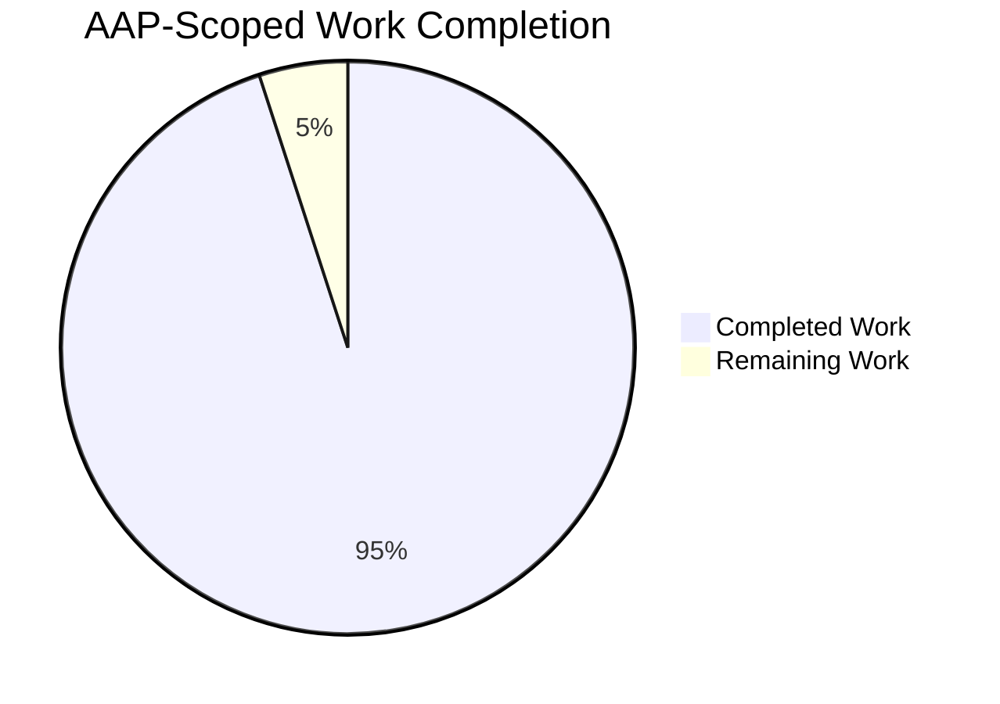
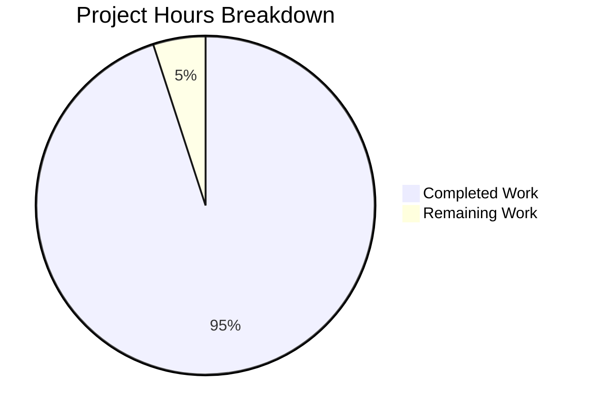
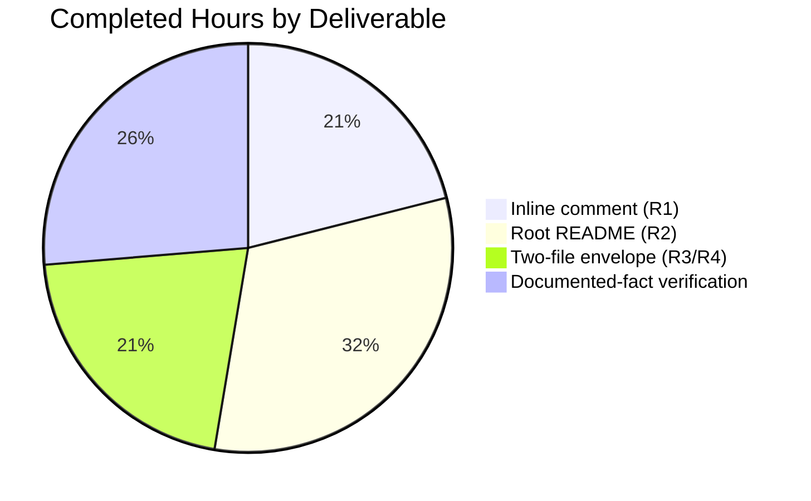

# 1. Executive Summary

SimpleJS documents itself in two files: one inline summary comment in `server.js` and a root `README.md`, both delivered and verified against a running instance.

## 1.1 Project Overview

SimpleJS is a Node.js HTTP server in one tracked file, `server.js`, answering every request on port 3000 with status 200 and the plain-text body `Hello, World!` (14 bytes). This change documented that behaviour in place and how to run it, adding no test suite, manifest, dependency, build system or further documentation — none was permitted and none exists. The repository is a runnable demonstration server whose two files describe themselves.

## 1.2 Completion Status



| Metric | Hours |
|---|---|
| Total Hours | 10.0 |
| Completed Hours (AI + Manual) | 9.5 |
| Remaining Hours | 0.5 |

**95% complete** — 9.5 completed hours ÷ (9.5 completed + 0.5 remaining) × 100 = 95%. The one remaining item is the release gate in Section 2.2.

## 1.3 Key Accomplishments

- ✅ JSDoc summary directly above the request handler in `server.js`.
- ✅ Existing statement byte-identical (142 bytes; file 2 lines / 222 bytes).
- ✅ Root `README.md` created with the nine specified lines (115 bytes).
- ✅ Documented command `node server.js` verified to start and serve on port 3000.
- ✅ Install position verified: no manifest, no lockfile, no dependency.
- ✅ Status 200 and the exact 14-byte body on every path and method.
- ✅ Two files changed: 10 insertions, 0 deletions, no third path.
- ✅ `node --check server.js` exits 0; no prohibited artefact exists.

## 1.4 Critical Unresolved Issues

No unresolved issues identified. All four agreed deliverables — the comment, the README, the no-change-beyond-those-two constraint and the exactly-two-files constraint — are complete and verified, so **0 of 4** remain open. The program's minimal HTTP posture (fixed port, no `Content-Type`, 200 for every path) is an accepted scope boundary, assessed as risk in Section 6.

## 1.5 Access Issues

No access issues identified. Nothing beyond a Node.js runtime is needed: no dependency, no environment variable, no external service, no credential and no third-party permission.

## 1.6 Recommended Next Steps

1. **[High]** Merge once the syntax gate and the documented command pass on the merged result.
2. **[Medium]** Re-render `README.md` after any edit; the run command must still render as a code block.
3. **[Medium]** Schedule around the single hard-coded port: one instance per host.
4. **[Low]** Amend `README.md` lines 5 and 9 with any change that adds a manifest or a different entry point.
5. **[Low]** Decide, under a new request, whether to add a manifest, gate, configurable port or richer HTTP behaviour.

# 2. Project Hours Breakdown

Every hour below traces to a deliverable the agreed specification defined for this change, or to the path-to-production gate for it. Completed hours are 9.5; remaining hours are 0.5; total project hours are 10.0, giving the 95% stated in Section 1.2.

## 2.1 Completed Work Detail

| Component | Hours | Description |
|---|---|---|
| Inline handler comment in `server.js` (R1) | 2.0 | The single-line JSDoc summary `/** Responds to every HTTP request with the plain-text body "Hello, World!". */` placed as the new first line above the request handler, with the pre-existing statement kept byte-identical below it; form limits (one summary, no tags, no example) and the syntax check. |
| Root `README.md` (R2) | 3.0 | The nine-line README at the repository root: project name, install statement, run command as a four-space code block; heading structure, line count against the 15-line cap, byte and trailing-newline verification. |
| Two-file change envelope (R3, R4) | 2.0 | Confinement of the change to `README.md` (created) and `server.js` (updated), and the audit that no manifest, lockfile, dependency, test, documentation configuration, extra documentation file or third path exists. |
| Documented-fact verification | 2.5 | Runtime confirmation that the documented command starts the program, that nothing must be installed first, that every request is answered with status 200 and the exact 14-byte body, and that the process stops cleanly and releases its port. |
| **Total** | **9.5** | |

## 2.2 Remaining Work Detail

| Category | Hours | Priority |
|---|---|---|
| Release verification of the documented facts and the README code-block rendering on the merged result | 0.5 | Low |
| **Total** | **0.5** | |

No deliverable from the agreed scope is outstanding: the 0.5 hours is the path-to-production gate — re-running the syntax check and the documented command, and re-rendering the README, on the merged change. Section 2.1 (9.5) + Section 2.2 (0.5) = 10.0 total project hours, matching the metrics table in Section 1.2 and the chart in Section 7.

# 3. Test Results

The repository ships no committed automated suite, so the evidence below is the set of checks executed directly against this codebase: the program's own syntax gate, the response contract of a running instance, the process lifecycle, byte-level inspection of both delivered files, and the port-clash path. 27 checks were executed, 27 passed, 0 failed.

| Area / Category | Framework | Tests | Passed | Failed | Coverage | What This Proves |
|---|---|---|---|---|---|---|
| Program syntax gate | `node --check server.js` (Node v22.23.5) | 1 | 1 | 0 | The single program file, whole-file parse | `server.js` parses and loads as a Node module without error |
| HTTP response contract | `curl` against a running instance | 17 | 17 | 0 | 5 paths (`/`, `/nonexistent`, `/a/b/c?x=1&y=2`, `/index.html`, an encoded traversal literal), 6 methods (POST, PUT, PATCH, DELETE, OPTIONS, TRACE), HEAD, header capture, a two-request keep-alive pair | Every request, whatever its path or method, is answered 200 with the exact 14-byte body `Hello, World!\n`; HEAD returns 200 with no body and framing stays correct across keep-alive reuse |
| Process lifecycle | `node server.js` start and SIGTERM stop | 2 | 2 | 0 | Documented start from the repository root, stop and port release | The documented command boots the server, emits exactly one 41-byte startup line with empty stderr, and the port is free again after the process stops |
| Delivered-file byte checks | `wc`, `sha256sum`, `cat -A`, `git diff` | 6 | 6 | 0 | Both files, line and byte counts, trailing newline, indentation, change shape | The comment is the fixed sentence above a byte-identical statement (2 lines / 222 bytes) and `README.md` is the nine fixed lines (9 lines / 115 bytes), with 10 insertions and 0 deletions against the base revision |
| Port-clash path | Second instance launched on the occupied port | 1 | 1 | 0 | One occupied-port start | A second instance exits with status 1 instead of displacing the running one, which keeps serving |

**Not Covered**

- **No committed automated suite, linter, formatter, coverage or CI gate.** None was permitted, so nothing guards future edits: a later change is protected only by `node --check server.js` and by re-running the documented command by hand. A human should re-run that check and the verification request in Section 9 after any edit to either file.
- **Browser, UI, accessibility and visual behaviour.** The program renders no page and returns a 14-byte plain-text body, so there is no rendered surface to test. Nothing of this kind should be expected before release.
- **Rendering regressions in `README.md`.** The four-space-indented run command renders as a code block today; no gate protects it, so an edit that inserts a list above it would silently degrade it to paragraph text. A human should re-render the file on any edit.
- **HTTPS/TLS, reverse-proxy, container and process-supervisor deployment.** The server was exercised only as a plain foreground Node process; no proxy, container image, init system or TLS terminator was involved.
- **Sustained load, concurrency at scale and multi-instance operation.** Only single-instance traffic was exercised, and the hard-coded listen literal admits one instance per host, so clustered or multi-host operation is untested.
- **Runtimes other than Node v22.23.5.** No Node version is declared anywhere in the repository (no `engines` field, no version file), so no other runtime was exercised.
- **Databases, caches, queues, outbound calls and credential handling.** None exists in this program, so there is nothing of that kind to exercise.

# 4. Runtime Validation & UI Verification

- ✅ **Startup with the documented command** — `node server.js` from the repository root prints one 41-byte line, `Server running at http://127.0.0.1:3000/`, with an empty stderr stream.
- ✅ **Universal response** — 17 requests across 5 paths and 6 methods returned 200 with the 14-byte body `Hello, World!\n`; HEAD returned 200 with no body.
- ✅ **Response framing** — every body-carrying response carried `Content-Length: 14`; two requests on one keep-alive connection returned two exact bodies (28 bytes total).
- ✅ **Nothing to install** — the program booted and served with no manifest, no lockfile and no `node_modules` present and no install, resolve or build step performed.
- ✅ **Shutdown and port release** — SIGTERM ended the process and the port then refused connections.
- ✅ **Port-clash handling** — a second instance on the occupied port exited with status 1 and left the running instance serving.
- ✅ **No runtime side effects** — no file was created, no log sink was opened, and the working tree was unchanged after traffic.
- ⚠ **No `Content-Type` header** — responses carry `Date`, `Connection`, `Keep-Alive` and `Content-Length` only, so clients must inspect the payload rather than the media type.
- ⚠ **Every path returns 200** — there is no 404 or error path, so a client cannot distinguish a real route from a missing one.

**Never exercised at runtime:** any browser or UI surface (the program renders no page, so there is nothing to drive and no screenshot applies); HTTPS/TLS termination, reverse-proxy fronting, container packaging and process-supervisor start-up; sustained load, concurrency at scale, multi-instance and multi-host operation; and any Node.js runtime other than v22.23.5.

# 5. Compliance & Quality Review

## 5.1 Compliance Matrix

| Deliverable | Benchmark | Status | Progress |
|---|---|---|---|
| Request handler comment in `server.js` (R1) | Documentation completeness — the handler states in place what it does | PASS | ✅ Complete |
| Comment form limits | Documentation discipline — one summary line, no tags, no second paragraph, no usage example | PASS | ✅ Complete |
| Existing statement preserved | Behaviour preservation — no unrequested change to logic, formatting or naming | PASS | ✅ Complete |
| Root `README.md` (R2) | Documentation completeness — project name, install position and run command | PASS | ✅ Complete |
| README content limits | Scope discipline — under 15 lines, no contributing/license/testing/deployment/architecture section, no table of contents, badge or diagram | PASS | ✅ Complete |
| Accuracy of the documented facts | Documentation accuracy — every claim holds against the code and a running instance | PASS | ✅ Complete |
| Change envelope (R3, R4) | Change discipline — exactly `README.md` created and `server.js` updated, no third path, no deletion | PASS | ✅ Complete |
| No scaffolding | Dependency hygiene — no manifest, lockfile, dependency, test suite, test file or documentation tooling | PASS | ✅ Complete |
| Security baseline | Secret, input-surface and injection-sink review of both files | PASS | ✅ Complete |
| Syntax gate | Build integrity — `node --check server.js` exits 0 | PASS | ✅ Complete |
| Runtime behaviour | Functional correctness — status, body, lifecycle and port release against a live instance | PASS | ✅ Complete |

## 5.2 AAP & Rule Divergences and Gaps

**No divergences from the Agent Action Plan or user rules were identified.**

The basis for that conclusion: no user-specified rule exists for this project, so no rule could be departed from; and every requirement the plan fixed for the two files is present exactly as specified, with nothing skipped, deferred, reworded or implemented differently. `server.js` carries the prescribed sentence as its first line above a statement that remains byte-identical to the base revision; `README.md` carries the prescribed nine lines and ends in a single newline; the change set is exactly those two paths with 10 insertions and 0 deletions; and every artefact the plan excluded — package manifest, lockfile, dependency, test suite, test file, documentation configuration, licence, contributing guide, changelog, `docs/` folder, diagram, badge, 404 handler, error handler, environment-variable configuration and hardening — is absent from the tree. The scope prohibitions the plan stated were therefore honoured in full, and the program's minimal HTTP posture is the excluded-by-design state rather than a departure from it.

# 6. Risk Assessment

| Risk | Category | Severity | Probability | Mitigation | Status |
|---|---|---|---|---|---|
| Documented facts drift: `README.md:5` ("no dependencies and no package manifest") and `README.md:9` (`node server.js`) become false the moment a manifest, lockfile or different entry point lands | Technical | Medium | Medium | Amend both lines in the same change that adds a manifest, lockfile or entry point | Open |
| No standing automated check: `node --check server.js` verifies syntax only, so Markdown rendering and claim accuracy have no gate and an edit can invalidate them silently | Technical | Medium | High | Re-render `README.md` and re-run the documented command after any edit to either file | Open |
| Hard-coded listen port: the literal 3000 admits one instance per host, and a second start exits 1 with `EADDRINUSE` | Operational | High | High | Serialise instances and deployments, or relocate the literal in a coordinated change | Open |
| Startup log names `http://127.0.0.1:3000/` while the listener binds all interfaces, so an operator may assume the service is loopback-only | Operational | Medium | Medium | Treat the line as a message and confirm the actual binding before exposing the host | Open |
| Zero committed tests: every behaviour must be re-verified by hand after any future change because no suite runs | Operational | Medium | High | Re-run the verification sequence in Section 9 after any edit | Open |
| Every path returns 200 with no 404 or error path, so a consumer cannot distinguish a real route from a missing one | Integration | Medium | Certain | Consumers must not infer routing or liveness semantics from a 200 | Open |
| No `Content-Type` header: responses carry `Content-Length` and connection headers only, so clients must sniff the payload | Integration | Low | Certain | Consumers treat the 14-byte payload as text by inspection | Open |
| No graceful shutdown: SIGTERM ends the process immediately, so any work later added to the handler would be cut mid-flight | Operational | Low | Low | Keep the handler stateless for as long as no shutdown path exists | Accepted |

Every row above is a forward-looking property of the delivered program, not unfinished work: each remedy lies outside the scope this change was agreed under. The two rows marked Open under Technical are the ones a maintainer can address entirely inside `README.md`, without reopening the program.

# 7. Visual Project Status





| View | Value |
|---|---|
| Total project hours | 10.0 |
| Completed hours | 9.5 |
| Remaining hours | 0.5 |
| Completion | 95% |
| Remaining hours by priority — Low | 0.5 |
| Remaining hours by priority — Medium | 0.0 |
| Remaining hours by priority — High | 0.0 |

The remaining 0.5 hours sits entirely in the single Low-priority release gate recorded in Section 2.2; no agreed deliverable and no release-blocking item is outstanding.

# 8. Summary & Recommendations

**What was delivered and verified.** SimpleJS now documents itself in the two places its reader looks. `server.js` opens with a single-line JSDoc summary, `/** Responds to every HTTP request with the plain-text body "Hello, World!". */`, sitting directly above a request handler statement that remains byte-identical to the base revision, and a new root `README.md` gives the project name, states that nothing needs installing because there is no manifest and no dependency, and gives the command that starts the program. The change is exactly those two paths — 10 insertions, 0 deletions — with no manifest, lockfile, test suite, documentation configuration or third file anywhere in the tree.

**How it was proved.** The program's syntax gate exits 0, and a live instance confirmed every claim the documentation makes: `node server.js` boots from the repository root and prints one 41-byte startup line with an empty stderr; 17 requests across five paths and six methods were each answered 200 with the exact 14-byte body; HEAD returned 200 with no body; framing held across keep-alive reuse; SIGTERM stopped the process and freed the port; and a second instance on the occupied port exited with status 1 without disturbing the running one. 27 checks were executed and all 27 passed.

**What remains.** The agreed scope is complete, and **95% complete** reflects the one outstanding path-to-production step: 9.5 completed hours of deliverable work against 0.5 remaining hours for re-verifying the documented facts and the README's code block on the merged result. No deliverable is unstarted or partial, no divergence from the agreed specification or from a project rule was found, and no release-blocking issue is open. The critical path to production is short: run the syntax gate, run the documented command and confirm the 200 plus 14-byte response, re-render the README, then merge.

**Production readiness.** Within its intent the program is ready to publish: it starts with one documented command, needs nothing installed, answers deterministically, writes no file, logs nothing sensitive and releases its port promptly. It should not be treated as general-purpose production infrastructure — the port is a hard-coded literal that admits one instance per host, responses carry no `Content-Type`, every path returns 200 with no 404 or error path, shutdown is immediate, and there is no observability beyond a single startup line. Each of those is a deliberate boundary of this change rather than a defect, and each needs a new request before it can be revisited.

**Success measures to watch.** After merge, the following should hold: `node --check server.js` exits 0; the documented command yields exactly one startup line and an empty stderr; `GET /` returns 200 with 14 bytes of `Hello, World!`; `README.md` still renders its run command as a code block at nine lines; and the tracked tree still holds exactly those two files. Any future change that adds a manifest, a lockfile or a different entry point must amend `README.md` lines 5 and 9 in the same commit.

# 9. Development Guide

The project is one Node.js file with no dependency, no manifest and no build step, so the whole environment is a Node.js runtime and a shell. Every command below was executed from the repository root (`node --version` reported v22.23.5, `npm --version` reported 11.21.0).

## 9.1 System prerequisites

- A Node.js runtime on `PATH`. The program uses only the built-in `http` module and was verified on Node.js v22.23.5; no version is declared in the repository, so any current LTS release satisfies it.
- A POSIX shell for the verification commands, and `curl` for the HTTP checks.
- No database, cache, message broker, container runtime, credential or environment variable is required.
- Port 3000 free on the host, because the listen port is a literal in the source.

```bash
node --version    # v22.23.5 on the verified host
```

## 9.2 Environment setup

There is no virtual environment, no `.env` file and no configuration to create. The program reads no environment variable, so nothing needs exporting before it starts.

## 9.3 Dependency installation

Nothing is installed. The repository has no `package.json`, no lockfile and no `node_modules`, and there is nothing to resolve:

```bash
ls package.json package-lock.json node_modules 2>/dev/null || echo "nothing to install"
node --check server.js && echo "server.js parses"
```

Do not run `npm install`: there is no manifest for it to install from.

## 9.4 Application startup

Run the documented command from the repository root. It holds the terminal in the foreground:

```bash
$ node server.js
Server running at http://127.0.0.1:3000/
```

The startup line is the program's only output — exactly one 41-byte line on stdout, nothing on stderr. Stop it with `Ctrl-C`, or from another shell with `kill <pid>`. To keep it running while you check it, capture its output in a throwaway file, then run the checks in Section 9.5 and delete that file so the working tree stays clean:

```bash
node server.js > server-startup.log 2>&1 &
echo $!                          # the pid to stop later
sleep 1 && cat server-startup.log
kill "$(pgrep -f 'node server.js' | head -1)"   # or kill <pid> with the pid printed above
rm server-startup.log            # local artifact, never part of the project
```

## 9.5 Verification steps

With the server running, these checks confirm the documented behaviour. Each was run and produced the output described beside it.

```bash
# status and body length: expect "200 14B"
curl -s -o /dev/null -w "%{http_code} %{size_download}B\n" http://127.0.0.1:3000/

# exact body bytes: expect 48 65 6c 6c 6f 2c 20 57 6f 72 6c 64 21 0a
curl -s http://127.0.0.1:3000/ | od -An -tx1

# response headers: expect 200 OK, Date, Connection, Keep-Alive, Content-Length: 14, and no Content-Type
curl -s -D - -o /dev/null http://127.0.0.1:3000/

# universality across path and method: every line should read 200
curl -s -o /dev/null -w "/nonexistent -> %{http_code}\n" http://127.0.0.1:3000/nonexistent
curl -s -X POST -o /dev/null -w "POST /x -> %{http_code}\n" http://127.0.0.1:3000/x
curl -s -I -o /dev/null -w "HEAD / -> %{http_code}\n" http://127.0.0.1:3000/

# the gate the repository defines for itself
node --check server.js && echo "gate passed"

# after stopping the process: expect http_code=000 (connection refused)
curl -s -o /dev/null -w "http_code=%{http_code}\n" --max-time 2 http://127.0.0.1:3000/
```

## 9.6 Example usage

The response contract is the whole interface: any request to any path returns the same body.

```bash
$ curl -s http://127.0.0.1:3000/
Hello, World!
$ curl -s http://127.0.0.1:3000/api/anything?x=1
Hello, World!
$ curl -s -o /dev/null -w "%{http_code}\n" http://127.0.0.1:3000/does-not-exist
200
```

Capturing the body to a file confirms it is exactly the 14 bytes `Hello, World!` plus a newline; delete the file afterwards:

```bash
curl -s http://127.0.0.1:3000/ > body.txt && wc -c < body.txt   # 14
rm body.txt
```

## 9.7 Troubleshooting

**`EADDRINUSE` on start.** Port 3000 is already bound — usually by another instance of this same program, since the port is a literal and no environment variable overrides it. A second instance exits with status 1 and prints an unhandled `error` event on stderr while the first keeps serving.

```bash
# is something already answering? http_code=000 means nothing is listening
curl -s -o /dev/null -w "http_code=%{http_code}\n" --max-time 2 http://127.0.0.1:3000/

# portable bind probe: prints "port 3000 is free" or "port 3000 is in use: EADDRINUSE"
node -e "const s=require('net').createServer();s.once('error',e=>{console.log('port 3000 is in use:',e.code);process.exit(1)});s.once('listening',()=>{console.log('port 3000 is free');s.close()});s.listen(3000)"
```

Stop the process holding the port, then start again. If two instances must run at once — which the delivered program does not support — stage a copy of `server.js` outside the repository with its `listen(3000` literal changed, so the tracked file keeps port 3000 and stays untouched.

**`Cannot find module` or a path error on start.** The command resolves the file relative to the working directory, so it must be run from the repository root where `server.js` lives.

**`curl` returns `000` or exit code 7.** Nothing is listening: the process stopped, was never started, or is still starting. Wait for the startup line and retry.

**No `Content-Type` in the response.** Expected: the program sets no media type, so clients must treat the 14-byte payload as text by inspection rather than by header.

**An unknown path returns 200 instead of 404.** Expected: there is no 404 path and no error handler, so every request receives the same response.

# 10. Appendices

## A. Command Reference

| Command | Run from | Purpose | Observed result |
|---|---|---|---|
| `node --version` | anywhere | Confirm the runtime | `v22.23.5` |
| `node --check server.js` | repository root | The repository's only gate: parse the program | exit 0, no output |
| `node server.js` | repository root | Start the server (the command the README documents) | prints `Server running at http://127.0.0.1:3000/` and serves |
| `curl -s -o /dev/null -w "%{http_code} %{size_download}B\n" http://127.0.0.1:3000/` | anywhere | Status and body length | `200 14B` |
| `curl -s http://127.0.0.1:3000/ \| od -An -tx1` | anywhere | Exact response bytes | `48 65 6c 6c 6f 2c 20 57 6f 72 6c 64 21 0a` |
| `curl -s -D - -o /dev/null http://127.0.0.1:3000/` | anywhere | Response headers | `HTTP/1.1 200 OK`, `Date`, `Connection`, `Keep-Alive`, `Content-Length: 14` |
| `curl -s -I -o /dev/null -w "%{http_code}\n" http://127.0.0.1:3000/` | anywhere | HEAD behaviour | `200` with no body |
| `git diff --name-status 70e3ee8...HEAD` | repository root | Change envelope | `A README.md`, `M server.js` |
| `git ls-files` | repository root | Tracked inventory | `README.md`, `server.js` |

## B. Port Reference

| Port | Owner | Notes |
|---|---|---|
| 3000 | `server.js` listen literal | Hard-coded; no environment variable overrides it; binds all interfaces while the startup message names `127.0.0.1`; one instance per host. |
| 3100 + *n* | Verification copy of `server.js` | Only for a staged copy outside the repository with the port literal changed, used when port 3000 is already occupied. The delivered file keeps 3000. |

## C. Key File Locations

| Path | Role | Size |
|---|---|---|
| `server.js` | The entire program: one comment line and one statement creating the HTTP server, registering the handler, listening on 3000 and logging the startup line | 2 lines, 222 bytes |
| `README.md` | Root documentation: project name, install position, run command | 9 lines, 115 bytes |

No other file is tracked: there is no manifest, lockfile, source directory, test directory, configuration file or documentation directory.

## D. Technology Versions

| Technology | Version | Role |
|---|---|---|
| Node.js | v22.23.5 (verified) | Runs `server.js`; the program uses only the built-in `http` module |
| npm | 11.21.0 | Present on the host but never invoked — there is no manifest and nothing to install |
| Node.js `http` module | Bundled with the runtime | The program's only import |

No version is declared in the repository: there is no `engines` field, no `.nvmrc` and no version statement in the README.

## E. Environment Variable Reference

The program reads no environment variable. `process.env` does not appear in `server.js`, and there is no configuration file to load. The only environment input that matters is the shell `PATH`, which must expose `node`.

| Variable | Required | Purpose |
|---|---|---|
| — | — | None. No variable changes the program's behaviour, port or response. |

## F. Developer Tools Guide

| Tool | Used for | Notes |
|---|---|---|
| `node` | Running the program and the syntax gate | The only runtime prerequisite |
| `curl` | All HTTP verification | `-o /dev/null -w` for status and size, `-D -` for headers, `-I` for HEAD |
| `od -An -tx1` | Byte-level proof of the 14-byte body | Portable alternative to `xxd`, which may be absent |
| `wc -l -c` | Confirming the nine README lines and the 222-byte program | Used with `sha256sum` for file identity |
| `cat -A` | Showing trailing newlines and the four-space indent on the run command | Makes invisible characters visible |
| `git` | Change envelope and tracked inventory | `diff --name-status`, `diff --numstat`, `ls-files` |
| Port probe (`node -e` with `net`) | Confirming port 3000 is free or occupied | Use when `ss`, `lsof` or `netstat` are unavailable on the host |

## G. Glossary

| Term | Meaning |
|---|---|
| Agreed specification | The action plan for this change: one comment line in `server.js` and a new root `README.md`, and nothing else |
| Documented contract | The behaviour the two files state: `node server.js` starts the program, and every request is answered 200 with `Hello, World!` |
| Change envelope | The set of paths the change was allowed to touch — here, exactly `README.md` (created) and `server.js` (updated) |
| Gate | The one check the repository defines for itself: `node --check server.js` |
| JSDoc summary | A single `/** ... */` comment line above the code it describes, with no tags, no second paragraph and no example |
| Listen literal | The hard-coded `3000` in `listen(3000)`, which fixes the port and limits the host to one instance |
| Plain-text body | The 14 bytes `Hello, World!` followed by a newline; the response sets no `Content-Type` header |
| Byte-identical | Unchanged at the byte level — the 142-byte statement below the comment matches the base revision exactly |
