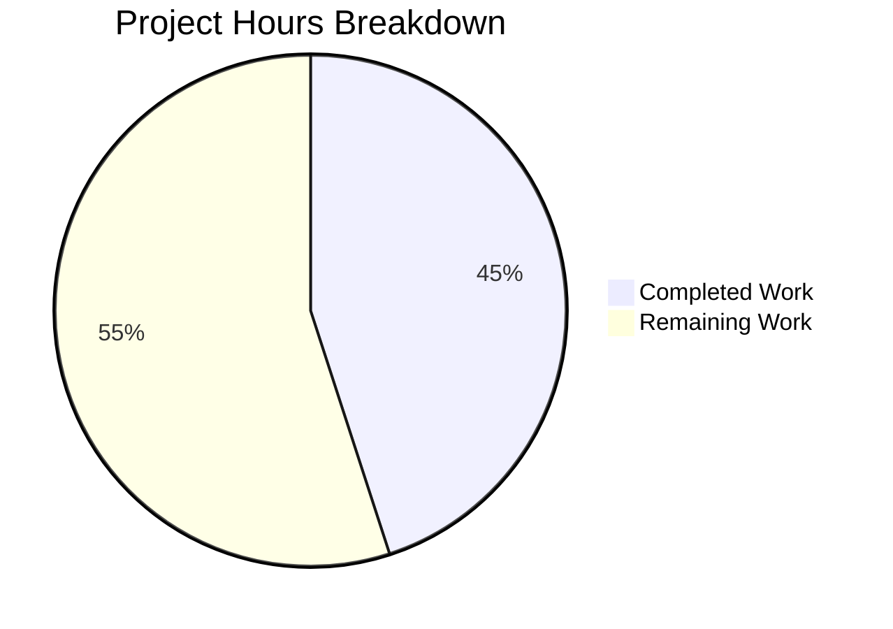

# 1. Executive Summary

## 1.1 Project Overview

SimpleJS is a single-file Node.js HTTP service: `server.js` answers every request with the 14-byte body `Hello, World!` on TCP port 3000. This release documents it for a first-time reader — a one-line summary above the request handler, and a minimal README carrying the project name, a no-install statement and the command that starts it. Two files change, nine lines are added, and no dependency, build step or configuration.

## 1.2 Completion Status

**45% complete** — 9.0 of 20.0 project hours delivered; all 34 plan requirements are met, and the remaining 11.0 hours are path-to-production work the plan excludes.



| Metric | Hours |
|---|---|
| Total Hours | 20.0 |
| Completed Hours (AI + Manual) | 9.0 |
| Remaining Hours | 11.0 |

Completed = 9.0h / 20.0h = **45.0%**.

## 1.3 Key Accomplishments

- [x] Request handler documented in place — one `/** ... */` summary above the statement, which stays byte-identical (`server.js:1-2`).
- [x] Minimal README created — name, no-install statement and run command, eight lines (`README.md:1-8`).
- [x] Every documented claim verified: the name matches the remote, the no-install claim matches the sole built-in `http` import, and `node server.js` is the entry point.
- [x] Documented command exercised from a clean checkout on the documented port — one startup line, empty stderr, the described response.
- [x] Handler exercised across eight HTTP methods and ten paths — traversal, injection, UTF-8, 100 KB payloads — with an identical 200 / 14-byte response each time.
- [x] Lifecycle, load and rendering verified — clean signal shutdown, restart, 50 sequential and 20 concurrent requests, and a browser render with zero console messages.

## 1.4 Critical Unresolved Issues

**6 open items** against the 40 work items scoped here — 34 plan requirements, all met, plus 6 path-to-production items.

| Issue | Impact | Owner | ETA |
|---|---|---|---|
| Port 3000 is hard-coded and bound on the wildcard interface with no error handler; a busy port exits 1 with an unhandled `EADDRINUSE` stack and no startup line | The documented command cannot run beside another instance, and the service answers on every local interface while its startup line names loopback | Backend maintainer | 2.0h |
| No automated regression suite — the only gate is `node --check` plus a manual smoke check | An edit to either file can break the documented behaviour with nothing detecting it | Backend maintainer | 3.0h |
| No CI workflow | Verification stays manual and depends on whoever remembers to run it | DevOps maintainer | 1.5h |
| No `Content-Type` and no 404 handling — every path and method returns the same 200 body | Clients and monitors that read 200 as "resource exists", or dispatch on media type, are misled | Backend maintainer | 1.5h |
| Observability is one startup line — no request logging, health check, metrics or tracing | An operator has no runtime signal beyond "the process is up" | Backend maintainer | 2.0h |
| Documentation states name, install and run only; the port, response contract and failure modes are undocumented | A reader whose port 3000 is taken meets an unexplained failure | Documentation owner | 1.0h |

## 1.5 Access Issues

No access issues identified — the checkout is fully readable and writable, and no credential or third-party service is involved.

## 1.6 Recommended Next Steps

1. **[High]** Make the listen host and port configurable, defaulting to loopback and 3000, with a clear message when the port is busy (2.0h).
2. **[Medium]** Add a regression suite on Node's built-in test runner and run it in CI (4.5h).
3. **[Medium]** Send `Content-Type: text/plain; charset=utf-8` and return 404 for unknown paths, or document the catch-all (1.5h).
4. **[Low]** Add request logging and a health endpoint (2.0h).
5. **[Low]** Document the operational contract — port, response, absent content type, port-in-use failure (1.0h).

# 2. Project Hours Breakdown

Hours are estimated per Agent Action Plan deliverable and per path-to-production category, then checked against what the repository and a running service show. The calculation is explicit: **completed 9.0h + remaining 11.0h = 20.0h total; 9.0 ÷ 20.0 = 45.0%**. Completed-hour confidence is high — each item is present in the tree and was exercised at runtime. The remaining figures are medium-confidence estimates for work no one has started, and each carries round-up contingency.

## 2.1 Completed Work Detail

| Component | Hours | Description |
|---|---|---|
| Documentation intent and scope analysis | 1.0 | Reconciled the request into two documentation places, three README items and a no-extra-work limit; fixed the placement rules for both edits. |
| Handler summary comment (`server.js`) | 1.5 | One-line `/** ... */` summary inserted above the statement that defines the request handler; the statement left byte-identical, with no tags, second paragraph or example. |
| README authoring (`README.md`) | 1.5 | Eight lines at the repository root: project name heading, a no-install statement with its true reason, and `node server.js` inside a `bash` fence — nothing else. |
| Dependency and scope-limit enforcement | 1.0 | No manifest, lockfile, dependency or tooling added; exactly two files changed; every excluded artefact verified absent; handler logic untouched. |
| Execution-parameter and format conformance | 0.5 | Markdown plus one native single-line JSDoc comment only; no build, lint, format, design-system, rule-set or attachment artefact produced. |
| Runtime verification of the documented claims | 2.5 | Static gate, documented start, method-and-path matrix, lifecycle and signal handling, load, and observability driven against a running service. |
| Browser rendering verification | 0.5 | Headless-browser pass on the documented URL and a deep path: rendering, console, page errors and per-request network activity. |
| Repository delivery and commit hygiene | 0.5 | Two atomic single-file commits, run artefacts left untracked, tracked tree holding exactly the two delivered files. |
| **Total** | **9.0** | Matches Completed Hours in Section 1.2. |

## 2.2 Remaining Work Detail

| Category | Hours | Priority |
|---|---|---|
| Port and bind configurability, `EADDRINUSE` error handling and graceful shutdown | 2.0 | High |
| Automated regression suite on Node's built-in test runner (status, body bytes, startup line, port, lifecycle) | 3.0 | Medium |
| CI workflow running the syntax gate, smoke check and suite | 1.5 | Medium |
| Response contract: `Content-Type` and 404 handling | 1.5 | Medium |
| Observability: request logging and a health endpoint | 2.0 | Low |
| Operational documentation beyond the three documented items | 1.0 | Low |
| **Total** | **11.0** | Matches Remaining Hours in Section 1.2 and the Remaining Work slice in Section 7. |

No Agent Action Plan requirement falls in this table: all 34 are delivered and verified, and every remaining hour is path-to-production work for operating the service the documentation describes.

# 3. Test Results

Every row below was executed against the delivered files on this host with Node.js v22.23.5; the counts are the checks observed, not estimates. The project ships no test framework, so all checks are a purpose-built runtime harness — `node --check`, direct `curl` probes and shell assertions — plus a headless-browser pass.

| Area / Category | Framework | Tests | Passed | Failed | Coverage | What This Proves |
|---|---|---|---|---|---|---|
| Static syntax gate | `node --check` (Node.js 22.23.5) | 1 | 1 | 0 | Not instrumented | The single source file parses and compiles cleanly. |
| Startup, documented run command and lifecycle | Runtime harness (shell + `curl`) | 14 | 14 | 0 | Not instrumented | The documented command starts the service from a clean checkout, prints exactly one startup line with empty stderr, and shuts down and restarts cleanly on SIGINT and SIGTERM. |
| HTTP request and response coverage | Runtime harness (`curl`) | 20 | 20 | 0 | Not instrumented | Eight methods across ten paths — including traversal, injection, `%00`, UTF-8, a 2000-character path and a 100 KB POST — all receive the documented 200 with the identical 14-byte body; HEAD returns headers only; `Content-Length: 14` is present and `Content-Type` absent. |
| Transport, load and concurrency | Runtime harness | 3 | 3 | 0 | Not instrumented | Keep-alive connections are reused, and 50 sequential plus 20 concurrent requests all return the identical body. |
| Observability and repository integrity | Runtime harness | 3 | 3 | 0 | Not instrumented | Serving traffic adds no log output, stderr stays empty, and the tracked tree is unchanged by running the service. |
| Browser rendering | Headless Chrome 157 + DevTools harness | 4 | 4 | 0 | Not instrumented | The root URL, a deep path with a query string and a reload all render `Hello, World!` as a plain-text document with zero console messages and zero page errors. |
| **Total** | | **45** | **45** | **0** | | |

**Not Covered.** The following are outside what any of the checks above exercise, and a human should close them before this service is released as anything other than a documentation-backed demo:

- **Automated regression.** The repository holds no test framework, no test file and no test command, so none of the 45 checks is repeatable from the repository itself; nothing guards a future edit to either delivered file. This is the largest gap between "verified today" and "verified on every change".
- **Sustained soak and network fault behaviour.** Long-duration load, connection resets mid-response, back-pressure and packet loss were never exercised; only 50 sequential and 20 concurrent requests were driven.
- **IPv6 loopback reachability.** `http://[::1]:3000/` is refused in this environment, so the service is verified on IPv4 loopback and the host address only.
- **TLS and authentication.** No such surface exists in the code, so nothing about transport security or access control is verified by tests.
- **Coverage percentage.** With no instrumentation available, no coverage figure can be stated; the counts above describe which behaviours were exercised, not the fraction of code they reach.

# 4. Runtime Validation & UI Verification

- ✅ **Documented start** — `node server.js` from the repository root binds TCP 3000 and prints exactly one 41-byte line, `Server running at http://127.0.0.1:3000/`, with zero bytes on stderr.
- ✅ **Install-free boot** — the service starts and serves with no `package.json`, lockfile or `node_modules` present, which is what the documentation's install item states.
- ✅ **Request handling** — GET, HEAD, POST, PUT, PATCH, DELETE, OPTIONS and TRACE across ten paths returned 200; body-bearing responses were 14 bytes byte-identical to `Hello, World!\n`.
- ✅ **Response contract as implemented** — `Content-Length: 14` on every body-bearing response, default status 200, no reflected input from query strings, bodies or headers.
- ✅ **Shutdown and restart** — SIGINT exits 130 and SIGTERM exits 143, the port is released within about 30 ms, and an immediate restart serves the same body with no `EADDRINUSE`.
- ✅ **Load** — 50 sequential requests all 200 with one distinct body; 20 concurrent requests all 200 with the same body.
- ✅ **Observability** — one startup line per start, byte-identical every time; 70 requests plus eight path probes added no stdout or stderr bytes.
- ✅ **Browser rendering** — headless Chrome 157: both `/` and `/deep/path?q=1` render a single monospace line `Hello, World!` as a `text/plain` document, with 0 console messages, 0 page errors and 8 of 8 network requests returning 200.
- ⚠ **Second instance on a busy port** — exits 1 with an unhandled `EADDRINUSE` stack (1068 bytes on stderr) and no startup line; recovery is to free the port or start the service with a port override via a preload module, which was exercised and serves the same body on the alternate port.
- ⚠ **Transport header shape** — no `Content-Type` is sent (browsers classify the document by sniffing as `text/plain`), and a HEAD response carries neither a body nor `Content-Length`, so a client sizing the resource with HEAD learns nothing.

**Never exercised at runtime.** Sustained soak or long-duration load, network loss and back-pressure, TLS termination, authentication and rate limiting, and IPv6 loopback reachability are not covered by any run: the first four have no implementation to drive, and `http://[::1]:3000/` is refused in this environment. Behaviour in those conditions is unknown rather than known-good.

# 5. Compliance & Quality Review

## 5.1 Compliance Matrix

Each row states where the work stands now, verified against the tree and a running service.

| Deliverable / Requirement Area | Status | Progress | Evidence |
|---|---|---|---|
| Handler summary comment present, correctly placed and single-line | ✅ PASS | 100% | `server.js:1` — one `/** ... */` summary directly above the statement, no tags, no second paragraph |
| Handler statement unchanged byte for byte | ✅ PASS | 100% | sha256 `7ea2abcb…c8ccaa`, 142 bytes, identical to the pre-existing blob; diff is 1 insertion, 0 deletions |
| README carries exactly the name, install and run items | ✅ PASS | 100% | `README.md:1-8` — 8 lines, 1 heading, 0 badges, links, tables or TOC |
| Documented claims true of the code | ✅ PASS | 100% | Name matches the repository remote; no-install matches the sole built-in `http` import; `node server.js` names the only entry point |
| In-scope file list exhaustive; exclusions honoured | ✅ PASS | 100% | Exactly `README.md` (added) and `server.js` (modified); no other documentation file, manifest, lockfile, test suite, handler or configuration |
| Dependency-free delivery | ✅ PASS | 100% | No `package.json`, lockfile, `node_modules`, generator, linter or formatter anywhere in the tree |
| Format conformance | ✅ PASS | 100% | Markdown for the README, one native single-line JSDoc comment for the source; no build, lint or format artefact |
| Repository hygiene | ✅ PASS | 100% | Two atomic single-file commits, no run artefacts committed, tracked tree holding exactly the two delivered files |
| Automated verification inside the repository | ❌ FAIL | 0% | No test framework, test file, test command or CI workflow exists; the only gate is `node --check` |
| Response completeness (`Content-Type`, 404 handling) | ❌ FAIL | 0% | Every path and method returns the same body with no `Content-Type` and no 404 path |
| Operational observability | ❌ FAIL | 20% | One startup line per start; no request logging, health endpoint, metrics or tracing |
| Operational documentation completeness | ❌ FAIL | 60% | Name, install and run are documented; the port, response contract and port-in-use failure are not |

The four failing rows sit outside the plan's own scope, which excludes a test suite, a manifest, a 404 handler, an error handler, hardening, environment configuration and any further documentation. They are recorded as path-to-production work in Sections 1.4, 2.2 and 6, not as departures.

## 5.2 AAP & Rule Divergences and Gaps

**No divergences from the Agent Action Plan or user rules were identified.**

The basis for that conclusion: all 34 requirements the plan states are delivered exactly as written — the two files changed are the two it names, the comment and the eight README lines are byte-identical to the literals it fixes, the handler statement is untouched, and every artefact the plan excludes is genuinely absent from the tree. Product-level properties a production operator would want — a configurable port and loopback-only bind, an error handler, a `Content-Type`, 404 handling, request logging, a regression suite and CI — are not departures either: they are pre-existing properties of the single-line server, and the plan names each of them as explicitly out of scope. They are carried forward as path-to-production work with hour estimates in Section 2.2, as risks in Section 6 and as open items in Section 1.4. No user rule set was supplied for this project, so there is no rule against which the delivery could diverge.

# 6. Risk Assessment

| Risk | Category | Severity | Probability | Mitigation | Status |
|---|---|---|---|---|---|
| Port 3000 is hard-coded and bound on the wildcard interface with no error handler: a second instance or busy port exits 1 with an unhandled `EADDRINUSE` stack and no startup line, and the service answers on every local IPv4 interface although its startup line names loopback | Technical | High | High | Make host and port configurable with loopback and 3000 as defaults; add a `server.on('error')` handler with a clear message and a non-zero exit; close the listener on signals | Open |
| No automated regression guard: the only gate is `node --check` plus a manual HTTP smoke check, so an edit to either file can break the documented behaviour undetected | Technical | Medium | Medium | Add a suite on Node's built-in test runner covering status, body bytes, startup line, port and lifecycle, and run it in CI | Open |
| Wildcard bind, cleartext HTTP, no authentication and no rate limiting: anything that can reach the port can issue unlimited requests | Security | High if exposed | Medium | Bind loopback by default; terminate TLS and authenticate in front of the service before exposing it beyond a local or demo network | Open |
| Every path and method returns the same 200 body with no `Content-Type` and no 404: clients, crawlers and uptime monitors that read 200 as "resource exists", or dispatch on media type, are misled | Integration | Medium | High | Send `Content-Type: text/plain; charset=utf-8` and return 404 for unknown paths, or document the catch-all as deliberate | Open |
| Observability is one startup line: no request logging, health check, metrics or tracing, so an operator has no runtime signal beyond process liveness | Operational | Medium | High | Add per-request logging and a health endpoint; keep the startup line as the boot signal | Open |
| The documentation states only name, install and run, so a reader cannot learn the port, the response contract or the port-in-use failure mode | Operational | Low | Medium | Extend the documentation with the operational contract, including how to run a second instance on another port | Open |
| Unmeasured conditions: sustained soak, network loss and back-pressure, and IPv6 loopback reachability were never exercised, so behaviour there is unknown rather than known-good | Integration | Low | Low | Run a soak and a network-fault test, and verify an IPv6 bind once the environment supports it | Open |

# 7. Visual Project Status


**Delivered versus remaining hours** — 9.0h of the 20.0h total is delivered (Dark Blue, #5B39F3); 11.0h remains (White, #FFFFFF).

**Remaining hours by category** (sums to the 11.0h remaining figure):

| Category | Hours | Priority |
|---|---|---|
| Port and bind configurability, error handling, graceful shutdown | 2.0 | High |
| Automated regression suite | 3.0 | Medium |
| CI workflow | 1.5 | Medium |
| Response contract (`Content-Type`, 404) | 1.5 | Medium |
| Observability (request logging, health endpoint) | 2.0 | Low |
| Operational documentation | 1.0 | Low |
| **Total** | **11.0** | |

**Requirement delivery status** — measured against the 34 requirements of the plan:

| Status | Count | Share |
|---|---|---|
| Completed | 34 | 100% |
| Partially completed | 0 | 0% |
| Not started | 0 | 0% |
| Divergent from the plan | 0 | 0% |

# 8. Summary & Recommendations

The documentation deliverable is complete and verified: a one-line summary now describes the request handler where it is defined, and a minimal README states the project name, that nothing needs installing, and the command that starts the service. Both files match the specified content byte for byte, the handler statement they document is untouched, and the delivery is exactly two files and nine inserted lines with no dependency, build step or configuration. All 34 requirements of the plan are met, which is the whole of its documented scope.

Verification went beyond reading the diff. The documented command was run from a clean checkout on the documented port, the response was checked at byte level across eight methods and ten paths, and the lifecycle was driven through SIGINT, SIGTERM, restart, 50 sequential and 20 concurrent requests. The page was rendered in a real browser with zero console messages and zero page errors. 45 checks were executed and 45 passed, and the tracked tree is identical before and after every run, so what was verified is exactly what is delivered.

**45% of the 20.0 project hours is complete (9.0h delivered, 11.0h remaining).** Every remaining hour is path-to-production work the plan deliberately excludes rather than unfinished documentation: a regression suite and CI (4.5h), port and bind configurability with real error handling (2.0h), a response contract with `Content-Type` and 404 handling (1.5h), observability (2.0h) and operational documentation (1.0h). The critical path runs through the first of those: nothing in the repository re-runs today's checks, so the verified behaviour is protected by review alone.

| Metric | Value |
|---|---|
| Plan requirements delivered | 34 of 34 (100%) |
| Files changed | 2 added/modified, 0 deleted |
| Lines added / removed | 9 / 0 |
| Dependencies added | 0 |
| Checks executed / passed | 45 / 45 |
| Project hours complete | 9.0 of 20.0 (45.0%) |

**Recommendation.** Ship the documentation as delivered — it is accurate, minimal and verified, and no further work on it is warranted. The service it documents remains a deliberate single-line demo: a hard-coded port on the wildcard interface, no `Content-Type`, no 404 or error handling, and a single startup log line. That is the right shape for a demo and the wrong shape for anything internet-facing, so the hardening tasks above should land before the service is deployed anywhere its port is reachable, and the regression suite and CI before the next edit to either file.

# 9. Development Guide

## Prerequisites

- **Node.js 18 or newer** — the code uses only the core `http` module. Verified here on `node v22.23.5`.
- No package manager step, no build tool, no database, no external service, no environment variable and no credential.
- `curl` for the verification steps below. Commands that inspect the listening socket with `ss`, `lsof`, `netstat` or `fuser` are not available in this environment; a `curl` probe is used instead.

## Setup

```bash
# 1. From the repository root, confirm the runtime
node --version            # v22.23.5

# 2. Confirm the only source file parses — this is the repository's whole static gate
node --check server.js    # exits 0 with no output
```

There is nothing to install. The repository contains no `package.json`, lockfile or `node_modules`, and `server.js` depends only on Node's built-in `http` module.

## Start the service

```bash
# From the repository root
node server.js
```

Expected output on stdout, and nothing on stderr:

```
Server running at http://127.0.0.1:3000/
```

The process holds TCP port 3000 until it is stopped. Confirm the port is free before starting (curl exit code 7 means nothing is listening):

```bash
curl -sS --max-time 2 -o /dev/null http://127.0.0.1:3000/; echo $?
```

## Verify it works

```bash
# Full response headers and body
curl -sS -i http://127.0.0.1:3000/

# Byte-level body check — must be exactly 14 bytes ending in a newline
curl -sS http://127.0.0.1:3000/ | od -An -c
curl -sS -o /dev/null -w 'code=%{http_code} size=%{size_download}\n' http://127.0.0.1:3000/
```

Expected: `HTTP/1.1 200 OK`, `Content-Length: 14`, no `Content-Type`, and the body `Hello, World!` with a trailing newline (`code=200 size=14`).

## Example usage

Any path and any method is answered the same way, because the handler never reads the request:

```bash
curl -sS http://127.0.0.1:3000/                     # Hello, World!
curl -sS http://127.0.0.1:3000/any/deep/path        # Hello, World!
curl -sS -X POST -d 'a=1' http://127.0.0.1:3000/    # Hello, World!
curl -sSI http://127.0.0.1:3000/                    # headers only, no body
```

## Stop the service

Stop only the process you started, by its pid:

```bash
node server.js &            # note the pid printed by the shell
kill -INT %1                # exit status 130, port released
# or, for a pid captured explicitly:
# kill -TERM <pid>          # exit status 143, port released
```

## Troubleshooting

**`Error: listen EADDRINUSE: address already in use :::3000`** — another process holds port 3000. The second instance exits 1, prints nothing on stdout and writes a stack trace to stderr. Either stop the process holding the port, or start the service on a different port without editing the source, using a preload module that rewrites the listen argument:

```bash
SHIM="$(mktemp -d)/portshim.cjs"
cat > "$SHIM" <<'EOF'
const http=require('http');const o=http.Server.prototype.listen;
http.Server.prototype.listen=function(...a){const p=process.env.PORT_OVERRIDE;if(p&&typeof a[0]==='number')a[0]=Number(p);return o.apply(this,a);};
EOF

PORT_OVERRIDE=33199 node -r "$SHIM" server.js &
curl -sS http://127.0.0.1:33199/     # Hello, World!
kill -INT %1                         # exit status 130, port released
rm -rf "$(dirname "$SHIM")"          # remove the preload module when done
```

The startup line still prints `http://127.0.0.1:3000/`, because that string is source text rather than the bound port.

**A browser shows a plain page rather than HTML** — expected. No `Content-Type` header is sent, so the browser sniffs the 14-byte body as `text/plain` and renders it in its plain-text viewer. A `/favicon.ico` request gets the same 200 body and is discarded by the browser.

**`curl: (7) Failed to connect`** — the service is not running, or it is not listening on the address you requested. It binds the wildcard interface on port 3000, so `127.0.0.1`, `localhost` and the host's own address all work; `[::1]` may be refused where the environment has no IPv6 loopback.

**No log lines appear for requests** — expected. The only output the service ever writes is the single startup line.

# 10. Appendices

## A. Command Reference

| Purpose | Command | Expected result |
|---|---|---|
| Runtime version | `node --version` | `v22.23.5` (18+ works) |
| Static gate | `node --check server.js` | exit 0, no output |
| Port-free probe | `curl -sS --max-time 2 -o /dev/null http://127.0.0.1:3000/; echo $?` | `7` when nothing is listening |
| Start the service | `node server.js` | one line: `Server running at http://127.0.0.1:3000/` |
| Full response | `curl -sS -i http://127.0.0.1:3000/` | 200, `Content-Length: 14`, body `Hello, World!` |
| Body bytes | `curl -sS http://127.0.0.1:3000/ \| od -An -c` | `H e l l o , W o r l d ! \n` |
| Status and size | `curl -sS -o /dev/null -w 'code=%{http_code} size=%{size_download}\n' http://127.0.0.1:3000/` | `code=200 size=14` |
| Method probe | `curl -sS -X POST -d 'a=1' http://127.0.0.1:3000/` | `Hello, World!` |
| Header-only probe | `curl -sSI http://127.0.0.1:3000/` | 200 headers, no body |
| Stop on SIGINT | `kill -INT <pid>` | exit 130, port released |
| Stop on SIGTERM | `kill -TERM <pid>` | exit 143, port released |
| Start on another port | `PORT_OVERRIDE=33199 node -r "$SHIM" server.js` | serves on 33199, prints the hard-coded 3000 URL |
| Change review | `git diff --stat 70e3ee8..HEAD` | 2 files changed, 9 insertions(+) |
| Tree inventory | `git ls-files` | `README.md`, `server.js` |

## B. Port Reference

| Port | Owner | Notes |
|---|---|---|
| 3000 | `server.js` | Hard-coded in the single source statement and bound on the wildcard interface. Not configurable without a source edit or a preload override. |
| Any free port | Preload port override (`PORT_OVERRIDE`) | Runs a second instance without editing the source; the startup line still prints 3000. |

## C. Key File Locations

| Path | Role |
|---|---|
| `server.js` | The whole application: one statement creating the HTTP server on port 3000, plus a one-line summary comment above it. |
| `README.md` | The project documentation: name, install item and run command, eight lines. |
| `blitzy/screenshots/` | Untracked browser run artefacts; never committed and never part of the deliverable. |

## D. Technology Versions

| Component | Version observed |
|---|---|
| Node.js | v22.23.5 (any 18+ runs the code) |
| Module used | Core `http` — no third-party dependency |
| Browser used for rendering verification | Google Chrome 157.0.8103.78 (headless) |
| `curl` | 8.18.0 |

## E. Environment Variable Reference

The service reads **no environment variable** — there is no configuration surface in the code. The one variable relevant to operating it is `PORT_OVERRIDE`, which lives solely in the optional preload module described in the Development Guide and is read by that module, not by `server.js`.

## F. Developer Tools Guide

| Need | Tool | Note |
|---|---|---|
| Syntax check | `node --check` | The only static gate the repository defines. |
| HTTP probing | `curl` | Preferred here because `ss`, `lsof`, `netstat` and `fuser` are not installed. |
| Byte inspection | `od`, `wc`, `md5sum` | Used to prove the body is exactly 14 bytes with a single trailing newline. |
| Portable port binding | Preload module | Overrides the hard-coded listen port without touching the source. |
| Browser verification | Headless Chrome + DevTools protocol | Used for rendering, console and network evidence on the documented URL. |

## G. Glossary

| Term | Meaning |
|---|---|
| **Handler** | The inline `(req,res)=>res.end('Hello, World!\n')` function that produces every response. |
| **Startup line** | The single stdout line `Server running at http://127.0.0.1:3000/`, written once per start when the listener binds. |
| **Wildcard bind** | Listening on every local interface when `listen()` is called without a host argument. |
| **`EADDRINUSE`** | The error raised when the port is already taken; unhandled here, so the process exits 1 with a stack trace. |
| **Path-to-production work** | Work needed to operate the delivered documentation and service in production, outside the plan's documented scope. |
| **Sanctioned exclusion** | An artefact the plan explicitly puts out of scope — test suite, manifest, error handler, hardening, extra documentation. |
