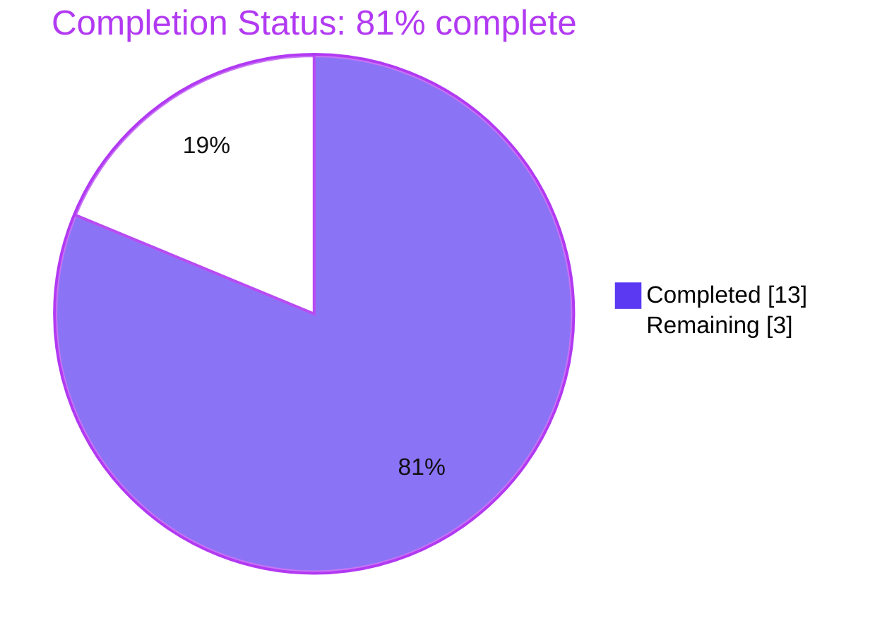
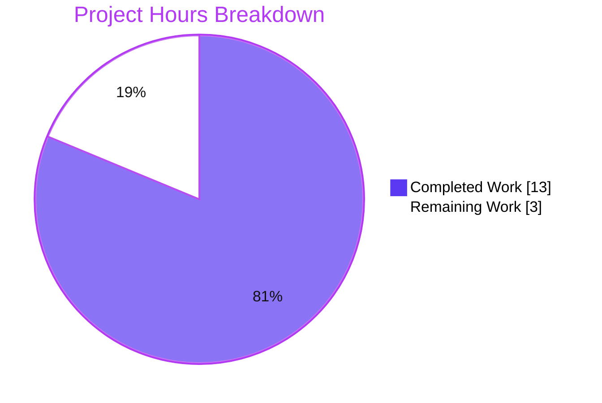

# 1. Executive Summary

A documentation release for SimpleJS, the single-file Node.js HTTP server that answers every request with `Hello, World!`.

## 1.1 Project Overview

SimpleJS is a single-file Node.js HTTP server: one statement in `server.js` binds TCP port 3000 and answers every request, whatever its method or path, with the 14-byte plain-text body `Hello, World!`. This release gave the project the documentation it lacked, in two files and nothing else — a one-line JSDoc summary above the request handler, and a root `README.md` naming the project, stating that there is no install step, and giving the command that starts the server. The readers are developers and operators who receive this repository and must run it without prior context. No behaviour changed: the server statement is byte-identical to what the project shipped before.

## 1.2 Completion Status

**81% complete — 13.0 hours delivered of 16.0 hours of requested and release-path work.**

| Metric | Hours |
|---|---|
| Total Hours | 16.0 |
| Completed Hours (AI + Manual) | 13.0 |
| Remaining Hours | 3.0 |



Both requested deliverables are complete and verified. The remaining 3.0 hours are release-path steps — review and merge, confirming the documented procedure on the runtime you deploy on, and one documentation decision — not missing deliverable scope.

## 1.3 Key Accomplishments

- The request handler is documented in place by a single-line JSDoc summary (`server.js:1`).
- The code change is one added line; the server statement is byte-identical to the base commit (`sha256 7ea2abcb…`).
- A nine-line `README.md` states the project name, that no install step exists, and the run command.
- No other file was added, modified or deleted; the repository holds exactly two tracked files.
- The documented procedure was executed end to end: no install, `node server.js`, the exact startup line, HTTP 200 with the fixed 14-byte body, clean stop.
- The endpoint was exercised across every HTTP method, twenty path shapes, unread request bodies, malformed framing, 1000-request bursts and signal shutdown.
- Every documented claim was falsified against the running service; no secret, stack trace or internal detail reaches a client.
- The README renders as a title, two paragraphs and a bash block, and the response renders as plain text in a browser.

## 1.4 Critical Unresolved Issues

**0 of 2 requested deliverables remain open.** Seven items are carried forward beyond that scope — two open, five accepted caveats that the request itself excludes or fixes. All seven are listed below.

| Issue | Impact | Owner | ETA |
|---|---|---|---|
| The README's "no install step / no dependencies" claim is unguarded | The first thing a new reader reads becomes false the moment a manifest or dependency is added | Repository owner | 0.5–1 h, whenever a manifest is next introduced |
| The README body omits the runtime prerequisite, the working directory and the port | A reader without Node.js context must infer them, or read `server.js` | Repository owner | Decision, plus 0.5 h if the body is widened |
| No TLS, no media type, no security headers, no rate limiting, no authentication | Unhardened for any network that is not trusted | Deploying team | Outside the requested change; terminate at a proxy or raise a follow-up |
| The listener accepts connections on every interface while the startup message advertises `127.0.0.1` | Exposure wider than the documentation implies on a shared host | Deploying team | Pin the interface or restrict exposure |
| No error path on a failed bind — the process exits 1 with a stack trace | A port conflict reads as a crash, with no retry guidance | Operator | Supervise the process with a restart policy |
| No graceful shutdown or connection draining | In-flight connections are closed by the kernel on SIGTERM | Operator | Retry-tolerant clients |
| Port 3000 is hardcoded and host-global, and HEAD responses carry no `Content-Length` | A second copy on one host fails to start; a HEAD client that frames a body waits for its own timeout | Operator / integrator | Override the port for extra copies; prefer GET |

## 1.5 Access Issues

No access issues identified. Building, running and verifying this project needs no credential, no external service, no environment variable and no installation step, and no permission beyond this repository's own branches.

## 1.6 Recommended Next Steps

1. **[High]** Review and merge the documentation change onto the default branch (1.0 h).
2. **[High]** Confirm the documented run command on the Node.js release lines you deploy on and record the supported set (1.5 h).
3. **[Medium]** Decide whether the nine-line README body is sufficient for its audience; widen it only as a deliberate departure from the content the request fixed (0.5 h).
4. **[Medium]** Choose the deployment controls for this process — an explicit interface bind, a declared media type, TLS in front, and a restart policy. These are excluded from the remaining hours because the request ruled them out.
5. **[Low]** Guard the README's dependency claim the next time a manifest is introduced (0.5 h).

# 2. Project Hours Breakdown

## 2.1 Completed Work Detail

Hours counted against the requested deliverables and the verification their acceptance criterion requires.

| Component | Hours | Description |
|---|---|---|
| Request-handler documentation | 1.0 | One-line JSDoc summary added as `server.js:1` above the file's only statement, describing what the handler does; placement and wording taken verbatim from the specification, with the handler's unconditional contract confirmed against the code. |
| Project README | 1.5 | Root `README.md` created as a nine-line body: title, the statement that no install step exists, and the run command in a fenced bash block; each claim checked against the code it describes. |
| Minimal-diff and constraint conformance | 1.5 | Diff confined to one added line plus one new file; the server statement proven byte-identical to the base commit by hash and `cmp`; absence of any manifest, test, lockfile, documentation tooling or third file confirmed across the tree. |
| Static conformance and syntax verification | 2.5 | Delivered bytes compared against the prescribed content, character and line counts, hashes against the base commit, `node --check` syntax check, Markdown rendering check, and falsification of each documented claim against the code. |
| Runtime verification of the documented procedure and endpoint | 6.5 | Boot from a clean shell with nothing installed; exact startup line and port bind; endpoint exercised across methods, path shapes, unread request bodies, malformed framing, concurrency and signal shutdown; observability and sensitive-data scans; browser render checks of the response and the README. |
| **Total** | **13.0** | Matches Completed Hours in Section 1.2. |

## 2.2 Remaining Work Detail

| Category | Hours | Priority |
|---|---|---|
| Release: review and merge the documentation change onto the default branch | 1.0 | High |
| Deployment-runtime confirmation: run the documented procedure on the Node.js release lines you target and record the supported set | 1.5 | Medium |
| Documentation decision: confirm whether the nine-line README body is sufficient for its audience, and widen it if it is not | 0.5 | Medium |
| **Total** | **3.0** | Matches Remaining Hours in Section 1.2 |

Two things are deliberately absent from this table. Hardening that the request excluded — TLS, media type, security headers, rate limiting, authentication, an error path, an explicitly bound interface — is carried in Section 6 as risk rather than as remaining work, because the request forbade adding it. The same is true of the accepted caveats listed in Section 1.4, each of which requires exactly the changes this change was not permitted to make.

# 3. Test Results

The project ships no test framework and no test suite; it has no manifest and no dependencies, and adding one was out of scope for this change. The rows below are what was executed against the delivered files and the running server, aggregated by capability. Coverage is reported as not available because no coverage tooling exists or may be added here; the numbers are case counts from executed runs.

| Area / Category | Framework | Tests | Passed | Failed | Coverage | What This Proves |
|---|---|---|---|---|---|---|
| Endpoint request/response contract, path and method spectrum, adversarial payloads | curl + raw TCP sockets | 134 | 134 | 0 | n/a — no coverage tooling in this project | Every request, whatever its method, path or body, is answered `200` with the fixed 14-byte plain-text body `Hello, World!` |
| Process lifecycle, malformed-traffic resilience, concurrency and shutdown | POSIX signals + raw sockets | 35 | 35 | 0 | n/a | The server survives invalid HTTP without harm, serves concurrent bursts (up to 1000 requests) with a stable descriptor count, and exits cleanly on SIGTERM and SIGINT |
| Boot and runtime contract | bash + curl + `/proc` inspection | 30 | 30 | 0 | n/a | `node server.js` from the repository root binds port 3000, prints the documented startup line, and reads no environment variable, flag or argument |
| Deliverable content and constraint conformance | shell byte comparison + git | 60 | 60 | 0 | n/a | Both files match the prescribed content byte-for-byte, the server statement is untouched, and no manifest, test, lockfile, tooling or third file exists |
| Observability and sensitive-data exclusion | grep over logs, headers and bodies | 15 | 15 | 0 | n/a | Nothing is logged per request, and no secret, stack trace, file path or internal detail reaches a client or a log |
| Documentation-to-service integration | bash + curl | 14 | 14 | 0 | n/a | The documented procedure, executed verbatim from a clean shell, produces the documented startup line and the documented response |
| Continuity of the pre-existing server statement | `cmp` + restart cycles | 11 | 11 | 0 | n/a | Source bytes and observable behaviour are unchanged across clean and repeated starts |
| Build and run gate | `node --check` + HTTP smoke run | 3 | 3 | 0 | n/a | The file parses and the server serves the documented body — the project's entire package gate |

## Not Covered

No automated test exists for the following, and each is a gap a human should close before relying on this server beyond a local, trusted host:

- **Secured transport and network controls** — TLS, security headers, rate limiting and authentication are not tested because none exists; the request excluded them.
- **A deployed process** — the server was only ever started ad hoc on one host. No supervisor, container, CI gate, health check or readiness probe exists to exercise.
- **Long-run behaviour** — the longest observed run is a 1000-request burst. Multi-hour stability, memory and descriptor growth over time, and behaviour under sustained load are unmeasured.
- **Other runtimes and platforms** — only Node.js v22.23.3 on Linux has been exercised, and the repository declares no supported version set, so the documented command is unverified elsewhere.
- **The README through the server** — every path returns the constant body, so the README is unreachable over HTTP by design; its rendering was verified directly, and no test asserts a served form for it.
- **Documentation tooling** — the JSDoc summary sits above a statement rather than a named symbol, so no tool can bind it; nothing in the project consumes it.
- **Two copies on one host** — the hardcoded, host-global port makes a second instance fail to start; only that failure was observed, not any supported multi-instance arrangement.
- **The dependency claim over time** — nothing asserts that "no install step / no dependencies" stays true once a manifest or dependency is introduced.

# 4. Runtime Validation & UI Verification

This project has no user interface: it serves no HTML, no assets and no client-side code, so there are no screens, routes, forms or navigation to verify. The browser checks below cover how the response and the README actually render. Everything listed was driven against the running server, not inferred from the source.

- ✅ **Server startup** — `node server.js` from the repository root printed exactly `Server running at http://127.0.0.1:3000/` (41 bytes, one line) and bound TCP port 3000; reproduced on a remapped port as well, and with an empty environment.
- ✅ **Endpoint response** — `GET /` returned `HTTP/1.1 200 OK` with `Content-Length: 14`; the complete header set (`Date`, `Connection`, `Keep-Alive`, `Content-Length`) is Node's own, the application setting none. The body was byte-exact: `Hello, World!\n`.
- ✅ **Method and path handling** — GET, POST, PUT, PATCH, DELETE, OPTIONS and TRACE each returned the constant body; unrouted, deep, nested, query-bearing, percent-encoded, Unicode and 2000-character paths all returned `200`, never a `404`.
- ✅ **Request bodies** — empty, JSON, form-encoded, 1 MB and 5 MB bodies were never read and never changed the response, which stayed byte-identical.
- ✅ **Malformed traffic and framing boundaries** — invalid request lines, bare CR in a header, folded headers and conflicting framing headers were answered `400` by Node's parser; header blocks above the 16384-byte limit were answered `431` (measured boundary: `200` at 16340 characters, `431` from 16364). After every probe the process was alive and the next valid request was byte-exact.
- ✅ **Concurrency and load** — 20, 50 and 100 parallel requests and a 1000-request burst all returned `200`; the process descriptor count stayed at 22 and the startup log did not grow by a byte.
- ✅ **Shutdown** — SIGTERM (exit 143) and SIGINT (exit 130) ended the process with empty stderr and the port released; twenty requests in flight during the shutdown window all completed.
- ✅ **Browser rendering** — headless Chrome rendered the response as a plain white page with the single line `Hello, World!` at both `/` and an unrouted path (200, not 404), executed no injected script from XSS payloads placed in the path or query, and logged no console messages; the README rendered as one `SimpleJS` heading, two paragraphs and one bash block with no leaked Markdown.
- ⚠ **Partial — conflict, framing and drain edges**: a second copy on a held port exits 1 with `EADDRINUSE` and a stack trace on its own stderr; HEAD responses carry no `Content-Length`, so a client that frames a body on a persistent connection waits for its own timeout while `curl -I` returns immediately; and no graceful drain exists, so in-flight sockets are closed by the kernel on shutdown. All three follow from the scope the request fixed.
- ❌ **Never exercised** — TLS or any secured transport; a supervised, containerised or deployed process; a soak run beyond a 1000-request burst; any Node.js release other than v22.23.3; any operating system other than Linux; and the README served over HTTP, which is impossible by design since every path returns the constant body.

# 5. Compliance & Quality Review

## 5.1 Compliance Matrix

Every deliverable this project set out to produce, with the state it is in now.

| Deliverable | Benchmark | Status | Verified State |
|---|---|---|---|
| Request-handler documentation (R1) | Documentation coverage | ✅ PASS | `server.js:1` carries the single-line JSDoc summary; its claim held across every request exercised |
| Project README (R2) | Documentation completeness | ✅ PASS | Nine-line `README.md` with the project name, the no-install statement and the run command |
| Prescribed content conformance | Specification conformance | ✅ PASS | Both files byte-identical to the content the specification fixes (`cmp` clean; 222 B and 120 B) |
| Minimal diff | Change hygiene | ✅ PASS | One added line to `server.js`, zero deletions; ten insertions across the whole change |
| File-set and scope control | Scope discipline | ✅ PASS | Exactly two tracked files; no third file, rename, deletion or mode change |
| Mandated absences | Requirement adherence | ✅ PASS | No 404 handler, error handler, environment-variable configuration or hardening exists or was added |
| Dependency hygiene | Supply chain | ✅ PASS | No manifest, lockfile, `node_modules` or dependency; the sole import is the built-in `http` module |
| Syntax and static quality | Build quality gate | ✅ PASS | `node --check` exits 0; no placeholder, stub, dead code, debug output or commented-out code anywhere |
| Runtime behaviour of the documented procedure | Functional verification | ✅ PASS | The documented command boots on the documented port and serves the documented body from a clean shell |
| Documented-claim accuracy | Documentation accuracy | ✅ PASS | Every README and JSDoc claim was falsified against the running service and held |
| Security baseline | Security review | ⚠ PASS with caveat | No secret, injection, input-handling or file-access surface exists; the process is deliberately unhardened because the request excluded hardening |
| Regression control | Change safety | ✅ PASS | The server statement is byte-identical to the base commit and behaviour is identical across restarts |

## 5.2 AAP & Rule Divergences and Gaps

No divergences from the Agent Action Plan or user rules were identified.

The basis for that conclusion: the delivered bytes are indistinguishable from the content the specification fixes — a direct comparison against the prescribed blocks is clean, at 2 lines / 222 bytes and 9 lines / 120 bytes respectively; the change is confined to the two named files (`A README.md`, `M server.js`, 10 insertions and 0 deletions, no rename or deletion); each of the ten binding constraints was re-checked on the delivered tree and holds; and no user-specified rules were provided for this project, so there is no rule that could be departed from. Nothing was deferred, skipped or built differently, and no design decision was taken that the specification did not sanction.

Three things can look like departures and are not. No test suite, harness or manifest was added, and none should be: the request rules them out, so their absence is compliance rather than an unmet gap. The server is unhardened — no TLS, media type, security headers, rate limiting, authentication or error path — because the request required exactly that absence; the consequences are carried as risk in Section 6, not as deviation. And verification ran wider than the minimum the request describes, covering method and path spectra, malformed framing, concurrency and browser rendering, without changing a delivered byte: exercising the work more thoroughly than the minimum is not a departure from what the files must contain.

# 6. Risk Assessment

Risks are forward-looking: what could still go wrong once this server runs somewhere other than a local development host. Two are open; the remaining six are accepted consequences of the scope the request fixed, and each would be closed by exactly the changes that request excluded.

| Risk | Category | Severity | Probability | Mitigation | Status |
|---|---|---|---|---|---|
| The README's "no install step / no dependencies" claim is unguarded, so it silently becomes false when a manifest or dependency is introduced | Technical | Medium | Medium | Update the README in the same change that adds a manifest, or add a check at that point | Open |
| The README body omits the runtime prerequisite, the working directory and the port, so a reader without Node.js context must infer them | Technical | Low | High | Widen the body as a deliberate decision, carried in Section 2.2 as remaining work | Open — decision pending |
| The listener accepts connections on every interface while the startup message advertises `127.0.0.1` | Security | Medium | Medium | Pass an explicit host argument, or restrict exposure with a host firewall or a private network | Accepted — comment-only change was required |
| Plaintext HTTP with no TLS, security headers, rate limiting or authentication | Security | Medium | Medium | Terminate TLS and add the missing controls at a reverse proxy in front of the process | Accepted — excluded by the request |
| No error path: a failed bind exits 1 with a stack trace and no diagnostic | Operational | Medium | Medium | Supervise the process with a restart policy and probe readiness after start; run one instance per host | Accepted — the request excluded error handling |
| Port 3000 is hardcoded and host-global, so a second copy on one host fails to start | Operational | Low | High | Run one instance per host, or remap the port with a preload override (Section 9) | Accepted — the documented command is fixed |
| No graceful shutdown or connection draining, so in-flight sockets are closed by the kernel on SIGTERM | Operational | Low | Medium | Use retry-tolerant clients; twenty in-flight requests were observed completing during shutdown | Accepted — drain logic is excluded |
| Responses declare no media type, and HEAD responses carry no `Content-Length` | Integration | Low | High | Prefer GET, or a proxy that frames responses; declare the media type only if the statement may change | Accepted — fixed by the prescribed content |

# 7. Visual Project Status

Project hours, split between delivered and remaining work against the requested scope and the release path.



**81% complete** — 13.0 hours completed, 3.0 hours remaining, 16.0 hours total.

| Remaining Category | Hours | Priority |
|---|---|---|
| Release: review and merge onto the default branch | 1.0 | High |
| Deployment-runtime confirmation of the documented procedure | 1.5 | Medium |
| Documentation decision on the README body | 0.5 | Medium |
| **Total** | **3.0** | |

The remaining hours are release steps only. Every requested deliverable is complete and verified, and the hardening this change was not permitted to add is carried as risk in Section 6 rather than as unfinished work.

# 8. Summary & Recommendations

This release did exactly what it set out to do: SimpleJS now documents itself in two files and nothing else. `server.js` carries a one-line JSDoc summary above its request handler as line 1, describing the project's only behaviour — answering every request with the 14-byte plain-text body `Hello, World!`. A nine-line `README.md` at the repository root names the project, states that there is no install step, and gives the run command. Both files match the content the request fixed, byte for byte: 222 bytes and 120 bytes, verified by direct comparison. The change to the server is a single added line; the statement beneath it is byte-identical to the commit the project already shipped, so nothing about how the server runs has changed. **The project stands at 81% complete — 13.0 of 16.0 hours — with both requested deliverables finished and the remainder confined to release steps.**

| Metric | Value |
|---|---|
| Requested deliverables | 2 of 2 complete and verified |
| Code change | 10 insertions, 0 deletions, 2 files |
| Executed test cases | 302, all passing, none failing |
| Runtime flows exercised | Startup, endpoint, malformed traffic, concurrency, shutdown, browser rendering |
| Hours | 13.0 completed, 3.0 remaining, 16.0 total |

The verification is substantive for a change this small. The documented procedure was executed verbatim from a clean shell with nothing installed: it produced the documented startup line and the documented 14-byte response on the documented port. The endpoint was driven across every HTTP method, twenty path shapes, unread bodies up to 5 MB, malformed request lines, oversized header blocks, 1000-request bursts and signal shutdown — always the same exact response, with no descriptor growth, no per-request logging and no internal detail ever reaching a client. Both artefacts were rendered in a real browser: the response as plain text with no script execution from injected payloads, and the README as intended. Every claim in both files was falsified against the running service rather than read off the source.

What remains is short and precise: review and merge the change onto the default branch (1.0 h), confirm the documented command on the Node.js release lines you intend to deploy on, since the repository declares no version and only one runtime has been exercised (1.5 h), and decide whether the nine-line README body carries enough for its audience — it currently omits the runtime prerequisite, the working directory and the port, which the fixed body excludes (0.5 h). That is the critical path to release, and it is 3.0 hours. Separately, the server itself is deliberately unhardened: it binds every interface while advertising loopback, serves plaintext with no media type, security headers, rate limiting or authentication, and has no error path when its port is taken. Each of those is a consequence of the scope this request fixed, is recorded as risk in Section 6, and would be closed by a follow-up change rather than by this one.

Production readiness: **ready to merge as the documentation release it is**, and ready to run on a trusted host for the purpose it documents. It is not production-hardened, and this assessment does not count that against it, because the request ruled hardening out. The recommendation is to merge, run the documented procedure once on the deployment runtime, and treat the hardening items in Section 6 as the first follow-up — with the README's dependency claim guarded whenever a manifest is next introduced, since that is the one place where this documentation can quietly stop being true.

# 9. Development Guide

Every command below was run against this checkout; the outputs shown are the ones observed.

### System prerequisites

- **Node.js** — verified on v22.23.3. The repository declares no version, so any recent Node.js release that still supports CommonJS works.
- **A POSIX shell** and `curl` for the verification steps. Nothing else: no package manager, no compiler, no build tool, no database, no broker, no container.

### Environment setup

None. The server reads no environment variable, takes no argument, needs no configuration file, and there is no `.env`, settings file or manifest to create. It starts and serves identically under an empty environment.

### Dependency installation

None, and there is nothing to install. Do not add a manifest, lockfile or dependency — the only import is Node's built-in `http` module.

```bash
# run from the repository root
ls -a            # expect: .git  README.md  server.js
node --version   # expect the Node.js release you intend to use
```

### Start the server

```bash
# from the repository root, in the foreground
node server.js
```

Expected output — exactly this single line, after which the process keeps running:

```
Server running at http://127.0.0.1:3000/
```

The listener binds TCP port 3000. The port is hardcoded in the server statement.

### Verification steps

From a second shell:

```bash
curl -i http://127.0.0.1:3000/
```

Expected — note that every header shown is emitted by Node itself; the application sets none:

```
HTTP/1.1 200 OK
Date: ...
Connection: keep-alive
Keep-Alive: timeout=5
Content-Length: 14

Hello, World!
```

Byte and status assertions:

```bash
curl -s http://127.0.0.1:3000/ | od -c
# expect: H e l l o ,   W o r l d ! \n         (14 bytes)

curl -s -o /dev/null -w '%{http_code} %{size_download}\n' http://127.0.0.1:3000/no-such-path
# expect: 200 14     — there is no routing and no 404 handler, by design
```

Static gate (the whole package gate is this syntax check plus the smoke run above):

```bash
node --check server.js
# expect: no output, exit status 0
```

### Example usage

Any method and any path return the same body, because the request is never read:

```bash
curl -s http://127.0.0.1:3000/                    # Hello, World!
curl -s http://127.0.0.1:3000/anything            # Hello, World!
curl -s -X POST -d 'x=1' http://127.0.0.1:3000/   # Hello, World!
curl -s -X DELETE http://127.0.0.1:3000/          # Hello, World!
```

The response carries no `Content-Type`, so clients infer the media type (Chrome renders it as `text/plain`). Use `curl -I` for a HEAD request; `curl -X HEAD` waits for a body that its own framing tells it to expect, because HEAD responses carry no `Content-Length`.

### Stop the server

```bash
# foreground: press Ctrl-C
# or, by the pid the shell reports:
node server.js & echo $!    # prints the pid, e.g. 13010
kill <pid>                  # SIGTERM; the process exits with status 143
```

Nothing is written to stdout while serving — the log holds only the 41-byte startup line — and the port is released as soon as the process exits.

### Running a second copy on one host

Port 3000 is hardcoded and host-global, so a second copy fails to start with `EADDRINUSE`. Remap the port with a preload override kept outside the repository:

```bash
cat > "$HOME/port-override.js" <<'SHIM'
// Remaps the port the server binds. The startup message still names 3000.
const port = Number(process.env.PORT || 3000);
const http = require('http');
const listen = http.Server.prototype.listen;
http.Server.prototype.listen = function (...args) {
  if (typeof args[0] === 'number') args[0] = port;
  return listen.apply(this, args);
};
SHIM

PORT=8080 node --require "$HOME/port-override.js" server.js
curl -s http://127.0.0.1:8080/     # Hello, World!
```

The startup line still reports `http://127.0.0.1:3000/`, because that message is part of the server statement; the listener is on 8080.

### Troubleshooting

| Symptom | Cause | Resolution |
|---|---|---|
| `Error: listen EADDRINUSE: address already in use :::3000`, exit status 1, stack trace | The port is already held by another process | Stop the holder, or start this copy on another port with the override above. The trace is expected: there is no error handler by design, so a bind failure surfaces as an uncaught exception. |
| `node: command not found` | Node.js is not on `PATH` | Install Node.js, or invoke it through the path your shell prints for `command -v node`. |
| `curl: (7) Failed to connect` | Nothing is listening on that port, or the process exited | Confirm the startup line printed in the server's terminal, and that the URL's port matches the startup line. |
| Serving works but the log stays empty | Nothing is logged per request | Expected — only the startup line is written. |
| `curl -X HEAD ...` hangs until its timeout | HEAD responses carry no `Content-Length` | Use `curl -I`, or any client that does not wait for a body on HEAD. The handler cannot set headers. |
| A request to a missing path returns the same body | No routing and no 404 handler exists | Expected — every request reaches the single handler. |

# 10. Appendices

### A. Command Reference

| Purpose | Command | Expected Result |
|---|---|---|
| Syntax check | `node --check server.js` | No output, exit status 0 |
| Start the server | `node server.js` (from the repository root) | `Server running at http://127.0.0.1:3000/` |
| Status and body size | `curl -s -o /dev/null -w '%{http_code} %{size_download}\n' http://127.0.0.1:3000/` | `200 14` |
| Full response | `curl -i http://127.0.0.1:3000/` | `HTTP/1.1 200 OK` with `Content-Length: 14` and the body `Hello, World!` |
| Byte-level check | `curl -s http://127.0.0.1:3000/ \| od -c` | `H e l l o ,   W o r l d ! \n` |
| Headers only (HEAD) | `curl -I http://127.0.0.1:3000/` | `200 OK`, `Content-Length: 14` |
| Start in the background and capture the pid | `node server.js & echo $!` | Prints the pid |
| Stop the server | `kill <pid>` | Exit status 143 (SIGTERM) |
| Second copy on one host | `PORT=8080 node --require "$HOME/port-override.js" server.js` | Binds 8080 and serves the same body |
| Source byte comparison | `git show <base-commit>:server.js \| cmp - <(tail -n +2 server.js)` | No output means the statement is byte-identical |
| File hashes | `sha256sum server.js README.md` | `8d0e3105…` and `b0229369…` |
| Markdown check | `npx --no-install markdownlint-cli2 README.md` | 0 issues where a Markdown linter is already available; nothing is installed into this project |

### B. Port Reference

| Port | Purpose | Notes |
|---|---|---|
| 3000 | The server's listener, hardcoded in `server.js` | Host-global: a second instance on one host needs the preload override |
| 8080 | Example remapped port used in the development guide | Illustrative only; not part of the project |

Requests whose header block exceeds Node's 16384-byte limit are rejected by the HTTP parser with `431`, independently of the port.

### C. Key File Locations

| Path | Role |
|---|---|
| `server.js` | The entire application — one JSDoc summary line plus the single server statement; entry point for `node server.js` |
| `README.md` | Project documentation — project name, the no-install statement and the run command |

No other file belongs to this project, and none should be added without cause.

### D. Technology Versions

| Component | Version | Notes |
|---|---|---|
| Node.js | v22.23.3 (verified on this checkout) | The repository declares and pins no version |
| `http` module | Node.js built-in | The only import in the project |
| Dependencies | none | No manifest, no lockfile, no `node_modules` |

### E. Environment Variable Reference

None. The project reads no environment variable — there is no `process.env` access anywhere — and it boots and serves identically under an empty environment. The `PORT` variable appears only in the optional preload override in the development guide, which is not part of the project.

### F. Developer Tools Guide

- **Node.js CLI** — `node --check` for a syntax check, `node server.js` to run, `node --version` to record the runtime.
- **curl** — status, header, body and byte inspection, all covered in Appendix A.
- **Git and core utilities** — `git show` and `git diff` to inspect the change; `cmp`, `sha256sum` and `wc` for byte-level comparisons.
- **A browser** — any Chromium-based browser renders the response as plain text; there is no HTML, asset or script to inspect.
- **Nothing else** — this project has no linter, formatter, bundler, test runner or coverage tool, and adding one would require a manifest the project deliberately does not have.

### G. Glossary

| Term | Meaning |
|---|---|
| JSDoc summary | A single `/** ... */` line stating what a unit of code does, with no annotation tags |
| Minimal diff | Restricting a change to the lines it needs and leaving existing bytes untouched |
| Smoke run | Starting the server and asserting one real HTTP response end to end |
| Gate | This project's whole-package check: the syntax check plus the smoke run, both of which must pass |
| `EADDRINUSE` | The operating-system error a bind raises when another process already holds the port |
| Implicit 200 | Node's default status when a handler ends a response without setting one |
| Header-block limit | Node's 16384-byte ceiling on a request's header block; requests above it are answered `431` |
| Loopback | The `127.0.0.1` address the startup message names; the listener itself binds all interfaces |
