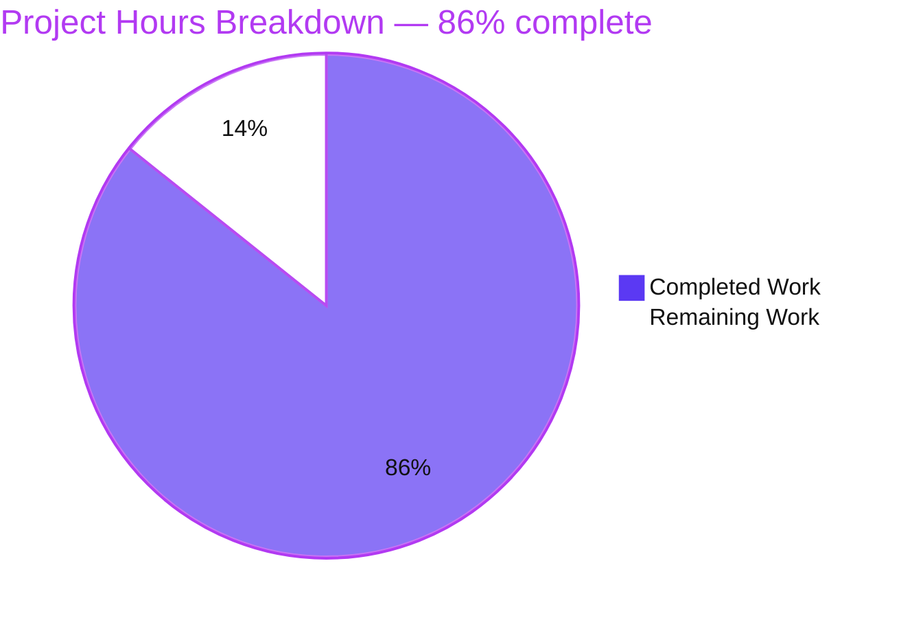
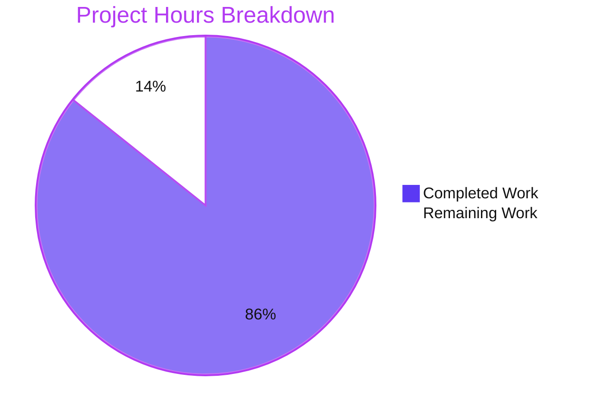

# 1. Executive Summary

## 1.1 Project Overview

SimpleJS is a single-file demonstration web service: `server.js` creates a Node.js built-in HTTP server whose one request handler answers every request with the body `Hello, World!`. The work documented here is a documentation release in two parts — a one-line JSDoc summary above that handler, and a new four-line `README.md` stating the project name, the install position and the run command. Readers are developers and reviewers who need the repository to explain itself at its entry point and at its code. No runtime behaviour, dependency or interface changed.

## 1.2 Completion Status



Completed work is shown in dark blue (`#5B39F3`); remaining work in white (`#FFFFFF`) outlined in violet-black (`#B23AF2`) so it stays legible.

| Metric | Value |
|---|---|
| Total Hours | 10.5 |
| Completed Hours (AI + Manual) | 9.0 |
| Remaining Hours | 1.5 |
| Percent Complete | 86% (9.0 ÷ 10.5 = 85.71%, rounded to 86%) |

## 1.3 Key Accomplishments

- **Handler documentation** — one JSDoc summary line above the request handler (`server.js:1`), no tags, the statement beneath it unchanged.
- **Repository entry point** — `README.md` states the project name, the install position and the run command in four lines, and nothing else.
- **Claim accuracy** — all three README statements verified against the tree and the running process.
- **Scope discipline** — two files, five inserted lines, and no dependency, manifest, test suite, CI workflow, docs directory, badge or licence.
- **Handler behaviour** — seven methods and ten path shapes answered 200 with the same 14-byte body; HEAD returned headers only.
- **Operability and browser confirmation** — one readiness line, empty stderr, SIGTERM exit 143 with the port freed, immediate restart, fail-fast `EADDRINUSE`, and the documented URL rendering as plain text with 10 of 10 requests 200.

## 1.4 Critical Unresolved Issues

**0 of 6** scoped requirements remain open. Nine items are carried forward as accepted characteristics of the frozen statement, grouped below with their exact counts; none of them blocks the change from merging.

| Issue | Impact | Owner | ETA |
|---|---|---|---|
| Documentation accuracy (1): the handler comment names 13 of the 14 response bytes and generalises to "every HTTP request" | A reader could under-count the body by one byte or assume HEAD carries a body | Repository code owner | Sign-off task, 0.5 h |
| Response contract characteristics (3): no `Content-Type`; HEAD omits `Content-Length`; HTTP/1.0 responses are close-delimited | Consumers must sniff the media type and read to EOF on HTTP/1.0 | Service consumers | Accepted, no work scheduled |
| Deployment and operability characteristics (3): wildcard bind on a hardcoded port with no graceful shutdown; no health, readiness or metrics signal; a client stalling mid-headers holds a connection until the runtime's own timeout | Network exposure must be controlled outside the file; liveness can only be probed through `/`; a stalled client costs one connection | Platform and operations | Accepted, controlled at the network and monitoring layer |
| Verification and reproducibility guardrails (2): no automated gate exists in the repository; no Node.js version is pinned anywhere | Future edits are guarded only by a manual syntax check plus a live request; the run command depends on the host runtime | Repository code owner | 0.5 h to record the runtime; review-gate practice adopted |

## 1.5 Access Issues

No access issues identified. The repository needs no credentials, service accounts, API keys or third-party access: the server uses only Node.js built-ins, and every verification ran locally over loopback.

## 1.6 Recommended Next Steps

1. **[High]** Sign off the documentation and settle the single wording question in the handler comment (0.5 h).
2. **[High]** Merge and confirm the documented run command from a clean clone, then stop by the pid that owns port 3000 (0.5 h).
3. **[Medium]** Record the Node.js v22.x prerequisite in the host image so the run command is reproducible (0.5 h).
4. **[Medium]** Adopt the syntax check plus a live 200 / `Hello, World!` request as the review gate for `server.js`.
5. **[Low]** Decide whether any accepted runtime characteristic warrants a follow-up change request.

# 2. Project Hours Breakdown

## 2.1 Completed Work Detail

| Component | Hours | Description |
|---|---|---|
| Request-handler comment (`server.js:1`) | 1.0 | One `/** … */` summary inserted at column 0 above the statement that creates the server and passes the handler; one line, no `@param`, no `@returns`, no second paragraph, no example. |
| Repository entry point (`README.md:1-4`) | 1.0 | Four lines: the project name, the install position (no package install required, Node.js the only requirement) and the run command with the port it listens on. Under the 15-line ceiling with eleven lines to spare. |
| Comment-only change discipline (`server.js:2`) | 0.5 | Two files changed, five lines inserted, zero deleted, no deleted path and no third path; the pre-existing statement is byte-identical to its previous revision. |
| Prohibition conformance across the tree | 1.5 | Verified absence of any dependency manifest, lockfile, `node_modules`, test file or test command, CI workflow, `docs/` directory, badge, licence, changelog, contributing file, diagram or image; zero environment-variable reads and zero response-header writes in the code. |
| README claim substantiation from repository facts | 1.0 | All three README claims traced to their source: the project name from the repository identity, the absent manifest from a probe of the root, and the port from `listen(3000` matched against the documented "port 3000". |
| Byte-level acceptance verification of both artefacts | 1.0 | Both files compared against the specified content: `server.js` 2 lines / 228 bytes and `README.md` 4 lines / 199 bytes, both matching exactly, with `node --check server.js` exiting 0. |
| Documented run-command validation | 1.0 | Clean-copy start with `node server.js`: readiness line, listener on TCP 3000, first request 200 with the 14-byte body, SIGTERM exit 143 with the port released, immediate restart serving. |
| Runtime behavioural verification of the documented values | 2.0 | Method and path matrices, HEAD semantics, response-header inventory, empty-environment start, keep-alive reuse, pipelining, 50 concurrent requests, one browser render of the documented URL, and file-descriptor stability across 200 requests. |
| **Total** | **9.0** | |

## 2.2 Remaining Work Detail

| Category | Hours | Priority |
|---|---|---|
| Human sign-off of the delivered documentation, including the decision on how the handler comment describes the response body (Section 5.2) | 0.5 | High |
| Merge to the default branch and post-merge confirmation of the documented run command from a clean clone | 0.5 | Medium |
| Record the required Node.js v22.x runtime as a host prerequisite for the documented run command | 0.5 | Low |
| **Total** | **1.5** | |

The remaining hours are path-to-production activities only: every scoped deliverable is complete, and no row above re-opens work the current scope forbids.

## 2.3 Hours Calculation and Completion Percentage

Completed work is counted where a scoped requirement produced a delivered artefact or a verification that proves it, at the component level shown in 2.1. Remaining work is counted only where a human must still act before the change is released: sign-off, merge with post-merge confirmation, and one runtime-prerequisite note.

- Completed: 1.0 + 1.0 + 0.5 + 1.5 + 1.0 + 1.0 + 1.0 + 2.0 = **9.0 hours**
- Remaining: 0.5 + 0.5 + 0.5 = **1.5 hours**
- Total project hours: 9.0 + 1.5 = **10.5 hours**
- Completion: 9.0 ÷ (9.0 + 1.5) × 100 = **85.71%, rounded to 86%**

Confidence is high: the deliverables are two short files whose content is fully specified and was compared byte for byte, and the remaining activities are small, well-bounded human steps. The 1.5-hour figure carries no unknown — each row names the artefact or decision it closes.

# 3. Test Results

The repository contains no automated test suite, and adding one is excluded by the current scope, so verification is a runtime gate: a syntax check, static conformance probes over the whole tree, and live requests against the running server. **45 checks were executed, 45 passed, 0 failed.** They ran against the delivered `server.js` on its documented port and against an identical copy differing only in the port literal, so the documented port stayed free between runs. No coverage tooling exists in the repository and none may be added, so the coverage column records that fact rather than a number.

| Area / Category | Framework | Tests | Passed | Failed | Coverage | What This Proves |
|---|---|---|---|---|---|---|
| Static acceptance and repository conformance | Node.js v22.23.5 (`node --check`) and shell probes | 10 | 10 | 0 | n/a — no coverage tooling exists or may be added | Both delivered files match the specified content byte for byte, the tracked tree holds exactly those two files, and no excluded artefact exists anywhere in it |
| Startup and logging | `curl` 8.18.0 plus the process's own output streams | 3 | 3 | 0 | n/a | The run command produces exactly one readiness line of the documented text, nothing is written per request, and stderr stays empty |
| Handler response contract — methods, paths and body | `curl` 8.18.0 plus raw TCP sockets | 19 | 19 | 0 | n/a | Seven methods and ten path shapes are answered 200 with the identical 14-byte body, and HEAD returns headers with no body |
| Response safety and header surface | `curl` 8.18.0 plus raw TCP sockets | 4 | 4 | 0 | n/a | Path traversal, a script payload and CRLF injection in the path change neither the body nor the headers, and the response carries exactly four headers |
| Environment independence | `curl` 8.18.0 with `env -i` | 1 | 1 | 0 | n/a | The server serves identically from a process started with an empty environment, so no configuration is read |
| Process lifecycle | `curl`, `ss`/`lsof`, process exit codes | 4 | 4 | 0 | n/a | SIGTERM exits 143 and frees the port, an immediate restart serves, a second instance fails fast with `EADDRINUSE` and no readiness line, and no listener is left behind |
| Connection and protocol handling | `curl` 8.18.0 plus a raw socket | 3 | 3 | 0 | n/a | Keep-alive reuses one connection, two pipelined requests are answered in order, and HTTP/1.0 is served close-delimited |
| Concurrency | `curl` 8.18.0 at 20-way parallelism | 1 | 1 | 0 | n/a | 50 simultaneous requests all returned 200 with the 14-byte body and the process's descriptor count did not grow |
| **Total** | | **45** | **45** | **0** | | |

**Not Covered**

The following were delivered or exist in the running system but were not exercised by any check in this verification, and a human should cover them before treating the service as production-verified:

- **HTTPS / TLS** — the server has no TLS listener and none can be added without a change the current scope forbids; every check used plaintext HTTP.
- **IPv6 clients** — the socket binds the wildcard address, but all traffic was sent to IPv4 loopback, so an IPv6 client path was never exercised.
- **A client that stalls mid-headers** — the connection would be held until the runtime's own header timeout expires; that timeout path was never driven, so its real duration is unmeasured here.
- **Sustained load or soak** — the largest burst was 50 simultaneous requests over seconds; no multi-minute run, memory-growth measurement or long-lived descriptor trend exists.
- **Node.js versions other than v22.23.5** — nothing in the repository pins a version, and only the installed runtime was exercised.
- **Deployment contexts** — no reverse proxy, TLS terminator, load balancer or container was placed in front of the server, so header rewriting, connection reuse at the proxy and idle-timeout interactions are unverified.
- **The README as a reader experiences it** — both documented commands were executed literally and behaved as written, but no human onboarding run has been performed to judge whether the four lines are sufficient for a first-time reader.

# 4. Runtime Validation & UI Verification

The running system was driven end to end through its only surface — the HTTP listener — plus a browser rendering the documented URL. Status is against the behaviour the repository specifies.

- ✅ **Start-up** — `node server.js` from the repository root binds TCP 3000 and prints `Server running at http://127.0.0.1:3000/` before the first request is answered.
- ✅ **Documented entry point** — the README's install line (nothing to install) and run line were executed literally in a clean copy, and the server answered on the documented port at the first attempt.
- ✅ **Request handling** — GET, POST, PUT, DELETE, PATCH, OPTIONS, TRACE and HEAD across ten path shapes; every body-carrying response was 200 with the same 14 bytes, and HEAD returned headers with no body.
- ✅ **Unknown paths** — `/no-such-path` answered 200 with the identical body through curl, a raw socket and the browser; no 404 surface exists.
- ✅ **Header surface** — exactly `Date`, `Connection: keep-alive`, `Keep-Alive: timeout=5` and `Content-Length: 14`; no `Content-Type` and no security headers.
- ⚠️ **Content negotiation** — one fixed representation: no declared media type, no compression, no `Range`/206, no conditional requests and no upgrade. Accepted, because every remedy changes the statement the current scope freezes.
- ✅ **Shutdown, restart and port contention** — SIGTERM exit 143 with the port released, an immediate restart serving, and a second instance exiting 1 with `EADDRINUSE` and no readiness line.
- ✅ **Environment independence** — started with `env -i`, the process served identically and its environment measured 0 bytes.
- ✅ **Browser rendering and client-side flow** — headless Chrome rendered `Hello, World!` as plain text; 10 of 10 requests returned 200, none left the origin, zero console messages were emitted at any level, and the unknown path and a reload were byte-identical to the first load.
- ⚠️ **Operability signals** — the only liveness evidence is the single startup line and a 200 from `/`; no health, readiness, metrics or tracing output exists, so a wedged process cannot be distinguished from a serving one by signal alone.

**Never exercised at runtime:** HTTPS/TLS (the server has no TLS listener), IPv6 clients (all traffic used IPv4 loopback), a client that stalls part-way through its request headers and the header timeout that eventually closes it, sustained or multi-minute load, any Node.js runtime other than the installed v22.23.5, and any deployment behind a reverse proxy, load balancer or container. None of these has a surface in the delivered files; each is a property of the host or of the frozen statement, and a human should cover the ones the target environment requires before release.

# 5. Compliance & Quality Review

## 5.1 Compliance Matrix

| Deliverable / Requirement | Benchmark | Status | Verified Evidence |
|---|---|---|---|
| One-line comment above the request handler (R1) | Documentation completeness | ✅ PASS | `server.js:1` — 86 bytes including the newline, at column 0, directly above the statement that passes the handler |
| Comment form: one line, single `/** … */` summary, no tags (R4) | Documentation form | ✅ PASS | One comment block, zero `@param`, `@returns`, `@example` or `@throws` tags, no second paragraph |
| README states only the project name, install position and run command (R2) | Scope discipline | ✅ PASS | `README.md:1-4` — one H1, one blank separator, two bullets, zero other non-blank lines |
| README under the fifteen-line ceiling (R5) | Documentation brevity | ✅ PASS | 4 lines |
| Comment-only change with the pre-existing statement preserved (R3) | Change hygiene | ✅ PASS | Two files, 5 insertions, 0 deletions, no deleted path; the statement is byte-identical to its previous revision |
| No test suite, test file, lockfile, dependency or manifest (R6) | Dependency hygiene | ✅ PASS | Tracked tree is exactly `server.js` and `README.md`; zero manifest, lockfile, `node_modules` or test artefacts |
| No 404 handler, error handler, environment-variable configuration or hardening (R6) | Runtime behaviour | ✅ PASS | Every method and path answers 200 with the constant body; zero `process.env` reads; four response headers only; serves under `env -i` |
| Documentation accuracy of the delivered text against observed behaviour | Documentation accuracy | ⚠️ PASS WITH CAVEAT | The comment names 13 of the 14 response bytes and generalises protocol coverage — see 5.2 |
| Documented run command operates as written (0.9) | Operational readiness | ✅ PASS | Clean-copy start, readiness line, 200 with the 14-byte body, SIGTERM exit 143 with the port freed, restart serving |
| README claims true of the tree (0.2) | Traceability | ✅ PASS | Project name, absent dependency manifest and port 3000 each verified against the tree and the running process |
| Reproducibility of the documented run command on another host | Deployment readiness | ⚠️ PARTIAL | No Node.js version is declared anywhere; the run command depends on the host runtime (Section 2.2, row 3) |
| Automated regression protection over the two files | Maintainability | ➖ NOT APPLICABLE | No manifest, linter, CI workflow or test suite exists, and each is excluded by the current scope |

## 5.2 AAP & Rule Divergences and Gaps

| What the AAP/Rule Required | What Was Delivered Instead | Why It Diverged | Impact | Remediation |
|---|---|---|---|---|
| A one-line comment above the request handler describing what it does (R1), with the exact wording fixed at the point of specification (0.4.1) | The single line at `server.js:1` names the response body as `Hello, World!` while the handler sends 14 bytes including the trailing newline, and states it answers "every HTTP request" although HEAD returns headers with no body and requests the runtime's parser rejects never reach the handler | The specification fixed the comment text verbatim while freezing the statement the comment describes; reconciling the two needed a decision the delivery scope did not permit, so the wording was delivered as specified | Documentation accuracy only — no runtime, security or performance effect; a reader can mis-state the body length by one byte or assume protocol coverage the handler does not have | Reword the comment in a follow-up change, or accept it as written; 0.5 h in Section 2.2, row 1 |

This is the only divergence found. Its root is visible in the repository: the comment at `server.js:1` and the statement at `server.js:2` must agree, yet the wording was fixed by the specification while the statement was frozen byte for byte, so the two could not be brought into line without departing from one or the other. Nothing else diverges. Every artefact that a conventional software change would add — test suite, manifest, lockfile, CI workflow, 404 handler, error handler, environment configuration, hardening — is an absence this request itself requires, so their absence is conformance, not a gap. No user-specified rule was supplied for this work, so no rule was overridden. The reader's decision is narrow: keep the delivered wording and record why, or reopen it and accept a one-file change to `server.js:1` alone.

# 6. Risk Assessment

Risks below are forward-looking: what can still go wrong once this change is released, and how it is contained. Items that the current scope requires to stay as they are marked accepted rather than scheduled.

| Risk | Category | Severity | Probability | Mitigation | Status |
|---|---|---|---|---|---|
| No automated gate exists over the two delivered files: a future edit to the dense two-line `server.js` is caught only by a syntax check and a live request | Technical | Medium | Medium | Make `node --check server.js` plus a live 200 / `Hello, World!` request the review gate for every change to the file | Open — accepted by scope |
| Documentation drift: the README's "no dependency manifest" and "port 3000" statements are true today and become wrong if a manifest is added or the listener moves | Technical | Low | Low | Treat `README.md` as part of any change that introduces a manifest or alters the listener | Open — accepted |
| Undeclared media type: responses carry no `Content-Type`, so a consumer that branches on the declared type receives nothing to branch on | Integration | Low | High | Consumers treat the body as plain text; declaring a media type requires changing the frozen statement | Open — accepted |
| Stale listener blocks the documented start: port 3000 is hardcoded, so a leftover instance makes the run command exit 1 with `EADDRINUSE` and no readiness line | Operational | Medium | Medium | Stop the pid that owns port 3000 before starting, and read exit 1 with an empty readiness stream as a port conflict | Open — accepted |
| No health, readiness or metrics signal: a wedged process cannot be distinguished from a serving one, and nothing is logged per request | Operational | Medium | High | Probe `/` for 200 plus the 14-byte body and treat any other outcome as down; accept that request-level forensics are unavailable | Open — accepted |
| A client that stalls part-way through its headers holds a connection until the runtime's header timeout expires | Operational | Low | Medium | Enforce client read timeouts and connection limits at the fronting layer; the runtime does close the connection eventually | Open — accepted |
| Unpinned runtime: nothing in the repository declares a Node.js version, so the documented run command depends on whatever the host provides | Operational | Low | Medium | Record the Node.js v22.x prerequisite in the host image (Section 2.2, row 3) | Open — scheduled |
| Plaintext wildcard listener with no authentication, rate limiting or security headers: the socket binds every interface, so the service is reachable from any network the host is on | Security | Medium | Low | Control exposure at the network layer — loopback-only publication or a firewall and policy — since the statement cannot be changed | Open — accepted |

No further integration risk exists: the server makes no outbound call, holds no data store, has no authentication surface and depends on no external service.

# 7. Visual Project Status

Progress at a glance: completed work in dark blue (`#5B39F3`), remaining work in white (`#FFFFFF`) outlined in violet-black (`#B23AF2`) so it stays visible on a white page.



Remaining hours by category, matching Section 2.2 exactly:

| Remaining Category | Hours | Priority | Share of Remaining |
|---|---|---|---|
| Human sign-off of the delivered documentation, including the response-body wording decision | 0.5 | High | 33% |
| Merge to the default branch and post-merge confirmation from a clean clone | 0.5 | Medium | 33% |
| Record the required Node.js v22.x runtime as a host prerequisite | 0.5 | Low | 33% |
| **Total** | **1.5** | | **100%** |

Priority distribution of the remaining work: High 0.5 h, Medium 0.5 h, Low 0.5 h. Every hour of remaining work closes a named human action; none of it is delivery work left undone, which is why completed work holds 9.0 of the 10.5 project hours (86%).

# 8. Summary & Recommendations

**What was delivered.** SimpleJS now explains itself in the two places a reader looks first. `server.js` opens with a single JSDoc summary describing the request handler, and the statement beneath it is untouched — the diff is one inserted line and zero deletions, with the statement byte-identical to its previous revision. `README.md` is new and holds exactly the project name, the install position and the run command in four lines. Both files match the content the request specified, byte for byte: `server.js` at 2 lines / 228 bytes, `README.md` at 4 lines / 199 bytes. All six scoped requirements are met, and the tree contains nothing the request excluded — no manifest, lockfile, dependency, test suite, CI workflow, docs directory, badge or licence.

**What was verified.** Verification was a runtime gate, because the repository has no automated test suite and adding one is outside its scope. Forty-five checks ran against the delivered file and an identical copy differing only in the port literal: ten static conformance probes, three on startup and logging, nineteen on the handler's method, path and body contract, four on response safety and headers, one on environment independence, four on process lifecycle, three on connection and protocol handling, and one concurrency burst of fifty requests. Forty-five passed and none failed. A headless browser then loaded the documented URL: `Hello, World!` rendered as plain text, 10 of 10 requests returned 200, none left the origin, and no console message was emitted at any level. Robustness held under adversarial input — traversal, script payloads and CRLF injection changed neither the body nor the headers — and the process held 22 file descriptors while idle and still 22 after 200 requests.

**What remains open.** Nine items are accepted rather than outstanding work: the response contract's characteristics (no declared media type, HEAD without `Content-Length`, close-delimited HTTP/1.0), the deployment characteristics (wildcard bind on a hardcoded port, no graceful shutdown, no health or metrics signal, a mid-header stall that holds a connection until the runtime's timeout), the guardrail gaps (no automated gate, no pinned runtime), and one documentation-accuracy point recorded in Section 5.2 — the comment names 13 of the 14 response bytes and generalises protocol coverage. That last item is the single divergence from what the request set out to achieve, and it is the only one that needs a human decision. Against 10.5 total hours, 9.0 are complete and 1.5 remain, giving **86% AAP-scoped completion**.

**Critical path to production.** Sign off the documentation and settle the wording question (0.5 h); merge and confirm the documented run command from a clean clone — syntax check, start, 200 with the 14-byte body, then stop by the pid that owns port 3000 (0.5 h); record the Node.js v22.x prerequisite in the host image so the run command is reproducible elsewhere (0.5 h). Nothing else stands between this change and release.

**Success metrics and readiness.** The change succeeds if `node --check server.js` exits 0, the documented `node server.js` prints exactly one readiness line, a request to port 3000 returns 200 with 14 bytes, an unknown path returns the same body, a second instance fails fast, and a reader can install and run the project from `README.md` alone — all of which were observed. Production readiness for a documentation-only change is **ready to merge**: it adds no runtime behaviour, no dependency and no attack surface, and every caveat recorded here belongs to the pre-existing statement the scope freezes rather than to the work delivered.

# 9. Development Guide

Every command in this section was executed against the delivered repository and produced the output shown.

## Prerequisites

- **Node.js v22.x** — verified on v22.23.5, resolved from the system `PATH`. Node.js is the only requirement: the server loads the built-in `http` module and nothing else. `npm` is present (11.21.0) but is never used.
- No database, message broker, cache, container runtime or reverse proxy.
- A POSIX shell with `curl` (8.18.0 was used) and either `lsof` or `ss` for checking and releasing the port.

## Environment setup

There is nothing to set up. No virtual environment, no `.env` file, no credentials, and no environment variable is read by the process — it serves identically with an empty environment. Clone the repository and work from its root:

```bash
cd SimpleJS
git ls-files          # prints exactly: README.md  server.js
```

## Dependency installation

None. There is no package manifest, lockfile or `node_modules` directory, so `npm install` is not part of this project and must not be introduced. Confirm that for yourself:

```bash
ls package.json package-lock.json yarn.lock node_modules 2>&1
# ls: cannot access 'package.json': No such file or directory  (and the same for the other three)
```

## Application startup

From the repository root:

```bash
node --check server.js     # syntax gate — exits 0 with no output
node server.js
```

Expected output, and the only output the process ever produces:

```text
Server running at http://127.0.0.1:3000/
```

The readiness line is printed only after the socket has bound, so its appearance means the port is accepting. The port number is hardcoded to 3000. The process does not depend on its working directory: started from an unrelated working directory with an absolute path to `server.js`, it printed the same line and served the same body.

## Verification steps

With the server running in another terminal:

```bash
# status must be 200
curl -sS -o /dev/null -w 'status=%{http_code}\n' http://127.0.0.1:3000/

# body must be exactly 14 bytes
curl -sS http://127.0.0.1:3000/ | wc -c      # prints 14

# full response head: four headers, no Content-Type
curl -sS -D - -o /dev/null http://127.0.0.1:3000/

# any method, any path — same 200 and same body
curl -sS -X POST -o /dev/null -w 'status=%{http_code}\n' http://127.0.0.1:3000/anything
```

Observed response head:

```text
HTTP/1.1 200 OK
Date: <timestamp>
Connection: keep-alive
Keep-Alive: timeout=5
Content-Length: 14
```

Stopping the server: terminate only the process that owns the port.

```bash
kill $(lsof -ti tcp:3000 -sTCP:LISTEN)
```

`SIGTERM` exits 143 and releases the port; an immediate restart binds and serves again.

## Example usage

```bash
curl -sS http://127.0.0.1:3000/          # Hello, World!
curl -sS http://127.0.0.1:3000/anything  # Hello, World!
curl -sS http://127.0.0.1:3000/no-such-path -o /dev/null -w '%{http_code}\n'   # 200
```

Request bodies are never read; a POST with any payload receives the same constant body. The server answers every request with one fixed representation, so a `200` means "the process is up", not "the path exists".

## Change workflow

No linter, test suite or CI pipeline exists in this repository, and none may be added under the current scope. The review gate for any change is therefore:

```bash
node --check server.js
node server.js &
curl -sS -o /dev/null -w '%{http_code}\n' http://127.0.0.1:3000/   # must print 200
curl -sS http://127.0.0.1:3000/ | wc -c                            # must print 14
kill $(lsof -ti tcp:3000 -sTCP:LISTEN)
```

## Troubleshooting

| Symptom | Cause | Resolution |
|---|---|---|
| `Error: listen EADDRINUSE: address already in use :::3000`, exit status 1, no readiness line | Another process already holds port 3000; the readiness line prints only after a successful bind | `lsof -ti tcp:3000 -sTCP:LISTEN` to find the owner, then `kill` that pid. Never kill by process name on a shared host. |
| `curl: (7) Failed to connect to 127.0.0.1 port 3000`, status `000`, curl exit 7 | Nothing is listening — the server is not running, or it exited on a port conflict | Start it with `node server.js` and re-run the probe |
| `Cannot find module …/server.js` | The command was run outside the repository root with a relative path | Run from the repository root, or pass an absolute path to `server.js` |
| `node --check server.js` reports a syntax error | The edit broke the file; the process would have crashed at start-up | Fix the reported line before starting the server |
| The process prints the readiness line but the browser shows a raw text page with no styling | Expected: the response is plain text with no `Content-Type` header, so browsers sniff it | Nothing to fix; this is the specified behaviour |
| A response looks one byte longer than expected | The body is `Hello, World!` plus a trailing newline — 14 bytes | Compare with `curl -sS http://127.0.0.1:3000/ \| od -c` |

# 10. Appendices

## A. Command Reference

| Command | Purpose | Observed result |
|---|---|---|
| `git ls-files` | List tracked files | `README.md`, `server.js` |
| `node --check server.js` | Syntax gate before starting | Exit 0, no output |
| `node server.js` | Start the server | One readiness line; listens on TCP 3000 |
| `curl -sS -o /dev/null -w '%{http_code}\n' http://127.0.0.1:3000/` | Status probe | `200` |
| `curl -sS http://127.0.0.1:3000/ \| wc -c` | Body length | `14` |
| `curl -sS -D - -o /dev/null http://127.0.0.1:3000/` | Response head | `HTTP/1.1 200 OK` plus four headers |
| `curl -sSI http://127.0.0.1:3000/` | HEAD behaviour | `200`, headers only, no `Content-Length` |
| `curl -sS --http1.0 -D - http://127.0.0.1:3000/` | HTTP/1.0 behaviour | `200`, `Connection: close`, no `Content-Length` |
| `lsof -ti tcp:3000 -sTCP:LISTEN` | Find the port owner | The `node` process id |
| `ss -ltnp \| grep :3000` | Inspect the bind address | `LISTEN … *:3000` (wildcard) |
| `kill $(lsof -ti tcp:3000 -sTCP:LISTEN)` | Stop the server | `SIGTERM` → exit 143, port released |
| `node server.js` (second instance) | Port-contention behaviour | Exit 1, `EADDRINUSE`, empty readiness stream |
| `env -i node server.js` | Environment independence | Serves 200 with 14 bytes |

## B. Port Reference

| Port | Purpose | Notes |
|---|---|---|
| 3000 | The only port the server uses | Hardcoded in `server.js:2`; TCP; wildcard bind; the readiness line names `http://127.0.0.1:3000/` |
| — | No other port exists | No health, metrics, admin, debug or second listener is opened |

## C. Key File Locations

| Path | Lines | Contents |
|---|---|---|
| `server.js` | 1-2 | Line 1: the JSDoc summary of the request handler. Line 2: the single statement that creates the server, ends every response with the constant body and listens on port 3000. |
| `README.md` | 1-4 | Line 1 the project name; line 2 blank; line 3 the install position; line 4 the run command and port. |

## D. Technology Versions

| Component | Version | Notes |
|---|---|---|
| Node.js | v22.23.5 exercised | No version is declared in the repository, so the run command depends on the host runtime |
| npm | 11.21.0, unused | No manifest exists to install against |
| `curl` | 8.18.0 | Verification client for status, body and headers |
| Headless Chrome | 157 | Browser verification of the rendered response |
| Runtime modules | `http` (Node.js built-in) | The only import in the tree; no third-party package |
| Language | JavaScript (CommonJS) | One source file, two lines |

## E. Environment Variable Reference

| Variable | Required | Read by the process | Notes |
|---|---|---|---|
| — | None | None | The process reads no environment variable: it served identically from a process started with `env -i`, whose environment measured 0 bytes. No `.env` file, configuration file or secret exists or is needed. |

## F. Developer Tools Guide

- **Syntax gate** — `node --check server.js` catches a broken edit before the server starts; it is the only static check available in this repository.
- **HTTP client** — `curl` with `-w '%{http_code}'` for status, `-D -` for the response head, and `--http1.0` to see the close-delimited behaviour.
- **Port inspection** — `lsof -ti tcp:3000 -sTCP:LISTEN` for the owning pid and `ss -ltnp | grep :3000` for the bind address; both were used to confirm the listener and to release it.
- **Process streams** — the server's stdout carries only the readiness line and its stderr stayed empty; capture them separately (`node server.js > out.log 2> err.log`) when you need to prove that.
- **Browser check** — open `http://127.0.0.1:3000/` in any browser: a plain white page with one line of monospace `Hello, World!` is the correct rendering, and an empty console at every level is the expected result.
- **Raw-socket probes** — pipelining, HEAD and HTTP/1.0 details beyond what `curl` shows can be confirmed with any socket client; the checks in Section 3 used a throwaway script that is not part of the repository and should not be added to it.

## G. Glossary

- **JSDoc summary** — a single `/** … */` comment line describing a unit of code; here it sits above the statement that creates the server and describes the handler that statement passes in.
- **Readiness line** — the single line `Server running at http://127.0.0.1:3000/`, printed only after the socket has bound; its appearance is the signal that the port accepts connections.
- **Constant body** — the fixed 14-byte response `Hello, World!` followed by a newline, identical for every method and every path.
- **HEAD** — a request for the headers a GET would return, without the body; the handler still answers 200 but the runtime sends no body and no `Content-Length`.
- **Keep-alive** — reusing one TCP connection for several requests; the server advertises a 5-second idle timeout.
- **Pipelining** — sending a second request on a connection before the first response is read; both are answered in order.
- **Close-delimited response** — a body whose end is signalled by closing the connection rather than by `Content-Length`; this is what an HTTP/1.0 client receives.
- **Media-type sniffing** — a browser guessing the content type when no `Content-Type` header is present; Chrome resolves this body to plain text.
- **`EADDRINUSE`** — the error raised when the requested port is already held; a second instance exits 1 with no readiness line.
- **Wildcard bind** — listening on every local interface (`*:3000`) rather than loopback only, which is the behaviour of the statement the scope freezes.
