# Technical Specification

# 1. Introduction

## 1.1 Executive Summary

### 1.1.1 Project Overview

SimpleJS is a single-file Node.js HTTP service. The entire codebase is `server.js`, a single 142-character CommonJS statement. It creates a server with Node.js's built-in `http` module, listens on TCP port 3000, and answers every request with the plain-text body `Hello, World!\n`.

```javascript
require('http').createServer((req,res)=>res.end('Hello, World!\n'))
  .listen(3000,()=>console.log('Server running at http://127.0.0.1:3000/'));
```

*(The source is one line; it is wrapped here for readability.)*

| Attribute | Value | Evidence |
|---|---|---|
| Repository name | SimpleJS | Git remote configuration |
| Source files | 1 — `server.js` (142 bytes, 1 line) | Repository root listing |
| Language / module system | JavaScript, CommonJS (`require`) | `server.js` |
| Runtime | Node.js; no version pinned | `require('http')` in `server.js`; no manifest present |
| Third-party dependencies | None | No `package.json` or lockfile |
| Version history | One commit, `70e3ee8` "Add files via upload" (2026-10-01) | Git log |
| Documentation, tests, licence | None present | Repository root listing |

The repository has no README, manifest, documentation, or roadmap, so it does not state its purpose, audience, or direction. Wherever this section describes intent, the description is inferred from the code and labelled as an inference.

### 1.1.2 Core Business Problem

The repository documents no business problem. The code solves one technical problem: it exposes a reachable, deterministic HTTP endpoint that needs nothing but a Node.js runtime. Programs of this shape typically serve one of the following purposes. All are inferred, because the repository confirms none of them:

- Checking that a Node.js runtime is installed and can run a script.
- Checking that TCP port 3000 is reachable through host networking, containers, proxies, or firewalls.
- Acting as a minimal scaffold for a larger HTTP service.
- Acting as a small, predictable fixture for tooling that builds, analyses, or deploys repositories.

### 1.1.3 Key Stakeholders and Users

| Stakeholder | Role | Interaction with the System |
|---|---|---|
| Repository owner (GitHub account `rjhonsi-blitzy`) | Author of the only commit | Maintains `server.js` |
| Developers and operators | Run the service | Start it with `node server.js` and read the one-line startup message on stdout |
| HTTP clients (browsers, `curl`, health probes) | Consume the endpoint | Send any request to port 3000 and receive `Hello, World!` |

The code defines no user personas, roles, accounts, or access tiers. Every client is anonymous and receives the same response.

### 1.1.4 Business Impact and Value Proposition

The repository defines no measurable business impact. Its value lies in its minimalism:

| Value Driver | Basis in the Code |
|---|---|
| Zero setup | Only the Node.js built-in `http` module is used, so there is no install step |
| Immediate startup | One top-level statement; no configuration, files, or services to load |
| Deterministic output | Every request receives the same HTTP 200 response with a fixed 14-byte body |
| Minimal maintenance surface | No stored data, authentication, outbound calls, or dependency updates to manage |

These properties make the repository useful as a baseline or template. It does not deliver a business capability in its current form.

## 1.2 System Overview

### 1.2.1 Project Context

#### Business Context and Market Positioning

The repository has no product positioning, target market, or competitive framing. Technically, it is a canonical "Hello, World" Node.js HTTP server, the conventional first program for the Node.js `http` module. It is not positioned as a product.

#### Current System Limitations

SimpleJS does not replace or upgrade an earlier system. Its history is a single initial commit (`70e3ee8`, "Add files via upload"), and the `main` branch holds the same single-file tree as the working branch. The current implementation has the following limitations, each confirmed by reading `server.js` or by running it:

| Limitation | Observed Behaviour | Consequence |
|---|---|---|
| Hard-coded port | Always listens on `3000`; no environment variable or argument is read | The port can only be changed by editing the source |
| Misleading startup message | Logs `http://127.0.0.1:3000/`, but `listen(3000)` with no host binds `:::3000` (all interfaces, dual-stack). The server answered on a non-loopback host address | The service is network-exposed, not local-only as the message implies |
| No error handling | A second instance on the same port throws an unhandled `'error'` event (`EADDRINUSE`) and exits with code 1 | Port conflicts crash the process |
| No `Content-Type` header | The response carries only `Date`, `Connection`, `Keep-Alive`, and `Content-Length` | Clients must guess the media type |
| Request content ignored | Method, path, query, headers, and body are never read | Only one fixed endpoint behaviour is possible |
| No lifecycle management | No signal handlers or graceful shutdown | In-flight connections are dropped when the process is terminated |
| No project scaffolding | No `package.json`, start script, `engines` field, tests, or CI | The runtime version and acceptance criteria are not codified |

#### Integration with the Existing Enterprise Landscape

The system has no enterprise integrations. It makes no outbound network calls and uses no database, message broker, identity provider, or observability platform. Its integration surfaces are inbound HTTP/1.1 on TCP port 3000 and a single line written to stdout.

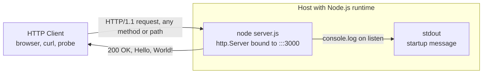

### 1.2.2 High-Level Description

#### Primary System Capabilities

- Accepts HTTP/1.1 connections on TCP port 3000 on every network interface.
- Returns HTTP `200 OK` with the body `Hello, World!\n` for every request, whatever its method, path, query, or body.
- Keeps connections alive using Node.js defaults (`Connection: keep-alive`, `Keep-Alive: timeout=5`, observed on Node.js v22.23.3).
- Prints one startup line, `Server running at http://127.0.0.1:3000/`, once the socket is listening.

#### Major System Components

All the components below are defined inside the one statement in `server.js`.

| Component | Provided By | Responsibility |
|---|---|---|
| HTTP server | `require('http').createServer(...)` (Node.js built-in) | Accepts TCP connections, parses HTTP requests, and manages keep-alive |
| Request handler | Inline arrow function `(req,res)=>res.end('Hello, World!\n')` | Ends every response with the fixed body; never reads `req` |
| Listen callback | Inline arrow function passed to `.listen(3000, ...)` | Writes the startup message to stdout |
| Runtime | Node.js (external, version not pinned) | Supplies the event loop, sockets, and the CommonJS loader |

`server.js` declares no named functions, classes, or globals and exports nothing. Running it as a script is its only use.

#### Core Technical Approach

The service is one event-driven Node.js process with no framework. It keeps no state and leaves the status code and headers at their `http` module defaults. Because nothing is read from configuration or external sources, every response is identical.

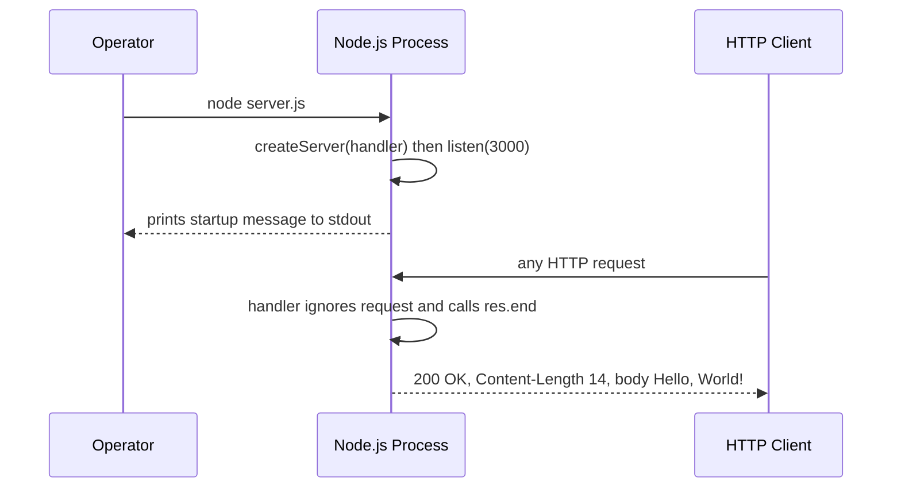

The table below records the response observed for `GET`, `POST`, `DELETE`, and `HEAD` requests against `/`, `/foo`, and `/any/path?q=1`:

| Property | Observed Value |
|---|---|
| Status line | `HTTP/1.1 200 OK` |
| Body | `Hello, World!\n` (14 bytes); empty for `HEAD` |
| Headers | `Date`, `Connection: keep-alive`, `Keep-Alive: timeout=5`, `Content-Length: 14` |
| `Content-Type` | Not sent |

### 1.2.3 Success Criteria

The repository defines no objectives, SLAs, tests, or benchmarks. The criteria below are derived from the observable behaviour of `server.js` and can be used as acceptance checks.

#### Measurable Objectives

| Objective | Target | Verification Method |
|---|---|---|
| Successful startup | Prints `Server running at http://127.0.0.1:3000/` and keeps running | Run `node server.js` |
| Port availability | Listens on TCP port 3000 | Connect to `127.0.0.1:3000` |
| Response correctness | Status 200, body exactly `Hello, World!\n`, `Content-Length: 14` | `curl -i http://127.0.0.1:3000/` |
| Method and path independence | Same response for any method and path | `curl -X POST http://127.0.0.1:3000/any/path` |
| Zero-install execution | Runs without a dependency installation step | No manifest or `node_modules` is required |

#### Critical Success Factors

- A Node.js runtime that supports CommonJS `require` and ES2015 arrow functions is available on the host.
- TCP port 3000 is free. If it is not, the process exits with `EADDRINUSE` and code 1.
- The network path from the client to port 3000 is open.

#### Key Performance Indicators

The code defines and instruments no KPIs: it has no metrics, request logging, or health endpoint. If KPIs are needed, they must be measured from outside the process:

| Indicator | Measurement Point | Status in Code |
|---|---|---|
| Startup success rate | Process exit code and the stdout startup line | Not instrumented |
| Ratio of successful (HTTP 200) responses | External HTTP probe | Not instrumented |
| Response latency | External load or probe tool | Not instrumented |

## 1.3 Scope

### 1.3.1 In-Scope

#### Core Features and Functionalities

**Must-have capabilities.** The system implements exactly these capabilities:

| Capability | Implementation in `server.js` |
|---|---|
| HTTP server creation | `require('http').createServer(...)` |
| Listening on a fixed port | `.listen(3000, ...)` with no host argument, so it binds all interfaces |
| Fixed response | `res.end('Hello, World!\n')` with the default status 200 |
| Startup notification | `console.log('Server running at http://127.0.0.1:3000/')` in the listen callback |

**Primary user workflows.**

| Workflow | Actor | Steps and Result |
|---|---|---|
| Start the service | Developer or operator | Run `node server.js`; the startup line appears on stdout and the process keeps running |
| Request the endpoint | HTTP client | Send any request to port 3000 and receive `200 OK` with `Hello, World!` |
| Stop the service | Developer or operator | Send an interrupt or termination signal (for example, Ctrl+C). The process exits under Node.js default signal behaviour, with no cleanup step |

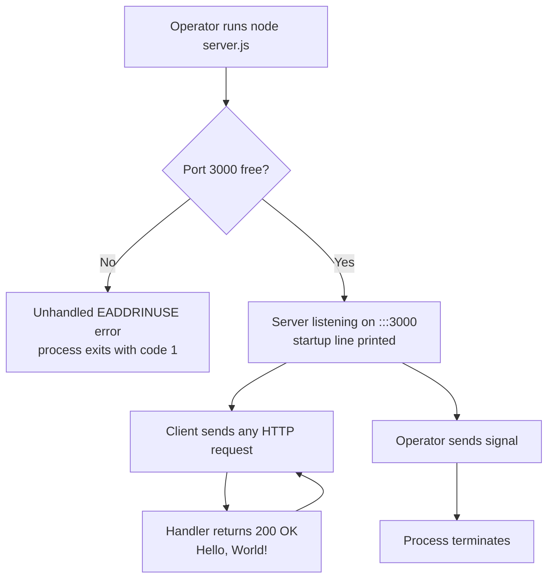

**Essential integrations.** The only integration is the Node.js built-in `http` module. There are no third-party packages, external services, or data stores.

**Key technical requirements.**

| Requirement | Value | Source |
|---|---|---|
| Runtime | Node.js; no version declared (verified on v22.23.3) | `server.js`; no manifest present |
| Language features | CommonJS `require`, ES2015 arrow functions | `server.js` |
| Network | TCP port 3000 free and reachable | `.listen(3000, ...)` |
| Protocol | HTTP/1.1 over plain TCP | Node.js `http` module |

#### Implementation Boundaries

| Boundary | Definition |
|---|---|
| System boundary | One Node.js process running `server.js`. Inputs are inbound HTTP requests on TCP port 3000; outputs are HTTP responses and one stdout line |
| User groups covered | Anonymous HTTP clients, all treated the same; operators who start and stop the process |
| Geographic / market coverage | None specified. There is no localisation, region setting, or time-zone handling, and the response text is a fixed English string |
| Data domains | None. The only data is the string literal `Hello, World!\n`. Request data is never read, and nothing is stored, transformed, or sent elsewhere |

### 1.3.2 Out-of-Scope

#### Excluded Features and Capabilities

None of the following exists anywhere in the repository:

| Category | Excluded Capability |
|---|---|
| Request handling | Routing, method dispatch, query/body parsing, content negotiation, custom status codes or headers (including `Content-Type`) |
| Data | Databases, caches, file I/O, sessions, state of any kind |
| Security | Authentication, authorisation, TLS/HTTPS, rate limiting, CORS, input validation |
| Configuration | Environment variables, command-line arguments, config files; port and message are hard-coded |
| Reliability | `'error'` event handling, graceful shutdown, clustering, process supervision |
| Observability | Request logging, metrics, tracing, health or readiness endpoints |
| Engineering scaffolding | `package.json`, start scripts, `engines` field, automated tests, linting, CI/CD, container images, README, licence |

#### Future Phase Considerations

The repository contains no roadmap, issue references, or TODO markers, so no future phase is documented. The limitations in Section 1.2.1 point to natural extension points. These are not committed plans:

- A configurable port and host, so the bind address matches the logged URL.
- A listener for the server's `'error'` event, so startup failures are reported cleanly.
- An explicit `Content-Type: text/plain` header.
- A `package.json` with a start script and a declared Node.js version range.
- Automated tests covering the acceptance checks in Section 1.2.3.

#### Integration Points Not Covered

- Outbound HTTP or API clients of any kind.
- Persistence layers (SQL, NoSQL, object storage) and message brokers.
- Identity providers and secret stores.
- Logging, monitoring, and APM platforms.
- Reverse proxies, load balancers, container orchestration, or deployment descriptors. None are defined in the repository.

#### Unsupported Use Cases

| Use Case | Reason Unsupported |
|---|---|
| Dynamic or per-request content | The handler always returns the same literal string |
| Multiple endpoints or REST APIs | No routing; every path returns the same response |
| Static file serving | No file system access |
| HTTPS clients | Only plain HTTP is served |
| Loopback-only exposure | Binds all interfaces despite the `127.0.0.1` startup message |
| Several instances on one host | The fixed port 3000 causes `EADDRINUSE` and exit code 1 for every instance after the first |
| Deployment where the platform assigns the port | The port cannot be set at runtime |

## 1.4 References

- `server.js` - The entire application. Source of every capability, component, and limitation in this section: the built-in `http` module, the inline request handler returning `Hello, World!\n`, `listen(3000)` with no host, and the startup message naming `127.0.0.1:3000`. Running it on Node.js v22.23.3 confirmed the `200 OK` response, the 14-byte `Content-Length`, the absence of `Content-Type`, the `:::3000` all-interface bind, and the `EADDRINUSE` exit with code 1.
- `` (repository root) - Contains only `server.js`. Established that there is no manifest, lockfile, README, licence, tests, CI configuration, container definition, or roadmap.
- Git metadata (not a repository file) - Repository name SimpleJS, owner account `rjhonsi-blitzy`, the single commit `70e3ee8` "Add files via upload" (2026-10-01), and a `main` branch identical to the working branch.

# 2. Product Requirements

## 2.1 Feature Catalog

The whole product is the one statement in `server.js`. It breaks down into four discrete, testable features that line up with the capability table in Section 1.3.1. All four are implemented in the only commit (`70e3ee8`, 2026-10-01), so each has the status **Completed**.

The repository has no README, roadmap, or issue tracker, so it states no priorities and no business goals. In this section:

- **Priority** reflects how essential a feature is to the behaviour you can observe. *Critical* means removing the feature stops the service from working.
- **Business value** and **user benefits** are inferred from the code, in line with the inferred purposes in Section 1.1.2.

| Feature ID | Feature Name | Category | Priority / Status |
|---|---|---|---|
| F-001 | HTTP Server Creation | Core Runtime | Critical / Completed |
| F-002 | Fixed-Port Network Listener | Networking | Critical / Completed |
| F-003 | Universal Fixed Response | Request Handling | Critical / Completed |
| F-004 | Startup Notification | Operations / Observability | Medium / Completed |

```javascript
require('http').createServer((req,res)=>res.end('Hello, World!\n'))     // F-001 + F-003
  .listen(3000,()=>console.log('Server running at http://127.0.0.1:3000/')); // F-002 + F-004
```

*(Wrapped onto two lines for readability. The source is a single line.)*

### 2.1.1 F-001 — HTTP Server Creation

| Attribute | Value |
|---|---|
| Unique ID | F-001 |
| Feature Name | HTTP Server Creation |
| Feature Category | Core Runtime |
| Priority Level | Critical |
| Status | Completed (commit `70e3ee8`) |

**Description**

- **Overview:** Loads Node.js's built-in `http` module with CommonJS `require('http')` and builds an `http.Server` by calling `createServer(...)` with an inline request listener. The one statement is evaluated when `node server.js` runs. Afterwards the process stays alive, because the listening socket keeps the event loop running.
- **Business Value:** Gives a working HTTP service with no install step, no dependencies, and no configuration (inferred).
- **User Benefits:** Operators can start the service on any host that has Node.js, with nothing but `node server.js`. No `npm install` is needed and no `node_modules` directory has to exist.
- **Technical Context:** Uses no framework. The server keeps no state and exports nothing. It declares no named functions, classes, or globals. Request parsing, connection handling, and protocol defaults all come from the Node.js `http` module.

**Dependencies**

| Dependency Type | Detail |
|---|---|
| Prerequisite Features | None. This is the root feature |
| System Dependencies | A Node.js runtime with CommonJS `require` and ES2015 arrow functions. No version is declared; behaviour was verified on v22.23.3 |
| External Dependencies | None. There is no `package.json`, lockfile, or third-party module |
| Integration Requirements | Hosts the F-003 handler as its request listener. Provides the server object on which F-002 calls `.listen(...)` |

### 2.1.2 F-002 — Fixed-Port Network Listener

| Attribute | Value |
|---|---|
| Unique ID | F-002 |
| Feature Name | Fixed-Port Network Listener |
| Feature Category | Networking |
| Priority Level | Critical |
| Status | Completed (commit `70e3ee8`) |

**Description**

- **Overview:** Calls `.listen(3000, callback)` on the server from F-001. No host argument is passed, so Node.js binds the unspecified address. On the verification host that was `:::3000`, a dual-stack bind on every interface. Plain HTTP/1.1 connections are accepted with the Node.js keep-alive defaults (`Connection: keep-alive`, `Keep-Alive: timeout=5`).
- **Business Value:** Gives the service one well-known, predictable port for clients, probes, and network checks (inferred).
- **User Benefits:** Clients always reach the service at port 3000. It answers on the loopback address and on every other host address.
- **Technical Context:** The port is hard-coded, and no environment variable, argument, or config file can change it. The server registers no `'error'` listener. If the port is already taken, the `EADDRINUSE` error goes unhandled and the process exits with code 1.

**Dependencies**

| Dependency Type | Detail |
|---|---|
| Prerequisite Features | F-001 (the `http.Server` instance being listened on) |
| System Dependencies | TCP port 3000 is free on the host. Inbound traffic to port 3000 is allowed |
| External Dependencies | None |
| Integration Requirements | Delivers inbound requests to the F-003 handler. Calls the F-004 callback once the socket is bound |

### 2.1.3 F-003 — Universal Fixed Response

| Attribute | Value |
|---|---|
| Unique ID | F-003 |
| Feature Name | Universal Fixed Response |
| Feature Category | Request Handling |
| Priority Level | Critical |
| Status | Completed (commit `70e3ee8`) |

**Description**

- **Overview:** The inline handler `(req,res)=>res.end('Hello, World!\n')` ends every response with the fixed 14-byte body `Hello, World!\n`. The handler never reads `req`, so the method, path, query, headers, and body have no effect. The status (`200 OK`) and the headers (`Date`, `Connection`, `Keep-Alive`, `Content-Length: 14`) are Node.js defaults. No `Content-Type` is sent.
- **Business Value:** Gives a deterministic response that is easy to check, suitable for connectivity tests, runtime checks, or a scaffold baseline (inferred).
- **User Benefits:** Clients get the same answer every time. A `curl` call is enough to confirm the service is up.
- **Technical Context:** The handler is stateless and does no I/O or computation per request. A `HEAD` request returns `200 OK` with no body. On Node.js v22.23.3 it was also observed to carry no `Content-Length` header.

**Dependencies**

| Dependency Type | Detail |
|---|---|
| Prerequisite Features | F-001 (registers the handler), F-002 (delivers requests) |
| System Dependencies | The Node.js `http` module response object (`res.end`) |
| External Dependencies | None |
| Integration Requirements | Inbound HTTP/1.1 clients of any kind (browsers, `curl`, health probes). No upstream or downstream services |

### 2.1.4 F-004 — Startup Notification

| Attribute | Value |
|---|---|
| Unique ID | F-004 |
| Feature Name | Startup Notification |
| Feature Category | Operations / Observability |
| Priority Level | Medium |
| Status | Completed (commit `70e3ee8`) |

**Description**

- **Overview:** The listen callback runs `console.log('Server running at http://127.0.0.1:3000/')`, which writes one line to stdout after the socket is bound.
- **Business Value:** Tells the operator that startup succeeded. It is the only output the application itself produces (inferred).
- **User Benefits:** Operators see straight away that the service is ready, and get a URL to try.
- **Technical Context:** The URL is a fixed string literal, not read from the actual bind address. It names `127.0.0.1` even though the server binds every interface (see F-002). Requests are never logged: after 200 requests, stdout still held only the startup line. If the bind fails, the callback never runs and no message is printed.

**Dependencies**

| Dependency Type | Detail |
|---|---|
| Prerequisite Features | F-002 (the callback fires only after a successful `listen`) |
| System Dependencies | The Node.js `console` global writing to the process's stdout |
| External Dependencies | None |
| Integration Requirements | Whatever reads the process's stdout (terminal, process supervisor, or container log driver). The repository defines none of these |


## 2.2 Functional Requirements

Each requirement below records how `server.js` behaves today, as built. Each one can be checked with `node server.js` and `curl`. Every requirement is at version **1.0**, baselined against commit `70e3ee8` (see Section 2.6.3). Where a requirement's acceptance criteria name response headers or defaults, they were observed on Node.js v22.23.3.

### 2.2.1 F-001 — HTTP Server Creation

**Requirement Details**

| Requirement ID | Description | Acceptance Criteria | Priority / Complexity |
|---|---|---|---|
| F-001-RQ-001 | Create the HTTP server using only the Node.js built-in `http` module | `server.js` requires nothing but `'http'`. `node server.js` starts in a directory with no `package.json` or `node_modules` | Must-Have / Low |
| F-001-RQ-002 | Register the F-003 handler as the server's request listener | Every request to the running server returns the F-003 response | Must-Have / Low |
| F-001-RQ-003 | Run as a long-lived foreground process until terminated externally | After the startup line appears, the process keeps running. It ends on SIGINT or SIGTERM under default Node.js signal behaviour, with no cleanup | Must-Have / Low |

**Technical Specifications**

| Specification | Value |
|---|---|
| Input Parameters | None. No environment variables, command-line arguments, or config files are read |
| Output / Response | A running `http.Server` instance. The module exports nothing |
| Performance Criteria | None defined in the repository. Startup is a single statement with no I/O before `listen` |
| Data Requirements | None. Nothing is stored or loaded |

**Validation Rules**

| Rule Type | Rule |
|---|---|
| Business Rules | One process, one server instance, no configuration |
| Data Validation | Not applicable. The application parses no input itself; HTTP parsing is done by the Node.js `http` module |
| Security Requirements | None in the code (no authentication, TLS, or rate limiting). The server inherits Node.js parser limits: `maxHeaderSize` 16384 bytes, `headersTimeout` 60000 ms, `requestTimeout` 300000 ms |
| Compliance Requirements | None defined. There is no licence file, so distribution terms are not stated |

### 2.2.2 F-002 — Fixed-Port Network Listener

**Requirement Details**

| Requirement ID | Description | Acceptance Criteria | Priority / Complexity |
|---|---|---|---|
| F-002-RQ-001 | Listen on TCP port 3000 | After startup, a TCP connection to `127.0.0.1:3000` succeeds | Must-Have / Low |
| F-002-RQ-002 | Bind the unspecified address (no host argument) so the server is reachable on every interface | The socket table shows a listener on `:::3000`. The server answers on a non-loopback host address | Should-Have / Low |
| F-002-RQ-003 | Keep HTTP/1.1 connections alive using Node.js defaults | Responses include `Connection: keep-alive` and `Keep-Alive: timeout=5` | Could-Have / Low |
| F-002-RQ-004 | Fail fast when port 3000 is taken | A second instance prints `Error: listen EADDRINUSE: address already in use :::3000` on stderr, prints no startup line, and exits with code 1 | Should-Have / Low |

**Technical Specifications**

| Specification | Value |
|---|---|
| Input Parameters | Port literal `3000` in the source. There is no host argument and no backlog argument |
| Output / Response | A bound listening socket. If binding fails, an unhandled `'error'` event, a stack trace on stderr, and exit code 1 |
| Performance Criteria | None defined in the repository. Node.js defaults apply: `keepAliveTimeout` 5000 ms; server `timeout` 0, so no idle socket timeout |
| Data Requirements | None |

**Validation Rules**

| Rule Type | Rule |
|---|---|
| Business Rules | The port is fixed at 3000 and cannot be changed at runtime. Only one instance can run per host |
| Data Validation | Not applicable |
| Security Requirements | None in the code. The service is exposed on every interface over plain HTTP, with no TLS and no access control |
| Compliance Requirements | None defined |

### 2.2.3 F-003 — Universal Fixed Response

**Requirement Details**

| Requirement ID | Description | Acceptance Criteria | Priority / Complexity |
|---|---|---|---|
| F-003-RQ-001 | Return the body `Hello, World!\n` for every request | The response body is exactly 14 bytes, `Hello, World!` followed by a line feed, and is byte-identical across repeated requests | Must-Have / Low |
| F-003-RQ-002 | Return status `200 OK` (the `http` default; never set explicitly) | `curl -i http://127.0.0.1:3000/` shows `HTTP/1.1 200 OK` | Must-Have / Low |
| F-003-RQ-003 | Give the same response whatever the method, path, query, headers, or body | `GET /`, `POST /any/path?q=1` with a body, and `DELETE /foo` all return the same status and body | Must-Have / Low |
| F-003-RQ-004 | Send only the default headers, with no `Content-Type` | Headers are exactly `Date`, `Connection`, `Keep-Alive`, and `Content-Length: 14` | Should-Have / Low |
| F-003-RQ-005 | Answer `HEAD` requests without a body | `curl -I http://127.0.0.1:3000/` returns `200 OK` with an empty body | Could-Have / Low |

**Technical Specifications**

| Specification | Value |
|---|---|
| Input Parameters | Any HTTP/1.1 request. The `req` argument is never read |
| Output / Response | `200 OK`. Body `Hello, World!\n` (14 bytes; empty for `HEAD`). No `Content-Type` |
| Performance Criteria | None defined in the repository. Indicative loopback baseline from 200 sequential `curl` requests on Node.js v22.23.3: p50 0.173 ms, p95 0.316 ms. This was measured in one environment and is not a target |
| Data Requirements | One string literal held in the source. No request data is read, kept, or forwarded |

**Validation Rules**

| Rule Type | Rule |
|---|---|
| Business Rules | Every client is anonymous and gets the same response. The handler keeps no state between requests |
| Data Validation | The application validates no input because it consumes none |
| Security Requirements | The response contains nothing derived from the request, so the application code has no reflection or injection surface |
| Compliance Requirements | None defined. No personal data is read, stored, or emitted |

### 2.2.4 F-004 — Startup Notification

**Requirement Details**

| Requirement ID | Description | Acceptance Criteria | Priority / Complexity |
|---|---|---|---|
| F-004-RQ-001 | Print `Server running at http://127.0.0.1:3000/` to stdout once the server is listening | The first and only line on stdout is exactly that string | Must-Have / Low |
| F-004-RQ-002 | Print the message only after a successful bind | When the bind fails with `EADDRINUSE`, no startup line is printed | Should-Have / Low |
| F-004-RQ-003 | Write nothing else to stdout while the server runs | After 200 requests, stdout still holds exactly one line | Could-Have / Low |

**Technical Specifications**

| Specification | Value |
|---|---|
| Input Parameters | None. The URL is a hard-coded literal |
| Output / Response | One line on stdout, written by `console.log` |
| Performance Criteria | Printed once per process start |
| Data Requirements | None |

**Validation Rules**

| Rule Type | Rule |
|---|---|
| Business Rules | The message text is fixed and does not reflect the real bind address |
| Data Validation | Not applicable |
| Security Requirements | The message reveals no secrets. Its loopback URL disagrees with the all-interface bind in F-002-RQ-002 (see Section 2.4.4) |
| Compliance Requirements | None defined |


## 2.3 Feature Relationships

All four features belong to one method chain in `server.js`: `require('http').createServer(handler).listen(3000, callback)`. Their relationships follow from that chain alone. The repository defines no other coupling.

### 2.3.1 Feature Dependencies Map

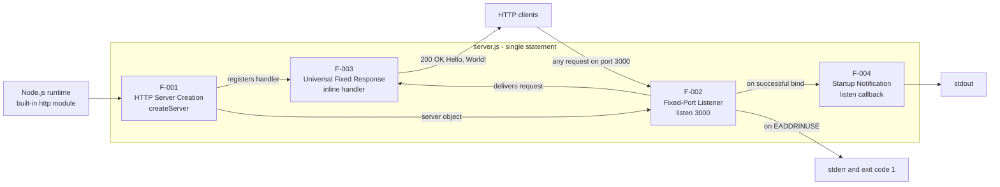

| Feature | Depends On | Relationship |
|---|---|---|
| F-001 | Node.js runtime | Loads `http` and builds the server |
| F-002 | F-001 | Calls `.listen` on the server F-001 returns |
| F-003 | F-001, F-002 | Registered by F-001; requests reach it through F-002 |
| F-004 | F-002 | Runs as the `listen` callback, only after a successful bind |

These relationships are the as-built forms of the process flows already documented elsewhere in this specification:

- the context diagram in Section 1.2.1
- the startup and request sequence diagram in Section 1.2.2
- the start, request, and stop workflow flowchart in Section 1.3.1

### 2.3.2 Integration Points

| Integration Point | Direction | Features | Detail |
|---|---|---|---|
| TCP port 3000 (HTTP/1.1) | Inbound | F-002, F-003 | Bound on the unspecified address (`:::3000`); answers any method or path |
| stdout | Outbound | F-004 | One startup line |
| stderr / exit status | Outbound | F-002 | Unhandled `EADDRINUSE` stack trace and exit code 1 |
| OS signals | Inbound | F-001 | SIGINT and SIGTERM end the process under Node.js defaults; there are no handlers |

The application has no outbound network calls, data stores, or third-party services.

### 2.3.3 Shared Components

| Component | Shared By | Role |
|---|---|---|
| `http.Server` instance | F-001, F-002, F-003, F-004 | Created by F-001, bound by F-002, runs the F-003 handler, and calls the F-004 callback |
| Node.js event loop | All features | Keeps the process alive and dispatches connection, request, and listen events |
| `server.js` statement | All features | The single source location for every feature. Changing one feature means editing the shared line |

### 2.3.4 Common Services

| Service | Provided By | Used By |
|---|---|---|
| HTTP parsing, keep-alive, default status and headers | Node.js `http` module | F-001, F-002, F-003 |
| Console output | Node.js `console` global | F-004 |
| Unhandled-error reporting and exit | Node.js `EventEmitter` / process defaults | F-002 |

Shared services such as authentication, configuration, logging frameworks, or persistence do not exist in the repository.


## 2.4 Implementation Considerations

The considerations below come from reading `server.js` and running it on Node.js v22.23.3. Items labelled *inferred* follow from the code but were not exercised.

### 2.4.1 F-001 — HTTP Server Creation

| Aspect | Consideration |
|---|---|
| Technical Constraints | Written as CommonJS (`require`). There is no `package.json`, so no `"type"` field and no `engines` range. The supported Node.js versions are not codified. The whole program is one 142-byte statement |
| Performance Requirements | None defined. The process does no work before `listen`, and its request handling is single-threaded on the event loop. Observed resident memory while serving was about 57 MB |
| Scalability Considerations | Runs as one process with no clustering or worker threads. Capacity is bounded by one event loop |
| Security Implications | No authentication, TLS, or request limits are set in code. Only Node.js parser defaults protect the process: 16384-byte header limit, 60 s `headersTimeout`, 300 s `requestTimeout` |
| Maintenance Requirements | There are no tests, linting, or CI to guard changes, and any edit touches the shared single line. Runtime upgrades rest on the Node.js `http` API staying stable |

### 2.4.2 F-002 — Fixed-Port Network Listener

| Aspect | Consideration |
|---|---|
| Technical Constraints | The port literal `3000` is hard-coded, and no host is given, so the server binds every interface. A platform that assigns the port at runtime is unsupported (Section 1.3.2) |
| Performance Requirements | None defined. Default keep-alive (`keepAliveTimeout` 5000 ms) reuses client connections. The server `timeout` is 0, so idle sockets are not timed out |
| Scalability Considerations | Only one instance can bind port 3000 on a host; every later instance exits with `EADDRINUSE`. Scaling out needs separate hosts or network namespaces (inferred) |
| Security Implications | The service is network-exposed on every interface over plain HTTP, although the startup message suggests loopback only. Any network restriction has to come from outside the application |
| Maintenance Requirements | No `'error'` listener is registered, so a bind failure shows up only as an uncaught stack trace and exit code 1. No supervisor or restart policy is defined in the repository |

### 2.4.3 F-003 — Universal Fixed Response

| Aspect | Consideration |
|---|---|
| Technical Constraints | The response is a string literal. The status and headers are left at their defaults, so no `Content-Type` is sent and clients must assume a media type |
| Performance Requirements | None defined. A request involves no I/O or computation. Indicative loopback latency was p50 0.173 ms, p95 0.316 ms, and max 3.968 ms over 200 sequential requests. Do not treat these figures as SLAs |
| Scalability Considerations | The handler is stateless, so identical instances are interchangeable behind any load distribution (inferred) |
| Security Implications | The request is never read and nothing from it is echoed back. The application code has no input-handling surface, and no data is disclosed beyond the fixed string |
| Maintenance Requirements | Changing the response means editing the source. There is no template, configuration, or content file |

### 2.4.4 F-004 — Startup Notification

| Aspect | Consideration |
|---|---|
| Technical Constraints | The URL is a literal, not read from `server.address()`, so it cannot follow a change to the port or host |
| Performance Requirements | It runs once per start and adds nothing to request handling |
| Scalability Considerations | Not applicable |
| Security Implications | **Conflicting evidence:** the message reports `http://127.0.0.1:3000/`, while `listen(3000)` binds `:::3000`. An operator relying on the message may wrongly assume the service is local-only |
| Maintenance Requirements | It is the only operational signal: there is no request log, metrics, or health endpoint. Failures go to stderr through Node.js defaults, not through this feature |


## 2.5 Traceability Matrix

Each requirement maps to the code fragment in `server.js` that implements it, to the related parts of this specification, and to a method for verifying it. The repository has no automated tests, so every verification method is a manual or scripted check.

| Requirement ID | Source in `server.js` | Specification Cross-Reference | Verification Method |
|---|---|---|---|
| F-001-RQ-001 | `require('http').createServer(...)` | 1.2.2 Major System Components; 1.2.3 Zero-install execution | Run `node server.js` with no `package.json` or `node_modules` present |
| F-001-RQ-002 | `createServer((req,res)=>...)` | 1.2.2 Major System Components | Any request returns the F-003 response |
| F-001-RQ-003 | Listening socket keeps the event loop alive; no signal handlers | 1.3.1 Primary user workflows (start, stop) | Process stays running after startup and ends on Ctrl+C |
| F-002-RQ-001 | `.listen(3000, ...)` | 1.2.3 Port availability; 1.3.1 Key technical requirements | Connect to `127.0.0.1:3000` |
| F-002-RQ-002 | `.listen(3000, ...)` with no host argument | 1.2.1 Misleading startup message; 1.3.2 Loopback-only exposure | Socket table shows `:::3000`; request via a non-loopback host address |
| F-002-RQ-003 | Node.js `http` defaults | 1.2.2 Primary System Capabilities | `curl -i` shows `Connection: keep-alive`, `Keep-Alive: timeout=5` |
| F-002-RQ-004 | No `'error'` listener on the server | 1.2.1 No error handling; 1.3.1 workflow flowchart | Start a second instance; expect `EADDRINUSE` and exit code 1 |
| F-003-RQ-001 | `res.end('Hello, World!\n')` | 1.2.3 Response correctness | Body is 14 bytes, identical on every request |
| F-003-RQ-002 | No explicit status (`200` default) | 1.2.3 Response correctness | `curl -i` status line `HTTP/1.1 200 OK` |
| F-003-RQ-003 | `req` never referenced | 1.2.3 Method and path independence | Compare `GET /`, `POST /any/path?q=1`, `DELETE /foo` |
| F-003-RQ-004 | No `setHeader` / `writeHead` call | 1.2.1 No `Content-Type` header | `curl -i` shows four headers and no `Content-Type` |
| F-003-RQ-005 | Node.js `http` `HEAD` handling | 1.2.2 observed response table | `curl -I` returns `200 OK` with an empty body |
| F-004-RQ-001 | `console.log('Server running at http://127.0.0.1:3000/')` | 1.2.3 Successful startup | First stdout line matches the literal |
| F-004-RQ-002 | Message lives in the `listen` callback | 1.3.1 workflow flowchart | No startup line when the bind fails |
| F-004-RQ-003 | No other `console` calls | 1.3.2 Observability exclusions | Stdout has exactly one line after many requests |

**Coverage summary**

| Feature | Requirements | Must / Should / Could | Automated Tests |
|---|---|---|---|
| F-001 | 3 | 3 / 0 / 0 | None |
| F-002 | 4 | 1 / 2 / 1 | None |
| F-003 | 5 | 3 / 1 / 1 | None |
| F-004 | 3 | 1 / 1 / 1 | None |


## 2.6 Assumptions, Constraints and Requirement Versioning

### 2.6.1 Assumptions

| ID | Assumption | Affects |
|---|---|---|
| A-001 | Priorities, business value, and user benefits are inferred from the code, because the repository has no README, roadmap, or issues | Section 2.1 |
| A-002 | The current behaviour is treated as the requirement baseline, including the all-interface bind and the missing `Content-Type`. Nothing in the repository says otherwise | F-002, F-003 |
| A-003 | Node.js defaults were captured on v22.23.3: keep-alive timeout, parser limits, `HEAD` handling, and the `EADDRINUSE` message format. Other Node.js versions may differ | F-001, F-002, F-003 |
| A-004 | Latency and memory figures come from one loopback environment. They are baselines, not targets | F-001, F-003 |
| A-005 | The host provides a free TCP port 3000 and a network path from clients to it | F-002 |

### 2.6.2 Constraints

| ID | Constraint | Source | Affects |
|---|---|---|---|
| C-001 | The whole product is one CommonJS statement in a single file, with no manifest | `server.js`; repository root | All |
| C-002 | Port `3000` and the response text are hard-coded; no configuration is read | `server.js` | F-002, F-003, F-004 |
| C-003 | Plain HTTP/1.1 only; no TLS | `require('http')` | F-002, F-003 |
| C-004 | No `'error'`, signal, or shutdown handling | `server.js` | F-001, F-002 |
| C-005 | No automated tests or CI, so all verification is manual or scripted (Section 2.5) | Repository root | All |
| C-006 | The supported Node.js version range is not declared | No `package.json` | F-001 |

The extension points listed in Section 1.3.2 are not committed plans and are excluded from this catalog: a configurable port and host, an `'error'` listener, an explicit `Content-Type`, a `package.json`, and automated tests.

### 2.6.3 Requirement Version Tracking

| Version | Baseline | Date | Change Summary |
|---|---|---|---|
| 1.0 | Commit `70e3ee8` "Add files via upload". The `main` branch tree is identical | 2026-10-01 | First baseline: four features (F-001 to F-004) and 15 requirements, all Completed |

The repository defines no change-control process. In this specification, requirement IDs are permanent. If the behaviour of `server.js` changes, the affected requirement is re-versioned in this table, and a new capability gets the next free feature ID, F-005.


## 2.7 References

- `server.js` - The entire application and the source of features F-001 to F-004 and all 15 requirements:
  - `require('http').createServer(...)`
  - the inline handler `res.end('Hello, World!\n')`
  - `.listen(3000, ...)` with no host
  - the `console.log` startup message

  Running it on Node.js v22.23.3 confirmed the following:
  - `200 OK` responses for `GET`, `POST`, and `HEAD`
  - the 14-byte body and its headers, with no `Content-Type`
  - the `:::3000` bind
  - `EADDRINUSE` followed by exit code 1
  - a single stdout line
  - the inherited `http` defaults: `keepAliveTimeout` 5000 ms, `headersTimeout` 60000 ms, `requestTimeout` 300000 ms, `maxHeaderSize` 16384
  - the indicative latency and memory baselines
- `` (repository root) - Contains only `server.js`. It has no `.blitzyignore`, manifest, lockfile, README, licence, tests, or CI configuration, which underpins assumptions A-001 and A-002 and constraints C-001, C-005, and C-006.
- Git metadata (not a repository file) - The single commit `70e3ee8` "Add files via upload" (2026-10-01), used as the version 1.0 requirement baseline, and a `main` branch identical to the working branch.
- Section 1.1 Executive Summary - Inferred purposes and stakeholders, aligned with the business value statements.
- Section 1.2 System Overview - Limitations, components, the context and sequence diagrams, and the success criteria cross-referenced in the traceability matrix.
- Section 1.3 Scope - The in-scope capability table that the feature breakdown follows, the workflow flowchart, out-of-scope items, and unsupported use cases.


# 3. Technology Stack

## 3.1 Programming Languages

SimpleJS is written in a single language: server-side JavaScript in one file, `server.js`, run directly by the Node.js runtime. The repository has no other source, script, markup, or infrastructure language. None of the languages in the organisation's default stack (Python, TypeScript, Swift, Kotlin, Objective-C) appears, because the system has no backend framework layer, web or mobile client, native application, or infrastructure code (Section 1.3.2).

### 3.1.1 Languages by Component

| Component | Language | Dialect / Module System | Evidence |
|---|---|---|---|
| HTTP service (F-001 to F-004) | JavaScript | ES2015+ syntax, CommonJS modules, non-strict (sloppy) mode | `server.js` |
| Build, test, and deployment scripts | None | — | No such files in the repository |
| Client / UI layer | None | — | The service returns a plain string, not an HTML or JavaScript client |
| Infrastructure as code | None | — | No Terraform, CloudFormation, or container definitions |

The language features used are deliberately few:

| Feature | Use in `server.js` | Minimum Language Level |
|---|---|---|
| CommonJS `require` | `require('http')` loads the built-in HTTP module | Node.js CommonJS loader |
| Arrow functions | Request handler `(req,res)=>...` and listen callback `()=>...` | ES2015 |
| Method chaining | `createServer(...).listen(...)` in one expression | ES5 |
| String literal with escape | `'Hello, World!\n'` (14 bytes) | ES5 |

No classes, `async`/`await`, promises, template literals, destructuring, `import` statements, or `'use strict'` directive are used. The file declares no bindings at all.

### 3.1.2 Selection Rationale

The repository records no rationale for its language choice. The reasons below are inferred from the code and from the zero-install success criterion in Section 1.2.3:

- **Native to the runtime.** JavaScript is the language Node.js executes. `node server.js` runs the source as it is, with no compiler, transpiler, or bundler.
- **No build step.** TypeScript, the default-stack web language, would need a compiler, a `tsconfig.json`, and a package manifest. That contradicts constraint C-001 (one statement, no manifest) in Section 2.6.2.
- **Canonical form.** The file follows the conventional Node.js "Hello, World" HTTP server (Section 1.2.1). Its value lies in being minimal, not in language-level abstractions.
- **Python not applicable.** The default backend language (Python with Flask) would add a second runtime and a dependency install, for behaviour that the Node.js standard library already provides.

### 3.1.3 Constraints and Dependencies

| Constraint | Detail | Impact |
|---|---|---|
| Module system set by default | With no `package.json`, Node.js treats `server.js` as CommonJS | `require` works only while no ancestor `package.json` declares `"type": "module"` |
| ESM incompatibility (verified) | Placing `server.js` under a `package.json` with `"type": "module"` fails at startup with `ReferenceError: require is not defined in ES module scope` | Migrating needs either a `.cjs` extension or `import http from 'node:http'` |
| No declared language level | No `engines` field or `.nvmrc` exists (constraint C-006) | The only implicit floor is ES2015 arrow-function support (Section 1.2.3) |
| No transpilation | Source executes as written | Syntax newer than the host runtime supports cannot be introduced without adding a build step |
| Single-statement structure | All behaviour sits on one 142-byte line | Any language-level change, even a lint fix, touches every feature at once (Section 2.4.1) |

```javascript
// Equivalent ES module form (not in the repository), required if "type": "module" is ever adopted
import http from 'node:http';
```


## 3.2 Frameworks & Libraries

SimpleJS uses no application framework. Its whole technology base is the Node.js runtime and two facilities bundled with it: the built-in `http` module and the `console` global. The default stack's frameworks (Flask, LangChain, React, TailwindCSS, React Native, ElectronJS) are not used, because the system has no Python backend, AI workload, or user interface.

### 3.2.1 Core Runtime and Built-in Libraries

No version is declared anywhere in the repository (constraint C-006). The versions below are those of the verification host, read from `process.versions` and `process.release`, and match the baseline in assumption A-003.

| Component | Version (verified host) | Role in SimpleJS | Referenced By |
|---|---|---|---|
| Node.js runtime | v22.23.3 (`process.release.lts` = `Jod`, an LTS line) | Event loop, CommonJS loader, process lifetime | `node server.js` (Section 1.3.1) |
| `http` built-in module | Ships with the runtime | `createServer(handler)`, `listen(3000, cb)`, `res.end(...)`; supplies the status, headers, and keep-alive defaults | `require('http')` (F-001, F-002, F-003) |
| `console` global | Ships with the runtime | Writes the startup line to stdout | Listen callback (F-004) |
| V8 JavaScript engine | 12.4.254.21-node.57 | Runs the JavaScript source | Implicit |
| llhttp | 9.4.3 | HTTP/1.1 parser underneath the `http` module | Implicit |
| libuv | 1.51.0 | TCP socket I/O and the event loop | Implicit |

`require('http')` and `require('node:http')` return the same object on the verification host, so the bare specifier always resolves to the built-in module and cannot be shadowed by an installed package of the same name.

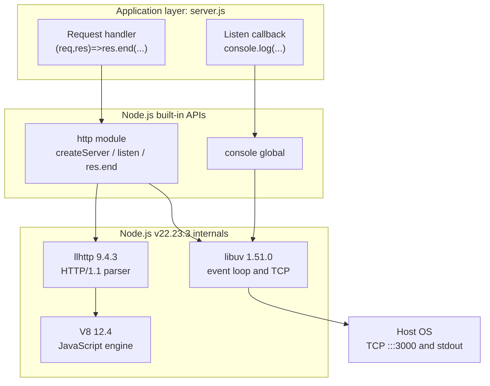

### 3.2.2 Framework Selection Rationale

The repository states no rationale. The justification below is inferred from what the code needs (Section 1.2.2):

| Candidate | Status | Reason (inferred) |
|---|---|---|
| Node.js built-in `http` | **Adopted** | Covers everything F-001 to F-004 need with no install step. Keeps the zero-dependency, zero-install property in Section 1.2.3 |
| Express, Fastify, Koa (Node.js web frameworks) | Not used | There are no routes, middleware, body parsing, or templating to support. Every request gets the same response (F-003) |
| Flask (default-stack backend) | Not applicable | Python framework. It would replace the whole runtime, not complement it |
| LangChain (default-stack AI framework) | Not applicable | The system has no AI, LLM, or data-processing function |
| React, TailwindCSS, React Native, ElectronJS (default-stack front ends) | Not applicable | There is no client, UI, mobile, or desktop component. The response is a plain string |

### 3.2.3 Compatibility Requirements

| Requirement | Detail |
|---|---|
| API surface | Only four long-standing, stable APIs are called: `http.createServer(listener)`, `server.listen(port, callback)`, `response.end(string)`, and `console.log(string)` |
| Runtime version | Any Node.js release with CommonJS and ES2015 arrow functions can run the code (Section 1.2.3). Verified only on v22.23.3 |
| Version-dependent defaults | Observable behaviour relies on runtime defaults that the code never sets. On v22.23.3 these are `keepAliveTimeout` 5000 ms, `headersTimeout` 60000 ms, `requestTimeout` 300000 ms, server `timeout` 0, and `maxHeaderSize` 16384 bytes. Other releases may differ (assumption A-003) |
| Protocol | HTTP/1.1 over plain TCP only. `https` and `http2` are not loaded (constraint C-003) |
| Module format | CommonJS only. See the ESM constraint in Section 3.1.3 |

### 3.2.4 Security Implications

- **Supply chain.** All executed code comes from the Node.js distribution itself. There is no third-party code to audit, pin, or patch.
- **Patch path.** Because the parser (llhttp), socket layer (libuv), and engine (V8) all ship inside the runtime, upgrading Node.js is the only way security fixes reach this service. With no version pinned, the patch level depends entirely on the host. Operators should run a Node.js release line that still receives security updates.
- **Transport.** The bundled OpenSSL (3.5.8 on the verification host) is never used, because only `http` is loaded. Traffic is unencrypted, and TLS termination, if needed, must come from outside the process (Section 2.4.2).
- **Hardening.** Request-size and timeout protection comes only from the runtime defaults listed in Section 3.2.3. The code adds no limits of its own (Section 2.4.1).


## 3.3 Open Source Dependencies

SimpleJS declares and installs no third-party packages. The repository has no `package.json`, no lockfile (`package-lock.json`, `yarn.lock`, `pnpm-lock.yaml`), and no `node_modules` directory, and `npm ls --depth=0` at the repository root reports an empty tree. The only module the code loads is the built-in `http` (Section 3.2.1).

### 3.3.1 Package Dependencies and Registries

| Item | Status | Evidence |
|---|---|---|
| Direct dependencies | None | `server.js` contains only `require('http')`, a built-in |
| Transitive dependencies | None | No manifest or `node_modules` |
| Development dependencies (linters, test runners, type checkers) | None | No manifest or tool configuration files |
| Package registry (npm or other) | Not used | Nothing is fetched at install or run time |
| Version pinning / lockfile | Not applicable | There is nothing to pin. The runtime version itself is also unpinned (constraint C-006) |

npm (11.18.0 on the verification host) ships with Node.js but plays no part in building or running SimpleJS. The service starts with `node server.js` alone (Section 1.3.1).

### 3.3.2 Open Source Components Delivered by the Runtime

All open source code that executes belongs to the Node.js distribution. It is installed with the host runtime, not with the repository. The licences below are taken from the Node.js copyright file on the verification host (`/usr/share/doc/nodejs/copyright`).

| Component | Version (verified host) | Licence | Used by SimpleJS |
|---|---|---|---|
| Node.js | v22.23.3 | MIT | Yes: runtime, `http`, `console` |
| V8 | 12.4.254.21-node.57 | BSD-style (V8 licence) | Yes: JavaScript execution |
| llhttp | 9.4.3 | MIT | Yes: HTTP/1.1 request parsing |
| libuv | 1.51.0 | MIT | Yes: event loop and TCP sockets |
| OpenSSL | 3.5.8 | Apache License 2.0 | No: bundled, but `https`/`tls` are never loaded |

The repository itself has no licence file (Section 1.3.2), so the terms under which SimpleJS's own code may be reused are not stated.

### 3.3.3 Dependency Management Implications

- **Zero-install property.** Without a dependency graph, there is no install step, no registry availability risk, and no vulnerable-package exposure in application code. This is what makes the zero-install success criterion in Section 1.2.3 achievable.
- **Single upgrade surface.** Every dependency version is fixed by whichever Node.js build the host provides. Security advisories for llhttp, libuv, V8, or Node.js core apply directly, and the only remedy is a runtime upgrade.
- **Integration requirement for future packages.** Adding any npm package would first require a `package.json`. That file would also settle the module type (Section 3.1.3) and should declare an `engines` range, closing constraint C-006.


## 3.4 Third-Party Services

SimpleJS uses no third-party services. `server.js` makes no outbound network calls, reads no credentials or environment variables, and loads no SDK or client library. Its only integration surfaces are inbound HTTP/1.1 on TCP port 3000 and one line written to stdout (Section 1.2.1).

| Category | Default-Stack Option | Status in SimpleJS | Evidence |
|---|---|---|---|
| External APIs and integrations | — | None. No HTTP client, webhook, or message broker | Only `require('http')` is loaded, and only `createServer` is called on it |
| Authentication services | Auth0 | Not used. Every client is anonymous and handled identically | The handler never reads `req` (F-003) |
| Monitoring and observability | — | None. No metrics, tracing, APM agent, or request log; the startup line is the only signal | `console.log` appears only in the listen callback (F-004) |
| Cloud services | AWS | Not used. No cloud SDK, deployment descriptor, or provider configuration | Repository contains only `server.js` |

Security implications: because nothing leaves the process, there are no API keys, tokens, or secrets to manage, and no egress traffic to control. The flip side is that access control, TLS, and monitoring are all absent from the application. If a deployment needs them, they must be supplied by surrounding infrastructure, such as a reverse proxy, firewall, or external HTTP probe (Sections 1.2.3 and 2.4.2).


## 3.5 Databases & Storage

SimpleJS has no database, cache, or storage layer. The only data in the system is the string literal `Hello, World!\n`, held in the program source. Request data is never read, and nothing is stored, transformed, or forwarded (Section 1.3.1, Data domains).

| Category | Default-Stack Option | Status in SimpleJS | Evidence |
|---|---|---|---|
| Primary database | MongoDB | Not used. No driver, connection string, or schema | No dependencies (Section 3.3.1) |
| Secondary databases | — | None | — |
| Data persistence strategy | — | None. The service is stateless; no state outlives a request or a process restart | Handler performs no I/O (Section 2.4.3) |
| Caching solutions | — | None at application level. The response is a constant, so there is nothing to compute or cache | `res.end('Hello, World!\n')` |
| File and object storage | — | None. No `fs` module, static files, or object-store client | Only `require('http')` |

Because the service holds no data, there are no data-at-rest security, backup, retention, or migration concerns. The statelessness also means that identical instances are interchangeable (Section 2.4.3).


## 3.6 Development & Deployment

The repository contains no development tooling, build system, container definition, infrastructure code, or CI/CD configuration. Development and deployment come down to having a Node.js runtime and running one command. Every engineering-scaffolding item is listed as out of scope in Section 1.3.2, and constraint C-005 (no automated tests or CI) applies throughout.

### 3.6.1 Development Tools

| Tool Category | Status | Evidence / Note |
|---|---|---|
| Version control | Git (2.43.0 on the verification host). One commit, `70e3ee8` "Add files via upload" (2026-10-01). The remote is hosted on GitHub, and `main` holds an identical tree | Repository history |
| Runtime for local development | Node.js, version not declared. Verified on v22.23.3 | Section 3.2.1 |
| Package manager | Not used. npm 11.18.0 is present on the host but has nothing to manage | Section 3.3.1 |
| Linting and formatting (ESLint, Prettier) | None | No configuration files |
| Type checking (TypeScript, JSDoc checks) | None | Plain JavaScript, no annotations |
| Testing framework | None. Acceptance checks are run by hand with `curl` (Sections 1.2.3 and 2.5) | No test files |
| Editor / workspace configuration | None | No `.editorconfig`, `.vscode/`, or similar |
| Ignore rules | None | No `.gitignore` |

Running `node --check server.js` is the only static verification available without adding tooling. It confirms that the file parses on the host runtime.

### 3.6.2 Build System

SimpleJS has no build system. No compile, transpile, bundle, minify, or asset step exists, and no `scripts` block defines `start` or `test` commands. The deployable artefact is the source file itself, so what is committed is exactly what runs.

```bash
# The complete build-and-run procedure (Section 1.3.1)

node server.js
```

### 3.6.3 Execution and Deployment Model

| Aspect | Current State |
|---|---|
| Start command | `node server.js`. No flags, arguments, or environment variables are read |
| Host prerequisites | A Node.js runtime with CommonJS and ES2015 arrow functions; TCP port 3000 free; inbound network path to port 3000 (assumption A-005) |
| Process model | One foreground process with one event loop. No clustering, worker threads, or supervisor (Section 2.4.1) |
| Configuration | None. The port `3000` and the response text are hard-coded (constraint C-002) |
| Startup signal | One stdout line, `Server running at http://127.0.0.1:3000/` (F-004) |
| Failure behaviour | If port 3000 is taken, an unhandled `EADDRINUSE` is thrown and the process exits with code 1 (F-002) |
| Shutdown | No signal handlers. The process ends under Node.js default signal behaviour and drops in-flight connections (Section 1.2.1) |
| Deployment targets | None defined. No server, platform, or environment is specified |

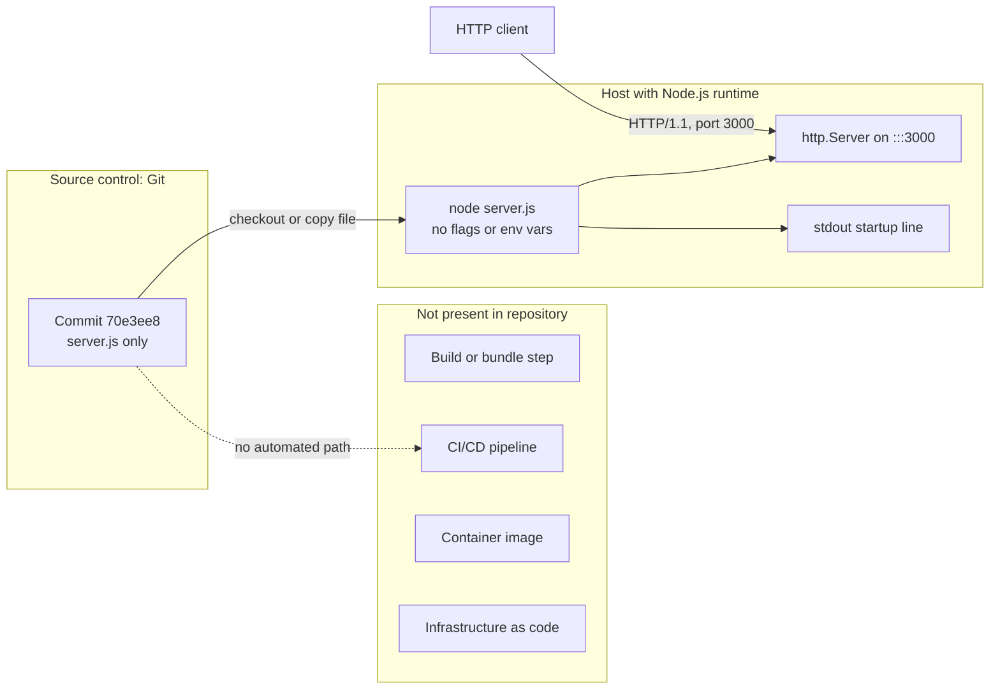

### 3.6.4 Containerization and Infrastructure

The default-stack choices here, Docker for containers and Terraform on AWS for infrastructure, are not used. The repository has no `Dockerfile`, Compose file, Kubernetes manifest, Terraform module, or cloud configuration.

If a deployment wraps the service in a container or provisioned host, the following integration requirements follow from the current code. They are inferred and were not exercised:

| Requirement | Reason |
|---|---|
| Expose or publish port `3000` | The port is fixed in source and cannot be remapped inside the process (F-002) |
| No host-binding change needed | `listen(3000)` already binds every interface (`:::3000`), so the port is reachable from outside a container network namespace |
| Supply an init process or accept forced stops | The code installs no `SIGTERM` handler. Running as PID 1 in a container, a Node.js process does not get the kernel's default termination behaviour for that signal, so stop requests may wait for the platform's kill timeout unless an init process is used |
| Collect stdout | The startup line is the only log output (F-004). Errors go to stderr through Node.js defaults |
| One instance per network namespace | A second process on the same host and port exits with `EADDRINUSE` (Section 2.4.2) |
| Provide TLS and access control externally | The application serves plain HTTP with no authentication (Section 3.4) |

### 3.6.5 CI/CD

No pipeline exists. The default-stack choice, GitHub Actions, is not configured: there is no `.github/workflows/` directory or any other CI definition. Changes reach the repository by direct commit, as the single upload commit `70e3ee8` shows. No automated gate protects them. Constraint C-005 therefore stands: the acceptance checks in Sections 1.2.3 and 2.5 are the only verification, and they are run by hand.

| Pipeline Stage | Status |
|---|---|
| Install dependencies | Not applicable (no dependencies) |
| Lint / static analysis | Not configured; `node --check server.js` is the only available check |
| Automated tests | Not configured |
| Build / package | Not applicable (no build step) |
| Container image publish | Not configured |
| Deployment / release | Not configured; no environments or release tags |


## 3.7 References

**Repository files and folders**

- `server.js` - The entire application. Established the language (JavaScript, CommonJS, ES2015 arrow functions), the single built-in dependency (`require('http')`), the hard-coded port 3000, the fixed response, and the startup message. Also confirmed the absence of frameworks, third-party packages, services, and storage.
- `` (repository root) - Contains only `server.js`. Confirmed the absence of `package.json`, lockfiles, `node_modules`, `.nvmrc`, `Dockerfile`, CI workflows, infrastructure code, linting/test configuration, `.gitignore`, README, and licence. Git history shows one commit, `70e3ee8`, with `main` identical.

**Runtime evidence from the verification host (environment, not declared by the repository)**

- `/usr/bin/node` - Node.js v22.23.3 (`process.release.lts` = `Jod`), V8 12.4.254.21-node.57, llhttp 9.4.3, libuv 1.51.0, OpenSSL 3.5.8. Also the `http.Server` defaults (keep-alive 5000 ms, headers 60000 ms, request 300000 ms, max header size 16384 bytes) and the equivalence of `http` and `node:http`.
- `/usr/share/doc/nodejs/copyright` - Licences of Node.js (MIT), llhttp (MIT), libuv (MIT), OpenSSL (Apache License 2.0), and V8 (BSD-style).
- Verification runs - `node --check server.js` passes. `npm ls --depth=0` reports an empty tree. Under a `package.json` with `"type": "module"`, `server.js` fails with `ReferenceError: require is not defined in ES module scope`.

**Technical Specification cross-references**

- Section 1.2 System Overview - Limitations (no scaffolding, unpinned runtime), component table, and critical success factors (CommonJS, ES2015, free port 3000).
- Section 1.3 Scope - Key technical requirements, and out-of-scope categories (data, security, observability, engineering scaffolding, integrations not covered).
- Section 2.1 Feature Catalog - Feature IDs F-001 to F-004 and their system dependencies.
- Section 2.4 Implementation Considerations - Runtime parser defaults, process model, network exposure, and security implications.
- Section 2.6 Assumptions, Constraints and Requirement Versioning - Assumptions A-003 and A-005, and constraints C-001, C-002, C-003, C-005, and C-006.

**Web sources**

- None. Searches for the current Node.js release schedule returned no results, so no external release or end-of-life dates are cited.


# 4. Process Flowchart

## 4.1 System Workflows

SimpleJS runs as one statement in `server.js`:

```javascript
require('http').createServer((req,res)=>res.end('Hello, World!\n'))
  .listen(3000,()=>console.log('Server running at http://127.0.0.1:3000/'));
```

*(Wrapped for readability; the source is a single 142-byte line.)*

The application code has **no branches**. Every decision point in the workflows below is made by the Node.js runtime, its `http` module (with the llhttp parser), or the operating system, never by `server.js`. Behaviour attributed to Node.js defaults was observed on Node.js v22.23.3 (assumption A-003, Section 2.6.1). The three workflows are the as-built forms of the start, request, and stop workflows in Section 1.3.1.

### 4.1.1 Core Business Processes

#### End-to-End User Journeys

| ID | Workflow | Actor and Touchpoints | Outcome |
|---|---|---|---|
| W-01 | Service Startup (F-001, F-002, F-004) | Operator: shell command `node server.js`; stdout; stderr on failure | **Success:** one stdout line, `Server running at http://127.0.0.1:3000/`, then the process stays in the foreground. **Failure:** stack trace on stderr, exit code 1, no startup line |
| W-02 | Request–Response (F-002, F-003) | HTTP client: TCP port 3000 on any host interface | `200 OK` with the 14-byte body `Hello, World!\n` for every well-formed request. Malformed, oversized, or slow requests get a Node.js default error status and the socket is closed |
| W-03 | Service Shutdown (F-001-RQ-003) | Operator: Ctrl+C in the terminal, or `kill` | The process ends with no output and no cleanup. The shell reports status 130 for SIGINT or 143 for SIGTERM |

A complete session runs W-01 once, then W-02 any number of times, possibly over persistent connections, and ends with W-03. Requests never write to stdout, so the operator sees nothing between startup and shutdown (F-004-RQ-003).

#### System Interactions

| Interaction | From → To | Mechanism | Feature |
|---|---|---|---|
| Module evaluation | Node.js loader → `server.js` | CommonJS evaluation of the single statement | F-001 |
| Server construction | `server.js` → `http` module | `createServer(handler)` returns an `http.Server` | F-001 |
| Socket bind | `http.Server` → OS TCP stack | `listen(3000)` with no host, so it binds the unspecified address (`:::3000`, dual-stack) | F-002 |
| Ready notification | `http.Server` → listen callback → stdout | `'listening'` event fires the callback, which calls `console.log` | F-004 |
| Request dispatch | `http.Server` → inline handler | `'request'` event calls `(req, res)` after the request headers are parsed | F-003 |
| Response emission | Handler → `ServerResponse` → client | `res.end('Hello, World!\n')` with default status and headers | F-003 |
| Signal delivery | OS → Node.js process | SIGINT or SIGTERM with no handler installed | F-001 |

#### Decision Points

| ID | Decision | Decided By | Outcomes |
|---|---|---|---|
| D-01 | Can `server.js` load as CommonJS? | Node.js module loader | **Yes:** continue. **No** (an ancestor `package.json` declares `"type": "module"`): `ReferenceError: require is not defined in ES module scope`, exit 1 |
| D-02 | Is TCP port 3000 free? | OS, via Node.js `net` | **Yes:** Listening. **No:** unhandled `EADDRINUSE`, exit 1 |
| D-03 | Are the request line and headers well formed? | llhttp parser | **No:** `400 Bad Request`, socket closed (about 4 ms observed) |
| D-04 | Is the header block within 16384 bytes? | `http.maxHeaderSize` | **No:** `431 Request Header Fields Too Large` |
| D-05 | Do the headers arrive within `headersTimeout` (60 s)? | `http.Server` connection checker, sweeping every 30 s | **No:** `408 Request Timeout`, observed after 89.6 s |
| D-06 | Is the method `HEAD`? | `ServerResponse` | **Yes:** status and headers only. **No:** 14-byte body |
| D-07 | Is the connection persistent? | `http` module (HTTP version and `Connection` header) | **HTTP/1.1 default:** keep-alive. **HTTP/1.0:** closed straight after the response |
| D-08 | Does the next request arrive within the keep-alive window? | `keepAliveTimeout` 5000 ms + `keepAliveTimeoutBuffer` 1000 ms | **Yes:** the socket is reused. **No:** the server closes it (observed at about 6.0 s) |
| D-09 | Termination signal received? | OS / Node.js default signal action | SIGINT → status 130; SIGTERM → status 143 |

The handler makes no decisions. Method, path, query, headers, and body never change the response (F-003-RQ-003). The handler does not wait for the request body either: a `POST` declaring `Content-Length: 100` and sending 3 bytes got `200 OK` at once.

#### Error Handling Paths

| ID | Trigger | Observable Result | Process Impact |
|---|---|---|---|
| E-01 | Port 3000 already bound (D-02) | stderr: `Error: listen EADDRINUSE: address already in use :::3000` from `node:events`; no startup line | Fatal, exit code 1 |
| E-02 | Loaded in ES module scope (D-01) | stderr: `ReferenceError: require is not defined in ES module scope` | Fatal, exit code 1 |
| E-03 | Malformed request (D-03) | Client gets `400 Bad Request`; connection closed | Non-fatal; server keeps listening; nothing logged |
| E-04 | Header block over 16384 bytes (D-04) | Client gets `431` | Non-fatal; nothing logged |
| E-05 | Incomplete headers past 60 s (D-05) | Client gets `408 Request Timeout` within the 60–90 s window | Non-fatal; nothing logged |
| E-06 | SIGINT or SIGTERM (D-09) | No output; open connections dropped | Process ends; restart means rerunning W-01 |

Retry, fallback, and recovery behaviour for these paths is in Section 4.3.2. The flowchart is in Section 4.4.4.

### 4.1.2 Integration Workflows

SimpleJS integrates with no external system. Its only boundaries are the operating system (TCP socket, signals, stdio, exit status) and the Node.js runtime (Section 2.3.2). There are no outbound calls, data stores, message brokers, or schedulers (Section 1.3.2).

#### Data Flow Between Systems

| Flow | Source → Destination | Payload | Channel |
|---|---|---|---|
| Inbound request | HTTP client → Node.js `http` parser | Request line, headers, optional body. The runtime parses them; the application never reads them | HTTP/1.1 over plain TCP, port 3000, every interface |
| Outbound response | Handler → HTTP client | `200 OK`; `Date`, `Connection: keep-alive`, `Keep-Alive: timeout=5`, `Content-Length: 14`; body `Hello, World!\n`. No `Content-Type` | Same TCP connection |
| Startup log | Listen callback → stdout | One fixed line naming `127.0.0.1`, although the bind is `:::3000` (Section 2.4.4) | Process stdout |
| Failure report | Node.js runtime → stderr | Uncaught exception stack trace | Process stderr |
| Exit status | Process → parent shell or supervisor | 1 (startup failure), 130 (SIGINT), 143 (SIGTERM) | Process exit status |

#### API Interactions

The only interface is one implicit HTTP endpoint that matches everything.

| Aspect | Contract |
|---|---|
| Address | TCP port 3000 on every host interface; any path, any method |
| Request requirements | None beyond parseable HTTP/1.x within the runtime limits (D-03 to D-05) |
| Success response | `200 OK`, body `Hello, World!\n` (14 bytes). `HEAD` returns `200 OK` with no body and, on v22.23.3, no `Content-Length` |
| Runtime-generated responses | `400`, `408`, `431`, produced by Node.js defaults, never by `server.js` |
| Authentication, versioning, content negotiation | None |

```bash
curl -i http://127.0.0.1:3000/any/path   # HTTP/1.1 200 OK ... Hello, World!
```

#### Event Processing Flows

All events are dispatched on one event-loop thread. The handler is synchronous and does no I/O.

| Event | Emitter | Listener in `server.js` | Effect |
|---|---|---|---|
| `'listening'` | `http.Server` | Yes: the `listen` callback | Prints the startup line (F-004) |
| `'request'` | `http.Server` | Yes: the inline handler passed to `createServer` | Calls `res.end('Hello, World!\n')` (F-003) |
| `'error'` | `http.Server` | None (listener count 0) | `EventEmitter` throws; exit 1 (E-01) |
| `'clientError'` | `http.Server` | None (listener count 0) | Node.js default: writes `400`, `408`, or `431`, then destroys the socket (E-03 to E-05) |
| `SIGINT` / `SIGTERM` | `process` | None | Default termination (E-06) |

#### Batch Processing Sequences

None. `server.js` defines no scheduler, timer, queue consumer, or background job. The only periodic activity is internal to Node.js: the `http.Server` connection checker runs every 30000 ms (`connectionsCheckingInterval`) and enforces `headersTimeout` and `requestTimeout`. That is why the 60 s header timeout fired at 89.6 s in testing.

## 4.2 Flowchart Requirements

Each major workflow from Section 4.1.1 is specified below by its start and end points, steps, decisions, boundaries, touchpoints, error states, and timing. Decision IDs (D-xx) and error IDs (E-xx) refer to the tables in Section 4.1.1. Requirement IDs refer to Section 2.2.

### 4.2.1 W-01 Service Startup

| Element | Specification |
|---|---|
| Start point | The operator runs `node server.js` from the directory that holds the file. No flags, arguments, or environment variables are read (constraint C-002) |
| End points | **Success:** Listening state, startup line on stdout, process held open by the bound socket. **Failure:** stderr stack trace and exit code 1 |
| Process steps | 1. Node.js evaluates `server.js` as CommonJS. 2. `require('http')` resolves the built-in module. 3. `createServer(handler)` builds the `http.Server` (F-001). 4. `.listen(3000, callback)` asks the OS to bind the unspecified address (F-002). 5. On `'listening'`, the callback prints the startup line (F-004) |
| Decision diamonds | D-01 (module format), D-02 (port free) |
| System boundaries | Shell → Node.js process → OS TCP stack |
| User touchpoints | The shell command; the stdout line; stderr on failure |
| Error states and recovery | E-01, E-02. Recovery is manual (Section 4.3.2) |
| Timing and SLA | No startup deadline is defined. The bind is attempted once, with no retry. Nothing does I/O before `listen` |
| Related requirements | F-001-RQ-001, F-001-RQ-002, F-002-RQ-001, F-002-RQ-002, F-002-RQ-004, F-004-RQ-001, F-004-RQ-002 |
| Diagrams | Sections 4.4.2, 4.4.5, 4.4.6 |

### 4.2.2 W-02 Request–Response

| Element | Specification |
|---|---|
| Start point | A client opens a TCP connection to port 3000 on any host interface and sends a request |
| End points | **Success:** `200 OK` with `Hello, World!\n` delivered. **Rejection:** a runtime error status (`400`, `408`, `431`) and the socket closed. **Connection end:** the socket closed after the response (HTTP/1.0) or after the keep-alive idle window |
| Process steps | 1. The OS accepts the connection. 2. llhttp parses the request line and headers. 3. The `'request'` event invokes the handler. 4. The handler calls `res.end('Hello, World!\n')`. 5. Node.js writes the status line, default headers, and body (no body for `HEAD`). 6. The socket is kept alive or closed |
| Decision diamonds | D-03 to D-08 |
| System boundaries | Client network → OS TCP stack → Node.js `http` (parser, response writer) → `server.js` handler |
| User touchpoints | HTTP client only. Nothing is written to stdout per request (F-004-RQ-003) |
| Error states and recovery | E-03, E-04, E-05. The server stays up; retrying is up to the client |
| Timing and SLA | See Section 4.2.4. No SLA is defined |
| Related requirements | F-002-RQ-003, F-003-RQ-001 to F-003-RQ-005 |
| Diagrams | Sections 4.4.3, 4.4.5, 4.4.6 |

### 4.2.3 W-03 Service Shutdown

| Element | Specification |
|---|---|
| Start point | The operator sends SIGINT (Ctrl+C) or SIGTERM (`kill`) to the process |
| End point | Process exit. The shell reports 130 (128 + SIGINT) or 143 (128 + SIGTERM) |
| Process steps | 1. The OS delivers the signal. 2. No handler is installed, so the Node.js default action ends the process. 3. The OS releases the listening socket and any open connections |
| Decision diamonds | D-09 |
| System boundaries | Operator → OS → Node.js process |
| User touchpoints | The terminal and the shell exit status. No shutdown message is printed |
| Error states and recovery | In-flight requests and keep-alive connections are dropped without draining (constraint C-004). Recovery means rerunning W-01 |
| Timing and SLA | Termination is immediate, with no drain period. When the process runs as PID 1 in a container, SIGTERM may not end it, so the platform's kill timeout applies (Section 3.6.4, inferred) |
| Related requirements | F-001-RQ-003 |
| Diagrams | Sections 4.4.5, 4.4.6 |

### 4.2.4 Timing and SLA Considerations

The repository defines no SLA, SLO, or timeout of its own. Every timing constraint below is a Node.js `http.Server` default read on v22.23.3. The *Observed* column shows how it behaved against the running server.

| Parameter | Default | Effect on Workflows | Observed |
|---|---|---|---|
| `keepAliveTimeout` | 5000 ms | Advertised as `Keep-Alive: timeout=5`; sets the idle window (D-08) | Two requests shared one connection |
| `keepAliveTimeoutBuffer` | 1000 ms | Added to the idle window before the server closes the socket | Idle socket closed at about 6010 ms |
| `headersTimeout` | 60000 ms | Deadline for a complete header block (D-05) | `408` at 89573 ms |
| `connectionsCheckingInterval` | 30000 ms | Sweep period that enforces the header and request timeouts | Explains the 60–90 s window for `408` |
| `requestTimeout` | 300000 ms | Deadline for a whole request | Not exercised |
| `timeout` (socket inactivity) | 0 | No inactivity timeout on sockets | Not applicable |
| `maxRequestsPerSocket` | 0 | Unlimited requests per keep-alive connection | Not applicable |
| Request latency | Not specified | Indicative loopback baseline only (assumption A-004) | p50 0.173 ms, p95 0.316 ms, max 3.968 ms over 200 sequential requests |

### 4.2.5 Validation Rules

#### Business Rules at Each Step

| Workflow Step | Rule | Enforced By | Outcome on Violation |
|---|---|---|---|
| W-01 load | `server.js` must run as CommonJS | Node.js module loader | E-02, exit 1 |
| W-01 bind | One instance per host on port 3000; the port cannot be changed at runtime | OS bind; hard-coded literal (C-002) | E-01, exit 1 |
| W-01 notify | Print the startup line only after a successful bind | `listen` callback semantics | No line on failure (F-004-RQ-002) |
| W-02 parse | The request must be well-formed HTTP/1.x | llhttp | E-03, `400` |
| W-02 parse | Header block of 16384 bytes or less | `http.maxHeaderSize` | E-04, `431` |
| W-02 parse | Headers complete within 60 s | `headersTimeout` | E-05, `408` |
| W-02 handle | Every client gets the same response | Inline handler (F-003-RQ-003) | Not applicable; the handler cannot fail |

#### Data Validation Requirements

The application validates no data, because it reads none (Section 2.2.3). The only input checks are the protocol checks Node.js applies before the handler runs (D-03 to D-05). The request body is never validated or consumed.

#### Authorization Checkpoints

None. The code has no authentication, authorisation, TLS, rate limiting, or CORS handling. All clients are anonymous and treated the same (Section 1.3.1). The service binds every interface over plain HTTP, so any access restriction must come from outside the application, such as a firewall, reverse proxy, or network policy (Section 2.4.2).

#### Regulatory Compliance Checks

None are defined. No personal data is read, stored, or emitted (Section 2.2.3). The repository has no licence file, so distribution terms are not stated (Section 2.2.1).

## 4.3 Technical Implementation

### 4.3.1 State Management

`server.js` holds no application state. It declares no variables, keeps no closures over mutable data, and keeps no counters or sessions. The only state is runtime-managed: the lifecycle of the process and of each TCP connection. Section 4.4.6 diagrams both.

#### State Transitions — Process Lifecycle

| State | Entered When | Leaves To |
|---|---|---|
| Loading | `node server.js` starts evaluating the module | Binding; or Crashed on a module-load error (E-02) |
| Binding | `.listen(3000, callback)` is called | Listening on a successful bind; or Crashed on `EADDRINUSE` (E-01) |
| Listening | `'listening'` fires and the startup line is printed | Listening (each request is served without changing state); Terminated on SIGINT or SIGTERM |
| Crashed | An uncaught exception reaches the top level | Exit code 1 |
| Terminated | The default signal action ends the process | Shell status 130 or 143 |

#### State Transitions — Connection Lifecycle

| State | Entered When | Leaves To |
|---|---|---|
| Connected | The OS accepts a TCP connection on port 3000 | ReceivingHeaders when bytes arrive |
| ReceivingHeaders | llhttp is parsing the request line and headers | Responding when the headers are complete; or Rejected (D-03 to D-05) |
| Responding | The handler runs and `res.end` writes the response | Idle (HTTP/1.1 keep-alive); or Closed (HTTP/1.0 or `Connection: close`) |
| Idle | The response is finished on a persistent connection | ReceivingHeaders on the next request; or Closed after about 6 s idle |
| Rejected | A runtime error status (`400`, `408`, `431`) is written | Closed |
| Closed | The socket is destroyed | Terminal state |

#### Persistence, Caching, and Transaction Boundaries

| Concern | Implementation | Evidence |
|---|---|---|
| Data persistence points | None. No file, database, or remote store is written or read. A restart loses nothing because nothing is held. The only durable artefact is `server.js` itself | `server.js` requires only `http`; Section 1.3.2 |
| Caching | No application cache. The response is a string literal inside the handler. No HTTP caching headers are sent: the observed headers are only `Date`, `Connection`, `Keep-Alive`, `Content-Length` | `server.js`; observed response headers |
| Transaction boundaries | No transactions. The unit of work is one request–response exchange, finished synchronously by one `res.end` call, with nothing to commit or roll back. A keep-alive socket carries several independent exchanges | `server.js` handler |
| Concurrency | One event-loop thread. Exchanges are serialised on that loop and share no data | Section 2.4.1 |

### 4.3.2 Error Handling

The code registers no error, client-error, or signal handlers (constraint C-004). Every behaviour below is a Node.js or OS default.

#### Mechanism Inventory

| Mechanism | Present | Behaviour |
|---|---|---|
| Retry | No | The bind is attempted once; `EADDRINUSE` is not retried. Responses carry no `Retry-After`. Any retry is up to the client or an external supervisor, and the repository defines neither |
| Fallback | No | No alternate port, host, or degraded mode exists. The port literal `3000` is the only option (C-002) |
| Error notification | Partial (runtime defaults) | Fatal errors: stack trace on stderr and a non-zero exit status. Request errors: an HTTP status to the client only. No logging, alerting, metrics, or health endpoint (Section 1.3.2) |
| Recovery | Manual | An operator fixes the cause and reruns `node server.js`. No process supervisor, restart policy, or container definition exists (Section 3.6) |
| Graceful shutdown | No | No `server.close()`, connection draining, or `SIGTERM` handler |

#### Error Notification Flows

| Error | Notified Party | Channel and Content | Logged by Application |
|---|---|---|---|
| E-01 `EADDRINUSE` | Operator | stderr: `Error: listen EADDRINUSE: address already in use :::3000`, stack from `node:events`; exit 1 | No |
| E-02 ES module scope | Operator | stderr: `ReferenceError: require is not defined in ES module scope, you can use import instead`; exit 1 | No |
| E-03 / E-04 / E-05 | HTTP client | `400 Bad Request`, `431`, or `408 Request Timeout`, then the socket is closed | No; stdout and stderr stay silent |
| E-06 Signal | Operator (shell) | Exit status 130 or 143; no message | No |

#### Recovery Procedures

| Error | Recovery Procedure |
|---|---|
| E-01 Port in use | Find the process that holds TCP port 3000, stop it or move to another host or network namespace, then rerun `node server.js`. Changing the port means editing the source (C-002) |
| E-02 Module format | Run `server.js` from a directory with no ancestor `package.json` declaring `"type": "module"`, or rename the file to `.cjs` as the Node.js error message suggests |
| E-03 to E-05 Client errors | No server action. The client corrects the request (syntax, header size, or sending speed) and retries |
| E-06 Unplanned stop | Rerun W-01. Requests in flight at termination are lost, and clients must resend them |

## 4.4 Required Diagrams

All diagrams show the as-built behaviour of `server.js` at commit `70e3ee8`, with Node.js defaults observed on v22.23.3. Subgraphs act as swim lanes for the actors and systems. Rounded nodes mark start and end points, and diamonds mark the decision points from Section 4.1.1.

### 4.4.1 High-Level System Workflow

The diagram covers all three workflows (W-01 startup, W-02 request–response, W-03 shutdown) across four lanes. Only the application lane is code in this repository. Every decision diamond belongs to the Node.js runtime lane.

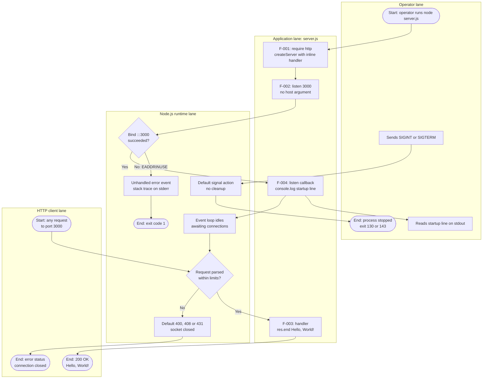

### 4.4.2 Service Startup Process Flow (W-01: F-001, F-002, F-004)

There are two fatal exits (E-01, E-02), and both end with exit code 1. The startup line is printed only on the success path, which satisfies F-004-RQ-002. No step has a timeout or retry.

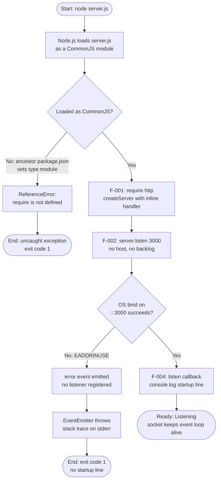

### 4.4.3 Request Handling Process Flow (W-02: F-002, F-003)

The diagram puts the runtime validation gates (D-03 to D-05) ahead of the handler. The handler path contains no decisions of its own, and the response is the same for every method, path, query, header set, and body. Timing constraints: a 60 s header deadline enforced on a 30 s sweep, and a 5 s advertised keep-alive window that closed at about 6 s in testing.

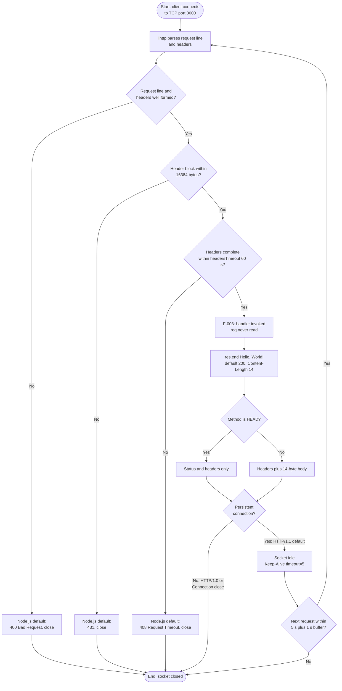

### 4.4.4 Error Handling Flowchart

The flowchart sorts errors by impact. Startup errors are fatal and need manual recovery. Request errors are non-fatal and are answered by Node.js defaults without any logging. Termination drops open connections. The dashed edges are the manual restart loop. No automated retry, fallback, or supervisor exists (Section 4.3.2).

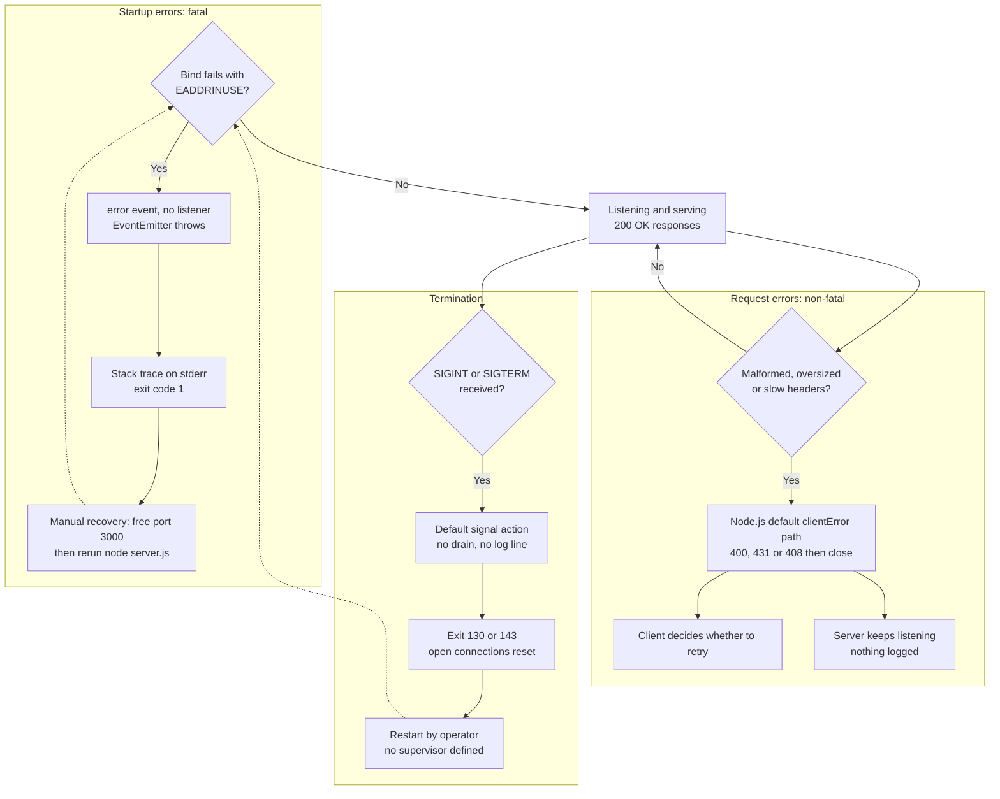

### 4.4.5 Integration Sequence Diagrams

**Startup, request, and keep-alive.** The application exchanges messages only with the Node.js `http` module. The `http` module handles every interaction with the OS and the client. The first diagram follows Section 1.2.2 and adds the observed keep-alive reuse and the server-side idle close.

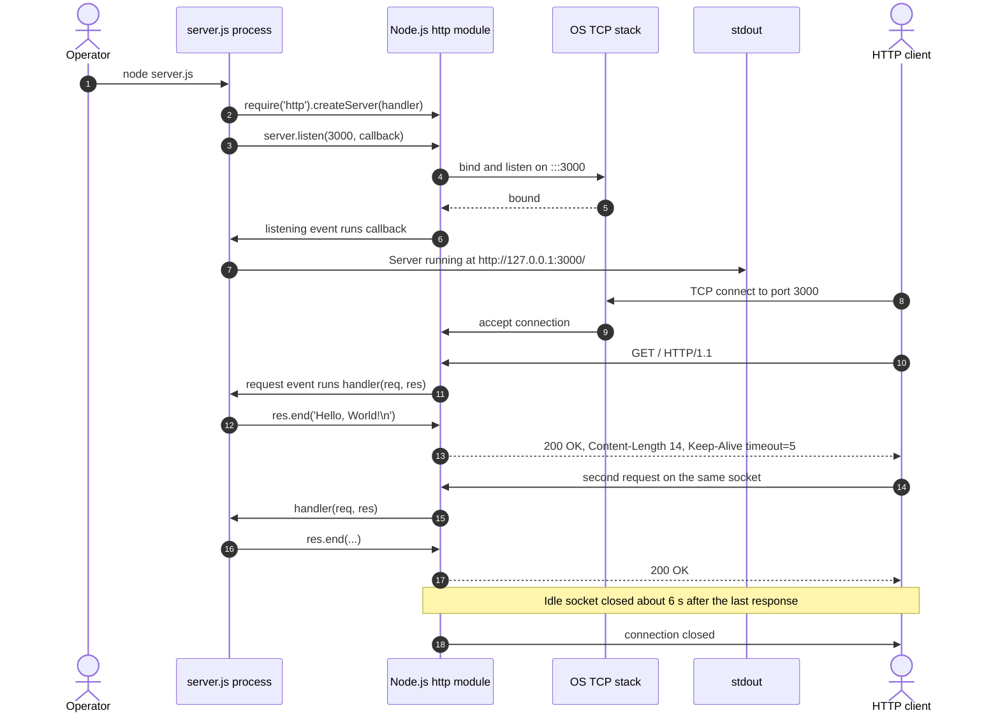

**Startup failure and shutdown.** A second instance cannot bind the port held by the first. The running instance ends without draining when signalled.

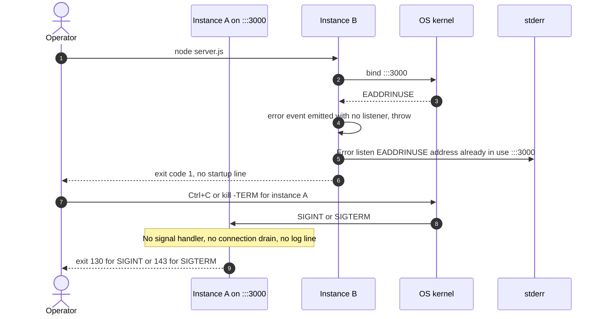

### 4.4.6 State Transition Diagrams

**Process lifecycle.** This diagrams the states in Section 4.3.1. Serving a request never changes the process state.

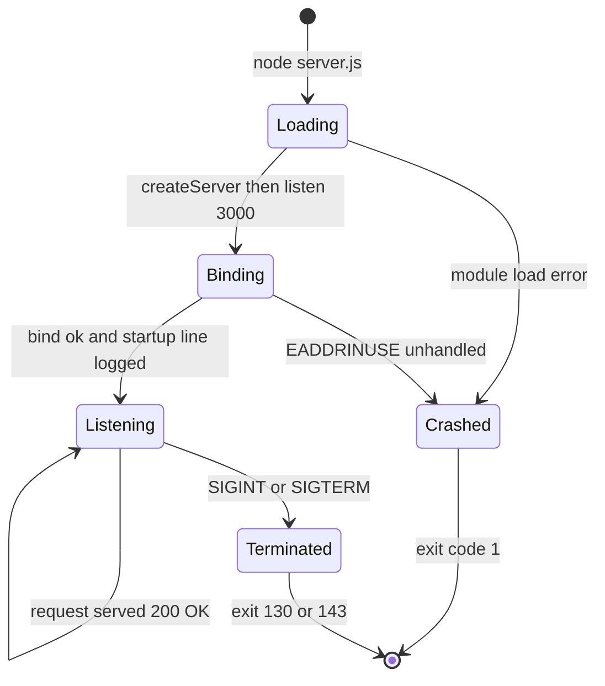

**Connection lifecycle.** This covers one TCP connection, managed entirely by the Node.js `http` module. Timing: a 60–90 s `408` deadline in ReceivingHeaders, and about 6 s idle before Closed.

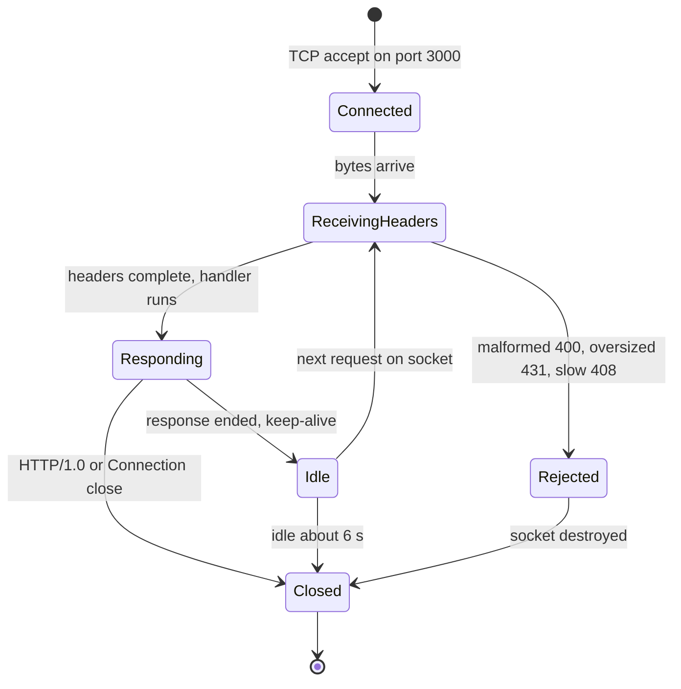

## 4.5 References

#### Repository Files and Folders

- `server.js` - The entire application: the CommonJS `require('http')`, `createServer` with the inline handler `res.end('Hello, World!\n')`, and `.listen(3000, ...)` with the startup `console.log` callback. It is the source of every workflow, decision point, event listener, and state described in this section
- `` (repository root) - Contains only `server.js` at commit `70e3ee8`. It confirmed that no manifest, configuration, tests, CI, container definition, or `.blitzyignore` exists, and therefore no persistence, caching, retry, supervisor, or batch component

#### Runtime Observations (Node.js v22.23.3, assumption A-003)

- Startup line, default `200 OK` headers, 14-byte body, `HEAD` handling, and `EADDRINUSE` exit code 1 with no startup line (W-01, W-02, E-01)
- `400 Bad Request` for a malformed request line, `431` for a 20000-byte header, and `408 Request Timeout` at 89573 ms for incomplete headers, with the server staying alive and logging nothing (E-03 to E-05)
- Keep-alive reuse across two requests; idle socket closed at about 6010 ms; HTTP/1.0 closed after the response; `200 OK` sent before an incomplete request body arrived (D-07, D-08)
- SIGINT → status 130 and SIGTERM → status 143, with no shutdown output (W-03, E-06)
- `ReferenceError: require is not defined in ES module scope` and exit code 1 when loaded under `"type": "module"` (E-02)
- `http.Server` defaults: `keepAliveTimeout` 5000, `keepAliveTimeoutBuffer` 1000, `headersTimeout` 60000, `requestTimeout` 300000, `connectionsCheckingInterval` 30000, `timeout` 0, `maxRequestsPerSocket` 0, `http.maxHeaderSize` 16384; zero `'error'` and `'clientError'` listeners (Section 4.2.4)

#### Technical Specification Cross-References

- Section 1.2.2 - The startup and request sequence diagram that Section 4.4.5 extends
- Section 1.3.1 - The start, request, and stop workflows formalised as W-01 to W-03; implementation boundaries
- Section 1.3.2 - Out-of-scope capabilities: persistence, security, configuration, reliability, observability
- Section 2.1 - Feature IDs F-001 to F-004
- Section 2.2 - Requirement IDs mapped to each workflow, plus the data-validation and security rules
- Section 2.3 - Integration points (TCP port 3000, stdout, stderr and exit status, OS signals) and event wiring
- Section 2.4 - Security and scalability considerations, including the `127.0.0.1` versus `:::3000` conflict (2.4.4) and the latency baseline
- Section 2.6 - Assumptions A-003 and A-004 and constraints C-002 and C-004
- Section 3.6 - Execution model, container PID 1 signal caveat, and absence of supervisor and CI

# 5. System Architecture

## 5.1 High-Level Architecture

This section describes the as-built architecture of `server.js` at commit `70e3ee8`. Node.js default behaviour was observed on v22.23.3 (assumption A-003, Section 2.6.1). The repository records no design rationale, so every statement of intent below is inferred from the code (assumption A-001).

### 5.1.1 System Overview

#### Architecture Style and Rationale

SimpleJS is a **single-process, event-driven monolith** built directly on the Node.js built-in `http` module, with no framework. The whole system is one CommonJS statement:

```javascript
require('http').createServer((req,res)=>res.end('Hello, World!\n'))
  .listen(3000,()=>console.log('Server running at http://127.0.0.1:3000/'));
```

*(Wrapped for readability; `server.js` is a single 142-byte line.)*

| Style Aspect | As Built | Evidence |
|---|---|---|
| Deployment unit | One script running as one OS process (monolith) | `server.js` is the only source file; Section 3.6.3 |
| Concurrency model | Reactor: one JavaScript thread runs the libuv event loop and dispatches callbacks. The process had 7 OS threads, the extra ones being runtime helpers such as the default 4-thread libuv pool | Process inspection under load |
| Framework | None. The built-in `http` API is used directly | `require('http')` is the only `require` |
| State | Stateless. No variables, closures over data, or stores | `server.js`; Section 4.3.1 |
| Layering | No layers inside the application. Architecturally there are two tiers: application code (`server.js`) and platform (the Node.js runtime) | `server.js` |

**Inferred rationale.** The style keeps the program as small as possible. With no dependencies, nothing has to be installed, nothing has to be built, and the committed file is itself the deployable artefact (Section 3.6.2). The cost is that every concern beyond the fixed response is either left to runtime defaults or missing altogether.

#### Key Architectural Principles and Patterns

- **Zero third-party dependencies.** The built-in `http` module is the only import, so the dependency graph ends at the Node.js runtime (Section 3.3).
- **Inversion of control through callbacks.** The application supplies two callbacks, and the runtime decides when to call them.
- **Observer pattern (`EventEmitter`).** The handler is bound to the `'request'` event and the startup callback to `'listening'` (Section 4.1.2).
- **Fluent method chaining.** `createServer` returns the server, and `.listen` is called on that return value with no intermediate variable.
- **Stateless, identical responses.** Every request gets the same output, so separate instances are interchangeable (Section 2.4.3).
- **Runtime defaults instead of configuration.** The status code, headers, timeouts, keep-alive, parser limits, error responses, and signal behaviour are all Node.js defaults. Only the port and the two string literals are set in code (constraint C-002).
- **Fail-fast startup.** A failed bind ends the process with exit code 1. This happens because no `'error'` listener exists, not because the code requests it (constraint C-004).

#### System Boundaries and Major Interfaces

The system boundary contains the application code (`server.js`) and the runtime it runs on. The runtime is installed on the host and its version is not pinned (constraint C-006). The system makes no outbound calls.

| Interface | Direction | Contract | Counterparty |
|---|---|---|---|
| Process invocation | Inbound | `node server.js`. No arguments, flags, or environment variables are read | Operator or supervisor |
| TCP port 3000, HTTP/1.x | Inbound request, outbound response | Any method and path return `200 OK` with `Hello, World!\n`. The socket is bound on `::`, which is dual-stack and covers every interface | HTTP clients |
| stdout | Outbound | One line, `Server running at http://127.0.0.1:3000/`, after a successful bind | Terminal or log collector |
| stderr and exit status | Outbound | Uncaught-exception stack trace; exit code 1, 130, or 143 | Operator or supervisor |
| OS signals | Inbound | `SIGINT` and `SIGTERM` trigger the default termination action | Operator or platform |

**Architectural assumptions:**

- A Node.js runtime that supports CommonJS and ES2015 arrow functions is installed on the host (C-006).
- TCP port 3000 is free, and clients can reach it over the network (A-005).
- Transport security, access control, supervision, and monitoring are supplied outside the process whenever a deployment needs them (Section 3.4).
- Runtime defaults behave as they did on v22.23.3 (A-003).

### 5.1.2 Core Components Table

Five components make up the system. Three of them are application code in `server.js`: the bootstrap chain and the two inline callbacks. The other two are supplied by the platform. The names match the component table in Section 1.2.2. The required five columns are split across two tables to keep each table at four columns or fewer.

**Responsibilities and dependencies**

| Component Name | Primary Responsibility | Key Dependencies |
|---|---|---|
| Bootstrap chain (top-level statement of `server.js`) | Composition root. Loads `http`, creates the server with the handler, and binds port 3000 with the listen callback | Node.js CommonJS loader; `http` module |
| HTTP server (`http.Server` instance) | Accepts TCP connections, parses HTTP/1.x, manages keep-alive, emits `'listening'` and `'request'`, and writes default error responses | Node.js `net`; llhttp 9.4.3; libuv event loop |
| Request handler (inline `(req,res)=>res.end('Hello, World!\n')`) | Ends every response with the fixed 14-byte body and never reads `req` | `ServerResponse` default status and headers |
| Listen callback (inline `()=>console.log(...)`) | Prints the startup line once, after the bind succeeds | `console` global; stdout |
| Node.js runtime (host-provided) | Loads the module, runs V8, drives the event loop, and applies the defaults for uncaught exceptions and signals | Host OS; version not declared (verified v22.23.3, libuv 1.51.0, V8 12.4) |

**Integration points and critical considerations**

| Component Name | Integration Points | Critical Considerations |
|---|---|---|
| Bootstrap chain | Invoked by `node server.js`; calls `createServer(handler)` and `.listen(3000, callback)` | One line shared by every feature (Section 2.3.3). It exports nothing, so it cannot be imported or unit-tested. It fails to load if an ancestor `package.json` sets `"type": "module"` (E-02) |
| HTTP server | TCP `:::3000`. Events: `'request'` and `'listening'` have listeners; `'error'` and `'clientError'` have none | Only one instance can bind the port per network namespace (E-01). Every timeout and limit is a runtime default (Section 5.2.2) |
| Request handler | `'request'` event; `res.end` | Sends no `Content-Type` and does not wait for the request body. Its output is constant, whatever the input |
| Listen callback | `'listening'` event; stdout | **Conflicting evidence:** the message names `127.0.0.1`, but the bind is on `::`, which includes every interface (Section 2.4.4) |
| Node.js runtime | Signals, stdio, exit status | No `engines` range is declared (C-006). Default behaviour can differ between Node.js versions (A-003) |

### 5.1.3 Data Flow Description

#### Primary Data Flows

1. **Startup control flow (W-01).** The operator's command makes the CommonJS loader evaluate `server.js`. The bootstrap chain builds the HTTP server and asks the OS to bind `:::3000`. When the bind succeeds, the HTTP server emits `'listening'` and the listen callback writes one line to stdout. When it fails, the runtime writes a stack trace to stderr and exits with code 1.
2. **Request–response flow (W-02).** Client bytes arrive on the TCP socket, and the event loop hands them to the llhttp parser. Once the headers are complete, the HTTP server builds the request object (`req`) and the response object (`res`) and emits `'request'`. The handler ignores `req` and calls `res.end` with the literal. `ServerResponse` then writes the status line, the default headers, and the body back to the same socket.
3. **Diagnostic flows.** The startup line goes to stdout. Uncaught failures go to stderr. Termination is reported only through the exit status (Section 4.1.2).

The application components exchange no business data. The only data the application produces is its two string literals.

#### Integration Patterns and Protocols

- **Synchronous request–response** over HTTP/1.1, or HTTP/1.0, on plain TCP. Each exchange is completed by one synchronous `res.end` call.
- **Persistent connections.** HTTP/1.1 connections are kept alive by default (`Keep-Alive: timeout=5`). Two pipelined requests sent on one socket got two `200 OK` responses, in order.
- **Protocol edge cases are handled by the runtime alone.** `Expect: 100-continue` is answered with `100 Continue` and then `200 OK`. A request with `Upgrade: websocket` is served as a normal `200 OK`. `CONNECT` closes the socket with no response bytes. An HTTP/2 connection preface or TLS ClientHello gets `400 Bad Request` (Section 5.2.8).
- **In-process event dispatch.** Components communicate only through `EventEmitter` callbacks inside one process. There is no IPC, message queue, or outbound RPC.

#### Data Transformation Points

| Transformation | Input | Output | Performed By |
|---|---|---|---|
| Request parsing | Raw TCP bytes | `IncomingMessage` (`req`) with headers and a body stream, which the handler discards | llhttp / HTTP server |
| Body serialisation | JavaScript string literal `'Hello, World!\n'` | 14 bytes on the wire with `Content-Length: 14`, not chunked | `ServerResponse` via `res.end` |
| Header synthesis | Nothing supplied by the application | `200 OK`, `Date`, `Connection: keep-alive`, `Keep-Alive: timeout=5` | `ServerResponse` defaults |
| HEAD suppression | The same handler output | Status line and headers only, with no body. On v22.23.3 there is also no `Content-Length` | `ServerResponse` |
| Startup log | String literal | One newline-terminated line on stdout | `console.log` |
| Failure report | Uncaught `Error` | Stack trace text on stderr and exit code 1 | Node.js process defaults |

#### Key Data Stores and Caches

There are none. No database, file, or in-memory store is read or written, and the application has no cache. The response carries no `Cache-Control`, `ETag`, or `Last-Modified` header, so any caching is left to client or intermediary defaults. The only transient buffers are kernel socket buffers, the runtime's per-connection parser state, and the literal held in the V8 heap. A restart loses nothing (Section 4.3.1).

### 5.1.4 External Integration Points

None of the integrations below is with a third-party service; SimpleJS has none (Section 3.4). The five required columns are split across two tables.

**Integration type and exchange pattern**

| System Name | Integration Type | Data Exchange Pattern |
|---|---|---|
| HTTP clients (browsers, `curl`, health probes) | Inbound network API: one implicit catch-all endpoint | Synchronous request–response; persistent and pipelined connections |
| Operator shell or process supervisor | Process control | Started by a command, stopped by a signal, result reported through the exit status |
| stdout and stderr consumers (terminal, log collector) | Output streams | One-way push: one startup line and runtime stack traces |
| Host OS TCP/IP stack | Socket bind | Passive listen on `::`, port 3000 |
| Node.js runtime installation | Platform dependency on the host | Loaded in-process at start |

**Protocol, format, and SLA**

| System Name | Protocol/Format | SLA Requirements |
|---|---|---|
| HTTP clients | HTTP/1.1 and HTTP/1.0 over plain TCP. Text body, no `Content-Type`. No HTTP/2 or TLS | None defined. Observed baselines are in Section 5.4.6 |
| Operator shell or supervisor | POSIX `SIGINT`/`SIGTERM`; exit codes 1, 130, 143 | None. No restart policy is defined |
| stdout and stderr consumers | Unstructured plain-text lines | None |
| Host OS TCP/IP stack | IPv6 dual-stack TCP socket `:::3000` | Port 3000 must be free (A-005) |
| Node.js runtime installation | CommonJS module using built-in `http` | No version range declared (C-006); verified on v22.23.3 |

## 5.2 Component Details

The five components from Section 5.1.2 are described below. Values marked as defaults were read from the runtime or observed on Node.js v22.23.3 (A-003). `server.js` overrides none of them.

### 5.2.1 Bootstrap Chain

| Aspect | Detail |
|---|---|
| Purpose and responsibilities | Composition root. Evaluating the module loads `http`, builds the server with the inline handler, and binds port 3000 with the inline listen callback. Creating and binding the server is the module's only side effect |
| Technologies and frameworks | JavaScript in non-strict mode (no `'use strict'`), CommonJS `require`, ES2015 arrow functions. Because there is no `package.json`, Node.js treats the `.js` file as CommonJS (C-001) |
| Key interfaces and APIs | Entry point `node server.js`. Calls `http.createServer(requestListener)` and `server.listen(3000, callback)`. Assigns nothing to `module.exports` and keeps no reference to the server |
| Data persistence requirements | None |
| Scaling considerations | Runs once per process. The port literal means only one instance can run per host or network namespace, and a second instance fails with `EADDRINUSE` (E-01). Scaling out needs separate hosts or namespaces (Section 3.6.4) |

Because no reference to the server object is kept, code added later could not call `server.close()` or attach an `'error'` listener without restructuring the statement.

### 5.2.2 HTTP Server (`http.Server`)

| Aspect | Detail |
|---|---|
| Purpose and responsibilities | Owns the listening socket and every client connection. Parses requests, enforces parser limits and timeouts, manages keep-alive and pipelining, and dispatches events to the two application callbacks |
| Technologies and frameworks | The Node.js `http` module (`http.Server` is a subclass of `net.Server`), the llhttp 9.4.3 parser, and libuv sockets |
| Key interfaces and APIs | Bound with `listen(3000)` and no host, which binds `::` (`server.address()` returns `{"address":"::","family":"IPv6"}`). The events it emits are listed below |
| Data persistence requirements | None. Connection and parser state is held in memory for each socket |
| Scaling considerations | No limit on connections (`maxConnections` is unset) or on requests per socket (`maxRequestsPerSocket` 0). All of it runs on one event-loop thread (Section 5.4.6) |

**Event interface**

| Event | Listener in `server.js` | Behaviour |
|---|---|---|
| `'listening'` | Listen callback | Prints the startup line (F-004) |
| `'request'` | Request handler | Sends the fixed response (F-003) |
| `'error'` | None | `EventEmitter` throws and the process exits with code 1 (E-01) |
| `'clientError'` | None | Default `400`, `408`, or `431` response, then the socket is destroyed (E-03 to E-05) |
| `'checkContinue'` | None | Default `100 Continue`, then the request is dispatched as `'request'` |
| `'upgrade'` | None | The request is served as a normal `'request'` and gets `200 OK` |
| `'connect'` | None | The socket is closed without any response bytes |

**Effective configuration (all defaults)**

| Setting | Value | Effect |
|---|---|---|
| `keepAliveTimeout` + `keepAliveTimeoutBuffer` | 5000 ms + 1000 ms | Idle persistent sockets close after about 6 s |
| `headersTimeout` / `requestTimeout` | 60000 ms / 300000 ms | Slow requests get `408`. The checks run on a 30000 ms `connectionsCheckingInterval` |
| `timeout` | 0 | No socket inactivity timeout |
| `http.maxHeaderSize` / `maxHeadersCount` | 16384 bytes / `null` | Oversized header blocks get `431`; the number of headers is not capped |

### 5.2.3 Request Handler

| Aspect | Detail |
|---|---|
| Purpose and responsibilities | Ends every response with `Hello, World!\n`. It is the system's only business logic |
| Technologies and frameworks | An inline arrow function `(req, res) => res.end('Hello, World!\n')` registered as the `requestListener` |
| Key interfaces and APIs | Receives `IncomingMessage` and `ServerResponse`. Calls only `res.end(string)` and relies on the `ServerResponse` defaults (`statusCode` 200, `sendDate` true, no preset headers). The value returned by `res.end` is discarded |
| Data persistence requirements | None. It keeps no state between calls |
| Scaling considerations | Synchronous, with no I/O and constant work, so its cost per request does not depend on the input. It does not wait for the request body: a `POST` that declared 100 bytes and sent 3 still got `200 OK` at once (Section 4.1.1) |

### 5.2.4 Listen Callback

| Aspect | Detail |
|---|---|
| Purpose and responsibilities | Signals readiness by writing one line once the socket is bound |
| Technologies and frameworks | An inline arrow function passed to `.listen`, calling the global `console.log` |
| Key interfaces and APIs | Runs once, on `'listening'`. It never runs if the bind fails. Its output is the literal `Server running at http://127.0.0.1:3000/` and is not built from `server.address()` |
| Data persistence requirements | None. The line goes to stdout, and keeping it is up to whoever collects stdout |
| Scaling considerations | Not applicable. It runs once per process start |

### 5.2.5 Node.js Runtime

| Aspect | Detail |
|---|---|
| Purpose and responsibilities | Runs the process: loads the module, executes the JavaScript, drives the event loop, and applies the defaults for uncaught exceptions and signals |
| Technologies and frameworks | Verified on Node.js v22.23.3 (LTS line "Jod"), with V8 12.4.254.21-node.57, libuv 1.51.0, and llhttp 9.4.3. The bundled OpenSSL 3.5.8 is never loaded, because `https` is not used. No version is pinned (C-006) |
| Key interfaces and APIs | CommonJS loader (fails with E-02 in an ES module scope), `console`, `process` default signal handling (`SIGINT` gives exit status 130, `SIGTERM` gives 143), and the uncaught-exception path (stack trace and exit code 1) |
| Data persistence requirements | None |
| Scaling considerations | JavaScript runs on one thread. `cluster` and `worker_threads` are not used. Running as PID 1 in a container needs an init process for `SIGTERM` to stop it promptly (Section 3.6.4) |

### 5.2.6 Component Interaction Diagram

Only the application layer is code in this repository. Every arrow into or out of the operating system passes through the platform layer.

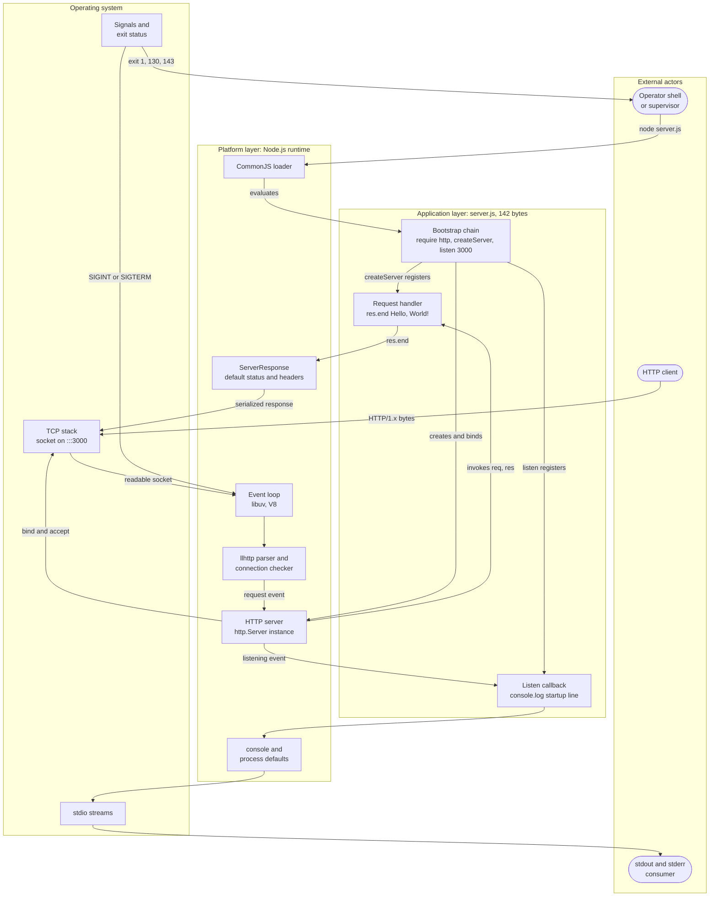

### 5.2.7 State Transition Diagram

The diagram covers the `http.Server` instance, with the states of each request–response exchange nested inside Listening. Several exchanges, on different connections, can be in progress at once. Each one finishes within a single synchronous handler call. The process lifecycle and the TCP connection lifecycle are diagrammed in Section 4.4.6.

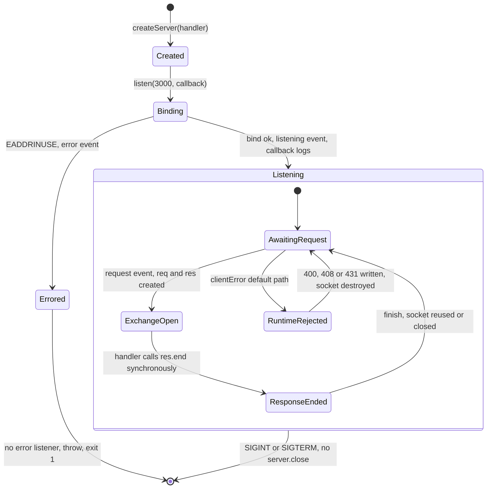

| State | `server.listening` | Notes |
|---|---|---|
| Created | `false` | The server object exists but no socket is bound |
| Binding | `false` | `listen` has been called; the OS bind is in progress |
| Listening | `true` | Startup line printed; exchanges are being served |
| Errored | `false` | `'error'` was emitted with no listener; the process is about to exit |

### 5.2.8 Sequence Diagrams

**Internal request dispatch.** The first diagram shows how a request passes through the platform components to the handler and back. The operator-level startup, keep-alive, failure, and shutdown sequences are in Section 4.4.5.

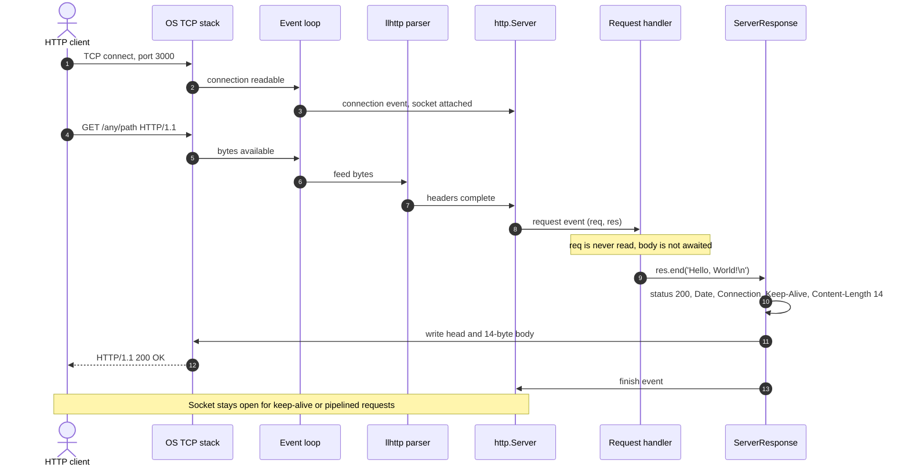

**Protocol cases handled by the runtime.** The second diagram shows requests that the HTTP server resolves itself, either before the handler runs or without running it at all. Each case was observed by probing the running server.

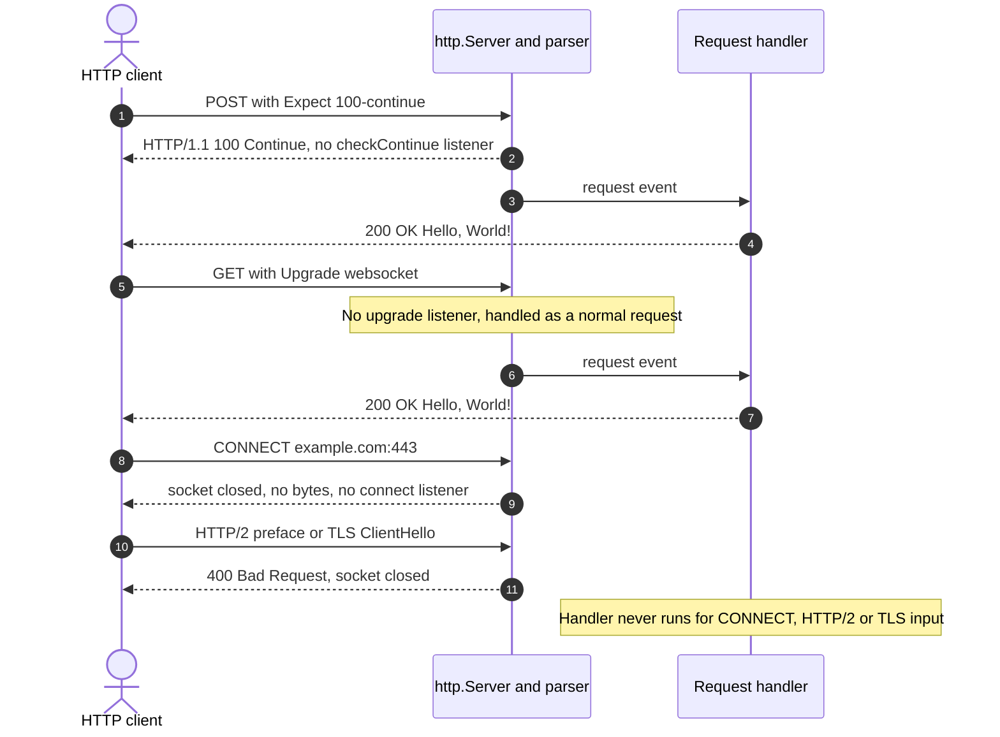

## 5.3 Technical Decisions

The repository holds no architecture decision records, design notes, or descriptive commit messages; its only commit is `70e3ee8` "Add files via upload". Each decision below was therefore reconstructed from `server.js`. The rationales are the most plausible reading for a minimal example server (A-001). Treat them as inferred, not stated by the authors.

### 5.3.1 Architecture Style Decisions and Tradeoffs

| Decision | Choice in `server.js` | Benefit | Tradeoff |
|---|---|---|---|
| Program structure | One CommonJS statement in one file | Smallest possible artefact, with nothing to build or install | Not modular and not importable, so it cannot be unit-tested. Every change edits the same line (C-001) |
| Framework | Built-in `http` only; no framework such as Express or Fastify | No install step and no third-party supply chain | No routing, middleware, or content negotiation |
| Process model | One process on one event loop | No coordination, IPC, or shared state | JavaScript uses one CPU core. A process failure is a full outage |
| State | Stateless, constant response | Instances are interchangeable, and a restart loses nothing | Any change in behaviour needs a code change |
| Configuration | Literals for the port and the text | Nothing to misconfigure | Cannot adapt to a platform-assigned port, and the startup message cannot follow the actual bind (C-002) |
| Protocol and error behaviour | Left to Node.js defaults | No code to write | Behaviour may change with the Node.js version (A-003). No `Content-Type` is sent |

### 5.3.2 Communication Pattern Choices

| Pattern | Used For | Justification | Implication |
|---|---|---|---|
| Synchronous HTTP request–response | Client interface | Any HTTP client can use it with no SDK or schema | No server push. Each exchange is complete in itself |
| HTTP/1.1 persistent connections (default) | Connection reuse | Saves TCP setup on repeat requests. Reuse was observed, and pipelined requests were answered in order | Each idle socket stays open for about 6 s |
| In-process `EventEmitter` callbacks | Runtime-to-application dispatch | The native Node.js idiom; needs no extra abstraction | An `'error'` event with no listener is fatal (E-01) |
| One-way stdout line | Readiness signal | The simplest notification available | Unstructured, and it names the wrong address (Section 2.4.4) |
| Process exit status | Failure and termination signal | Native to the OS and readable by any supervisor | Codes 1, 130, and 143 must be interpreted externally |

Asynchronous messaging, publish–subscribe, WebSockets, RPC, outbound HTTP, and inter-process communication are not used. `Upgrade` requests are served as plain `200 OK` responses (Section 5.2.8).

### 5.3.3 Data Storage Solution Rationale

The system has no data store. It has no data domain (Section 1.3.2), and its one output is a literal in the source. The consequences of that choice:

| Concern | Consequence |
|---|---|
| Backup and restore | Nothing to back up. The source file in Git is the only artefact that needs preserving |
| Schema and migrations | None |
| Consistency | Holds trivially, because every instance returns the same bytes |
| Horizontal scaling | No shared state to coordinate between instances |
| Recovery point | Not applicable, since no data can be lost (Section 5.4.7) |

### 5.3.4 Caching Strategy Justification

No caching is used at any layer, and none is needed: building the response costs one `res.end` call on a literal. On loopback, sequential requests took 0.173 ms at the median (Section 2.4.3), so a cache could not make the service measurably faster but would add complexity.

| Layer | Cache Present | Note |
|---|---|---|
| Application memory | No | The literal is the response; no memoisation exists |
| HTTP caching headers | No | No `Cache-Control`, `ETag`, `Last-Modified`, or `Expires` is sent. The `Date` header changes with every response |
| Reverse proxy or CDN | Not defined | The repository has no deployment configuration (Section 3.6.4) |
| Connection reuse | Yes (keep-alive) | The only reuse mechanism. It reuses connections, not response data |

### 5.3.5 Security Mechanism Selection

The application implements no security mechanism of its own. The protection that exists comes from runtime defaults, plus the fact that the request is never read.

| Concern | Mechanism Present | Provided By | Note |
|---|---|---|---|
| Authentication / authorisation | None | — | Every client is anonymous and treated the same (Section 5.4.5) |
| Transport security | None. Plain TCP; a TLS ClientHello gets `400 Bad Request` | — | TLS must be terminated outside the process (C-003) |
| Network exposure | Bound on `::`, every interface | `listen(3000)` with no host | Exposed beyond loopback even though the startup message says otherwise. Restrict with host or network firewalling |
| Input handling | The request is never read, parsed, or echoed | Request handler | The application code has no injection or reflection surface |
| Protocol abuse limits | 16384-byte header cap, 60 s `headersTimeout`, 300 s `requestTimeout` | Node.js defaults | No rate limiting, connection cap, or body-size limit |
| Secrets management | Not needed | — | No credentials, keys, or environment variables are read |
| Supply chain | No third-party packages | Zero-dependency design | Node.js is the only dependency; security fixes arrive with runtime upgrades |
| Security response headers | None | — | No HSTS, CSP, or `X-Content-Type-Options` |

### 5.3.6 Decision Tree: Placement of Concerns

Use this tree to find which layer owns a behaviour, and so where a change would have to be made. Most concerns end at a runtime default or at an external component.

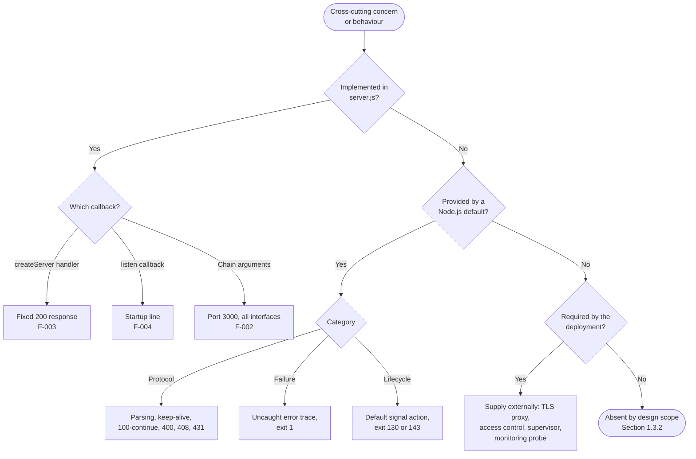

### 5.3.7 Architecture Decision Records

All the records below have the status **Accepted (inferred from the as-built code, commit `70e3ee8`)**. None was written by the authors.

| ADR | Decision | Context and Inferred Rationale | Consequences |
|---|---|---|---|
| ADR-001 | Use the built-in `http` module with no dependencies | A minimal server needs no routing or middleware | No install step. HTTP/1.x only; HTTP/2 and TLS are not available (C-003) |
| ADR-002 | Write the program as one CommonJS statement | The smallest program that serves HTTP | No manifest, no `engines` range, and nothing to import or test (C-001, C-006). Fails in an ES module scope (E-02) |
| ADR-003 | Return a constant response and ignore the request | The output is meant to demonstrate the server, not to serve data | Stateless and interchangeable instances. No `Content-Type`, no routing (C-002) |
| ADR-004 | Hard-code port 3000 and omit the host | A conventional development port, with no configuration needed | One instance per network namespace. Bound on every interface while the message names `127.0.0.1` (C-002) |
| ADR-005 | Leave errors, protocol details, and signals to runtime defaults | Error-handling code would outweigh the program itself | Bind failures are fatal and nothing is drained on shutdown (C-004). Client errors are answered with no logging |
| ADR-006 | Use the startup line as the only telemetry | Interactive use: an operator reads the terminal | No request log, metrics, or health endpoint (Section 5.4.1) |

The diagram shows how the records build on each other and which constraints from Section 2.6.2 each one produces.

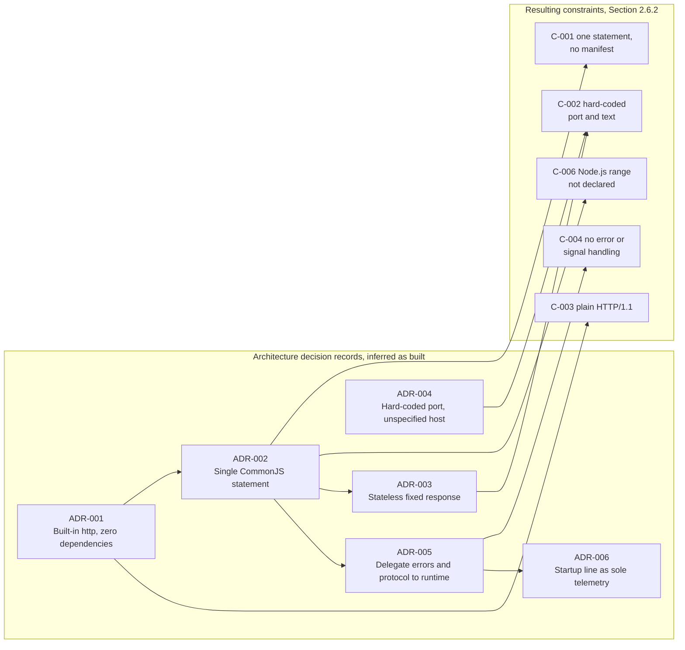

## 5.4 Cross-Cutting Concerns

`server.js` implements no cross-cutting concern itself. Each concern below is either a Node.js default or missing. Where it is missing, the table states what an external component would have to supply.

### 5.4.1 Monitoring and Observability Approach

The process is not instrumented: no metrics, health endpoint, or APM agent exists (Section 3.4). Every observable signal comes from runtime or OS behaviour, or from probing the process from outside.

| Signal | Available | Source | Use |
|---|---|---|---|
| Readiness | Yes | Startup line on stdout (listen callback) | A log watcher can treat the line as the ready signal. It is printed only after a successful bind |
| Liveness | Yes, implicitly | Any HTTP request on port 3000 returns `200 OK` | An HTTP probe on any path shows that the event loop is answering |
| Port reachability | Yes | OS TCP stack | A TCP connect check on port 3000 |
| Termination cause | Yes | Process exit status | 1 for a startup failure, 130 for `SIGINT`, 143 for `SIGTERM` |
| Metrics (request count, latency, errors) | No | — | Must be measured outside the process (Section 1.2.3) |
| Dedicated health or readiness endpoint | No | — | Every path returns the same response, so probes cannot tell a degraded state from a healthy one |
| Runtime-rejected requests (`400`, `408`, `431`) | No | — | Visible only to the client that receives them |

### 5.4.2 Logging and Tracing Strategy

| Aspect | Current State |
|---|---|
| Log destinations | stdout for the startup line; stderr for runtime stack traces |
| Format | Plain text with no timestamp, level, or structure |
| Volume | One line per process start. After 200 requests, stdout still held only the startup line |
| Request / access logging | None |
| Application error logging | None. Client errors (E-03 to E-05) and signal stops (E-06) leave no log entry |
| Correlation and distributed tracing | None. No request ID is generated, and no `traceparent` or similar header is read or propagated |
| Rotation and retention | Not applicable in the process; handled by whatever collects stdout and stderr |

### 5.4.3 Error Handling Patterns

The code has no `try`/`catch` and no `'error'`, `'clientError'`, `uncaughtException`, or signal listeners (C-004). Section 4.3.2 gives the full mechanism inventory and recovery steps.

| Error Class | Errors | Handling Layer | Pattern |
|---|---|---|---|
| Startup failure | E-01 `EADDRINUSE`, E-02 ES module scope | Runtime uncaught-exception path | Fail fast: stack trace on stderr, exit 1, manual recovery |
| Protocol and client errors | E-03 `400`, E-04 `431`, E-05 `408` | `http.Server` default `clientError` handling | Reject and close. Non-fatal and silent; the server keeps listening |
| Termination | E-06 `SIGINT` / `SIGTERM` | OS and runtime default signal action | Immediate stop: no drain, no log line |
| Handler exception | None observed. The handler only calls `res.end` on a literal | Not handled | *Inferred:* if code added to the handler threw, nothing would catch it, so it would be uncaught and end the process |

Retry, back-off, circuit breaking, fallback responses, graceful degradation, and supervised restart are all absent.

### 5.4.4 Error Handling Flow

The flow assigns each error path to the layer that handles it. The application layer intercepts nothing, so every path is decided by Node.js defaults and then ends with the operator or the client. Section 4.4.4 shows the same errors in operational order, including the manual restart loop.

```mermaid
flowchart TD
    ORG(["Error raised"]) --> L1{"Raised before<br/>listening?"}
    subgraph APH["Application layer: server.js"]
        A0["No try/catch, no error,<br/>clientError or signal listeners"]
    end
    subgraph RTH["Platform layer: Node.js runtime defaults"]
        R1{"error listener<br/>on http.Server?"}
        R2["Uncaught exception<br/>reaches top level"]
        R3["Stack trace to stderr"]
        R4{"clientError listener<br/>on http.Server?"}
        R5["Default response<br/>400, 408 or 431"]
        R6["Socket destroyed"]
        R7["Default signal action<br/>no drain"]
    end
    subgraph OPH["Operator and client layer"]
        O1["Exit code 1<br/>fix cause, rerun manually"]
        O2["Client corrects request<br/>and decides on retry"]
        O3["Exit 130 or 143<br/>manual restart"]
    end
    L1 -- "Yes" --> L3{"Error type?"}
    L3 -- "E-01 EADDRINUSE" --> R1
    L3 -- "E-02 ReferenceError<br/>in ES module scope" --> R2
    R1 -- "No" --> R2
    R2 --> R3 --> O1
    L1 -- "No" --> L2{"Request parse<br/>or header timeout?"}
    L2 -- "Yes: E-03 to E-05" --> R4
    R4 -- "No" --> R5 --> R6 --> O2
    R6 --> KEEP(["Server keeps listening"])
    L2 -- "No: E-06 signal" --> R7 --> O3
    A0 -. "nothing intercepts" .-> R1
    A0 -. "nothing intercepts" .-> R4
```

### 5.4.5 Authentication and Authorization Framework

There is no authentication or authorisation framework. The handler never reads `req`, so it inspects no credentials, cookies, tokens, or client addresses, and keeps no sessions or roles. Every client gets the same response on every path. The Auth0 option in the default stack is not used (Section 3.4).

If a deployment needs access control, it has to be added in front of the process, for example with an authenticating reverse proxy or API gateway. *Inferred:* the process binds every interface (`::`), so a proxy alone does not stop clients connecting to port 3000 directly. Host or network firewalling must also restrict that port.

### 5.4.6 Performance Requirements and SLAs

The repository defines no performance requirements, SLAs, or benchmarks. The figures below are baselines from a single verification host. They are not targets (A-004).

| Metric | Observed Value | Conditions |
|---|---|---|
| Sequential latency | p50 0.173 ms, p95 0.316 ms, max 3.968 ms | 200 sequential `curl` requests over loopback (Section 2.4.3) |
| Concurrent throughput | About 35,800 requests/s | 20,000 `GET /` requests from a Node.js client using 50 keep-alive sockets on the same 44-CPU host; no errors |
| Concurrent latency | p50 1.049 ms, p95 2.241 ms, p99 4.317 ms, max 27.821 ms | Same run |
| Startup time | 25.9–28.5 ms from spawn to the startup line | 5 runs |
| Resident memory | About 57 MB while serving; about 62 MB after the load run | Process RSS |
| Threads | 7 OS threads; JavaScript runs on one | Process inspection |

Because the load generator shared CPUs with the server, the throughput figure is a rough lower-bound indication for this host only.

**Scalability implications**

- **Vertical:** Request handling is bound by the single JavaScript thread. More cores do not help unless clustering is added, and `server.js` has none.
- **Horizontal:** The handler is stateless, so instances are interchangeable behind any load distribution. The fixed port allows only one instance per host or network namespace (E-01), so scaling out needs separate hosts or containers and a load balancer. None of these is defined in the repository (Section 3.6.4).
- **Connection limits:** Connections and requests per socket are unbounded. Idle keep-alive sockets close after about 6 s. Slow header senders are cut off at 60–90 s (Section 5.2.2).

### 5.4.7 Disaster Recovery Procedures

The repository has no disaster-recovery plan, backups, or replicas. Because the system is stateless, recovery means restoring the source and the runtime and then restarting the process.

| Objective | Value | Basis |
|---|---|---|
| Recovery Point Objective (RPO) | Not applicable | No data is stored, so none can be lost (Section 5.3.3) |
| Recovery Time Objective (RTO) | Not defined | No supervisor or restart policy exists, so recovery time depends on operator reaction. Startup takes about 26–29 ms |

| Scenario | Impact | Recovery Procedure |
|---|---|---|
| Startup crash (E-01, E-02) | Service unavailable; no data lost | Free port 3000, or fix the module scope, then rerun `node server.js` (Section 4.3.2) |
| Process terminated (E-06) | In-flight requests dropped | Rerun `node server.js`; clients resend their requests |
| Host loss | Full outage | Provision a host with Node.js, check out or copy `server.js`, open TCP port 3000, and run `node server.js` |
| Loss of the local checkout | None while the remote exists | Clone the GitHub-hosted remote. The `main` branch holds an identical tree (Section 3.6.1) |
| Behaviour change after a runtime upgrade | Response or timeout behaviour may differ (A-003) | Rerun the acceptance checks in Sections 1.2.3 and 2.5. If they fail, roll back to a known-good runtime; v22.23.3 is verified |

## 5.5 References

**Repository files and folders**

- `server.js` - The entire implementation: the bootstrap chain (`require('http').createServer(...).listen(3000, ...)`), the inline request handler that returns `Hello, World!\n`, and the inline listen callback that logs `Server running at http://127.0.0.1:3000/`. Its absence of error, signal, and configuration handling is the basis for every component, decision, and cross-cutting finding in this section
- `` (repository root) - Contains only `server.js`: no manifest, lockfile, tests, CI, container, or deployment configuration. This establishes the zero-dependency, single-file architecture and the absence of data stores, monitoring, and DR artefacts

**Runtime evidence.** Runtime behaviour was observed by running `server.js` on Node.js v22.23.3. Observed items include the `::` bind, server defaults, the protocol edge cases (`100-continue`, `Upgrade`, `CONNECT`, HTTP/2 preface, TLS bytes, pipelining), throughput and latency baselines, startup time, memory, and thread count. These observations are environment-specific (A-003, A-004).

**Cross-referenced Technical Specification sections**

- Section 1.2 System Overview - Component names, the limitations table, and the context and sequence diagrams
- Section 1.3 Scope - Out-of-scope concerns (data, security, configuration, observability, scaffolding)
- Section 2.3 Feature Relationships - Feature dependency map, integration points, and shared components
- Section 2.4 Implementation Considerations - Per-feature performance, scalability, and security considerations, and the conflicting evidence on `127.0.0.1` versus `:::3000`
- Section 2.5 Traceability Matrix - Acceptance checks used in the recovery procedures
- Section 2.6 Assumptions, Constraints and Requirement Versioning - Assumptions A-001 to A-005 and constraints C-001 to C-006
- Section 3.3 Open Source Dependencies - Zero third-party packages
- Section 3.4 Third-Party Services - No external services, authentication, monitoring, or cloud providers
- Section 3.6 Development & Deployment - Execution model, container requirements, and the Git remote
- Section 4.1 System Workflows - Workflows W-01 to W-03, decision points D-01 to D-09, error paths E-01 to E-06, and the event table
- Section 4.3 Technical Implementation - State, persistence, and caching tables; error mechanism inventory and recovery procedures
- Section 4.4 Required Diagrams - Operational flowcharts, sequences, and process and connection state diagrams that complement the architectural diagrams here

# 6. SYSTEM COMPONENTS DESIGN

## 6.1 Core Services Architecture

### 6.1.1 Applicability Statement

**Core Services Architecture is not applicable for this system.**

SimpleJS is a single-process, event-driven monolith (Section 5.1.1). The entire system is one 142-byte CommonJS statement in `server.js`. It creates one `http.Server`, binds TCP port 3000 on every interface, and answers every request with a constant `Hello, World!\n` body:

```javascript
require('http').createServer((req,res)=>res.end('Hello, World!\n'))
  .listen(3000,()=>console.log('Server running at http://127.0.0.1:3000/'));
```

*(Wrapped for readability. In the file it is a single line.)*

None of the conditions that would call for a services architecture is present at commit `70e3ee8`:

| Criterion | Expected in a Services Architecture | Observed in SimpleJS | Evidence |
|---|---|---|---|
| Multiple deployable units | Two or more services, each deployed on its own | One file run as one OS process. `server.js` is the only tracked file on every tracked branch | `server.js`; Section 3.6.3 |
| Inter-service calls | Outbound HTTP, RPC, or messaging between services | None. The only import is `http`, used solely to serve, and the handler performs no I/O | `server.js`; Section 5.3.2 |
| Distributed state | Shared or replicated data that needs coordinating | None. No data store exists, and the response is a literal | Section 5.3.3 |
| Deployment topology | Manifests that declare services, replicas, and networks | None. No Dockerfile, Compose file, Kubernetes manifest, Helm chart, or Terraform module | Section 3.6.4 |
| Service wiring configuration | Endpoints, ports, or credentials supplied at runtime | None. The port `3000` and both strings are hard-coded (C-002), and no environment variable is read | `server.js`; Section 3.6.3 |

The four parts of `server.js` (the bootstrap chain, `http.Server`, the request handler, and the listen callback; Section 5.1.2) are in-process callbacks wired together through `EventEmitter` events. They are not services. They share one V8 heap and one event-loop thread. None of them can be deployed, scaled, or restarted on its own, and they all fail together.

#### 6.1.1.1 How the Remaining Sub-sections Are Used

Sections 6.1.2 to 6.1.4 take each area listed for this section and record how the code currently behaves: what is missing, what Node.js defaults supply, and what a deployment would have to provide from outside the process. Statements that are inferred rather than observed are marked *Inferred*. Measurements come from a single verification host running Node.js v22.23.3 (assumption A-003). They are baselines, not targets (assumption A-004).

#### 6.1.1.2 Re-evaluation Triggers

This section would become applicable if any of the following changes were made. The repository contains no plans for any of them (Section 1.3.2).

| Change to the Codebase or Deployment | Areas That Would Become Applicable |
|---|---|
| A second deployable service is added, or `server.js` is split into units deployed separately | Service boundaries, inter-service communication, service discovery |
| The handler starts making outbound calls (HTTP, a database, a message broker) | Timeouts, retry with back-off, circuit breaking, fallback responses |
| Deployment manifests declaring more than one replica are added | Load balancing, health checks, auto-scaling, failover |
| The port becomes configurable, or the `cluster` module is introduced | Several instances per host; using more than one CPU core |
| Persistent or shared state is introduced | Data redundancy, replication, recovery point objectives |

### 6.1.2 Service Components

The system has one service component: the Node.js process running `server.js`. Each area below is described as it stands in that one process.

#### 6.1.2.1 Service Boundaries and Responsibilities

The service boundary is the process boundary. Inbound HTTP on port 3000, the operator's start command, and OS signals cross it on the way in. HTTP responses, one stdout line, stderr traces, and the exit status cross it on the way out (Section 5.1.1).

| Unit Inside the Boundary | Responsibility | Independently Deployable |
|---|---|---|
| Bootstrap chain (top-level statement) | Composition root. Loads `http`, creates the server, binds port 3000 | No. It is the module itself |
| HTTP server (`http.Server`) | Accepts connections, parses HTTP/1.x, manages keep-alive, sends the default `400`/`408`/`431` responses | No. It is a runtime object created by the bootstrap chain |
| Request handler | Ends every response with the fixed 14-byte body | No. It is an inline callback |
| Listen callback | Prints the startup line once the bind succeeds | No. It is an inline callback |
| Node.js runtime | Hosts the process: event loop, module loader, signal and uncaught-exception defaults | Installed on the host. No version is pinned (C-006) |

#### 6.1.2.2 Inter-Service Communication Patterns

There is no communication between services, because there is only one service. Every communication path that does exist is listed below.

| Path | Pattern | Mechanism |
|---|---|---|
| HTTP client → process | Synchronous request–response | HTTP/1.1 or HTTP/1.0 over plain TCP. Connections are kept alive and pipelined requests are answered in order by default (Section 5.3.2) |
| Runtime → application code | In-process event dispatch | The `'request'` and `'listening'` events on the `EventEmitter` invoke the two inline callbacks |
| Process → operator | One-way output | The startup line on stdout, stack traces on stderr, and exit codes 1, 130, or 143 |
| Process → any other system | None | No outbound HTTP client, IPC, message broker, RPC, or database driver |

#### 6.1.2.3 Service Discovery Mechanisms

None. The service's address is static: the literal `3000` passed to `listen()` with no host, which binds `::` and therefore every interface. The repository has no service registry, DNS-SRV record, sidecar, or environment-provided endpoint, so clients must learn the host and port some other way.

The startup line cannot be used as an advertised address. It always prints `http://127.0.0.1:3000/` and is not built from the actual bind (Section 2.4.4). *Inferred:* a platform that assigns ports dynamically can reach the service only by mapping its assigned port to 3000, because the port cannot be set at runtime (Section 1.3.2).

#### 6.1.2.4 Load Balancing Strategy

No load balancing exists at any layer.

- **Inside the process.** One listening socket feeds one event loop. All connections are accepted and served on the single JavaScript thread. There are no `cluster` workers or worker threads (Section 5.2.5).
- **Outside the process.** The repository defines no load balancer, reverse proxy, API gateway, or orchestrator (Section 3.6.4).

*Inferred:* properties that matter if a load balancer is placed in front of several instances:

| Property | Implication for a Load Balancer |
|---|---|
| Stateless, identical responses | Any algorithm works (round robin, least connections) and no session affinity is needed |
| Every path returns `200 OK` | A health check on any path confirms only that the process is answering. It cannot detect a degraded state (Section 5.4.1) |
| Idle keep-alive sockets close after about 6 s (5000 ms `keepAliveTimeout` + 1000 ms buffer) | Upstream idle timeouts on the balancer should be shorter than this, so the balancer does not reuse a connection the server is closing |
| Bound on every interface | Clients can still reach port 3000 directly unless host or network firewalling blocks it (Section 5.4.5) |

#### 6.1.2.5 Circuit Breaker Patterns

Not applicable. The process calls no downstream dependency, so there is nothing for a circuit breaker to protect. The code contains no circuit-breaker library or logic. The only inbound protection is the runtime's default limits: a 16384-byte header cap, a 60 s `headersTimeout`, and a 300 s `requestTimeout` (Section 5.3.5). These are parser safeguards, not circuit breaking.

#### 6.1.2.6 Retry and Fallback Mechanisms

| Mechanism | Present | Behaviour |
|---|---|---|
| Server-side retry of downstream calls | No | The handler makes no call that could be retried |
| Retry on startup failure | No | A bind conflict throws an unhandled `EADDRINUSE`, and the process exits with code 1 with no retry or back-off (E-01) |
| Supervised restart | No | No supervisor, unit file, or restart policy exists (Section 5.4.7) |
| Fallback response | No | The response is constant. The only other responses are the runtime's default `400`, `408`, and `431` (E-03 to E-05) |
| Client-side retry | Outside the system | Clients decide whether to retry. *Inferred:* the handler has no side effects, so retrying any method returns the same response and changes nothing on the server |

#### 6.1.2.7 Service Interaction Diagram

The diagram shows the system as built: one process with no peers. Dashed edges show integrations that a services architecture would have and that are absent from the repository.

```mermaid
flowchart LR
    subgraph CALLERS["External actors"]
        CL(["HTTP clients"])
        OP(["Operator shell<br/>or supervisor"])
        LC(["stdout and stderr<br/>consumer"])
    end
    subgraph UNIT["Single deployable unit: one Node.js process running server.js"]
        RT["Node.js runtime<br/>loader, event loop, signals"]
        SRV["http.Server<br/>bound on :::3000"]
        HND["Request handler<br/>fixed 200 response"]
        LCB["Listen callback<br/>startup line"]
        RT -- "evaluates bootstrap chain" --> SRV
        SRV -- "request event<br/>in-process callback" --> HND
        SRV -- "listening event" --> LCB
    end
    subgraph ABSENT["Not present in repository"]
        PEER["Peer services"]
        REG["Service registry<br/>or discovery"]
        LB["Load balancer<br/>or API gateway"]
        BRK["Message broker<br/>or data store"]
    end
    CL -- "HTTP/1.x to fixed port 3000" --> SRV
    HND -- "200 OK, Hello, World!" --> CL
    OP -- "node server.js,<br/>SIGINT or SIGTERM" --> RT
    LCB -- "one stdout line" --> LC
    RT -- "stack trace, exit status" --> LC
    HND -. "no outbound calls" .-> PEER
    CL -. "no lookup, address<br/>known out of band" .-> REG
    CL -. "not defined" .-> LB
    HND -. "no I/O" .-> BRK
```

### 6.1.3 Scalability Design

The repository contains no scalability design. This sub-section sets out the limits the code imposes and the scaling behaviour observed on the verification host (Node.js v22.23.3, 44 CPUs). Because the load generator ran on the same host, the throughput figures are rough lower bounds for that host only (A-004).

#### 6.1.3.1 Horizontal and Vertical Scaling Approach

| Dimension | As Built | Limiting Factor | Reference |
|---|---|---|---|
| Vertical: CPU | Request handling runs on one JavaScript thread. `cluster` and `worker_threads` are not used, so extra cores give no extra throughput | The server process used about 0.81 CPU core while serving about 44,800 requests/s | Section 5.2.5 |
| Vertical: memory | No memory demand beyond the runtime baseline. No heap flags are set | RSS of 57–64 MB was observed | Section 5.4.6 |
| Horizontal: same host and network namespace | Not possible | A second process cannot bind port 3000 and exits with `EADDRINUSE`, code 1 | E-01; C-002 |
| Horizontal: separate namespaces or hosts | Possible. Three instances ran at the same time, one in the host namespace and two in separate network namespaces, all on port 3000, and each answered `200 OK` | Traffic distribution and provisioning must come from outside. The repository defines neither | Section 3.6.4 |

Statelessness is the property that makes scaling out possible. Instances share nothing, hold no sessions, and return identical bytes, so no coordination, replication, or affinity is needed between them (Section 5.3.3).

#### 6.1.3.2 Auto-Scaling Triggers and Rules

None are defined. The repository has no orchestrator, scaling policy, or metrics endpoint. The process exposes no request counters, latency figures, or queue depth (Section 5.4.1).

*Inferred:* an external autoscaler could use only signals observed from outside the process:

| Candidate Signal | Source | Caveat |
|---|---|---|
| Process CPU close to one core | Host or container metrics | One core is the ceiling for each instance, so sustained values near 1.0 mean it is saturated |
| Open connection count | Host TCP statistics | The application sets no connection cap (`maxConnections` is unset) |
| External probe latency | Synthetic HTTP checks on any path | Every path returns `200`, so the probe measures latency but cannot detect errors |

Startup takes 25.9–28.5 ms from spawn to the startup line, so adding an instance takes about as long as the platform needs to provision it (*Inferred*).

#### 6.1.3.3 Resource Allocation Strategy

No resource is allocated explicitly. Every value below is a runtime default or a property of the code, and no container CPU or memory limit is defined (Section 3.6.4).

| Resource | Allocation | Source |
|---|---|---|
| CPU | Not limited by the application. In practice one core, for the JavaScript thread | Runtime threading model |
| Memory | Default V8 heap sizing, with no `--max-old-space-size`. RSS was about 57 MB while serving and about 64 MB after a 100,000-request run | Runtime default |
| Threads | 7 OS threads. The libuv thread-pool size is the default, because `UV_THREADPOOL_SIZE` is not set | Runtime default |
| Connections | Unbounded: `maxConnections` is unset and `maxRequestsPerSocket` is 0 | `http.Server` defaults (Section 5.2.2) |
| Connection lifetime | Idle keep-alive sockets last about 6 s. `headersTimeout` is 60 s, `requestTimeout` 300 s, and the socket `timeout` 0 (disabled) | `http.Server` defaults (Section 5.2.2) |
| Network port | One fixed TCP port, 3000, per network namespace | `server.js` (C-002) |

#### 6.1.3.4 Performance Optimization Techniques

| Technique | Status | Note |
|---|---|---|
| Constant-cost handler | Present (intrinsic) | One synchronous `res.end` on a literal, with no I/O and no dependence on the input |
| Fixed-length response | Present (runtime) | `Content-Length: 14` is sent and the body is not chunked |
| Connection reuse and pipelining | Present (runtime default) | HTTP/1.1 keep-alive. Pipelined requests on one socket are answered in order |
| Not waiting for the request body | Present (intrinsic) | The handler responds as soon as the headers are parsed (Section 5.2.3) |
| Response caching | Absent | Not needed. Building the response already costs almost nothing (Section 5.3.4) |
| Compression, HTTP/2, CDN | Absent | HTTP/1.x only (C-003). No proxy is defined |
| Multi-core use (`cluster`) | Absent | One event loop per process |

#### 6.1.3.5 Capacity Planning Guidelines

The repository defines no capacity targets. The observed baselines are:

| Metric | Observed Value | Conditions |
|---|---|---|
| Throughput, run 1 | About 35,800 requests/s, no errors | 20,000 `GET /` requests, 50 keep-alive sockets (Section 5.4.6) |
| Throughput, run 2 | About 44,800 requests/s, no errors | 100,000 `GET /` requests, 50 keep-alive sockets; the server used about 0.81 CPU core |
| Concurrent latency | p50 1.049 ms, p95 2.241 ms, p99 4.317 ms, max 27.821 ms | Run 1 |
| Memory per instance | 57–64 MB RSS | While serving and after load |
| Startup time | 25.9–28.5 ms | 5 runs |

*Inferred* guidelines that follow from these baselines and the code's constraints:

1. **Plan for one core per instance.** Giving an instance more cores does not raise its throughput unless the code is changed.
2. **Size the instance count from measurements on the target hardware.** Divide the expected peak requests per second by the measured per-instance throughput. Each instance is a complete failure domain (Section 6.1.4), so add at least one spare instance.
3. **Set memory limits above the observed RSS.** The 57–64 MB figures are the floor, not a recommended limit.
4. **Plan connection capacity at the OS level.** The application caps nothing, so the host's file-descriptor and socket limits decide how many concurrent connections it can hold.
5. **Plan one instance per network namespace.** Use containers or separate hosts, and publish or map port 3000 for each one (Section 3.6.4).
6. **Measure again after any runtime upgrade.** All the limits and timeouts are Node.js defaults that can change between versions (A-003).

#### 6.1.3.6 Scalability Architecture Diagram

The namespace isolation and the bind conflict shown below were both observed on the verification host. The external load balancer is not part of the repository. It is shown, as inferred, only to mark where traffic distribution would have to sit.

```mermaid
flowchart TB
    subgraph EXTD["Traffic distribution: not defined in repository"]
        LB["External load balancer<br/>or orchestrator, inferred"]
    end
    subgraph NSA["Host or network namespace A"]
        IA["Instance A<br/>node server.js on :::3000"]
        IA2["Second process<br/>in namespace A"]
        ERR["EADDRINUSE<br/>exit code 1"]
        IA2 -- "bind :::3000 again" --> ERR
    end
    subgraph NSB["Network namespace B"]
        IB["Instance B<br/>node server.js on :::3000"]
    end
    subgraph NSC["Network namespace C"]
        IC["Instance C<br/>node server.js on :::3000"]
    end
    subgraph PERI["Per-instance resource profile, observed"]
        EL["One JavaScript thread<br/>about 0.8 CPU core at peak"]
        MEM["57 to 64 MB RSS<br/>7 OS threads"]
        CON["Connections and requests<br/>per socket unbounded"]
    end
    LB -. "stateless, any instance" .-> IA
    LB -. "stateless, any instance" .-> IB
    LB -. "stateless, any instance" .-> IC
    IA --> EL
    EL --- MEM
    EL --- CON
```

### 6.1.4 Resilience Patterns

`server.js` contains no resilience code: no `try`/`catch`, no `'error'`, `'clientError'`, `uncaughtException`, or signal listener, and no reference to the server object that could be used to call `server.close()` (C-004; Section 5.2.1). Whatever resilience exists comes from Node.js defaults and from the system being stateless.

#### 6.1.4.1 Fault Tolerance Mechanisms

| Fault | Handling | Effect on the Service | Reference |
|---|---|---|---|
| Malformed request line, oversized headers, slow headers | Runtime default `clientError` path sends `400`, `431`, or `408`, then destroys the socket | Contained to one connection. The server keeps listening and nothing is logged | E-03, E-04, E-05 |
| Port 3000 already bound | `'error'` is emitted with no listener, so it is thrown | The process exits with code 1 before serving anything. No startup line is printed | E-01 |
| Loaded in an ES module scope | `ReferenceError: require is not defined` | The process exits with code 1 | E-02 |
| `SIGINT` / `SIGTERM` | Default signal action | Immediate exit with code 130 or 143. In-flight requests are dropped and nothing is drained | E-06 |
| Exception in the handler | Not handled. None was observed, because the handler only calls `res.end` on a literal | *Inferred:* it would be uncaught and end the process | Section 5.4.3 |
| Loss of the instance or host | No redundancy | Full outage. The single instance is a single point of failure | Section 5.3.1 |

#### 6.1.4.2 Disaster Recovery Procedures

The repository has no disaster-recovery plan. The recovery objectives and per-scenario procedures are in Section 5.4.7: the Recovery Point Objective is not applicable, because no data exists, and no Recovery Time Objective is defined, because there is no supervisor. Recovering from host loss takes these steps:

1. Provision a host with a Node.js runtime that supports CommonJS. v22.23.3 is the verified version (C-006).
2. Get `server.js` from the GitHub-hosted remote. The `main` branch holds a tree identical to the documented checkout (Section 3.6.1).
3. Make sure TCP port 3000 is free and reachable (A-005). Check that no ancestor `package.json` sets `"type": "module"` (E-02).
4. Run `node server.js` and wait for the startup line, which takes about 26–29 ms.
5. Confirm that `GET /` returns `200 OK` with `Hello, World!` by rerunning the acceptance checks in Sections 1.2.3 and 2.5.

#### 6.1.4.3 Data Redundancy Approach

No runtime data exists, so nothing needs to be replicated or backed up (Section 5.3.3). The only artefact worth preserving is the source file, and its redundancy comes from Git alone:

| Copy | Location | Note |
|---|---|---|
| Documented checkout | Local working tree, branch `jr_br1_0510`, commit `70e3ee8` | Contains only `server.js` |
| Remote branches | GitHub-hosted remote: `main`, `jr_br1_0510`, `jr_br1_0110` | Every one of these trees contains only `server.js` |

No backup schedule, mirror, or retention policy is defined.

#### 6.1.4.4 Failover Configurations

None. The repository has no replica, standby instance, health-checked load balancer, or supervisor configuration (such as a systemd unit, a PM2 file, or a container restart policy).

*Inferred* considerations if failover is added outside the process:

- **No state transfer.** Instances are stateless, so a replacement instance needs nothing from the failed one.
- **Liveness detection only.** Health checks see only whether the process answers HTTP on port 3000, because every path returns `200` (Section 5.4.1).
- **Container stops can stall.** Running as PID 1 in a container without an init process, the process may not stop promptly on `SIGTERM`. Rolling replacement could then wait for the platform's kill timeout (Section 3.6.4).
- **Restarts must not overlap.** A replacement started on the same host and namespace before the old process releases port 3000 fails with `EADDRINUSE` (E-01).

#### 6.1.4.5 Service Degradation Policies

None. The service has a single function, so it is either fully available or down. It has no partial or degraded mode.

| Policy | Status |
|---|---|
| Load shedding or connection cap | Absent: `maxConnections` is unset |
| Rate limiting | Absent (Section 5.3.5) |
| Priority or queue management | Absent. All work runs in order on one event-loop thread |
| Degraded or static fallback response | Absent. The normal response is already a static literal |
| Graceful shutdown or drain | Absent. Signals stop the process immediately (E-06) |
| Slow-client bounds | Runtime defaults only: `headersTimeout` 60 s, enforced within 60–90 s, and `requestTimeout` 300 s. These bound slow senders; they are not overload protection |

*Inferred:* under overload, latency rises as requests queue behind the single JavaScript thread, and no explicit rejection occurs. The system was not load-tested to saturation. The highest latency observed at 50 concurrent connections was 27.821 ms (Section 5.4.6).

#### 6.1.4.6 Resilience Pattern Diagram

The diagram traces each class of fault to its containment scope and its recovery path. Only connection-level faults recover automatically. Every process-level fault becomes a full outage that needs a manual restart. Section 5.4.4 shows the same errors by handling layer.

```mermaid
flowchart LR
    subgraph FLT["Fault"]
        F1["Malformed, oversized<br/>or slow request"]
        F2["Port 3000 in use<br/>or ES module scope"]
        F3["SIGINT or SIGTERM"]
        F4["Process or host loss"]
    end
    subgraph SCP["Containment scope"]
        S1["One connection<br/>400, 431 or 408, socket closed"]
        S2["Whole service<br/>single instance, no replica"]
    end
    subgraph REC["Recovery"]
        R1(["Automatic: server<br/>keeps listening"])
        R2["Manual: operator<br/>reruns node server.js"]
        R3(["Service available<br/>no state to restore"])
    end
    F1 -- "runtime default<br/>clientError path" --> S1
    S1 --> R1
    F2 -- "uncaught error, exit 1" --> S2
    F3 -- "exit 130 or 143,<br/>in-flight requests dropped" --> S2
    F4 -- "full outage" --> S2
    S2 -- "no supervisor, no failover,<br/>no degraded mode" --> R2
    R2 -- "startup about 26 to 29 ms" --> R3
```

### 6.1.5 References

**Repository files and folders**

- `server.js` - The whole system: one CommonJS statement that loads only `http`, creates one `http.Server` with an inline fixed-response handler, binds port 3000 with no host, and logs the startup line. It has no cluster, outbound client, retry, error, or signal handling, and reads no configuration.
- `` (repository root) - Contains only `server.js`. It has no deployment manifests, container or orchestration files, infrastructure code, or service configuration. The same holds for every tracked branch at commit `70e3ee8`.

**Technical Specification cross-references**

- Section 1.3 Scope - Unsupported use cases (several instances on one host, platform-assigned ports) and integration points that are not covered (load balancers, orchestration).
- Section 2.4 Implementation Considerations - Conflicting evidence on the bind address (`127.0.0.1` in the log, `::` in fact), and baseline latency.
- Section 3.6 Development & Deployment - Process model, absence of container and infrastructure definitions, container integration requirements (PID 1 and `SIGTERM`, one instance per network namespace), and the Git remote holding an identical `main` tree.
- Section 5.1 High-Level Architecture - Single-process, event-driven monolith style; system interfaces; in-process `EventEmitter` dispatch with no IPC or outbound RPC.
- Section 5.2 Component Details - `http.Server` defaults (`maxConnections` unset, `maxRequestsPerSocket` 0, keep-alive and timeout values) and runtime threading.
- Section 5.3 Technical Decisions - Process-model tradeoffs, the communication patterns not used, the absence of a data store, caching, and security mechanisms, and constraints C-001 to C-006.
- Section 5.4 Cross-Cutting Concerns - Observability signals, error classes E-01 to E-06, the error handling flow, performance baselines, and disaster-recovery objectives and scenarios.

**Runtime verification (Node.js v22.23.3, 44-CPU verification host)**

- A host-namespace instance and two instances in separate network namespaces ran at the same time on port 3000, and each returned `200 OK`.
- A 100,000-request run over 50 keep-alive sockets completed at about 44,800 requests/s with no errors. The server used about 0.81 CPU core, with an RSS of about 64 MB and 7 OS threads.

## 6.2 Database Design

### 6.2.1 Applicability Statement

**Database Design is not applicable to this system.**

SimpleJS has no database, no persistent storage, and no data domain. The whole system is one 142-byte CommonJS statement in `server.js`, the only tracked file. It loads the built-in `http` module, binds TCP port 3000, and answers every request with the string literal `Hello, World!\n`:

```javascript
require('http').createServer((req,res)=>res.end('Hello, World!\n'))
  .listen(3000,()=>console.log('Server running at http://127.0.0.1:3000/'));
```

*(Wrapped for readability. In the file it is a single line.)*

The handler never reads the request, keeps no variables, and performs no I/O. The system has nothing to store, so it has nothing to model, index, migrate, replicate, or back up. Section 3.5 reaches the same conclusion for the technology stack, and Section 5.3.3 for the architecture.

| Criterion | Expected If a Database Were Used | Observed in SimpleJS | Evidence |
|---|---|---|---|
| Driver, ORM, or storage dependency | A package manifest or a `require` of a database, ORM, cache, or `fs` module | None. `http` is the only module loaded, and there is no manifest | `server.js`; Section 3.3 |
| Schema and migration artefacts | Model classes, schema files, migration scripts, seed data | None. The repository root holds only `server.js` on every tracked branch | Repository root; Section 3.6 |
| Connection configuration | A connection string, credentials, or environment variables | None. No environment variable or configuration file is read, and the port is a literal (C-002) | `server.js` |
| Persistent writes | File or database writes when a request is handled | None. No regular file is opened, and storage-layer writes did not change across 50 requests | Runtime verification (Section 6.2.1.1) |
| State across requests or restarts | Data that outlives an exchange or a process | None. Request data is ignored, and a restarted process returns identical bytes | Runtime verification; Section 4.3.1 |
| Cache tier | An in-memory cache, Redis, or Memcached client | None at any layer | Section 5.3.4 |

#### 6.2.1.1 Runtime Verification

These checks were run against a copy of `server.js` on Node.js v22.23.3 (assumption A-003).

| Check | Observation | Conclusion |
|---|---|---|
| Request content | Three `POST /users?id=N` requests carried a form body with `name` and `secret` fields. Each returned `Hello, World!` | Request data is neither used nor stored |
| Open descriptors | Standard streams, pipes, event-loop descriptors, and one socket. No regular file was open | No file-based store is open |
| Network sockets | The one socket is the listener on `::`, port 3000. No outbound or database connection exists | No remote store is used |
| Write accounting | Over 50 requests, character writes rose only by the bytes of the HTTP responses (about 137 bytes each). Storage-layer writes stayed at 4096 bytes | Handling a request writes nothing to storage |
| Restart | After `SIGTERM` and a restart, `GET /` returned `200 OK` with the same body | Nothing is persisted, and nothing is lost |

#### 6.2.1.2 How the Remaining Sub-sections Are Used

Sections 6.2.2 to 6.2.5 go through each area this section is required to cover. For each one they record that it is absent and give the evidence. Section 6.2.6 holds the required diagrams. They show the transient, in-memory data structures, the data flow, and the absence of any replication tier. Statements that are inferred rather than observed are marked *Inferred*.

#### 6.2.1.3 Re-evaluation Triggers

This section would become applicable if any of the following changes were made. The repository contains no plans for any of them (Section 1.3.2).

| Change to the Codebase | Areas That Would Become Applicable |
|---|---|
| The handler reads request data and stores it, or the response is built from stored data | Entity relationships, data models, indexes, constraints, migrations |
| A database, cache, or file-store client is added as a dependency | Connection pooling, query optimisation, caching policies, access controls |
| Personal or user data is collected | Retention rules, privacy controls, audit mechanisms |
| Several instances share persistent state | Replication, partitioning, read/write splitting, backup architecture (Section 6.1.1.2) |

### 6.2.2 Schema Design

No schema exists. The repository defines no tables, collections, documents, models, or type definitions, and nothing is ever written to a store. Section 6.2.6.1 gives the closest equivalent to an entity diagram: the transient objects that the Node.js runtime creates for each exchange.

#### 6.2.2.1 Schema Design Areas

| Area | Status | Evidence |
|---|---|---|
| Entity relationships | None. There are no persistent entities to relate. The only relationships are runtime ones: a server accepts connections, a connection carries requests, and each request gets one response | `server.js`; Section 4.3.1 |
| Data models and structures | No application data model. The data items are literals in the source and runtime objects for each exchange (Section 6.2.2.2) | `server.js` |
| Indexing strategy | None. There is no store to index | Section 6.2.2.3 |
| Partitioning approach | None. There is no data set to shard or partition. Instances that run in separate network namespaces share nothing | Section 6.1.3.1 |
| Replication configuration | None. No primary, replica, or replication stream exists. Only the source file has copies, in Git | Sections 6.1.4.3, 6.2.6.3 |
| Backup architecture | None. No runtime data exists to back up. Git holds the one artefact worth keeping | Section 5.3.3 |

#### 6.2.2.2 Data Inventory

The table lists every data item the process handles. None is persisted by the application.

| Data Item | Where It Lives | Lifetime | Persisted |
|---|---|---|---|
| Response body `Hello, World!\n` (14 bytes) | String literal in the request handler in `server.js` | The life of the process, in compiled code | Only as source text in Git |
| Startup message `Server running at http://127.0.0.1:3000/` | String literal in the listen callback | Written once to stdout after the bind succeeds | Not by the application. Wherever stdout goes is outside the system |
| Port `3000` | Numeric literal passed to `listen()` | The life of the process | Only as source text |
| Inbound request (method, URL, headers, body) | Parsed by the runtime into an `IncomingMessage`. The handler ignores it and never consumes the body | One exchange | Never. It is not read, stored, or logged |
| Response headers (`Date`, `Connection`, `Keep-Alive`, `Content-Length`) | Generated by the runtime for each response | One exchange | Never |

#### 6.2.2.3 Indexes and Constraints Inventory

| Object Type | Defined | Note |
|---|---|---|
| Primary keys and unique constraints | None | There are no records to identify |
| Foreign keys and referential integrity | None | There are no related records |
| Check, not-null, and default constraints | None | There are no columns or fields |
| Indexes (B-tree, hash, full-text, secondary) | None | There is no store to query |
| Sequences, triggers, stored procedures, views | None | There is no database engine |

The only limits applied to data are HTTP protocol limits, and the Node.js runtime enforces them, not a schema. They are listed here so the inventory is complete (Section 5.3.5).

| Runtime Limit | Value | Applies To |
|---|---|---|
| Maximum header size | 16384 bytes. Larger header blocks are rejected with `431` | Inbound request headers |
| `headersTimeout` | 60 s, enforced within 60–90 s. Slow header blocks are rejected with `408` | Inbound request headers |
| `requestTimeout` | 300 s | The whole inbound request |
| Response length | `Content-Length: 14`, fixed by the literal | Outbound response body |

### 6.2.3 Data Management

No data management process exists, because the system creates, stores, and changes no data. The only managed artefact is the source file `server.js`, and Git manages it.

#### 6.2.3.1 Data Management Areas

| Area | Status | Detail |
|---|---|---|
| Migration procedures | None | There are no schema or data migrations, no migration tool, and no seed scripts. To deploy a new version, replace `server.js` and restart the process. No state exists to carry over: a restarted process served identical bytes (Section 6.2.1.1) |
| Versioning strategy | Source control only | The literal response is versioned with the code. Changing it means editing `server.js` and making a new commit (C-002). The baseline is version 1.0, commit `70e3ee8` (Section 2.6.3). There is no schema version, API version, or data-format version |
| Archival policies | None | No data builds up over time. The process writes one stdout line at startup and nothing for each request, so there are no logs or records to archive |
| Data storage and retrieval | Source file and memory only | Section 6.2.3.2 |
| Caching policies | None | No application cache, cache client, or HTTP caching header (`Cache-Control`, `ETag`, `Last-Modified`, `Expires`) exists. The `Date` header changes with every response (Section 5.3.4) |

#### 6.2.3.2 Data Storage and Retrieval Mechanisms

| Step | Mechanism | Storage Medium |
|---|---|---|
| Startup read | The CommonJS module loader reads `server.js` once when `node server.js` runs | Local file system. This is the only storage read |
| In-memory retention | The handler closure is compiled with the response literal inside it | V8 heap, for the life of the process |
| Retrieval per request | On the `'request'` event the handler calls `res.end` on the literal. No lookup, query, or deserialisation happens | Memory only |
| Inbound data | The runtime parses the request. The application holds no reference to it after the handler returns | Runtime buffers, for one exchange |
| Outbound data | The runtime writes about 137 bytes (headers and body) to the client socket | Network only. Nothing goes to storage |

#### 6.2.3.3 Source Artefact Copies

The table lists every copy of the only artefact that needs to be kept. Each tracked branch has the same Git tree, `717cd75`, and that tree contains only `server.js`.

| Copy | Location | Content |
|---|---|---|
| Documented checkout | Local branch `jr_br1_0510`, commit `70e3ee8` | `server.js` |
| Local `main` | Local branch | Same tree |
| Remote branches | `origin/main`, `origin/jr_br1_0510`, `origin/jr_br1_0110` | Same tree |

No backup schedule, mirror, or retention policy covers these copies (Section 6.1.4.3).

### 6.2.4 Compliance Considerations

The system stores no data, so data-at-rest compliance obligations do not arise. The table records each required area and why it does not apply. Concerns at the network level are listed only where they affect data handling.

#### 6.2.4.1 Compliance Areas

| Area | Status | Basis |
|---|---|---|
| Data retention rules | None needed | Nothing is retained after an exchange. The application writes no record, log entry, or file for each request. No retention period is defined, because nothing exists to expire |
| Backup and fault tolerance policies | None defined | There is no runtime data to back up. The recovery point objective does not apply, and no recovery time objective is defined (Section 5.4.7). A restart loses nothing, because nothing is held (Section 6.2.1.1). Source redundancy comes from Git alone (Section 6.2.3.3) |
| Privacy controls | No personal data is processed | The handler never reads the method, URL, headers, or body, and never logs or echoes them. Client addresses are not recorded. A request body with `name` and `secret` fields was ignored and nothing was written (Section 6.2.1.1) |
| Audit mechanisms | None | The application keeps no request log, access log, or data-change audit trail. The only telemetry is the startup line (Section 5.4.1). Git history is the only record of changes, and it holds one commit, `70e3ee8` "Add files via upload" |
| Access controls | None at the data layer | There are no database users, roles, grants, or credentials, and no secrets are read (Section 5.3.5). There is no authentication or authorisation, so every client gets the same public response |

#### 6.2.4.2 Related Network-Level Considerations

These items are not database controls. They are listed because they are the only places where data handling meets a security boundary.

| Consideration | Current Behaviour | Implication for Data |
|---|---|---|
| Transport encryption | None. Plain HTTP/1.x over TCP (C-003) | Whatever a client sends travels in clear text to port 3000. *Inferred:* TLS would have to end at an external proxy |
| Network exposure | Bound on `::`, so every interface, even though the startup line names `127.0.0.1` (Section 2.4.4) | Restricting who can send data to the process has to be done with host or network firewalling |
| Input data limits | Runtime defaults only (Section 6.2.2.3) | Inbound data is bounded by protocol limits, not by validation rules |

### 6.2.5 Performance Optimization

No data-tier performance work applies, because no data tier exists. Each request costs one synchronous `res.end` call on a literal, with no I/O and no dependence on the request. The table shows how each required area stands.

#### 6.2.5.1 Performance Areas

| Area | Status | Detail |
|---|---|---|
| Query optimisation patterns | Not applicable | No queries exist. Nothing is filtered, joined, sorted, or paginated |
| Caching strategy | None, and not needed | The response is already a constant held in memory, so a cache would add complexity without speeding anything up (Section 5.3.4) |
| Connection pooling | No outbound pool | The process opens no outbound or database connections. The nearest equivalent is inbound HTTP/1.1 keep-alive, a runtime default: client connections are reused, and idle sockets close after about 6 s (5000 ms `keepAliveTimeout` plus a 1000 ms buffer). `maxConnections` is unset, so the number of connections has no cap (Section 5.2.2) |
| Read/write splitting | Not applicable | No reads or writes go to a store, and no replicas exist. Each instance is one process with one event-loop thread |
| Batch processing approach | None | There are no scheduled jobs, bulk loads, or background workers. Pipelined requests on one socket are answered one at a time, in order, not batched (Section 5.3.2) |

#### 6.2.5.2 Observed Baselines

These figures show that performance is bounded by the HTTP runtime, not by data access. They come from the verification host and are baselines, not targets (assumption A-004).

| Measurement | Observed Value | Conditions |
|---|---|---|
| Sequential latency | p50 0.173 ms, p95 0.316 ms | 200 sequential requests over loopback (Section 2.4.3) |
| Concurrent throughput | About 35,800 to 44,800 requests/s, no errors | 50 keep-alive sockets (Sections 5.4.6, 6.1.3.5) |
| Storage I/O for each request | None. Storage-layer writes did not change across 50 requests | Section 6.2.1.1 |
| Memory per instance | 57–64 MB RSS, the runtime baseline. The application caches no data | Section 6.1.3.3 |

### 6.2.6 Required Diagrams

The system has no database, so none of these diagrams shows a database. Each one shows what the code actually does in the area the diagram type covers. All three were checked with the Mermaid CLI and render without errors.

#### 6.2.6.1 Database Schema Diagram

No persistent schema exists. The entity–relationship diagram below shows the only data structures the system handles. They are transient objects that the Node.js runtime owns, and they exist only in memory. None of them has a primary key, foreign key, or index, and none is stored. The attributes come from `server.js` and from the runtime defaults observed on Node.js v22.23.3 (Section 5.2.2).

```mermaid
erDiagram
    HTTP_SERVER ||--o{ CONNECTION : "accepts on port 3000"
    CONNECTION ||--o{ INCOMING_REQUEST : "carries, keep-alive"
    INCOMING_REQUEST ||--|| SERVER_RESPONSE : "answered by"
    HTTP_SERVER {
        string address "bound on ::, all interfaces"
        int port "3000, hard-coded literal"
    }
    CONNECTION {
        int idle_timeout_ms "5000 plus 1000 buffer, default"
        string protocol "HTTP 1.x over plain TCP"
    }
    INCOMING_REQUEST {
        string method "parsed by runtime, never read"
        string url "parsed by runtime, never read"
        string headers "16384-byte cap, never read"
        string body "never consumed"
    }
    SERVER_RESPONSE {
        int status_code "200, runtime default"
        string headers "Date, Connection, Keep-Alive, Content-Length"
        string body "Hello, World! literal, 14 bytes"
    }
```

The cardinalities match observed behaviour:

- A connection can carry no requests at all. This happens when a malformed request line is rejected with `400` before any `'request'` event fires.
- A connection can carry several requests, through keep-alive and pipelining.
- Every request that reaches the handler gets exactly one response.

#### 6.2.6.2 Data Flow Diagram

The only storage access is the module loader reading `server.js` once at startup. After that, data moves only between memory and the network. Dashed edges lead to stores that are not in the repository.

```mermaid
flowchart LR
    subgraph DISK["Durable storage: source only"]
        SRC[("server.js<br/>142 bytes, commit 70e3ee8")]
    end
    subgraph PROC["Node.js process memory"]
        LDR["CommonJS module loader<br/>reads file once at startup"]
        LIT["Compiled handler<br/>holds literal Hello, World!"]
        PRS["llhttp parser<br/>builds IncomingMessage"]
        RES["ServerResponse<br/>200, 14-byte body"]
    end
    subgraph EXT["Exchange boundary"]
        CLI([HTTP client])
        OUT([stdout consumer])
    end
    subgraph NONE["Not present in repository"]
        DB[("Database")]
        CCH[("Cache")]
        FST[("File or object store")]
        LOG[("Request or audit log")]
    end
    SRC -- "read at startup" --> LDR
    LDR -- "evaluates statement" --> LIT
    LDR -- "startup line, once" --> OUT
    CLI -- "request bytes" --> PRS
    PRS -- "request event,<br/>data ignored" --> LIT
    LIT -- "res.end literal" --> RES
    RES -- "response bytes" --> CLI
    LIT -. "no reads or writes" .-> DB
    LIT -. "no lookups" .-> CCH
    LIT -. "no fs use" .-> FST
    PRS -. "nothing logged" .-> LOG
```

#### 6.2.6.3 Replication Architecture

No data replication exists. The only artefact with copies is the source file, held on Git branches whose trees are identical. Running instances, including instances in separate network namespaces (Section 6.1.3.1), are independent copies of the code and share no state. They are not replicas of a data set.

```mermaid
flowchart TB
    subgraph VCS["Code copies held in Git, the only replicated artefact"]
        RMAIN["Remote branch main"]
        RJR1["Remote branch jr_br1_0510"]
        RJR2["Remote branch jr_br1_0110"]
        LOCAL["Local checkout<br/>jr_br1_0510 at 70e3ee8"]
        RJR1 -- "clone or pull" --> LOCAL
    end
    subgraph RUNI["Running instances, each independent"]
        INA["Instance A<br/>node server.js on :::3000"]
        INB["Instance B<br/>separate network namespace"]
    end
    subgraph NOREP["Data replication tier: not present"]
        PRIM[("Primary database")]
        REPL[("Read replica")]
        BAK[("Backup store")]
        PRIM -. "no replication stream" .-> REPL
        PRIM -. "no backup job" .-> BAK
    end
    LOCAL -- "node server.js" --> INA
    LOCAL -- "same file" --> INB
    INA -. "no shared state" .- INB
    INA -. "no connection" .-> PRIM
    INB -. "no connection" .-> PRIM
    RMAIN -. "identical tree" .- RJR1
    RJR2 -. "identical tree" .- RJR1
```

### 6.2.7 References

**Repository files and folders**

- `server.js` - The whole system: one CommonJS statement that loads only `http`, serves the 14-byte literal `Hello, World!\n`, and binds port 3000. It has no database, ORM, cache, or `fs` usage, reads no configuration or credentials, and holds no state.
- `` (repository root) - Contains only `server.js`. It has no schema, model, migration, seed, or database configuration files. Every tracked branch (`jr_br1_0510`, `main`, `origin/main`, `origin/jr_br1_0510`, `origin/jr_br1_0110`) has the same Git tree, `717cd75`, at commit `70e3ee8`.

**Technical Specification cross-references**

- Section 1.3 Scope - Data domains: no data is stored, transformed, or forwarded. Persistence integrations are out of scope.
- Section 2.4 Implementation Considerations - Sequential latency baseline. Conflicting bind-address evidence (`127.0.0.1` in the log, `::` in practice).
- Section 2.6 Assumptions, Constraints and Requirement Versioning - A-003, A-004, C-002, C-003, and the version 1.0 baseline at `70e3ee8`.
- Section 3.3 Open Source Dependencies - No third-party packages.
- Section 3.5 Databases & Storage - No database, cache, file storage, or persistence strategy.
- Section 3.6 Development & Deployment - No deployment or infrastructure definitions.
- Section 4.3 Technical Implementation - No persistence points, caching, or transaction boundaries. Connection lifecycle states.
- Section 5.2 Component Details - `http.Server` defaults (`maxConnections` unset, keep-alive and timeout values).
- Section 5.3 Technical Decisions - Data storage rationale, no caching at any layer, security mechanisms, pipelining behaviour.
- Section 5.4 Cross-Cutting Concerns - Startup line as the only telemetry, performance baselines, and disaster-recovery objectives (RPO not applicable, no RTO defined).
- Section 6.1 Core Services Architecture - Re-evaluation triggers, independent instances in separate network namespaces, resource allocation, and data redundancy through Git only.

**Runtime verification (Node.js v22.23.3, verification host)**

- `POST` requests with form bodies returned the fixed response. The only socket was the listener on `::` port 3000, and no regular file was open.
- Over 50 requests, storage-layer writes did not change, and character writes rose only by the bytes of the responses.
- After `SIGTERM` and a restart, the server returned an identical `200 OK` response.
- The three diagrams in Section 6.2.6 were checked with the Mermaid CLI and render without errors.

## 6.3 Integration Architecture

### 6.3.1 Applicability Statement

**Integration Architecture is not applicable for this system.**

SimpleJS integrates with no external system or service. The whole system is the single CommonJS statement in `server.js`. It loads only the built-in `http` module, calls only `createServer` on it, and answers every request with the same 14-byte body:

```javascript
require('http').createServer((req,res)=>res.end('Hello, World!\n'))
  .listen(3000,()=>console.log('Server running at http://127.0.0.1:3000/'));
```

*(Wrapped for readability. In the file it is a single 142-byte line.)*

None of the elements an integration architecture would describe is present at commit `70e3ee8`:

| Criterion | Expected in an Integration Architecture | Observed in SimpleJS | Evidence |
|---|---|---|---|
| Outbound integrations | HTTP clients, SDKs, webhooks, or database drivers calling other systems | None. After a 10,000-request burst the process owned exactly one socket: the listening socket on `:::3000` | `server.js`; runtime socket inspection |
| Designed API surface | Routes, resource models, schemas, versions | None. One implicit catch-all endpoint; the handler never reads `req` | `server.js` |
| Messaging infrastructure | Brokers, queues, topics, streams, schedulers | None. The only events are in-process `EventEmitter` events | `server.js`; Section 5.3.2 |
| Integration security | Authentication, authorization, rate limiting | None. Credentials are ignored and no request is ever refused by application code | Runtime probes (Section 6.3.2) |
| Integration infrastructure | API gateway, reverse proxy, service mesh, ingress | None. No deployment configuration exists | Repository root; Section 3.6.4 |
| Integration configuration | Endpoints, credentials, or environment variables supplied at runtime | None. The port `3000` and both strings are literals (C-002) | `server.js` |

What does exist is the system's own boundary: an inbound HTTP/1.x endpoint on TCP port 3000, plus process-level interfaces (start command, OS signals, stdout, stderr, exit status). These are documented in Sections 5.1.1 and 5.1.4. They are interfaces the system *offers*; it consumes none from other systems (Section 3.4).

#### 6.3.1.1 How the Remaining Sub-sections Are Used

Sections 6.3.2 to 6.3.4 take each area listed for this section and record how the code behaves today: what is missing, what Node.js defaults supply, and what a deployment would have to add outside the process. Section 6.3.5 holds the integration flow and sequence diagrams. Statements inferred rather than observed are marked *Inferred*. Measurements come from a single verification host running Node.js v22.23.3 (assumption A-003). They are baselines, not targets (assumption A-004).

#### 6.3.1.2 Re-evaluation Triggers

This section would become applicable if any of the following changes were made. The repository contains no plans for any of them (Section 1.3.2).

| Change to the Codebase or Deployment | Areas That Would Become Applicable |
|---|---|
| The handler starts reading `req` (method, path, headers, or body) | Resource and route design, content types, versioning, API documentation |
| An outbound HTTP call, SDK, or database driver is added | Third-party integration patterns, external service contracts, timeouts, retry, circuit breaking (Section 6.1.1.2) |
| Credentials, tokens, or identity checks are introduced | Authentication methods, authorization framework, secret management |
| A broker client, event stream, or scheduled job is added | Event processing, message queue architecture, batch flows, dead-letter handling |
| A gateway, reverse proxy, or ingress is defined for deployment | Gateway configuration, TLS termination, rate limiting, forwarded-header handling |

### 6.3.2 API Design

The system exposes one API: an implicit catch-all HTTP endpoint implemented by the inline handler `(req,res)=>res.end('Hello, World!\n')` in `server.js`. There is no route table, schema, contract file, or framework. Everything other than the response body is supplied by Node.js defaults.

#### 6.3.2.1 Protocol Specifications

**Transport and protocol**

| Property | Specification | Source |
|---|---|---|
| Transport | Plain TCP, IPv6 dual-stack socket on `:::3000`, reachable on every interface | `listen(3000)` with no host argument |
| Application protocol | HTTP/1.1 and HTTP/1.0. An HTTP/2 connection preface or a TLS ClientHello gets `400 Bad Request` | Runtime parser (llhttp 9.4.3); C-003 |
| Connection management | HTTP/1.1 keep-alive (`Keep-Alive: timeout=5`), with idle sockets closed after about 6 s. Pipelined requests are answered in order. HTTP/1.0 connections close after the response | `http.Server` defaults |
| Request limits | 16384-byte header cap, 60 s `headersTimeout`, 300 s `requestTimeout`. No body-size limit | `http.Server` defaults (Section 5.2.2) |
| Content negotiation | None. `Accept` and `Accept-*` headers are ignored and no `Content-Type` is sent | Handler never reads `req` |

**Endpoint specification**

| Method | Path and Query | Request Handling | Response |
|---|---|---|---|
| Any method recognised by the runtime except `HEAD` and `CONNECT` (e.g. `GET`, `POST`, `PUT`, `PATCH`, `DELETE`, `OPTIONS`) | Any | Headers, query string, and body are ignored | `200 OK`; body `Hello, World!\n` (14 bytes) |
| `HEAD` | Any | Ignored | `200 OK`, headers only. On v22.23.3 no `Content-Length` is sent |
| `CONNECT` | Authority form | No `'connect'` listener exists | No response bytes; socket closed |

**Response contract**

| Element | Value | Note |
|---|---|---|
| Status line | `HTTP/1.1 200 OK` | `ServerResponse` default status |
| Headers | `Date`, `Connection: keep-alive`, `Keep-Alive: timeout=5`, `Content-Length: 14` | No `Content-Type`, caching, CORS, rate-limit, or security headers |
| Body | `Hello, World!` followed by a newline, sent with a fixed length, not chunked | Literal in `server.js` |

**Runtime-generated responses** (application code is never invoked)

| Condition | Response | Behaviour |
|---|---|---|
| Malformed request line, HTTP/2 preface, or TLS bytes | `400 Bad Request` | Socket closed; server keeps listening; not logged (E-03) |
| Header block larger than 16384 bytes | `431 Request Header Fields Too Large` | Socket closed (E-04) |
| Header block incomplete after `headersTimeout` | `408 Request Timeout` | Enforced within 60–90 s (E-05) |
| `Expect: 100-continue` | `100 Continue`, then `200 OK` | No `checkContinue` listener; runtime default |
| `Upgrade: websocket` | Plain `200 OK` | No `'upgrade'` listener, so no protocol switch |

#### 6.3.2.2 Authentication Methods

None. The handler never reads headers, so every credential is ignored and every caller is anonymous. No identity provider is used; the default-stack Auth0 option is absent (Section 3.4).

| Credential Presented | Probe | Result |
|---|---|---|
| Bearer token | `Authorization: Bearer abc.def.ghi` on `GET /api/secure` | `200 OK`, standard body |
| HTTP Basic, wrong credentials | `bad:creds` on `GET /admin` | `200 OK`, 14 bytes |
| API key and session cookie | `X-API-Key` and `Cookie: session=1` on `GET /` | `200 OK` |
| No credentials | `DELETE /admin/users/1` | `200 OK` |

No response carries `401` or a `WWW-Authenticate` challenge. *Inferred:* because the transport is plain TCP, any credential a client sends crosses the network unencrypted. Authentication, if required, must be enforced by a component in front of the process (Section 6.3.4.3).

#### 6.3.2.3 Authorization Framework

None. There are no roles, scopes, permissions, ACLs, or resource ownership. Every caller may invoke every method on every path, and the result is identical. Two properties limit the impact:

- **No side effects.** The handler reads nothing, writes nothing, and changes no state, so unrestricted access exposes no data and modifies nothing (Section 5.3.5).
- **Network reachability is the only gate.** The socket is bound on `::`, every interface, despite the startup line naming `127.0.0.1` (Section 2.4.4). Restricting who can call the API requires host or network firewalling.

CORS is not implemented. A preflight `OPTIONS /` carrying `Origin` and `Access-Control-Request-Method: PUT` returns a plain `200 OK` with the body and no `Access-Control-Allow-*` header. *Inferred:* browsers will therefore block scripts on other origins from reading responses.

#### 6.3.2.4 Rate Limiting Strategy

None. A single client sent 10,000 requests over 100 keep-alive sockets in 363 ms. All 10,000 returned `200 OK`, and the only response headers observed were `Date`, `Connection`, `Keep-Alive`, and `Content-Length`: no `429`, `Retry-After`, or `RateLimit-*`.

| Control | Status | Behaviour |
|---|---|---|
| Per-client request rate limit | Absent | Bursts are served in full |
| Concurrent connection cap | Absent | `maxConnections` is unset |
| Requests per connection | Unlimited | `maxRequestsPerSocket` is 0 |
| Request body size | Unlimited | A 20,000,000-byte upload was accepted and discarded (Section 6.3.3.3) |
| Header size | 16384 bytes | `431` beyond the cap (runtime default) |
| Slow-client bounds | `headersTimeout` 60 s, `requestTimeout` 300 s, keep-alive 5 s plus 1 s buffer | Bound slow senders; not throughput limits |

*Inferred:* rate limiting must be applied upstream, by a proxy, gateway, or firewall. Each request costs constant work, so the overload risks are saturation of the single event-loop thread and connection exhaustion at the OS level (Section 6.1.4.5).

#### 6.3.2.5 Versioning Approach

None. No version is carried in the path, a header, the media type, or the query string, and the response names no version.

| Versioning Scheme | Probe | Result |
|---|---|---|
| URI path | `/v1/items`, `/v2/items`, `/api/v99/x` | Identical `200 OK` responses |
| Request header | `Accept-Version: 2` | Ignored; same response |
| Media type | `Accept: application/json` | Ignored; same response with no `Content-Type` |

The only versioned artefact is `server.js` in Git: commit `70e3ee8`, the requirement baseline 1.0 (Section 2.6.3). Part of the wire contract (headers, timeouts, error responses) comes from Node.js defaults, and no runtime range is declared (C-006). A runtime upgrade can therefore change the observable API without any change to the repository (A-003).

#### 6.3.2.6 Documentation Standards

None. The repository has no OpenAPI or Swagger document, JSON Schema, API reference, or code comments; `server.js` is the only file. Requests to `/openapi.json`, `/swagger`, and `/docs` return the same 14-byte body, and so do `/health` and `/metrics`. This Technical Specification is the only description of the API. The endpoint and response contract in Section 6.3.2.1 is the authoritative reference.

#### 6.3.2.7 API Architecture Diagram

The diagram traces an inbound request through the layers that exist. The dashed group lists the API layers a typical integration architecture would have; none is implemented anywhere in the repository.

```mermaid
flowchart TB
    C(["HTTP client"])
    subgraph MISS["API layers not implemented, shown for orientation"]
        M1["TLS termination"]
        M2["Authentication and authorization"]
        M3["Rate limiting"]
        M4["Routing and versioning"]
        M1 -.- M2
        M2 -.- M3
        M3 -.- M4
    end
    subgraph RTL["Node.js runtime layer, defaults only"]
        R1["TCP accept on :::3000<br/>libuv event loop"]
        R2{"llhttp parse<br/>HTTP/1.x request"}
        R3["Default error response<br/>400, 408 or 431, socket closed"]
        R4["http.Server builds<br/>req and res"]
        R5["Expect 100-continue<br/>answered automatically"]
    end
    subgraph APPL["Application layer: server.js"]
        H1["Handler ignores req:<br/>method, path, headers, body"]
        H2["res.end with literal<br/>Hello, World!"]
    end
    R6["ServerResponse defaults<br/>200 OK, Date, Keep-Alive,<br/>Content-Length: 14"]
    C -- "plain TCP" --> R1
    C -. "not present, no layer to pass" .-> M1
    R1 --> R2
    R2 -- "malformed, oversized<br/>or slow headers" --> R3
    R2 -- "headers complete" --> R4
    R4 -. "if requested" .-> R5
    R4 -- "request event" --> H1
    H1 --> H2
    H2 --> R6
    R6 -- "same socket, kept alive" --> C
    R3 --> C
```

### 6.3.3 Message Processing

The system has no message-processing infrastructure. Its only "messages" are in-process `EventEmitter` events raised by the runtime and the HTTP request–response exchanges they carry. No broker, queue, topic, stream, scheduler, or job runner is present in `server.js` or anywhere else in the repository.

#### 6.3.3.1 Event Processing Patterns

The application uses the observer pattern supplied by Node.js. `createServer(handler)` subscribes the handler to `'request'`, and `.listen(3000, callback)` subscribes the callback to `'listening'` (Section 5.1.1). Every other event falls through to a runtime default.

| Event | Source | Listener in `server.js` | Outcome |
|---|---|---|---|
| `'listening'` | `http.Server`, after a successful bind | Inline listen callback | One startup line on stdout, emitted once |
| `'request'` | `http.Server`, once request headers are parsed | Inline handler | `res.end` with the literal; `200 OK` |
| `'error'` | `http.Server`, on bind failure | None | Thrown as an unhandled `'error'` event; stderr trace and exit code 1 (E-01) |
| `'clientError'` | `http.Server`, on parse errors or header timeouts | None | Runtime default: `400`, `408`, or `431`, then the socket is destroyed; nothing logged (E-03 to E-05) |
| `SIGINT` / `SIGTERM` | Process | None | Default termination; exit code 130 or 143 (E-06) |

Processing semantics:

- **Ordering.** All events run on one JavaScript thread. Pipelined requests on one connection are answered in arrival order.
- **Concurrency.** The handler is synchronous and finishes in one call, so no two handler invocations overlap and no locking or back-pressure logic is needed.
- **Delivery.** In-process and unpersisted. *Inferred:* a request in flight when the process terminates is lost, and the client sees a dropped connection (E-06).

#### 6.3.3.2 Message Queue Architecture

None. There is no broker client (AMQP, Kafka, Redis, SQS, or similar), no queue or topic, no dead-letter queue, and no package manifest that could declare one (Section 3.3). After a 10,000-request burst the process owned exactly one socket, the listening socket on `:::3000`, with no outbound TCP, UDP, or Unix-domain sockets.

The only queuing is implicit and owned by the runtime and OS: connections waiting to be accepted, callbacks pending on the event loop, and pipelined requests waiting on one socket. None of these is configured by the application.

#### 6.3.3.3 Stream Processing Design

The application performs no stream processing.

| Stream | Behaviour | Evidence |
|---|---|---|
| Request body (`IncomingMessage` readable stream) | Never consumed by the handler. The runtime drains and discards it, then keeps the connection open | A 20,000,000-byte `POST /upload` returned `200 OK` in 7.8 ms; a second 20 MB `POST` reused the same connection |
| Chunked request bodies | Accepted and discarded | `Transfer-Encoding: chunked` request returned `200 OK` |
| Response body | Not streamed. One `res.end` call with `Content-Length: 14` | Response headers |
| Server-sent events, WebSockets, HTTP/2 streams | Not supported. `Upgrade` requests receive a plain `200 OK` | Section 5.1.3 |

*Inferred:* because the handler responds before any body arrives, uploads of any size are accepted and their bandwidth is consumed without limit (Section 6.3.2.4).

#### 6.3.3.4 Batch Processing Flows

None. The code contains no timers (`setInterval`, `setTimeout`), schedulers, cron definitions, job runners, or bulk endpoints. Every exchange is independent: one request produces one response. HTTP pipelining is the only case of several requests sharing a connection, and the runtime still handles each one on its own, in order.

#### 6.3.3.5 Error Handling Strategy

The application implements no error handling. There is no `try`/`catch`, and there are no `'error'`, `'clientError'`, `uncaughtException`, or signal listeners (C-004). Every error path below is a Node.js default.

| Error | Detection | Handling | Visibility |
|---|---|---|---|
| Malformed request, HTTP/2 preface, TLS bytes, oversized or slow headers | Parser and server timers | `400`, `431`, or `408`; socket destroyed; server keeps listening | None; not logged (E-03 to E-05) |
| `CONNECT` request | No `'connect'` listener | Socket closed with no response bytes | None |
| Port 3000 already bound | `'error'` event with no listener | Thrown; process exits with code 1 before serving | stderr stack trace (E-01) |
| Loaded in an ES module scope | CommonJS loader | `ReferenceError: require is not defined`; exit code 1 | stderr (E-02) |
| `SIGINT` / `SIGTERM` | OS signal | Immediate exit; in-flight requests dropped | Exit status 130 or 143 only (E-06) |
| Downstream failure | Not applicable | No downstream calls exist | — |

Retry, dead-letter queues, poison-message handling, idempotency keys, and compensation are all absent, because there is nothing to retry or compensate. *Inferred:* the handler has no side effects, so client-side retries of any method are safe and return the same response (Section 6.1.2.6).

#### 6.3.3.6 Message Flow Diagram

The diagram maps each event source to the `EventEmitter` event it raises and the resulting effect. Only `'listening'` and `'request'` have application listeners.

```mermaid
flowchart LR
    subgraph SRC["Event sources"]
        S1["OS socket bind result"]
        S2["Inbound TCP bytes"]
        S3["OS signals"]
    end
    subgraph EMIT["http.Server EventEmitter, one event loop thread"]
        E1["listening<br/>listener: inline callback"]
        E2["error<br/>no listener"]
        E3["request<br/>listener: inline handler"]
        E4["clientError<br/>no listener, runtime default"]
    end
    subgraph SINK["Effects"]
        K1["stdout: startup line"]
        K2["Thrown error, stderr trace,<br/>exit code 1"]
        K3["200 OK, Hello, World!"]
        K4["400, 408 or 431,<br/>socket destroyed, not logged"]
        K5["Default termination,<br/>exit 130 or 143"]
    end
    S1 -- "bind succeeded" --> E1
    S1 -- "EADDRINUSE" --> E2
    S2 -- "valid request parsed" --> E3
    S2 -- "parse error or timeout" --> E4
    E1 --> K1
    E2 --> K2
    E3 --> K3
    E4 --> K4
    S3 -- "no signal listener" --> K5
```

### 6.3.4 External Systems

SimpleJS consumes no external system. Every relationship with something outside the process is either a counterparty that calls SimpleJS or a platform it runs on (Section 5.1.4).

#### 6.3.4.1 Third-Party Integration Patterns

| Pattern | Status | Evidence |
|---|---|---|
| Outbound REST or HTTP calls | Absent | Only `createServer` is called on `http`. The process owns only its listening socket |
| SDKs and client libraries | Absent | No `package.json` or `node_modules`; `npm ls` reports an empty tree (Section 3.3) |
| Inbound webhooks | No dedicated support | *Inferred:* a provider posting to any path receives `200 OK`, and its payload is discarded unread |
| Identity federation (OAuth 2.0, OIDC, SAML) | Absent | No redirect, token, or callback handling (Section 6.3.2.2) |
| Cloud provider services | Absent | No cloud SDK or provider configuration (Section 3.4) |
| Observability backends (APM, metrics, log shipping) | Absent | The startup line on stdout is the only telemetry (Section 5.4.1) |

#### 6.3.4.2 Legacy System Interfaces

None. There are no adapters, file drops, FTP or SOAP endpoints, mainframe connectors, or database links. The repository has a single commit, `70e3ee8` "Add files via upload", and references no predecessor system. Serving HTTP/1.0 clients (Section 6.3.2.1) is protocol compatibility provided by the runtime, not a legacy integration.

#### 6.3.4.3 API Gateway Configuration

None. The repository defines no API gateway, reverse proxy, ingress controller, load balancer, or service-mesh configuration (Section 3.6.4). Clients connect directly to `:::3000`. Proxy headers are not read: a request carrying `X-Forwarded-For` and `Forwarded: for=203.0.113.9;proto=https` received the standard `200 OK`.

*Inferred* requirements if a gateway or reverse proxy is placed in front of the process:

| Concern | Implication for the Gateway |
|---|---|
| TLS | Terminate TLS at the gateway and forward plain HTTP/1.1 upstream. The process cannot accept TLS or HTTP/2 (C-003) |
| Access control and rate limiting | Enforce at the gateway. The application enforces neither (Sections 6.3.2.2 to 6.3.2.4) |
| Direct bypass | The process binds every interface, so firewall port 3000 to accept traffic only from the gateway |
| Upstream keep-alive | Use an upstream idle timeout shorter than the server's idle close of about 6 s (Section 6.1.2.4) |
| Health checks | Any path returns `200`, so checks confirm only that the process answers (Section 5.4.1) |
| Content type | No `Content-Type` is sent. Add one at the gateway if clients need it |
| Request tracing | Request IDs and forwarded headers are neither read, logged, nor propagated, so a trace ends at the gateway |
| CORS | Add `Access-Control-Allow-*` headers at the gateway if browser clients on other origins need to read responses |

#### 6.3.4.4 External Service Contracts

SimpleJS holds no contracts with external services. The contracts it offers to its counterparties are:

| Counterparty | Interface | Contract Offered | SLA |
|---|---|---|---|
| HTTP clients | TCP port 3000, HTTP/1.x | Any method and path return `200 OK` with the 14-byte body; runtime errors as listed in Section 6.3.2.1 | None defined. Observed baselines are in Section 5.4.6 |
| Operator or supervisor | Start command, OS signals, exit status | `node server.js` with no arguments, flags, or environment variables; exit codes 1, 130, 143 | None. No restart policy |
| Log consumer | stdout and stderr | One unstructured startup line; runtime stack traces on failure | None |
| Host OS | TCP socket bind | Binds `::` on port 3000, which must be free (A-005) | Not applicable |

#### 6.3.4.5 External Dependency Inventory

The only dependencies are the Node.js runtime and the components bundled inside it. None is declared in the repository. The versions below are those of the verification host (A-003, C-006).

| Dependency | Type | Version Observed | Role |
|---|---|---|---|
| Node.js runtime | Host-installed platform | v22.23.3 (LTS line "Jod"); not pinned | Loads and runs `server.js` as CommonJS |
| `http` core module | Built into Node.js | Ships with the runtime | Server, request parsing, response writing |
| llhttp | Bundled in Node.js | 9.4.3 | HTTP/1.x parser |
| libuv | Bundled in Node.js | 1.51.0 | Event loop and TCP sockets |
| V8 | Bundled in Node.js | 12.4.254.21-node.57 | JavaScript engine |
| OpenSSL | Bundled in Node.js | 3.5.8 | Not used: `server.js` loads `http`, not `https` |
| Host TCP/IP stack | Operating system | IPv6 dual-stack | Listening socket `:::3000` |
| npm packages | — | None | No manifest or lockfile exists |
| Third-party services | — | None | No outbound connections (Section 3.4) |

### 6.3.5 Integration Flow Diagrams

The diagrams below show the integration surfaces that exist and the key flows across them, as observed on the verification host. The API architecture diagram is in Section 6.3.2.7 and the message flow diagram in Section 6.3.3.6. Sections 4.4.5 and 5.2.8 hold further startup, request, and protocol-edge sequences.

#### 6.3.5.1 Integration Flow Diagram

Solid edges are interfaces that exist. Dashed edges point to integrations an integration architecture would normally include and that are absent from the repository.

```mermaid
flowchart LR
    subgraph EXT["External parties, all inbound or passive"]
        CL(["HTTP clients<br/>browsers, curl, probes"])
        OP(["Operator shell<br/>or supervisor"])
        LOGC(["stdout and stderr<br/>consumer"])
    end
    subgraph SYS["SimpleJS process: node server.js"]
        SRV["http.Server<br/>TCP :::3000, HTTP/1.x"]
        HND["Request handler<br/>fixed 200 response"]
        LCB["Listen callback<br/>startup line"]
        RT["Node.js runtime<br/>loader, signals, exit status"]
        RT -- "evaluates server.js" --> SRV
        SRV -- "request event" --> HND
        SRV -- "listening event" --> LCB
    end
    subgraph NONE["Integrations absent from the repository"]
        TP["Third-party APIs<br/>and SDKs"]
        IDP["Identity provider<br/>or secret store"]
        MQ["Message broker<br/>or event stream"]
        GW["API gateway, reverse proxy<br/>or TLS terminator"]
        DB["Database or cache"]
    end
    CL -- "any method and path" --> SRV
    HND -- "200 OK, 14-byte body" --> CL
    OP -- "start command, SIGINT or SIGTERM" --> RT
    LCB -- "one line on stdout" --> LOGC
    RT -- "stderr trace, exit status" --> LOGC
    HND -. "no outbound call" .-> TP
    HND -. "credentials never read" .-> IDP
    HND -. "no publish or consume" .-> MQ
    CL -. "not defined, direct connect" .-> GW
    HND -. "no I/O" .-> DB
```

#### 6.3.5.2 Key Flow: Requests With and Without Credentials, and a CORS Preflight

All three requests were probed. Each reaches the same handler and gets the same response, which is why authentication, authorization, and CORS are recorded as absent (Sections 6.3.2.2 and 6.3.2.3).

```mermaid
sequenceDiagram
    autonumber
    participant C as HTTP client
    participant RT as Node.js runtime and http.Server
    participant H as Request handler in server.js
    C->>RT: GET /api/secure with Authorization Bearer token
    RT->>RT: Parse request line and headers with llhttp
    RT->>H: Emit request event with req and res
    Note over H: req is never read, so no token check,<br/>role check, version match or route lookup
    H->>RT: res.end Hello, World!
    RT-->>C: 200 OK, Date, Connection keep-alive, Keep-Alive timeout=5, Content-Length 14
    C->>RT: DELETE /admin/users/1 with no credentials
    RT->>H: Emit request event
    H->>RT: res.end Hello, World!
    RT-->>C: 200 OK, identical response
    C->>RT: OPTIONS / with Origin and Access-Control-Request-Method PUT
    RT->>H: Emit request event
    H->>RT: res.end Hello, World!
    RT-->>C: 200 OK with body, no Access-Control-Allow headers
    Note over C,H: Application code never produces 401, 403, 404 or 429
```

#### 6.3.5.3 Key Flow: Large Upload and Connection Reuse

The handler answers without reading the body. The runtime then drains the unread body so the keep-alive connection can carry the next request (Section 6.3.3.3).

```mermaid
sequenceDiagram
    autonumber
    participant C as HTTP client
    participant RT as Node.js runtime and http.Server
    participant H as Request handler in server.js
    C->>RT: POST /upload, Content-Length 20000000, body streaming
    RT->>H: Emit request event once headers are parsed
    H->>RT: res.end Hello, World! without reading the body stream
    RT-->>C: 200 OK, Content-Length 14
    RT->>RT: Drain and discard the unread request body
    C->>RT: Second POST on the same keep-alive connection
    RT->>H: Emit request event
    H->>RT: res.end Hello, World!
    RT-->>C: 200 OK, connection reused
    Note over C,RT: Idle socket closed by the server after about 6 s
```

#### 6.3.5.4 Key Flow: Process Lifecycle Integration

This is the integration between the process and its operator, the host network stack, and its output consumer. It covers the readiness signal and both exit paths (E-01, E-06).

```mermaid
sequenceDiagram
    autonumber
    participant OP as Operator or supervisor
    participant RT as Node.js runtime
    participant OS as Host OS TCP stack
    participant LG as stdout and stderr consumer
    OP->>RT: node server.js
    RT->>OS: Bind TCP port 3000 on all interfaces
    alt Bind succeeds
        OS-->>RT: Listening on :::3000
        RT->>LG: Server running at http://127.0.0.1:3000/
        Note over OP,LG: Readiness is inferred from this single line
        OP->>RT: SIGINT or SIGTERM
        RT-->>OP: Exit status 130 or 143, nothing drained or logged
    else Port already in use
        OS-->>RT: EADDRINUSE
        RT->>LG: Unhandled error event stack trace on stderr
        RT-->>OP: Exit status 1, no startup line
    end
```

### 6.3.6 References

**Repository files and folders**

- `server.js` - The whole system: one CommonJS statement that loads only `http`, creates one `http.Server` whose inline handler ignores `req` and ends every response with `Hello, World!\n`, binds port 3000 with no host, and logs the startup line. It contains no outbound client, authentication, authorization, rate limiting, routing, versioning, messaging, timers, error or signal handling, and reads no configuration.
- `` (repository root) - Contains only `server.js`. It has no package manifest, lockfile, API documentation (OpenAPI or Swagger), gateway or proxy configuration, deployment manifests, or broker configuration. The same holds for every tracked branch at commit `70e3ee8`.

**Technical Specification cross-references**

- Section 1.3 Scope - Integration points not covered (outbound APIs, persistence, identity providers, monitoring, reverse proxies and load balancers) and the absence of plans to add them.
- Section 2.4 Implementation Considerations - Conflicting bind-address evidence (`127.0.0.1` in the log, `::` in fact).
- Section 2.6 Assumptions, Constraints and Requirement Versioning - Assumptions A-003 to A-005, constraints C-002 to C-004 and C-006, and the 1.0 requirement baseline at `70e3ee8`.
- Section 3.3 Open Source Dependencies - No third-party packages; empty dependency tree.
- Section 3.4 Third-Party Services - No external APIs, authentication service, monitoring, or cloud services.
- Section 3.6 Development & Deployment - No container, orchestration, gateway, or infrastructure definitions.
- Section 4.4 Required Diagrams - Startup, request, and error sequences referenced from Section 6.3.5.
- Section 5.1 High-Level Architecture - System interfaces, protocol edge cases, and the external integration point tables.
- Section 5.2 Component Details - `http.Server` defaults (timeouts, `maxConnections`, `maxRequestsPerSocket`) and protocol-case sequences.
- Section 5.3 Technical Decisions - Communication patterns not used, security mechanism inventory, and ADR-001 to ADR-006.
- Section 5.4 Cross-Cutting Concerns - Observability signals, error classes E-01 to E-06, and performance baselines.
- Section 6.1 Core Services Architecture - Applicability pattern, load-balancer considerations, client-retry safety, and degradation policies.

**Runtime verification (Node.js v22.23.3, verification host)**

- Requests carrying a Bearer token, wrong Basic credentials, an API key and session cookie, or no credentials on administrative paths all returned `200 OK` with the standard body. No `401` or `WWW-Authenticate` was observed.
- Versioned paths (`/v1/items`, `/v2/items`, `/api/v99/x`), `Accept-Version: 2`, `Accept: application/json`, documentation paths, and proxy headers all produced the identical response.
- A CORS preflight `OPTIONS /` returned `200 OK` with no `Access-Control-Allow-*` header.
- A burst of 10,000 requests from one client completed in 363 ms with 10,000 `200 OK` responses and no rate-limit headers. Afterwards the process owned only its listening socket on `:::3000`, had written one stdout line, and had written nothing to stderr.
- A 20,000,000-byte upload returned `200 OK` in 7.8 ms, and a second 20 MB upload reused the same connection. A chunked request body returned `200 OK`.
- Runtime component versions on the host: llhttp 9.4.3, libuv 1.51.0, V8 12.4.254.21-node.57, OpenSSL 3.5.8.

## 6.4 Security Architecture

### 6.4.1 Applicability Statement

**Detailed Security Architecture is not applicable for this system.**

SimpleJS has no users, identities, data, secrets, or state to protect. The entire system is the single CommonJS statement in `server.js`. It loads only the built-in `http` module, never reads the incoming request, and answers every request with the same public 14-byte literal:

```javascript
require('http').createServer((req,res)=>res.end('Hello, World!\n'))
  .listen(3000,()=>console.log('Server running at http://127.0.0.1:3000/'));
```

*(Wrapped for readability. In the file it is a single 142-byte line.)*

None of the elements a security architecture would describe is present at commit `70e3ee8`, on any tracked branch:

| Criterion | Expected in a Security Architecture | Observed in SimpleJS | Evidence |
|---|---|---|---|
| Protected assets | User accounts, business data, files, or privileged operations | None. The only output is a literal; nothing is read, stored, or changed | `server.js`; Section 6.2 |
| Identity and access | Authentication, sessions, roles, permissions | None. `req` is never read, so credentials are ignored and every caller is anonymous | `server.js`; Section 6.3.2.2 |
| Cryptography | TLS, encryption at rest, hashing, signing | None. Only `http` is loaded; `https`, `tls`, and `crypto` are not | `server.js` |
| Secrets and configuration | Keys, certificates, credentials, environment variables | None. The port and both strings are literals (C-002) | `server.js` |
| Security code or configuration | Middleware, policy files, security headers, audit logging | None. The repository root contains only `server.js` | Repository root |

The system's only security-relevant surfaces are its inbound HTTP/1.x listener on TCP port `3000`, bound on every interface (`::`), and its process-level interfaces: the start command, OS signals, stdout, stderr, and exit status (Section 5.1.1).

#### 6.4.1.1 Standard Security Practices Followed Instead

Because the application implements no security controls, protection comes from three sources: properties of the code itself, Node.js runtime defaults, and controls a deployment must supply. The first two were observed on the verification host (Node.js v22.23.3, assumption A-003). The third is *inferred*: the repository defines no deployment (Section 3.6.4).

| Practice | Source | How It Applies | Status |
|---|---|---|---|
| Minimal attack surface | Code | One constant response. No routing, request parsing in application code, file access, or outbound calls | In place |
| No reflection of input | Code | Request data is never echoed, so the application code has no injection, XSS, or header-injection surface | In place |
| Zero third-party dependencies | Code | No `package.json` or `node_modules`, so there is no npm supply chain to audit (Section 3.3) | In place |
| No secrets in source | Code | No credentials, keys, or tokens exist to leak | In place |
| Strict HTTP parsing | Runtime default | llhttp rejects conflicting `Content-Length`/`Transfer-Encoding`, duplicate `Content-Length`, bare-LF framing, and NUL bytes with `400` | In place |
| Protocol abuse limits | Runtime default | 16384-byte header cap (`431`), 60 s `headersTimeout` (`408`), 300 s `requestTimeout`, `Host` required on HTTP/1.1 | In place |
| No version disclosure | Runtime default | No `Server` or `X-Powered-By` header is sent | In place |
| Transport encryption | Deployment | Terminate TLS in a reverse proxy or gateway in front of the process (C-003) | *Inferred*; not defined |
| Network restriction | Deployment | Firewall TCP `3000` to trusted sources or the proxy only, since the process binds every interface | *Inferred*; not defined |
| Least privilege | Deployment | Run as an unprivileged user. Port `3000` is above 1024, so root is not needed. The verification host ran it as root; the repository specifies no user | *Inferred*; not defined |
| Runtime patching | Deployment | Track Node.js security releases. No runtime range is declared (C-006), so the operator owns the version | *Inferred*; not defined |
| Rate limiting and access control | Deployment | Enforce upstream; the application enforces neither (Section 6.3.2.4) | *Inferred*; not defined |

#### 6.4.1.2 How the Remaining Sub-sections Are Used

Sections 6.4.2 to 6.4.4 take each area listed for this section and record what the code does today, what Node.js defaults supply, and what a deployment would need to add. Section 6.4.5 consolidates this into a control matrix, an exposure summary, and compliance requirements. Statements that are inferred rather than observed are marked *Inferred*. Probe results come from a single verification host running Node.js v22.23.3 (A-003) and may differ on other runtime versions.

#### 6.4.1.3 Re-evaluation Triggers

This section would become applicable if any of the following were added. The repository contains no plans for any of them (Section 1.3.2).

| Change to the Codebase or Deployment | Security Areas That Would Become Applicable |
|---|---|
| The handler reads `req` (path, query, headers, or body) | Input validation, output encoding, injection and reflection defences |
| User identities, logins, or credentials are introduced | Identity management, password policy, MFA, session and token handling |
| Data is stored, or files or databases are accessed | Data classification, encryption at rest, key management, retention, data masking |
| Different responses for different callers or paths | RBAC, permission management, resource authorization, audit logging |
| An outbound call or third-party package is added | Secret management, supply-chain scanning, egress control |
| TLS is terminated in the process (`https` module) | Certificate and private-key management, cipher and protocol policy |
| Deployment configuration is added to the repository | Network zoning, proxy hardening, container privilege, security headers |

### 6.4.2 Authentication Framework

There is no authentication framework. The inline handler `(req,res)=>res.end('Hello, World!\n')` in `server.js` never reads `req`, so it inspects no header, cookie, query parameter, body, or client address. No identity provider, authentication library, or credential store exists in the repository, and the default-stack Auth0 option is not used (Section 3.4). Section 5.4.5 records the same finding at the cross-cutting level.

#### 6.4.2.1 Identity Management

| Aspect | Current State | Evidence |
|---|---|---|
| Identity store (users, service accounts, clients) | None | No data store or user model exists (Section 6.2) |
| Identity provider or federation (OAuth 2.0, OIDC, SAML) | None | No redirect, callback, or token endpoint; every path returns the same body (Section 6.3.4.1) |
| Client identification | None. Every caller is anonymous and treated identically | Handler never reads `req` |
| Client address or proxy identity | Not read. `X-Forwarded-For` and `Forwarded` are ignored | Section 6.3.4.3 |
| Operator identity | Outside the application. Whoever can run `node server.js` or signal the process controls it | Host OS account controls; not defined in the repository |

#### 6.4.2.2 Multi-Factor Authentication

Not applicable. With no first factor there is no second. No one-time-password, WebAuthn, push, or step-up flow exists, and no MFA is configured for any operator path in the repository. *Inferred:* MFA for administrative access to the host and to the Git remote belongs to the hosting environment and the source-control platform, both outside this repository.

#### 6.4.2.3 Session Management

The application keeps no sessions. Responses carry no `Set-Cookie` header, and incoming cookies are ignored: a request with `Cookie: sid=abc123` received the standard response. The only state that persists between requests is the HTTP/1.1 keep-alive connection, which is transport reuse and carries no identity.

| Session Property | Value | Source |
|---|---|---|
| Session identifier or cookie | None issued | Response headers: `Date`, `Connection`, `Keep-Alive`, `Content-Length` only |
| Server-side session store | None | No state is held (Section 4.3.1) |
| Idle connection timeout | Keep-alive 5 s plus a 1 s buffer; idle sockets close after about 6 s | `http.Server` default |
| Header receipt timeout | 60 s `headersTimeout`, enforced within 60–90 s (`408`) | `http.Server` default (E-05) |
| Whole-request timeout | 300 s `requestTimeout` | `http.Server` default |
| Requests per connection | Unlimited (`maxRequestsPerSocket` 0) | `http.Server` default |
| Logout or revocation | Not applicable | — |

#### 6.4.2.4 Token Handling

No token is issued, validated, refreshed, or revoked. No JWT, OAuth, or API-key library is present, and `crypto` is not loaded, so no signature or MAC can be checked. Tokens that clients send are ignored without parsing: `Authorization: Bearer abc.def.ghi` and `X-API-Key` both received `200 OK` (Section 6.3.2.2). No signing keys or client secrets exist to manage (Section 6.4.4.3).

*Inferred:* the transport is plain TCP, so any token a client attaches crosses the network unencrypted, even though the server ignores it. Clients should not send real credentials to this endpoint unless TLS is terminated in front of it.

#### 6.4.2.5 Password Policies

None. The system stores no passwords and defines no complexity, rotation, lockout, or hashing policy. Passwords sent to it are discarded unread and leave no trace:

| Probe | Result |
|---|---|
| `POST /login?user=admin&password=…` with HTTP Basic credentials, a session cookie, and a form body containing `password=` and a card number | `200 OK`, standard 14-byte body; nothing reflected |
| Process output after the probe | stdout still held only the startup line; stderr was empty; none of the submitted values appeared in either |
| Wrong Basic credentials on `GET /admin` | `200 OK` (Section 6.3.2.2) |

No response carries `401 Unauthorized` or a `WWW-Authenticate` challenge, so no failed-login handling, brute-force throttling, or account lockout exists or is needed.

#### 6.4.2.6 Authentication Flow Diagram

The diagram shows the as-built authentication path. Requests with and without credentials follow the same route. The only checks applied are the runtime's protocol checks, which validate message framing, not identity.

```mermaid
sequenceDiagram
    autonumber
    participant C as HTTP client
    participant FW as Network path, no TLS
    participant RT as Node.js runtime and http.Server
    participant H as Request handler in server.js
    alt Credentials presented: Basic, Bearer, API key or cookie
        C->>FW: Request with Authorization or Cookie header
        Note over FW: Plain TCP: credentials travel unencrypted
        FW->>RT: Bytes on :::3000
    else No credentials
        C->>FW: Anonymous request on any method and path
        FW->>RT: Bytes on :::3000
    end
    RT->>RT: llhttp parse with strict framing and 16384-byte header cap
    alt Malformed, oversized or slow headers
        RT-->>C: 400, 431 or 408, socket closed
    else Headers valid
        RT->>H: request event with req and res
        Note over H: req never read: no identity lookup,<br/>no credential check, no session, no MFA
        H->>RT: res.end Hello, World!
        RT-->>C: 200 OK, no Set-Cookie, no WWW-Authenticate
    end
    Note over C,H: Application code never returns 401 and never issues a token or session
```

*Inferred:* if a deployment needs authentication, it must be enforced by a component in front of the process, such as an authenticating reverse proxy or API gateway. Port `3000` must also be firewalled so that clients cannot bypass that component by connecting directly (Sections 5.4.5 and 6.3.4.3).

### 6.4.3 Authorization System

There is no authorization system. Every caller may use every method on every path, and gets the same response. Two properties limit the impact: the handler has no side effects (it reads nothing, writes nothing, and changes no state), and its output is a public constant. The only effective gate on who can reach the service is network reachability, and the repository does not define it.

#### 6.4.3.1 Role-Based Access Control

None. No roles, groups, scopes, claims, or attribute policies exist, because no identity exists to attach them to (Section 6.4.2.1). Administrative-looking requests have no special meaning: `DELETE /admin/users/1` with no credentials returned `200 OK` (Section 6.3.2.2).

| RBAC Element | Present | Note |
|---|---|---|
| Role definitions | No | — |
| Role-to-permission mapping | No | — |
| User-to-role assignment | No | No users exist |
| Privileged or administrative endpoints | No | Every path is served by the same handler |

#### 6.4.3.2 Permission Management

No permission model exists in the application. The permissions that matter are held outside it, by the host and the source-control platform:

| Capability | Who Holds It | Controlled By |
|---|---|---|
| Send requests to the service | Anyone who can open TCP `3000` on any interface of the host | Host or network firewall. Not defined in the repository |
| Start, stop, or signal the process | The OS account that runs `node server.js`, and root | Host OS process permissions |
| Change service behaviour | Anyone who can write `server.js` on the host or push to the Git remote | File-system permissions and Git platform access. Not defined in the repository |
| Read process output | Whoever collects stdout and stderr | Host or log-collector permissions |

*Inferred:* because behaviour is fixed in the source, write access to `server.js` and to the remote branches (`main`, `jr_br1_0510`, `jr_br1_0110`) is the highest-privilege permission in the system.

#### 6.4.3.3 Resource Authorization

The system exposes no resources: no files, records, or objects are addressed by path, so there is nothing to authorize per resource. Probes that would reach protected resources in a typical server had no effect:

| Probe | Result | Why It Is Safe |
|---|---|---|
| Path traversal: `/../../etc/passwd` and `/%2e%2e/%2e%2e/etc/passwd` | `200 OK`, `Hello, World!` | The handler performs no file-system access |
| Absolute-form target `GET http://evil.example/` | `200 OK`, fixed body | No forwarding; the process makes no outbound connections, so it cannot act as an open proxy or be used for SSRF |
| `TRACE /` with a custom header | `200 OK`, fixed body | Request headers are not echoed, so cross-site tracing is not possible |
| `CONNECT example.com:443` | Socket closed, no bytes | No `'connect'` listener; no tunnel is opened (Section 6.3.2.1) |
| CORS preflight `OPTIONS /` | `200 OK`, no `Access-Control-Allow-*` | *Inferred:* browsers block cross-origin scripts from reading responses (Section 6.3.2.3) |

#### 6.4.3.4 Policy Enforcement Points

The application contains no policy enforcement point. Every gate that exists sits below it, in the runtime, or outside it, in infrastructure that the repository does not define.

| Enforcement Point | Layer | Policy Enforced | Status |
|---|---|---|---|
| Host or network firewall | Network | Who may connect to TCP `3000` | Not defined in the repository. The process binds `::`, every interface, although the startup line names `127.0.0.1` (Section 2.4.4) |
| Reverse proxy or API gateway | Edge | Authentication, authorization, rate limiting, TLS | Not defined (Section 6.3.4.3) |
| HTTP parser (llhttp) | Runtime | Message framing: CL and TE conflicts, duplicate `Content-Length`, bare LF, and NUL bytes return `400`; a missing `Host` on HTTP/1.1 returns `400` | Active by default; `insecureHTTPParser` is not enabled |
| `http.Server` limits | Runtime | Headers over 16384 bytes return `431`; headers incomplete after 60 s return `408`; requests are bounded at 300 s | Active by default |
| Request handler | Application | None. No check precedes `res.end` | Absent |

*Inferred:* the runtime controls guard protocol integrity. They are not access controls and do not distinguish one client from another.

#### 6.4.3.5 Audit Logging

No audit trail exists. The process writes one unstructured line to stdout at startup and nothing per request (Section 5.4.2).

| Auditable Event | Recorded | Where |
|---|---|---|
| Service start | Yes; text only, no timestamp, user, or address | stdout: `Server running at http://127.0.0.1:3000/` |
| Startup failure (E-01, E-02) | Yes; stack trace | stderr; exit code 1 |
| Request served (who, what, when) | No | — |
| Request rejected by the runtime (E-03 to E-05) | No | Visible only to the client |
| Authentication or authorization decision | Not applicable | No decisions are made |
| Process stop by signal (E-06) | No log line; only exit status 130 or 143 | Supervisor or shell |
| Change to `server.js` | Yes, if committed | Git history; the only commit is `70e3ee8` |

*Inferred:* request-level audit records, if required, must come from a proxy access log or from network flow logs, and log retention belongs to whatever collects stdout and stderr. No request ID or correlation header is generated or propagated, so records cannot be joined across components.

#### 6.4.3.6 Authorization Flow Diagram

The flow shows every gate a request passes. The dashed group lists the application-level enforcement points a typical system would have; none exists in `server.js`.

```mermaid
flowchart TD
    REQ(["Inbound request<br/>any method, path, identity"]) --> NET{"Network path permits<br/>TCP to port 3000?"}
    NET -- "No: host or network firewall,<br/>not defined in repository" --> DROP(["Connection refused or dropped"])
    NET -- "Yes: bound on :: by default" --> PARSE{"Runtime protocol gate:<br/>valid HTTP/1.x framing,<br/>Host header, size, timing?"}
    PARSE -- "No" --> REJ(["400, 408 or 431<br/>socket destroyed, not logged"])
    PARSE -- "Yes" --> HND["Handler invoked"]
    subgraph PEPS["Application policy enforcement points: none implemented"]
        P1["Role or scope check: absent"]
        P2["Resource ownership check: absent"]
        P3["Method allow-list: absent"]
        P4["CORS policy: absent"]
    end
    HND -. "no decision made" .-> P1
    HND --> RES["res.end Hello, World!"]
    RES --> OK(["200 OK for every caller<br/>no audit record written"])
```

### 6.4.4 Data Protection

The system stores no data and processes none: its one output is a public literal compiled into the source, and request data is discarded unread. Data protection therefore covers three things: data in transit on the unencrypted listener, the process's own output streams, and the integrity of `server.js` itself.

#### 6.4.4.1 Data Inventory and Classification

The classifications below are *inferred*; the repository defines no classification scheme.

| Data Item | Classification | Handling in the Process | Persistence |
|---|---|---|---|
| Response body `Hello, World!\n` | Public | Literal in `server.js`, sent with `Content-Length: 14` | Source file only |
| Inbound request data: headers, query, cookies, body | Unknown; supplied by clients | Parsed transiently by the runtime, never read by the handler. Unread bodies are drained and discarded, including a 20,000,000-byte upload (Section 6.3.3.3) | None. Not stored, logged, or reflected |
| Startup line | Internal, non-sensitive | One line on stdout | Wherever stdout is collected |
| Runtime stack traces (E-01, E-02) | Internal | Written to stderr on startup failure; they reveal script and runtime paths to the operator only | Wherever stderr is collected |
| `server.js` source | Internal; integrity-critical | Loaded once at start | Local checkout and Git remote |

The process holds no credentials, personal data, payment data, or business records. Runtime inspection found no regular files opened and no write I/O per request (Section 6.2).

#### 6.4.4.2 Encryption Standards

| Scope | Standard Applied | Evidence |
|---|---|---|
| Data in transit (client to server) | None. Plain HTTP/1.x over TCP | `server.js` loads `http`, not `https`. A TLS ClientHello gets `400 Bad Request`; `openssl s_client` to port `3000` fails with `wrong version number` |
| Data at rest | Not applicable. The application stores nothing | No file, database, or cache access (Section 6.2) |
| Source at rest | Not defined by the repository | Disk encryption of the host is the operator's responsibility |
| Hashing, signing, MAC | None | `crypto` is not loaded |
| Cryptographic library | OpenSSL 3.5.8 is bundled with the runtime but unused | Runtime component inventory (Section 6.3.4.5) |

*Inferred:* where encryption in transit is required, TLS must be terminated by a reverse proxy, gateway, or load balancer that forwards plain HTTP/1.1 to the process. The process cannot accept TLS or HTTP/2 (C-003). The TLS protocol versions and cipher policy would then be set by that component, outside this repository.

#### 6.4.4.3 Key Management

None. No certificates, private keys, API keys, signing secrets, or passwords exist in the repository or in the process, and no environment variables or configuration files are read. There is no key generation, storage, rotation, or revocation to manage.

*Inferred:* if TLS is added at an edge component, its certificate and private key belong to that component's secret store. They are not needed by `server.js`, so the application process would remain secret-free.

#### 6.4.4.4 Data Masking Rules

No masking rules are defined, and none is needed today, because no request data reaches any output.

| Output Channel | Request Data Present | Masking Required |
|---|---|---|
| HTTP response | No. The body is the literal and request headers are never echoed, including on `TRACE` | No |
| stdout | No. Only the startup line, written before any request | No |
| stderr | No. Only runtime stack traces from startup failures | No |
| Runtime error responses (`400`, `408`, `431`) | No. They carry status and connection headers only, with no diagnostic detail | No |

This was verified directly. Credentials, a session cookie, a password, and a card number were submitted in one request; none of them appeared in the response, on stdout, or on stderr (Section 6.4.2.5). *Inferred:* masking rules become necessary as soon as any request field is logged or echoed (Section 6.4.1.3).

#### 6.4.4.5 Secure Communication

| Channel | Protocol | Protection | Note |
|---|---|---|---|
| HTTP clients to the server | HTTP/1.1 or HTTP/1.0 over TCP `:::3000` | None. Plaintext, on every interface | Confidentiality and integrity of responses rest entirely on the network path |
| Operator to process | Shell start command, `SIGINT`, `SIGTERM` | Host OS process permissions | Local only |
| Process to log consumer | stdout and stderr | Host OS pipe and file permissions | Local only |
| Process to other systems | None | — | The process owns only its listening socket and makes no outbound connections |
| Source distribution | Git, GitHub-hosted remote | Provided by the hosting platform | Outside the runtime and not configured by tracked files |

**Response security headers.** The response carries only `Date`, `Connection`, `Keep-Alive`, and `Content-Length`.

| Header | Sent | Effect |
|---|---|---|
| `Strict-Transport-Security` | No | No HTTPS exists to enforce |
| `Content-Security-Policy`, `X-Frame-Options` | No | *Inferred:* low impact, because the body is a constant with no markup or script |
| `X-Content-Type-Options`, `Content-Type` | No | *Inferred:* browsers may content-sniff the untyped body, but it is fixed plain text |
| `Cache-Control` | No | The response is public and constant (Section 5.3.4) |
| `Server`, `X-Powered-By` | No | The runtime and version are not disclosed |

#### 6.4.4.6 Compliance Controls

The repository references no compliance framework, policy document, data-processing record, or licence file. Because the application stores and processes no personal or regulated data, data-protection obligations are not triggered by its own behaviour.

| Control Area | State | Note |
|---|---|---|
| Data minimisation | Inherent | No request data is read, retained, or logged |
| Retention and deletion | Not applicable | Nothing is stored (Section 6.2) |
| Encryption in transit | Not met by the process | Must be met by the deployment (Section 6.4.4.2) |
| Access restriction | Not met by the process | Must be met by network controls (Section 6.4.3.4) |
| Audit trail | Not met by the process | Only Git history and the startup line exist (Section 6.4.3.5) |
| Change control | Partial | Git history exists. There are no tests, CI, reviews, or scanning in the repository (C-005) |

*Inferred:* clients may still send regulated data, such as credentials or personal fields, even though it is ignored. Because the transport is plaintext, any such data is exposed on the network path, so deployments subject to data-protection rules must place TLS in front of the process.

#### 6.4.4.7 Security Zone Diagram

Solid edges show the as-built path: clients connect directly to the plain-HTTP listener. Dashed edges show the edge-zone controls a deployment would add; none is defined in the repository.

```mermaid
flowchart LR
    subgraph Z0["Zone 0: untrusted networks"]
        CL(["HTTP clients<br/>internet, LAN, other hosts"])
    end
    subgraph ZX["Zone 1: edge controls, not defined in repository"]
        FWL["Host or network firewall<br/>restrict TCP 3000"]
        PRX["TLS-terminating reverse proxy<br/>or gateway: authN, rate limit,<br/>security headers"]
    end
    subgraph Z2["Zone 2: host OS trust boundary"]
        subgraph Z3["Zone 3: SimpleJS process, node server.js"]
            SRV["http.Server<br/>plain TCP :::3000"]
            HND["Request handler<br/>constant response"]
        end
        STD["stdout and stderr<br/>startup line, stack traces"]
        OPR(["Operator shell<br/>start, SIGINT, SIGTERM"])
        SRC["server.js on disk<br/>Git checkout"]
    end
    CL -- "Direct plain HTTP:<br/>current default" --> SRV
    CL -. "Recommended path" .-> FWL
    FWL -. "allow proxy only" .-> PRX
    PRX -. "plain HTTP/1.1 upstream" .-> SRV
    SRV --> HND
    HND -- "200 OK, 14 bytes" --> CL
    OPR --> SRV
    SRV --> STD
    SRC -- "loaded at start" --> SRV
```

| Zone | Trust Level | Contents | Boundary Control |
|---|---|---|---|
| Zone 0 | Untrusted | Any client that can route to the host | None in the repository |
| Zone 1 | Edge, if deployed | Firewall, TLS proxy or gateway | *Inferred*; not defined (Section 6.3.4.3) |
| Zone 2 | Host-trusted | OS accounts, stdout and stderr, the checkout of `server.js` | Host OS permissions |
| Zone 3 | Process | `http.Server` and the handler; no secrets or data | Runtime protocol limits only (Section 6.4.3.4) |

### 6.4.5 Security Control Matrix and Compliance Requirements

This sub-section consolidates Sections 6.4.2 to 6.4.4. "Runtime" means a Node.js default observed on v22.23.3 (A-003); "Deployment" means a control the repository does not define and that must be supplied outside the process.

#### 6.4.5.1 Effective Security Policies

These are the policies the as-built system actually enforces, whether by design or by default.

| Policy Area | Effective Rule | Enforced By |
|---|---|---|
| Access | Allow every client, method, and path | `server.js` (no checks) |
| Authentication and sessions | None; credentials and cookies are ignored | `server.js` (never reads `req`) |
| Transport | Plaintext HTTP/1.x only; TLS and HTTP/2 get `400` | Runtime (C-003) |
| Network binding | Listen on `::`, every interface, port `3000` | `server.js` `listen(3000)` (C-002) |
| Message framing | Reject ambiguous or malformed messages, and a missing HTTP/1.1 `Host`, with `400` | Runtime parser |
| Header size | At most 16384 bytes, otherwise `431` | Runtime |
| Timeouts | Headers within 60 s (`408`), whole request within 300 s, idle keep-alive close after about 6 s | Runtime |
| Request body | Unlimited size; drained and discarded | Runtime (Section 6.3.3.3) |
| Request rate and connections | Unlimited | None (Section 6.3.2.4) |
| Data retention | Retain nothing | `server.js` (stateless) |
| Logging | Startup line only; no request or security events | `server.js` listen callback |

#### 6.4.5.2 Security Control Matrix

| Control | Status | Provided By | Evidence |
|---|---|---|---|
| User authentication | Absent | — | Section 6.4.2 |
| Multi-factor authentication | Not applicable | — | Section 6.4.2.2 |
| Session management | Absent; no sessions exist | — | No `Set-Cookie` (Section 6.4.2.3) |
| Token validation | Absent | — | Bearer and API-key probes return `200` |
| Password policy | Not applicable | — | No passwords stored |
| Role-based access control | Absent | — | Section 6.4.3.1 |
| Resource authorization | Not applicable; no resources | — | Traversal probes return the fixed body |
| Network access restriction | Absent | Deployment | Bound on `::` |
| Encryption in transit | Absent | Deployment (TLS proxy) | ClientHello returns `400` |
| Encryption at rest | Not applicable | — | No storage |
| Key and secret management | Not applicable | — | No secrets or environment variables |
| Data masking | Not required | — | No request data reaches any output |
| Input validation | Not required at application level | Code (request never read) | `server.js` |
| HTTP request-smuggling defence | Present | Runtime | CL+TE and duplicate `Content-Length` return `400` |
| Header-size and slow-header limits | Present | Runtime | `431` and `408` (E-04, E-05) |
| Rate limiting and connection caps | Absent | Deployment | 10,000-request burst fully served |
| Request body size limit | Absent | Deployment | 20 MB upload accepted |
| Security response headers | Absent | Deployment, if required | Header set in Section 6.4.4.5 |
| CORS policy | Absent; cross-origin reads blocked by browsers by default | — | Section 6.3.2.3 |
| Version disclosure suppression | Present | Runtime | No `Server` or `X-Powered-By` |
| Error detail suppression | Present | Runtime | Error responses carry no diagnostic body |
| Audit logging | Absent | Deployment (proxy access log) | Section 6.4.3.5 |
| Dependency supply chain | Minimal; no third-party packages | Code | No manifest (Section 3.3) |
| Runtime patching | Unmanaged; no version pinned | Deployment | C-006 |
| Least-privilege execution | Not specified | Deployment | Verification host ran as root; port `3000` needs no privilege |
| Change control | Partial | Git | Single commit `70e3ee8`; no CI (C-005) |

#### 6.4.5.3 Threat and Exposure Summary

The analysis below is *inferred* from the observed behaviour. No threat model exists in the repository.

| Threat | Exposure | Current Mitigation | Required Action |
|---|---|---|---|
| Eavesdropping or tampering in transit | Any request content, and the response itself, can be read or altered on the path | None | Terminate TLS in front of the process |
| Unintended network exposure | Reachable on every interface, although the startup line says `127.0.0.1` | None | Firewall port `3000`, or bind a specific host in code |
| Denial of service by request or connection flood | One event-loop thread; unlimited connections and requests | Constant, very cheap handler | Rate limiting and connection caps at the edge |
| Denial of service by bandwidth | Unlimited request bodies are drained | None | Body-size limit at the edge |
| Slow-client resource holding | Bounded by runtime timeouts | 60 s headers, 300 s request, about 6 s idle | Tighter timeouts at the edge if needed |
| Request smuggling or desync behind a proxy | Ambiguous framing | Strict parser returns `400` | Keep `insecureHTTPParser` disabled |
| Injection, XSS, header injection | None from application code | Request never read or echoed | Review if the handler starts using `req` |
| Spoofing and unauthorized access | Callers obtain only the public constant | No assets to protect | Edge access control if the endpoint must be private |
| Information disclosure | Minimal | No version headers; empty error bodies | Restrict who reads stderr |
| Runtime vulnerability | Depends on the installed Node.js version | None declared | Patch Node.js; pin a supported range |
| Code tampering | Changing `server.js` changes all behaviour | Git history | Protect write access to the host and the remote |
| Process compromise with high privilege | Runs as whatever account starts it | None | Run as an unprivileged account |
| Repudiation | No record of who sent what | None | Proxy access logs or network flow logs |

#### 6.4.5.4 Compliance Requirements

The repository declares no compliance requirement, regulatory scope, or security policy, and contains no licence file. The table records the baseline controls that organisational policies commonly expect of a network-exposed service, and where SimpleJS stands against each. The requirements are *inferred*; the status column is observed.

| Requirement | Applicability | As-Built Status | Responsible Layer |
|---|---|---|---|
| Encrypt data in transit | Applies to any non-local deployment | Not met: plaintext only | Deployment (TLS proxy) |
| Restrict access to authorised networks or clients | Applies if the endpoint must not be public | Not met: bound on `::`, no access control | Deployment (firewall or gateway) |
| Protect personal or regulated data | Not triggered by the application, which processes none | Met by design: nothing read, stored, or logged | Code; plus TLS for data clients might send |
| Retain and delete data per policy | Not applicable | No data held | — |
| Log and monitor security events | Applies to production deployments | Not met: startup line only | Deployment (proxy logs, external monitoring) |
| Manage vulnerabilities and patches | Applies | Partial: no third-party packages; Node.js version unmanaged (C-006) | Operator |
| Run with least privilege | Applies | Not specified by the repository | Operator |
| Controlled change and review | Applies | Partial: Git history only; no tests, CI, or scanning (C-005) | Repository owner |
| Document security posture | Applies | Met by this section | Technical Specification |

Section 6.4.1.3 lists the code and deployment changes that would turn these inferred requirements into application-level obligations.

### 6.4.6 References

**Repository files and folders**

- `server.js` - The whole system: one CommonJS statement that loads only `http`, creates one `http.Server` whose inline handler ignores `req` and ends every response with `Hello, World!\n`, calls `listen(3000)` with no host, and logs the startup line. It contains no authentication, authorization, session, cryptography (`https`, `tls`, `crypto`), secret, environment-variable, header-setting, or audit-logging code.
- `` (repository root) - Contains only `server.js`. It has no package manifest, lockfile, security policy, licence, deployment, proxy, firewall, or TLS configuration. Every tracked branch has the same tree at commit `70e3ee8`.

**Technical Specification cross-references**

- Section 1.3 Scope - Security, identity providers, secret stores, and reverse proxies are out of scope, with no plans to add them.
- Section 2.4 Implementation Considerations - The conflicting bind-address evidence: `127.0.0.1` in the log, `::` in fact.
- Section 2.6 Assumptions, Constraints and Requirement Versioning - Assumptions A-001 and A-003 to A-005, and constraints C-002, C-003, C-005, and C-006.
- Section 3.3 Open Source Dependencies - No third-party packages.
- Section 3.4 Third-Party Services - No authentication service, monitoring, or cloud services.
- Section 3.6 Development & Deployment - No container, gateway, or infrastructure definitions.
- Section 4.3 Technical Implementation - No persistence or state.
- Section 5.1 High-Level Architecture - System interfaces and protocol edge cases.
- Section 5.3 Technical Decisions - The security mechanism inventory and ADR-001 to ADR-006.
- Section 5.4 Cross-Cutting Concerns - Logging state, the authentication and authorization finding, and error classes E-01 to E-06.
- Section 6.2 Database Design - No data store, file access, or per-request writes.
- Section 6.3 Integration Architecture - Authentication, authorization, CORS, and rate-limiting probes; unlimited body handling; gateway implications; the runtime dependency inventory.

**Runtime verification (Node.js v22.23.3, verification host)**

- Response headers were only `Date`, `Connection: keep-alive`, `Keep-Alive: timeout=5`, and `Content-Length: 14`. There was no `Server`, `X-Powered-By`, `Content-Type`, or security header.
- One request carried HTTP Basic credentials, a session cookie, a password in the query, and a password and card number in the body. It returned the standard `200 OK`. Nothing was reflected, stdout held only the startup line, and stderr was empty.
- Path-traversal targets (`/../../etc/passwd` and its encoded form), an absolute-form `GET http://evil.example/`, and `TRACE /` all returned the fixed body. Nothing was echoed and no outbound connection was made.
- A request with both `Content-Length` and `Transfer-Encoding`, a request with conflicting duplicate `Content-Length`, a bare-LF request, a NUL byte in a header, and an HTTP/1.1 request without `Host` each returned `400 Bad Request`. `insecureHTTPParser` was not enabled, and `requireHostHeader` was `true`.
- `openssl s_client` to port `3000` failed with `wrong version number`, confirming that no TLS endpoint exists.
- The listening socket was `::` port `3000` (state LISTEN) in `/proc/net/tcp6`. The verification process ran as uid 0, and the start command had no runtime flags. The Node.js permission model was not active.
- Runtime defaults: `maxHeaderSize` 16384, `headersTimeout` 60000 ms, `requestTimeout` 300000 ms, `keepAliveTimeout` 5000 ms, and `maxRequestsPerSocket` 0. `maxConnections` was unset.

## 6.5 Monitoring and Observability

### 6.5.1 Applicability Statement

**Detailed Monitoring Architecture is not applicable for this system.**

SimpleJS is one stateless Node.js process with no dependencies. It serves one constant response, so there is nothing to monitor beyond whether the process is running and answering correctly. The whole system is the single CommonJS statement in `server.js`, and its only built-in telemetry is one `console.log` call in the listen callback:

```javascript
require('http').createServer((req,res)=>res.end('Hello, World!\n'))
  .listen(3000,()=>console.log('Server running at http://127.0.0.1:3000/'));
```

*(Wrapped for readability. In the file it is a single 142-byte line.)*

At commit `70e3ee8`, no tracked branch has any element that a monitoring architecture would describe:

| Criterion | Expected in a Monitoring Architecture | Observed in SimpleJS | Evidence |
|---|---|---|---|
| In-process instrumentation | Metrics client, APM agent, or tracing SDK | None. The only module loaded is `http`; no package manifest exists | `server.js`; Section 3.3 |
| Telemetry endpoints | `/metrics`, `/health`, or readiness and liveness routes | None. `/health`, `/healthz`, `/ready`, `/live`, `/metrics`, `/status`, `/stats`, and `/debug/vars` all return the standard `200 OK` with the 14-byte body | Runtime probe |
| Logging | Structured access, error, and audit logs | One 41-byte plain-text startup line on stdout. Runtime stack traces go to stderr only on failure | `server.js`; Section 5.4.2 |
| Monitoring services | Prometheus, Grafana, an APM, a log platform, paging | None configured or referenced | Section 3.4 |
| Deployment-level checks | Container `HEALTHCHECK`, Kubernetes probes, supervisor restart policy | None. The repository has no Dockerfile, manifest, or unit file | Section 3.6.4 |
| Service objectives | SLA, SLO, or KPI definitions | None. KPIs are listed as not instrumented | Section 1.2.3 |

The system's observable surface is limited to five external signals: the HTTP response on TCP port `3000`, the startup line on stdout, stack traces on stderr, the process exit status, and the process and socket state that the host OS exposes (Section 5.4.1).

#### 6.5.1.1 Basic Monitoring Practices Followed Instead

The repository does not implement any of these practices. Each one uses a signal that was observed on the verification host (Node.js v22.23.3, assumption A-003), and each must be carried out by tooling outside the process. Statements marked *Inferred* are recommendations derived from that behaviour.

| Practice | Signal Used | How It Applies | Status |
|---|---|---|---|
| Readiness by startup line | stdout: `Server running at http://127.0.0.1:3000/` | The line is printed only after a successful bind, 24–29 ms after launch. It is never printed when the bind fails (E-01) | Signal exists; watcher *Inferred*, not defined |
| Liveness by HTTP probe with a timeout | `200 OK` on any path | A probe needs a timeout because a stopped process still accepts TCP connections (Section 6.5.3.1) | Signal exists; prober *Inferred*, not defined |
| Response content check | Status `200`, `Content-Length: 14`, body `Hello, World!\n` | Any deviation means the wrong code or a changed runtime (Section 1.2.3) | Signal exists; check *Inferred* |
| Exit-status watch | Exit codes 1, 130, 137, 143 | Distinguishes startup failure from signal termination (Section 6.5.2.1) | Signal exists; supervisor not defined |
| stderr treated as an anomaly | Any byte on stderr | stderr stays empty in normal operation. Output means a crash, a debugger activation, or debug logging | Signal exists; collector not defined |
| Process and socket sampling | `/proc` CPU time, RSS, threads, file descriptors; TCP socket table | Tracks saturation of the single JavaScript thread and connection growth | Signal exists; agent not defined |
| Manual acceptance checks | `curl -i` against port `3000` | Run after every change or runtime upgrade (Sections 1.2.3 and 2.5) | Documented; run by hand (C-005) |

#### 6.5.1.2 How the Remaining Sub-sections Are Used

Sections 6.5.2 to 6.5.4 take each area listed for this section and record three things: what the code does today, what the Node.js runtime and host OS expose by default, and what external tooling would have to supply. Alert thresholds, dashboard layouts, probe settings, SLA requirements, routing, and runbooks are *Inferred*: they are derived from verified behaviour, but the repository defines none of them. Measurements come from one 44-CPU verification host and are baselines, not targets (assumption A-004). They should be recalibrated on the target hardware.

#### 6.5.1.3 Re-evaluation Triggers

A detailed monitoring architecture would become necessary if any of the following changes were made. The repository contains no plans for any of them (Section 1.3.2).

| Change to the Codebase or Deployment | Monitoring Areas That Would Become Applicable |
|---|---|
| The handler reads `req` or routes by path | Per-route request counts, status-code and error-rate metrics, access logs, and a dedicated health endpoint separate from business paths |
| Outbound calls, a database, or a broker are added | Dependency health checks, readiness distinct from liveness, distributed tracing, timeout and retry metrics |
| Several instances run behind a load balancer | Aggregated fleet metrics, per-instance labels, load-balancer health checks, fleet dashboards |
| A formal SLA or customer commitment is adopted | SLO dashboards, error budgets, an on-call rotation, retained availability evidence |
| Container, orchestrator, or supervisor configuration is added to the repository | Declared health probes, restart policies, log drivers, resource-limit alerts |
| A logging library or metrics client is added | Log aggregation pipeline, structured log parsing, metrics scraping and retention |


### 6.5.2 Monitoring Infrastructure

The repository contains no monitoring infrastructure: no agent, exporter, collector, alert rule, or dashboard definition. This sub-section lists the raw signals the process and host already produce, and the minimum external infrastructure needed to use them. Everything external is *Inferred*.

#### 6.5.2.1 Metrics Collection

`server.js` records no metrics: no counter, histogram, timer, or `perf_hooks` call, and no metrics client. A request to `/metrics` returns the same 14-byte body as every other path. Every metric must therefore be collected from outside the process.

**Metrics collectable externally today**

| Metric | Source | Verified Behaviour | Collection Status |
|---|---|---|---|
| Probe success and latency | Synthetic HTTP request to any path | Single loopback probe: connect 0.058 ms, time to first byte 0.450 ms | Not defined (*Inferred* prober) |
| Process up or down and exit code | Supervisor or shell that started the process | Exit codes 1, 130, 137, 143 (table below) | Not defined |
| Restart count | Number of startup lines on stdout | Exactly one 41-byte line per successful start | Not defined |
| CPU time | `/proc/<pid>/stat` (`utime`, `stime`) | About 0.81 core at about 44,800 requests/s (Section 6.1.3.5) | Not defined |
| Resident memory | `/proc/<pid>/status` (`VmRSS`) | 49 MB just after start; 57–64 MB while serving and after load | Not defined |
| OS threads | `/proc/<pid>/status` (`Threads`) | 7, constant | Not defined |
| Open file descriptors | `/proc/<pid>/fd` | 22 when idle; one more per open connection (42 with 20 clients) | Not defined |
| Established connections | `/proc/net/tcp` and `/proc/net/tcp6`, local port `3000`, state `01` | 20 with 20 keep-alive clients; 0 once idle for more than about 6 s | Not defined |

**Process exit status**

| Exit Code | Cause | Error Reference |
|---|---|---|
| 1 | Startup failure: `EADDRINUSE` on port `3000`, or `require` loaded in an ES module scope | E-01, E-02 |
| 130 | `SIGINT` (default action, no drain) | E-06 |
| 143 | `SIGTERM` (default action, no drain) | E-06 |
| 137 | `SIGKILL`. *Inferred* causes: a forced kill by an operator, a platform kill timeout, or the OOM killer | Verified exit code; no E-ID assigned |

**Metrics that cannot be collected without a code change or a proxy**

| Metric | Why It Is Unavailable | Possible Source (*Inferred*) |
|---|---|---|
| Server-side request count and rate | No counter and no access log | Reverse-proxy access log or load-balancer metrics |
| Status-code distribution, including runtime `400`, `408`, `431` | No `'clientError'` listener; rejections are silent (E-03 to E-05) | Proxy logs, for requests the proxy forwards |
| Server-side request latency | No timing code | Proxy upstream timing, or external probe latency |
| Event-loop delay, heap usage, GC activity | `perf_hooks` and `v8` are not used | On-demand inspection through the runtime inspector (Section 6.5.4.3, RB-07) |

#### 6.5.2.2 Log Aggregation

The process writes plain text to two streams and has no logging library, log levels, timestamps, or structure (Section 5.4.2). During normal operation stdout holds only the startup line and stderr stays empty. This was confirmed after 200 requests, a full set of probe paths, and 20 concurrent connections.

| Stream | Content | Emitted When | Format |
|---|---|---|---|
| stdout | `Server running at http://127.0.0.1:3000/` | Once per successful start, after the bind | One 41-byte line; no timestamp, level, or PID |
| stderr | Uncaught-error trace beginning `node:events:497`, `Unhandled 'error' event`, `Error: listen EADDRINUSE: address already in use :::3000` | Startup failure (E-01) | Multi-line runtime stack trace |
| stderr | `ReferenceError: require is not defined in ES module scope` | Startup in an ES module scope (E-02) | Multi-line runtime stack trace |
| stderr | `Debugger listening on ws://127.0.0.1:9229/<uuid>` and a help line | The process receives `SIGUSR1` (Node.js default) | Two plain-text lines |
| stderr | `HTTP <pid>: SERVER new http connection` and similar lines, plus a warning that the setting "can expose sensitive data" | Only when the operator sets `NODE_DEBUG=http` in the environment; `server.js` reads no variables | Per-connection debug lines |
| None | Access, request, or error log | Never | — |

*Inferred* aggregation practices:

- **Capture both streams.** Collect stdout and stderr separately through the supervisor, container log driver, or shell redirection. The process does no rotation or retention, so the collector owns both.
- **Add timestamps at collection.** No line carries one, so incident timelines depend on the collector's receive time.
- **Use the startup line as a restart marker, not an address.** The line always reports `127.0.0.1`, but the process binds `::` on every interface (Section 2.4.4).
- **Alert on any stderr output.** Because stderr is empty in normal operation, any bytes on it are significant (AL-05 in Section 6.5.2.4).
- **Do not enable `NODE_DEBUG=http` in routine collection.** The runtime warns that it can expose passwords, tokens, and authentication headers. Restrict it to time-boxed diagnosis (RB-07).
- **Take request-level logs from a proxy.** Access logs, if required, must come from a reverse proxy in front of the process (Section 6.4.3.5).

#### 6.5.2.3 Distributed Tracing

Distributed tracing is not applicable. The process is a single hop and makes no outbound calls: it owns only its listening socket (Section 6.3), so there is no downstream span to correlate.

| Tracing Element | State | Evidence |
|---|---|---|
| Trace context (`traceparent`, `tracestate`, B3 headers) | Not read, not propagated, not emitted | The handler never reads `req`. Response headers are always `Date`, `Connection`, `Keep-Alive`, `Content-Length` |
| Request or correlation ID | Not generated | Same fixed header set |
| Spans or tracing SDK | None | `server.js` loads only `http` |
| Downstream calls to instrument | None | No outbound sockets observed (Section 6.3) |

*Inferred:* a proxy in front of the process can start a span for each request and record its upstream time. The trace ends at the proxy, but because the handler does no internal work, upstream time is the whole of the process's contribution.

#### 6.5.2.4 Alert Management

No alerts are defined. The repository has no alert rules, alert manager, paging integration, or notification channel, and no monitoring service is used (Section 3.4).

**Severity levels (*Inferred*)**

| Severity | Meaning | Notification |
|---|---|---|
| Critical | The service is unavailable or returns an incorrect response | Page the on-call operator immediately |
| Warning | Risk of an outage, saturation, or abnormal output | Ticket or chat notice, handled within working hours |
| Info | An expected event worth recording, such as a planned restart | Dashboard annotation only |

**Alert threshold matrix (*Inferred*)**

The thresholds are derived from the verified baselines in Sections 5.4.6 and 6.1.3.5. They are starting values and must be recalibrated on the target host (A-004).

| Alert | Condition | Severity | Basis |
|---|---|---|---|
| AL-01 Service unreachable | No `200` within a 1 s timeout on 2 consecutive probes | Critical | Normal time to first byte is under 1 ms. A stopped process passes TCP checks but times out on HTTP |
| AL-02 Incorrect response | Status not `200`, `Content-Length` not `14`, or body not `Hello, World!\n` | Critical | Acceptance criteria in Section 1.2.3; any change signals wrong code or runtime drift (A-003) |
| AL-03 Unexpected process exit | Exit observed with code 1 or 137, or 130 or 143 outside a planned stop | Critical | E-01, E-02, E-06; no supervisor restarts the process |
| AL-04 Startup not ready | No startup line within 5 s of launch | Critical | A normal start takes 24–29 ms; a failed bind prints no line |
| AL-05 stderr activity | Any bytes written to stderr | Warning; Critical if followed by an exit | stderr is empty in normal operation |
| AL-06 Latency degraded | Probe p95 above 100 ms for 5 minutes | Warning | About 3.5 times the highest latency observed, 27.821 ms at 50 concurrent connections |
| AL-07 CPU saturation | Process CPU at or above 0.9 core for 5 minutes | Warning | One JavaScript thread is the per-instance ceiling; 0.81 core was used at about 44,800 requests/s |
| AL-08 Memory growth | RSS above 128 MB for 15 minutes | Warning | Twice the highest observed RSS (about 64 MB) |
| AL-09 Descriptor pressure | Open file descriptors above 80% of the process's `Max open files` limit | Warning | One descriptor per connection; the application sets no connection cap. The limit was 1048576 on the verification host |
| AL-10 Restart detected | More than one startup line in 10 minutes outside a planned deployment | Warning | Each start writes exactly one line |

*Inferred* alert-handling rules:

- **Use evaluation windows.** The probe failure count and the sustained durations above prevent alerts from flapping on single samples.
- **Silence planned restarts.** A planned stop legitimately raises AL-01, AL-03, and AL-10, because the process has no graceful drain (E-06).
- **Auto-resolve.** An alert should clear itself once its condition stops holding, for example when the probe succeeds again.
- **Group alerts by instance.** Each instance is its own failure domain (Section 6.1.3.5), so alerts should be deduplicated per host or namespace.

#### 6.5.2.5 Dashboard Design

No dashboard exists. The *Inferred* layout below is a single page built only from the externally collectable signals in Section 6.5.2.1.

| Row | Panel | Data Source | Purpose |
|---|---|---|---|
| 1. Service status | Probe status, process state and last exit code, last restart, response check | Prober, supervisor, stdout collector | Shows at a glance whether the service is up and correct (AL-01 to AL-04) |
| 2. Latency and success | Probe latency p50, p95, p99; probe success ratio | Prober | Trends degradation and supports SLA reporting (Section 6.5.3.4) |
| 3. Capacity | CPU against the 1-core ceiling; RSS against the 57–64 MB baseline; connections and descriptors | Host metrics agent | Capacity tracking (Section 6.5.3.5; AL-07 to AL-09) |
| 4. Events | stdout startup lines, stderr content, exit-status history | Log collector, supervisor | Incident timeline and root-cause evidence (Section 6.5.4.4) |

```mermaid
flowchart TB
    subgraph R1["Row 1: service status"]
        T1["Probe status<br/>up or down"]
        T2["Process state<br/>running, last exit code"]
        T3["Last restart<br/>startup line time"]
        T4["Response check<br/>200 and 14-byte body"]
    end
    subgraph R2["Row 2: latency and success"]
        G1["Probe latency<br/>p50, p95, p99"]
        G2["Probe success ratio<br/>rolling window"]
    end
    subgraph R3["Row 3: capacity"]
        G3["Process CPU<br/>against 1-core ceiling"]
        G4["Resident memory<br/>against 57-64 MB baseline"]
        G5["Open connections<br/>and file descriptors"]
    end
    subgraph R4["Row 4: events"]
        L1["stdout stream<br/>startup lines"]
        L2["stderr stream<br/>traces, debugger notices"]
        L3["Exit status history"]
    end
    T1 ~~~ G1
    G1 ~~~ G3
    G3 ~~~ L1
```

#### 6.5.2.6 Monitoring Architecture Diagram

Solid edges show signals that exist today, together with the *Inferred* external components that would consume them. Dashed edges show telemetry that `server.js` does not produce.

```mermaid
flowchart LR
    subgraph PROC["SimpleJS process: node server.js"]
        SRV["http.Server on :::3000<br/>fixed 200 response"]
        LCB["Listen callback<br/>console.log once"]
        RTD["Runtime defaults<br/>uncaught error, signals"]
    end
    subgraph SIG["Signals the process emits today"]
        OUT["stdout<br/>startup line only"]
        ERR["stderr<br/>stack traces"]
        EXS["Exit status<br/>1, 130, 137, 143"]
        OSS["Host OS view<br/>/proc CPU, RSS, fds,<br/>TCP socket table"]
    end
    subgraph EXTM["External monitoring: not defined in repository, inferred"]
        PRB["Synthetic HTTP prober<br/>GET or HEAD, timeout"]
        SUP["Process supervisor<br/>exit status watch"]
        LOG["Log collector<br/>stdout and stderr"]
        HMA["Host metrics agent"]
        ALR["Alert evaluator"]
        DSH["Dashboard"]
    end
    subgraph NOPE["Absent from server.js"]
        MET["Metrics endpoint"]
        TRC["Trace context<br/>and spans"]
        ACC["Access or<br/>structured logs"]
    end
    LCB --> OUT
    RTD --> ERR
    RTD --> EXS
    SRV --> OSS
    PRB -- "HTTP request on any path" --> SRV
    OUT --> LOG
    ERR --> LOG
    EXS --> SUP
    OSS --> HMA
    PRB --> ALR
    SUP --> ALR
    LOG --> ALR
    HMA --> ALR
    PRB --> DSH
    HMA --> DSH
    LOG --> DSH
    SRV -. "not exposed" .-> MET
    SRV -. "not generated" .-> TRC
    SRV -. "not written" .-> ACC
```

*Inferred:* the prober should run from outside the host as well as locally, so that it measures the client's network path as well as the process. The other three collectors run on the host, because their signals (stdout, stderr, exit status, and `/proc`) are local only.


### 6.5.3 Observability Patterns

The process implements no observability pattern of its own. Each pattern below is applied from outside, using the signals catalogued in Section 6.5.2.1.

#### 6.5.3.1 Health Checks

There is no dedicated health, readiness, or liveness endpoint. Every path is served by the same handler, so `/health` and `/` are equivalent probes. A `HEAD /health` request returned `200 OK` with only the `Date`, `Connection`, and `Keep-Alive` headers and no body.

**Probe types compared**

| Probe Type | Detects | Misses | Verified Result |
|---|---|---|---|
| TCP connect to port `3000` | Process absent; port not bound | A stopped or blocked process, because the kernel still completes the handshake | With the process stopped by `SIGSTOP` (state `T`), the connection succeeded in 2.8 ms |
| HTTP `GET` or `HEAD` with a timeout | Process absent; event loop not serving | Internal degradation, of which there is none to detect, and runtime rejections sent to other clients | Same stopped process: no reply within 3 s, and `curl -m 2` timed out (exit 28). After `SIGCONT`, `200` |
| HTTP `GET` with a content check | All of the above, plus wrong code or runtime drift | Nothing additional | `200`, `Content-Length: 14`, body `Hello, World!\n` (Section 1.2.3) |
| Startup line on stdout | Successful bind, which means ready | Any failure after startup; the line is printed only once | Printed 24–29 ms after launch; not printed on `EADDRINUSE` |
| Exit-status watch | Termination and its cause | Hangs and stops, because the process is still alive | Exit codes 1, 130, 137, 143 (Section 6.5.2.1) |

**Readiness and liveness.** The process has no dependencies to wait for, so it is ready as soon as the startup line appears and stays ready until it exits. Readiness and liveness are therefore the same check once startup is complete (*Inferred*). Only an HTTP probe with a timeout reliably confirms liveness; a TCP check alone produced a false "healthy" result against a stopped process.

**Probe configuration (*Inferred*)**

| Parameter | Value | Rationale |
|---|---|---|
| Method | `GET` for content checks; `HEAD` for lightweight liveness | `HEAD` returns `200` with no body; `GET` is needed for AL-02 |
| Path | `/` | Every path is equivalent |
| Timeout | 1 s | Normal time to first byte is under 1 ms. The highest latency observed under load was 27.821 ms |
| Interval | 10 s | The handler costs almost nothing, so frequent probing is cheap. The interval sets the shortest outage that can be detected |
| Failure threshold | 2 consecutive failures | Filters single dropped packets on the network path |
| Success criteria | `200`; for `GET`, also `Content-Length: 14` and the exact body | Matches the acceptance criteria |
| Initial delay | 1 s, or until the startup line appears | Startup takes 24–29 ms |
| Connection reuse | A new connection per probe, or keep-alive reuse within about 5 s | Idle keep-alive sockets are closed after about 6 s (5000 ms timeout plus a 1000 ms buffer) |

*Inferred:* if probes drive automatic restarts in a container, note that the process installs no `SIGTERM` handler. Running as PID 1 without an init process, a stop may wait for the platform's kill timeout and then end with exit code 137 (Section 3.6.4).

#### 6.5.3.2 Performance Metrics

The repository defines no performance metrics or targets. These baselines from the verification host are the reference for the latency and capacity alerts (A-004).

| Metric | Baseline | Conditions | Monitoring Use |
|---|---|---|---|
| Sequential latency | p50 0.173 ms, p95 0.316 ms, max 3.968 ms | 200 sequential `curl` requests over loopback | Reference for single-probe latency |
| Single probe timing | Connect 0.058 ms, first byte 0.450 ms | One `curl` over loopback | Sets the 1 s probe timeout margin |
| Concurrent latency | p50 1.049 ms, p95 2.241 ms, p99 4.317 ms, max 27.821 ms | 20,000 requests, 50 keep-alive sockets | Basis for AL-06 |
| Throughput | About 35,800 to 44,800 requests/s with no errors | 20,000- and 100,000-request runs, load generator on the same 44-CPU host | Lower-bound capacity reference |
| CPU per instance | About 0.81 core at about 44,800 requests/s | 100,000-request run | Basis for AL-07 |
| Startup time | 24.1–28.5 ms from spawn to the startup line | 8 runs in total | Basis for AL-04 and recovery-time estimates |
| Resident memory | 49 MB just after start; 57–64 MB while serving and after load | Process RSS | Basis for AL-08 |

*Inferred* measurement caveats:

- Probe latency includes the client and the network path. Loopback figures understate what remote clients see, so baselines must be re-measured from the probe's real location.
- The load generator shared CPUs with the server, so the throughput figures understate the server's capacity.
- No server-side latency exists to compare with probe latency. The difference between them cannot be attributed to the network without a proxy timing upstream requests.

#### 6.5.3.3 Business Metrics

SimpleJS has no business domain: no users, accounts, transactions, sessions, or content. Its one business outcome is delivering the constant response correctly.

| Business Metric | Applicability | Measurement (*Inferred*) |
|---|---|---|
| Requests served | The only volume indicator | Proxy or load-balancer request counts; the process counts nothing |
| Correct-response ratio | Stands in for "service delivered" | Content check on probes (AL-02) |
| Distinct clients or usage patterns | Not measurable in the process, which never reads `req` or client addresses | Proxy access logs |
| Revenue, conversion, or transaction metrics | Not applicable | — |

#### 6.5.3.4 SLA Monitoring

**SLA requirements as defined by the repository**

The repository defines no service-level agreement or objective.

| SLA Element | Defined in Repository | Note |
|---|---|---|
| Availability target | No | No uptime history is recorded anywhere |
| Latency target | No | Baselines only (Section 6.5.3.2) |
| Error-rate or correctness target | No | Acceptance criteria exist but carry no percentage target (Section 1.2.3) |
| Recovery Time Objective | No | No supervisor exists. Recovery depends on the operator (Section 5.4.7) |
| Recovery Point Objective | Not applicable | No data is stored |
| Support hours and response times | No | No operations model is defined |
| Reporting period and evidence retention | No | The process keeps no records |

**Candidate service-level indicators (*Inferred*)**

These indicators can be measured with the signals that exist today. Targets are left to whoever adopts an SLA.

| SLI | Definition | Measurement Point | Observed Baseline |
|---|---|---|---|
| Availability | Share of probe intervals in which a `200` arrives within the 1 s timeout | External prober | No history recorded |
| Correctness | Share of `GET` probes returning `200` with the exact 14-byte body | External prober | 100% of requests in the 20,000- and 100,000-request runs |
| Latency | p95 and p99 probe latency over the reporting window | External prober | p95 0.316 ms sequential; p99 4.317 ms at 50 concurrent connections |
| Recovery time | Time from an exit to the next startup line | Supervisor and stdout collector | Startup alone takes 24–29 ms; operator reaction time is not measured |

**Monitoring requirements if an SLA is adopted (*Inferred*)**

1. **Probe from outside the host.** Availability must cover the client's network path, not just the loopback interface.
2. **Choose the probe interval to fit the shortest outage that must count.** With a 10 s interval and a two-failure threshold, an outage is confirmed only after 10–20 s, and outages shorter than one interval can be missed altogether.
3. **Retain probe results for the whole reporting period.** The process keeps nothing, so external probe data is the only SLA evidence.
4. **Record planned maintenance.** With one instance and no graceful drain, every planned restart is a full outage and drops in-flight requests (E-06).
5. **Report from probe data, not process logs.** The process logs neither requests nor errors.

**Architectural constraints on any SLA**

| Constraint | Effect on an Achievable SLA |
|---|---|
| Single instance, single point of failure | Any process or host failure is a total outage (Section 6.1.4.1) |
| No supervisor or restart policy | Recovery time is detection time plus operator reaction plus about 26 ms of startup |
| No graceful shutdown | Every stop drops in-flight requests (C-004) |
| Fixed port, one instance per network namespace | Replacing an instance without downtime needs a second namespace and a load balancer, neither of which is defined (Section 6.1.3.1) |
| No server-side telemetry | All SLA evidence must come from external probes or a proxy |

#### 6.5.3.5 Capacity Tracking

The application caps no resource and reports none. Capacity is tracked through host-level signals against the ceilings the code imposes.

| Resource | Per-Instance Ceiling | Observed | Tracking Signal |
|---|---|---|---|
| CPU | One core, because JavaScript runs on one thread and `cluster` is not used | About 0.81 core at about 44,800 requests/s | Process CPU (AL-07) |
| Throughput | Not reached in testing. At least about 44,800 requests/s on the verification host | No errors in any load run | Proxy request rate; probe latency trend (AL-06) |
| Memory | Not limited by the application; default V8 heap sizing | 49–64 MB RSS | RSS (AL-08) |
| Connections | Not capped by the application (`maxConnections` unset). Bounded by the host's `Max open files`, which was 1048576 on the verification host | One descriptor per connection; idle connections close after about 6 s | Descriptor count and established sockets on port `3000` (AL-09) |
| Threads | Fixed by the runtime | 7, constant | Thread count; a change indicates a different runtime build |
| Instances per host | One per network namespace | A second bind exits with code 1 | Startup failures (AL-03, AL-04) |

*Inferred* tracking practices:

- **Track peaks, not averages.** Trend daily peak CPU and connection counts. Throughput is bound by one core, so peaks predict saturation sooner.
- **Scale out before AL-07 fires.** Add instances in separate network namespaces behind a load balancer, sized from throughput measured on the target hardware (Section 6.1.3.5).
- **Re-baseline after every runtime upgrade.** All limits and timeouts are Node.js defaults that can change between versions (A-003).


### 6.5.4 Incident Response

The repository defines no incident-response process: no on-call rota, contact list, `CODEOWNERS` file, runbook, or post-mortem template. The procedures below are *Inferred*. They are tied to the verified failure modes E-01 to E-06 and to the alerts in Section 6.5.2.4. The known stakeholders are the repository owner and the operators who run the process (Section 1.1).

#### 6.5.4.1 Alert Routing

| Severity | Alerts | Route | Expected Response |
|---|---|---|---|
| Critical | AL-01, AL-02, AL-03, AL-04; AL-05 when followed by an exit | Page the on-call host operator | Acknowledge, then start the matching runbook immediately |
| Warning | AL-05 to AL-10 | Ticket or team channel watched by the operator | Review within working hours |
| Info | Planned restarts and deployments | Dashboard annotation | None |

*Inferred* routing content: each notification should carry the host or namespace, the alert ID, the last exit code, the last stderr lines, and the collector's timestamp. The process's own output has no timestamps (Section 6.5.2.2), so the collector's time is the only one available.

#### 6.5.4.2 Escalation Procedures

| Level | Responder | Escalate When | Scope |
|---|---|---|---|
| L1 | Host operator | First response to every Critical alert | Restarts, port conflicts, signal causes, diagnostic capture (RB-01 to RB-05, RB-07) |
| L2 | Repository owner | L1 has not acknowledged within the escalation window, AL-02 fires, or the fix needs a code or runtime change | Changes to `server.js`, runtime version, rollback (RB-06) |
| L3 | Platform or network team, outside the repository | Host loss, firewall, proxy, DNS, or network-path faults | Infrastructure the repository does not define (Section 3.6.4) |

*Inferred:* the length of the escalation window is a decision for the operating organisation. The repository sets none. Behaviour is fixed in the source, so any incident that a restart cannot resolve ends at L2.

#### 6.5.4.3 Runbooks

**Alert-to-runbook map**

| Alert | Runbook |
|---|---|
| AL-01 Service unreachable | RB-04 if TCP connect still succeeds; RB-03 if the process has exited |
| AL-02 Incorrect response | RB-06 |
| AL-03 Unexpected process exit | RB-01 or RB-02 for exit code 1; RB-03 for 130, 137, or 143 |
| AL-04 Startup not ready | RB-01 or RB-02, chosen by the stderr content |
| AL-05 stderr activity | `EADDRINUSE` → RB-01; `ReferenceError` → RB-02; `Debugger listening` or `HTTP <pid>:` lines → RB-07 |
| AL-06 to AL-09 Latency, CPU, memory, descriptors | RB-05 |
| AL-10 Restart detected | RB-03 |

**Runbook catalogue**

| Runbook | Trigger | Diagnosis | Resolution |
|---|---|---|---|
| RB-01 Port conflict at startup | Exit code 1; stderr contains `Unhandled 'error' event` and `EADDRINUSE`; no startup line | Another process holds TCP `3000` in the same network namespace, often a previous instance that has not exited | Stop the holder, or run the new instance in another namespace or host. Rerun `node server.js` and wait for the startup line (E-01) |
| RB-02 ES module scope at startup | Exit code 1; stderr contains `ReferenceError: require is not defined in ES module scope` | An ancestor `package.json` declares `"type": "module"` | Run from a location without that setting, then rerun (E-02; Section 6.1.4.2) |
| RB-03 Process terminated | Exit code 130, 143, or 137; probes failing | Identify the sender: an operator, a platform stop, a kill timeout, or, for 137, the OOM killer (check host logs) | Confirm the old process has exited, so the restart does not hit E-01. Rerun `node server.js`; clients resend dropped requests (E-06) |
| RB-04 Process unresponsive | AL-01 fires while TCP connect still succeeds | Read `State` in `/proc/<pid>/status`. `T (stopped)` means the process was suspended. Otherwise, check whether CPU is pinned near one core | If stopped, send `SIGCONT`. Otherwise capture diagnostics (RB-07), then send `SIGTERM` and restart |
| RB-05 Saturation or growth | AL-06, AL-07, AL-08, or AL-09 | Compare CPU against one core and descriptors against `Max open files`. Check client traffic at the proxy, if one exists | Rate-limit or shed load at the edge (Section 6.4). Add instances in separate namespaces (Section 6.1.3). If memory keeps growing, capture a heap snapshot (RB-07), then restart |
| RB-06 Incorrect response | AL-02 | Diff `server.js` against commit `70e3ee8`, and compare `node -v` with the verified v22.23.3 | Restore `server.js` from `main`, or roll back the runtime. Rerun the acceptance checks |
| RB-07 Diagnostic capture | Requested by RB-04 or RB-05; or AL-05 shows an unexpected debugger notice | Send `SIGUSR1` to open the Node.js inspector on `127.0.0.1:9229`; the service keeps serving. For connection-level detail, restart with `NODE_DEBUG=http` | Take CPU or heap profiles, then stop the inspector or debug mode. *Inferred:* an unexpected debugger notice means someone with signal rights activated the inspector; treat it as a security event (Section 6.4) |

**Close-out checks after any runbook**

1. stdout shows a new startup line, and stderr has no new output.
2. A `GET` request returns `200 OK` with `Content-Length: 14` and the body `Hello, World!\n`:

```bash
curl -i http://127.0.0.1:3000/                # expect HTTP/1.1 200 OK, Content-Length: 14
curl -s -X POST http://127.0.0.1:3000/any/path # expect Hello, World!
```

3. A request with a different method and path returns the same response (Section 1.2.3).
4. All triggering alerts have auto-resolved.

*Inferred:* `NODE_DEBUG=http` can write sensitive headers to stderr, and the inspector gives full control of the process to anyone who can reach `127.0.0.1:9229`. Use both only for a limited time and on trusted hosts.

#### 6.5.4.4 Post-Mortem Processes

No post-mortem process or template exists. Post-incident evidence is limited by what the system records:

| Evidence Source | What It Shows | Limitation |
|---|---|---|
| Exit status | The cause class: 1, 130, 137, or 143 | Kept only if the supervisor or shell records it |
| stderr trace | Error type and stack | No timestamp |
| stdout startup lines | Each start event | No timestamp. The address is always `127.0.0.1`, whatever was actually bound |
| External probe history | Outage start and end, and latency | Exists only if a prober is deployed; resolution equals the probe interval |
| Host metrics history | CPU, RSS, and connections before the failure | Exists only if an agent is deployed |
| Git history | Code changes | One commit, `70e3ee8`, with no tags or releases |
| Proxy access logs | Affected requests and clients | Exist only if a proxy is deployed |

The system does not record request logs, runtime-rejected requests (E-03 to E-05), or the in-flight requests dropped at a stop (E-06).

*Inferred* post-mortem process:

1. **Trigger.** Hold a review for every Critical alert, and for any outage longer than one probe interval.
2. **Timeline.** Build it from collector, prober, and supervisor timestamps, because the process provides none.
3. **Classification.** Map the cause to E-01 to E-06, or record it as a new failure mode.
4. **Impact.** Quantify downtime and latency from probe history, and affected requests from proxy logs if available.
5. **Contributing gaps.** Link each gap to an entry in Section 6.5.4.5.
6. **Action items.** Give each item an owner (L1 or L2) and record it against the gap register.

#### 6.5.4.5 Improvement Tracking

The repository has no issue-tracker configuration, CI, or tests (C-005). Changes arrive by direct commit, so improvement items must be tracked outside the repository. The register below lists the observability and operability gaps confirmed in the code. Each can be the target of a post-mortem action item.

| Gap | Operational Impact | Possible Improvement (*Inferred*) | Reference |
|---|---|---|---|
| No supervisor or restart policy | Every exit is an outage until an operator acts | systemd unit or container restart policy | Section 5.4.7 |
| No graceful shutdown | Planned stops drop in-flight requests and raise AL-01 and AL-03 | `SIGTERM` handler that calls `server.close()`; the code currently keeps no reference to the server | C-004 |
| No `'error'` or `'clientError'` listeners | Startup failures appear only as raw traces, and runtime rejections are invisible | Listeners that log these events | Section 5.4.3 |
| Unstructured log without timestamps | Incident timelines rely on collector time | Structured logger with timestamps and levels | Section 5.4.2 |
| Startup line names the wrong address | Logs report `127.0.0.1`, while the process binds `::` | Log the address actually bound | Section 2.4.4 |
| No request metrics or access log | No server-side error rate, latency, or volume | Metrics endpoint or proxy access logs | Section 6.5.2.1 |
| No runtime version pin | Changes to defaults can go unnoticed (AL-02 risk) | `engines` field or a runtime version file | C-006 |
| No automated acceptance test | Regressions reach `main` unchecked | CI job running the acceptance checks | C-005 |
| Hard-coded port | One instance per namespace makes replacement without downtime harder | Configurable port | C-002 |

When any of these items is implemented, re-assess this section against the triggers in Section 6.5.1.3.

#### 6.5.4.6 Alert Flow Diagram

The flow from detection to review is *Inferred*. The repository defines none of its components.

```mermaid
flowchart TD
    subgraph DET["Detection: external, inferred"]
        S1["Probe fails or times out"]
        S2["Process exit observed"]
        S3["Bytes on stderr"]
        S4["CPU, RSS or latency<br/>above threshold"]
    end
    S1 --> EVA{"Condition held for<br/>its evaluation window?"}
    S2 --> EVA
    S3 --> EVA
    S4 --> EVA
    EVA -- "No" --> CLR(["Auto-clear, no notification"])
    EVA -- "Yes" --> SEV{"Severity"}
    SEV -- "Critical: service down,<br/>wrong response, exit" --> PG["Page on-call operator"]
    SEV -- "Warning: saturation,<br/>stderr output, slow probe" --> TK["Ticket or chat notice"]
    PG --> ACK{"Acknowledged within<br/>escalation window?"}
    ACK -- "No" --> ESC["Escalate to repository owner"]
    ACK -- "Yes" --> RB["Apply runbook RB-01 to RB-07"]
    ESC --> RB
    TK --> RB
    RB --> VER{"Acceptance checks pass?<br/>200, 14-byte body"}
    VER -- "No" --> RB
    VER -- "Yes" --> RES(["Resolved"])
    RES --> PM["Post-incident review<br/>for Critical alerts"]
```


### 6.5.5 References

**Repository files and folders**

- `server.js` - The whole system: one CommonJS statement that loads only `http`, serves a fixed `200` response on every path, binds port `3000` with no host, and emits its only telemetry, the startup line from `console.log` in the listen callback. It has no metrics, health endpoint, tracing, structured logging, error listeners, or signal handlers.
- `` (repository root) - Contains only `server.js`. It has no monitoring, logging, alerting, dashboard, container health-check, supervisor, or CI configuration, and the same holds for every tracked branch at commit `70e3ee8`.

**Technical Specification cross-references**

- Section 1.1 Executive Summary - Stakeholders: the repository owner, operators, and HTTP clients.
- Section 1.2 System Overview - Acceptance criteria (status `200`, 14-byte body, method and path independence) and KPIs that are not instrumented.
- Section 1.3 Scope - Observability and monitoring integrations are out of scope, with no plans to add them.
- Section 2.4 Implementation Considerations - The startup line names `127.0.0.1`, but the process binds `::`.
- Section 2.5 Traceability Matrix - The acceptance checks used to close out runbooks.
- Section 2.6 Assumptions, Constraints and Requirement Versioning - Assumptions A-003 and A-004; constraints C-002, C-004, C-005, and C-006.
- Section 3.3 Open Source Dependencies - No third-party packages, so no metrics or logging libraries.
- Section 3.4 Third-Party Services - No monitoring, APM, or alerting service.
- Section 3.6 Development & Deployment - Execution model, stdout collection, the PID 1 and `SIGTERM` behaviour, and the absence of CI.
- Section 5.4 Cross-Cutting Concerns - Observability signals, logging state, error classes E-01 to E-06, performance baselines, and disaster-recovery objectives.
- Section 6.1 Core Services Architecture - Candidate autoscaling signals, capacity baselines, and the single-instance failure domain.
- Section 6.3 Integration Architecture - No outbound connections; the process owns only its listening socket.
- Section 6.4 Security Architecture - Audit-logging gaps and edge controls (proxy, rate limiting) that runbooks rely on.

**Runtime verification (Node.js v22.23.3, 44-CPU verification host)**

- `/health`, `/healthz`, `/ready`, `/live`, `/metrics`, `/status`, `/stats`, and `/debug/vars` each returned `200 OK` with the 14-byte body. `HEAD /health` returned `200` with no body. A single loopback probe connected in 0.058 ms, with the first byte at 0.450 ms.
- With the process stopped by `SIGSTOP` (`State: T (stopped)`), a TCP connect to port `3000` succeeded in 2.8 ms. An HTTP request got no reply within 3 s, and `curl -m 2` exited with code 28. After `SIGCONT`, the request returned `200`.
- Process observables: RSS 49 MB just after start; 7 threads; 22 file descriptors when idle. With 20 keep-alive clients there were 42 descriptors and 20 established sockets on port `3000`, falling back to 22 and 0 once idle for more than about 6 s. `Max open files` was 1048576.
- The startup line is 41 bytes, printed once, 24.1–26.2 ms after spawn (3 runs). stdout held only that line, and stderr stayed empty, throughout normal operation.
- Exit codes: 143 for `SIGTERM`, 130 for `SIGINT`, 137 for `SIGKILL`, and 1 for `EADDRINUSE`. On `EADDRINUSE`, stderr contained `Unhandled 'error' event` and `EADDRINUSE`, and no startup line was printed.
- `SIGUSR1` made the runtime print `Debugger listening on ws://127.0.0.1:9229/<uuid>` to stderr and listen on `127.0.0.1:9229`, while the service kept serving `200`.
- `NODE_DEBUG=http` produced per-connection debug lines on stderr, together with a runtime warning about exposing sensitive data. stdout was unchanged.


## 6.6 Testing Strategy

### 6.6.1 Applicability Statement

**Detailed Testing Strategy is not applicable for this system.**

SimpleJS is one 142-byte CommonJS statement in `server.js`. It loads only the built-in `http` module, exports nothing, keeps no state, and contains no conditional logic. It has no data store, user interface, configuration, or outbound integration. All of its behaviour is captured by the 15 requirements in Section 2.5, and every one of them can be observed at the process boundary: the HTTP response on TCP port `3000`, the stdout startup line, stderr, and the exit status. A layered test pyramid with integration environments, contract tests, UI automation, and test-data management would have nothing to exercise.

```javascript
require('http').createServer((req,res)=>res.end('Hello, World!\n'))
  .listen(3000,()=>console.log('Server running at http://127.0.0.1:3000/'));
```

*(Wrapped for readability. In the file it is a single line.)*

At commit `70e3ee8`, no tracked branch has any element that a detailed testing strategy would govern:

| Criterion | Expected in a Detailed Testing Strategy | Observed in SimpleJS | Evidence |
|---|---|---|---|
| Existing test suites | Unit, integration, or E2E test files | None. The repository root holds only `server.js` | Repository root; Section 2.5 coverage summary ("Automated Tests: None") |
| Test framework and configuration | Runner configuration and a `test` script | None. There is no `package.json`, so no `scripts.test` | Section 3.6.1 |
| CI pipeline | Automated test stage | None. There is no `.github/workflows/` or other CI definition | Section 3.6.5; constraint C-005 |
| Testable units | Exported functions, classes, or modules | Nothing is exported. The two inline arrow functions can be reached only by intercepting `http.createServer` | `server.js` |
| Logic to exercise | Branches, validation, transformations | One unconditional `res.end` call with a literal | `server.js` |
| Integration dependencies | Databases, queues, third-party APIs | None. The process owns only its listening socket | Sections 3.4, 3.5, 6.3 |
| User interface | Browser or mobile UI | None. The response is a plain-text body with no `Content-Type` | Section 1.2.2 |
| Performance commitments | SLA or SLO targets | None. Only baselines exist | Section 6.5.3.4; assumption A-004 |

#### 6.6.1.1 Current Verification State

The repository contains no automated verification. The table below records how each kind of check is carried out today.

| Verification Activity | How It Is Performed Today | Gap |
|---|---|---|
| Syntax check | `node --check server.js`, run by hand (Section 3.6.1) | Not enforced before commit |
| Acceptance checks for F-001 to F-004 | Manual `curl` and shell checks listed per requirement in Section 2.5 | Not repeatable, and no results are recorded |
| Regression after a Node.js upgrade | None | Runtime defaults can change between versions unnoticed (A-003, C-006) |
| Code coverage | None | No measurement exists |
| Security probing | Ad hoc probes run while writing Section 6.4 | Not repeatable |
| Performance measurement | Ad hoc load runs (Sections 5.4.6, 6.1.3.5) | No threshold or record |

#### 6.6.1.2 Basic Testing Approach Adopted Instead

The recommended approach uses only the Node.js built-in test runner (`node:test`) and `node:assert/strict`. This adds no third-party dependency and is consistent with the zero-dependency decision recorded in Section 5.3 (ADR-001). It has two layers:

- **Unit tier.** In-process tests replace `http.createServer` with a mock before `server.js` is required. They verify the handler, the `listen` arguments, and the startup log line without binding a socket.
- **Black-box tier.** Tests spawn `node server.js` as a child process and verify it over TCP. The integration, end-to-end, security, and performance-smoke suites in Section 6.6.2 all reuse this harness.

Every pattern, measurement, and failure mode in this section was exercised against a scratch copy of `server.js`, outside the repository, on Node.js v22.23.3 (A-003). None of these tests is committed. Items marked *Recommended* are proposals. Measured figures are baselines from one verification host, not targets (A-004).

Section 6.6.2 covers each test tier and states plainly where a tier is not applicable. Sections 6.6.3 to 6.6.5 cover automation, quality metrics, and environment needs. Section 6.6.6 contains the required diagrams.

#### 6.6.1.3 Re-evaluation Triggers

A detailed testing strategy would become necessary if any of the following changes were made. The repository contains no plans for any of them (Section 1.3.2).

| Change to the Codebase | Testing Areas That Would Become Applicable |
|---|---|
| The handler reads `req` or routes by path | Route-level unit tests with request fixtures, branch-coverage targets, API contract tests, negative-input tests per route |
| Logic moves into exported modules | Direct unit tests on the exports with no `http` mock, and meaningful line and branch coverage |
| The port or host becomes configurable (C-002) | Parallel black-box tests on ephemeral ports, and configuration validation tests |
| A database, cache, or outbound API is added | Integration tests against containerised dependencies or test doubles, test-data seeding and cleanup, contract tests |
| A browser UI is added | UI automation, a cross-browser matrix, accessibility tests |
| A formal SLA is adopted | Load and soak tests with thresholds on the target hardware |
| Error, signal, or shutdown handling is added (C-004) | Tests for graceful drain on `SIGTERM` and for `'error'` and `'clientError'` listeners |
| A `package.json` with third-party dependencies is added | Dependency vulnerability scanning and lockfile checks. The manifest must keep CommonJS semantics (Section 6.6.3.1) |

### 6.6.2 Testing Approach

The approach has two layers, a mocked unit tier and a spawned-process black-box tier, plus security and performance-smoke suites built on the black-box harness. The repository commits none of them. Every result quoted below comes from running the patterns against a scratch copy of `server.js` on Node.js v22.23.3.

#### 6.6.2.1 Unit Testing

**Testing frameworks and tools**

| Tool | Role | Availability | Status |
|---|---|---|---|
| `node:test` (`test`, `describe`, `it`, `before`, `after`, `mock`) | Test runner and API | Built into Node.js; verified on v22.23.3 | *Recommended*; verified |
| `node:assert/strict` | Assertions | Built into Node.js | *Recommended*; verified |
| `mock.method`, `mock.fn` | Test doubles for `http.createServer`, `console.log`, and `res.end` | Part of `node:test` | *Recommended*; verified |
| `--experimental-test-coverage` | V8 coverage with `--test-coverage-functions`, `--test-coverage-branches`, `--test-coverage-lines` thresholds | Built in; flagged experimental in v22 | *Recommended*; verified |
| Reporters `spec`, `tap`, `junit`, `lcov` | Console, CI, and coverage output | Built in | *Recommended*; `spec`, `junit`, `lcov` verified |
| `node --check server.js` | Syntax gate | Built in | Available today (Section 3.6.1) |
| npm 11.18.0 | Runs `scripts.test` if a `package.json` is added | Present on the host, unused by the repository | Optional |

Third-party frameworks such as Jest, Mocha, c8, or Supertest are not needed. They would add the first third-party dependencies to a project that currently has none (Section 3.3).

**What the unit is and how it is isolated**

`server.js` exports nothing and binds port `3000` as soon as it is loaded. The unit under test is therefore its wiring: the single `createServer` call, the request handler, the `listen` arguments, and the listen callback. Isolation comes from replacing `http.createServer` with `mock.method` before `server.js` is required. This works because `require('http')` and `require('node:http')` return the same module object. With the mock in place, no socket is bound during a unit run, and no listener appeared on port `3000`.

```javascript
mock.method(http, 'createServer', (h) => { handler = h; return { listen: (...a) => { args = a; a[1](); } }; });
require('../../server.js');   // binds nothing; captures handler and listen arguments
handler(reqProxy, res); assert.deepEqual(res.end.mock.calls[0].arguments, ['Hello, World!\n']);
```

**Verified unit assertions**

| Assertion | Requirement |
|---|---|
| `createServer` is called exactly once | F-001-RQ-001 |
| The handler calls `res.end` once, with `'Hello, World!\n'` | F-001-RQ-002, F-003-RQ-001 |
| A `Proxy` passed as `req` records zero property reads | F-003-RQ-003 |
| `listen` receives exactly two arguments: `3000` and a function (no host) | F-002-RQ001, F-002-RQ-002 |
| `console.log` is called once, with `'Server running at http://127.0.0.1:3000/'` | F-004-RQ-001, F-004-RQ-003 |

Two unit files passed in about 0.1 s of wall time.

**Mocking strategy**

| Collaborator | Test Double | Purpose |
|---|---|---|
| `http.createServer` | `mock.method` returning a fake server object | Captures the handler and prevents any bind |
| `server.listen` | Fake method that records its arguments and invokes the callback | Asserts the port and the absence of a host argument |
| `console.log` | `mock.method` with a no-op body | Asserts the exact startup line and keeps runner output clean |
| `req` | `Proxy` that records every property read | Proves that the handler never reads the request |
| `res` | Plain object with `end: mock.fn()` | Asserts a single `end` call and its argument |

Nothing else needs a double: the code uses no file system, timers, environment variables, or network clients. `mock.module` is not used, because it requires the `--experimental-test-module-mocks` flag. A `server.js` module can be required only once per process, because of the module cache. The runner gives each test file its own process: two unit files that each required `server.js` both saw a fresh `createServer` call. Each unit file should therefore require `server.js` once and call `mock.restoreAll()` at the end.

**Code coverage requirements**

V8 coverage for `server.js` reports one line, two functions (the handler and the listen callback), and three branch records. Line coverage is meaningless for a one-line file: a test that only required `server.js` and never invoked the handler still scored 100% for lines and branches, but 50% for functions. The meaningful gate is therefore function coverage:

```bash
node --test --experimental-test-coverage --test-coverage-include=server.js \
  --test-coverage-functions=100 "test/unit/**/*.test.js"
```

With the full unit suite, `server.js` scored 100% for lines, branches, and functions. With the handler left uninvoked, the same command failed with `50.00% function coverage does not meet threshold of 100%` and exit code 1. `--test-coverage-include=server.js` keeps test files out of the totals.

**Test naming conventions (*Recommended*)**

| Convention | Rule | Reason |
|---|---|---|
| Directory per tier | `test/unit/`, `test/integration/`, `test/security/`, `test/perf/` | Each tier can be selected by glob |
| Test file suffix | `*.test.js` | Matches the explicit glob passed to the runner |
| Explicit glob, never a directory | `node --test "test/unit/**/*.test.js"` | `node --test test/unit/` treats the directory as a file and fails |
| Helpers excluded by glob | Shared helpers such as `test/helpers.js` carry no `.test.js` suffix | With no arguments, default discovery ran `test/helpers.js` as a test file (19 results instead of 18) |
| Requirement IDs in titles | For example `F-003-RQ-003 POST /any/path returns the identical response` | Links results to Section 2.5 and allows `--test-name-pattern=F-003` |

**Test data management**

All test data are literals: the body `Hello, World!\n`, the length `14`, the startup line, and port `3000`. There are no fixtures, factories, seeds, or databases. Shared constants, such as the startup line, should live in one helper module, so that a deliberate change to the literals in `server.js` requires exactly one matching edit in the tests. Because the current behaviour is the requirement baseline (A-002), any mismatch is a regression until Section 2.6.3 records a new requirement version.

#### 6.6.2.2 Integration Testing

**Service integration approach**

The only integration boundary is the one between the process, the Node.js runtime, and the kernel socket. The black-box harness spawns `process.execPath server.js`, which uses the same runtime as the test runner. It treats the stdout startup line as the readiness signal (F-004), sends requests, and stops the server with `SIGTERM` in an `after` hook.

```javascript
const child = spawn(process.execPath, [SERVER], { stdio: ['ignore', 'pipe', 'pipe'] });
// resolve once stdout contains 'Server running at http://127.0.0.1:3000/'; reject after 5 s or on early exit
```

**API testing strategy (verified suite: 8 tests, about 0.18 s)**

| Check | Request or Action | Expected Result | Requirement |
|---|---|---|---|
| Response contract | `GET /` through a keep-alive agent | `200`, body `Hello, World!\n`, `Content-Length: 14`, `Keep-Alive: timeout=5`, header names exactly `date`, `connection`, `keep-alive`, `content-length`, and no `Content-Type` | F-002-RQ-003, F-003-RQ-001, F-003-RQ-002, F-003-RQ-004 |
| Method and path independence | `POST /any/path?q=1` with a body; `DELETE /foo`; `PUT /v2/items` | Identical `200` responses | F-003-RQ-003 |
| `HEAD` handling | `HEAD /` | `200` with an empty body | F-003-RQ-005 |
| Fail fast on port conflict | `spawnSync` a second instance while the first is running | Exit status `1`, stderr matches `EADDRINUSE`, stdout empty | F-002-RQ-004, F-004-RQ-002 |
| Log discipline | 50 requests to distinct paths | stdout equals exactly the startup line plus a newline; stderr empty | F-004-RQ-003 |
| Termination | `SIGTERM` to a fresh instance | The child exits by signal `SIGTERM`, with no output beyond the startup line | F-001-RQ-003 |

A child process killed by a signal reports `code: null, signal: 'SIGTERM'` to `child_process`, so tests must assert on the signal. A shell reports the same termination as exit code 143 (Section 6.5.2.1).

**Client-dependent headers.** The response header set depends on the client's connection mode. With `agent: false`, the Node.js client sends `Connection: close`, and the server omits the `Keep-Alive` header. The first draft of the contract test failed for this reason. Header assertions must therefore fix the client mode explicitly, using a keep-alive agent for the contract check.

**Database integration testing.** Not applicable. The system has no database or persistent storage (Section 6.2).

**External service mocking.** Not applicable. The process makes no outbound calls and owns only its listening socket (Section 6.3), so no network doubles are needed.

**Test environment management**

| Concern | Rule | Reason |
|---|---|---|
| Fixed port | One server per network namespace. Run black-box files serially (`--test-concurrency=1`) or in separate namespaces | Port `3000` is hard-coded (C-002); a second bind exits with code 1 (E-01) |
| Pre-flight | Confirm that nothing listens on `3000` before the suite starts | An orphaned server makes every later black-box suite fail (Section 6.6.3.5) |
| Process tracking | Record the child PID, and stop that PID in `after` hooks | Teardown is scoped to the test's own process |
| Configuration | None to manage | `server.js` reads no environment variables or files |
| Runtime version | Record `node -v` with every result | Defaults are version-specific (A-003), and no version is pinned (C-006) |

#### 6.6.2.3 End-to-End Testing

**E2E test scenarios**

The system has no UI and no multi-service flow, so end-to-end means the whole process lifecycle: start, serve, and stop. These scenarios correspond to the acceptance criteria in Section 1.2.3.

| Scenario | Steps | Expected Outcome | Automation Status |
|---|---|---|---|
| E2E-01 Cold start | Run `node server.js` from a directory with no `package.json` or `node_modules` | Startup line on stdout; process keeps running | Automated by the harness readiness step |
| E2E-02 Serve any request | `GET`, `POST`, `DELETE`, `PUT`, and `HEAD` on varied paths | `200` with the 14-byte body (empty for `HEAD`) | Automated (Section 6.6.2.2) |
| E2E-03 Port conflict | Start a second instance | Exit code 1, `EADDRINUSE` on stderr, no startup line | Automated |
| E2E-04 Planned stop | Send `SIGTERM` | The process ends by signal, with no extra output | Automated |
| E2E-05 Non-loopback reachability | Request through a non-loopback host address | `200`, because the process binds `::` despite the `127.0.0.1` log line (Section 2.4.4) | Not automated. Needs a host or namespace with a non-loopback address. The unit tier covers the missing host argument |

**UI automation approach.** Not applicable. There is no user interface, and browsers receive a plain-text body with no `Content-Type`.

**Cross-browser testing strategy.** Not applicable, for the same reason.

**Test data setup and teardown.** Setup is spawning the process and waiting up to 5 s for the startup line; normal startup takes 24–29 ms (Section 6.5.3.2). Teardown is sending `SIGTERM` in an `after` hook and awaiting the exit. There is no data to seed or purge.

**Performance testing requirements**

A performance-smoke suite guards against gross regressions only. The repository defines no performance target (Section 6.5.3.4).

| Parameter | Value | Source |
|---|---|---|
| Load | 20,000 `GET /` over 50 keep-alive sockets | Env vars `PERF_REQUESTS`, `PERF_CONCURRENCY` |
| Pass criteria | 0 errors (status `200` and exact body on every response); p95 ≤ 100 ms | `PERF_P95_MAX_MS`; threshold matches alert AL-06 (Section 6.5.2.4) |
| Measured result | 776 ms total, about 25,773 requests/s; p50 1.490 ms, p95 3.148 ms, p99 5.436 ms, max 44.018 ms; 0 errors | One run, 0.9 s wall time |
| Caveat | The load generator runs inside the test process on the same host, so throughput is lower than the 35,800 to 44,800 requests/s measured with separate tooling (Sections 5.4.6, 6.1.3.5) | A-004 |

Formal load, soak, and stress testing is not required while no SLA exists. If an SLA is adopted, those tests must run on the target hardware with the load generator on a separate host.

#### 6.6.2.4 Security Testing

The application implements no authentication, authorisation, TLS, or rate limiting (Section 6.4). Security tests therefore check two things: that the runtime's protocol gate rejects malformed input, and that the application never reflects or logs request data. Because the parser limits are Node.js defaults, these tests also act as regression tests for runtime upgrades (A-003).

**Verified security suite (8 tests over raw TCP sockets, about 0.1 s)**

| Probe | Input | Expected Result | Threat Addressed |
|---|---|---|---|
| Malformed request line | `GARBAGE\r\n\r\n` | `HTTP/1.1 400 Bad Request` | Parser robustness |
| Oversized headers | A 20,000-byte header value | `431 Request Header Fields Too Large` (16,384-byte default limit) | Header-flood resource exhaustion |
| Smuggling shape | `Content-Length` together with `Transfer-Encoding: chunked` | `400 Bad Request` | Request smuggling |
| Missing `Host` | HTTP/1.1 request with no `Host` header | `400 Bad Request` | Protocol conformance |
| TLS on the plain port | TLS ClientHello bytes | `400 Bad Request` | Confirms there is no TLS endpoint (C-003) |
| Canary secrets | `POST /login?password=…` with `Authorization: Bearer`, `Cookie`, and a card number in the body | `200` fixed body; no `WWW-Authenticate` or `Set-Cookie`; canaries absent from stdout and stderr | Information disclosure, credential logging |
| Fingerprinting | `GET /` | No `Server` or `X-Powered-By` header | Version disclosure |
| Survivability | `GET /` after all the rejections above | `200`; stderr still empty | Denial of service by malformed input |

**Security testing outside the fast suite**

| Area | Approach | Reason |
|---|---|---|
| Slow headers (`408`) | Scheduled run only | The rejection arrives 60–90 s after the request starts (60 s `headersTimeout`, 30 s check interval; Section 4.3), which is too slow for every commit |
| TLS, authentication, rate limiting | Test at the proxy or edge layer that provides them | The process has no such controls (Section 6.4) |
| Dependency scanning | Not needed while there are zero dependencies. Add `npm audit` when a `package.json` gains dependencies | Section 3.3 |
| Static analysis | `node --check server.js` | No linter is configured (Section 3.6.1) |

#### 6.6.2.5 Test Strategy Matrix

The matrix maps every requirement in Section 2.5 to the tier that verifies it. "Verified" means the check passed against the scratch copy; no test is committed.

| Requirement | Unit Tier | Black-Box Tier | Status |
|---|---|---|---|
| F-001-RQ-001 Zero-dependency server creation | `createServer` called once | E2E-01 cold start with no manifest | Verified |
| F-001-RQ-002 Request handler wired | Handler ends `res` with the literal | Any request returns the F-003 response | Verified |
| F-001-RQ-003 Long-lived until a signal | — | Runs until `SIGTERM`; ends by signal | Verified |
| F-002-RQ-001 Port `3000` | `listen` first argument `3000` | Connects to `127.0.0.1:3000` | Verified |
| F-002-RQ-002 All-interface bind | `listen` has no host argument | E2E-05 non-loopback request | Unit verified; black-box not automated |
| F-002-RQ-003 Keep-alive defaults | — | `Keep-Alive: timeout=5` through a keep-alive agent | Verified |
| F-002-RQ-004 Fail fast on `EADDRINUSE` | — | Second instance: exit 1, stderr `EADDRINUSE` | Verified |
| F-003-RQ-001 Fixed 14-byte body | `res.end('Hello, World!\n')` | Body and `Content-Length: 14` | Verified |
| F-003-RQ-002 Status `200` | — | `200` on every request | Verified |
| F-003-RQ-003 Method and path independence | Zero reads on the `req` proxy | `POST`, `DELETE`, `PUT` responses identical | Verified |
| F-003-RQ-004 Default header set, no `Content-Type` | — | Exact header-name list | Verified |
| F-003-RQ-005 `HEAD` with no body | — | `HEAD /` returns `200` with an empty body | Verified |
| F-004-RQ-001 Startup literal | `console.log` argument | Readiness line matches | Verified |
| F-004-RQ-002 No startup line on bind failure | — | The second instance's stdout is empty | Verified |
| F-004-RQ-003 Exactly one log line | `console.log` called once | stdout unchanged after 50 requests | Verified |

### 6.6.3 Test Automation

No test automation exists. There is no pipeline, no `scripts.test`, and no pre-commit hook, and changes reach the repository by direct commit (Section 3.6.5, constraint C-005). The automation design below is *Recommended*. Its runner commands, reporters, parallel layouts, and failure modes were all exercised against the scratch copy.

#### 6.6.3.1 CI/CD Integration

**Recommended pipeline job**

| Step | Command | Purpose |
|---|---|---|
| 1. Provision runtime | Install a pinned Node.js 22.x and record `node -v` | Runtime defaults are version-specific (A-003); no version is declared (C-006) |
| 2. Static gate | `node --check server.js` | Rejects syntax errors |
| 3. Unit tier with coverage gate | `node --test --experimental-test-coverage --test-coverage-include=server.js --test-coverage-functions=100 "test/unit/**/*.test.js"` | Wiring assertions plus the function-coverage gate |
| 4. Black-box tiers | `node --test --test-concurrency=1 "test/integration/**/*.test.js" "test/security/**/*.test.js"` | Functional and security checks on the real process |
| 5. Performance smoke | `node --test --test-concurrency=1 "test/perf/**/*.test.js"` | Gross-regression check (Section 6.6.2.3) |
| 6. Publish artefacts | Upload `junit.xml` and `lcov.info` | Reporting (Section 6.6.3.4) |
| 7. Orphan check | Confirm nothing listens on port `3000` after the run | Keeps reused runners clean (Section 6.6.3.5) |

No CI service is configured. GitHub Actions is the default-stack choice, but no `.github/workflows/` definition exists (Section 3.6.5). The job needs no dependency installation step, because the suite uses only built-in modules.

**Optional `package.json`.** A manifest is needed only to provide an `npm test` entry point. The following minimal manifest ran successfully in the scratch copy: `npm test` passed all 18 tests, and the coverage script reported 100% for `server.js`.

```json
{ "private": true, "type": "commonjs",
  "scripts": { "test": "node --test --test-concurrency=1 \"test/**/*.test.js\"" } }
```

The manifest must keep CommonJS semantics: either `"type": "commonjs"` or no `type` field. Setting `"type": "module"` makes `server.js` fail at startup with `ReferenceError: require is not defined in ES module scope` (E-02, Section 3.2), which would break both the product and its tests.

#### 6.6.3.2 Automated Test Triggers

| Trigger | Suites Run | Blocking | Rationale |
|---|---|---|---|
| Push or pull request to `main` | Static, unit, integration, security | Yes | About 0.35 s in total, so cheap enough for every change |
| Node.js runtime version change | All suites, including performance smoke | Yes | Detects drift in defaults (A-003) |
| Scheduled (for example nightly) | Performance smoke and the slow-headers `408` probe | No; report only | The `408` probe takes 60–90 s, and shared runners make performance figures noisy |
| Manual release check | E2E-05 non-loopback reachability | Yes, before deployment to a new host | Needs a non-loopback address (Section 6.6.2.3) |

#### 6.6.3.3 Parallel Test Execution

The hard-coded port (C-002) prevents black-box test files from running in parallel within one network namespace.

| Layout | Configuration | Verified Result |
|---|---|---|
| Runner default concurrency | `node --test "test/**/*.test.js"` | Failed in 3 of 3 runs. 9 of 18 tests were cancelled, and two suites failed in their `before` hooks with `exited before ready` (port already bound, E-01) |
| Serial | `--test-concurrency=1` | 18 of 18 passed in 1,186 ms of wall time |
| Sharded across network namespaces | Three concurrent `unshare -n` namespaces with the loopback interface up, each running `--test-shard=k/3 --test-concurrency=1` | 18 of 18 passed (9 + 1 + 8) in 918 ms |

- Unit files bind no socket, so they can run with any concurrency.
- Namespace sharding requires privileges to create network namespaces. In CI, separate jobs or containers give the same isolation (*Inferred*).
- The whole suite takes under 1.2 s when run serially, so parallelism saves little time. Serial execution is the recommended default.
- *Inferred risk:* because every instance returns an identical response, a test in one file could pass against a server started by another file. Serial execution or per-namespace isolation removes this cross-talk.

#### 6.6.3.4 Test Reporting Requirements

| Output | Reporter and Destination | Consumer |
|---|---|---|
| Human-readable results | `--test-reporter=spec --test-reporter-destination=stdout` | Developers and CI logs |
| Machine-readable results | `--test-reporter=junit --test-reporter-destination=junit.xml` | CI test-results view |
| Coverage | `--test-reporter=lcov --test-reporter-destination=lcov.info` together with `--experimental-test-coverage` | Coverage tracking. The verified file showed `FNF:2 FNH:2`, `BRF:3 BRH:3`, `LF:1 LH:1` for `server.js` |
| Performance figures | One JSON line logged by the smoke test (`n`, `ms`, `rps`, `p50`, `p95`, `p99`, `max`, `errors`) | Trend comparison between runs |
| Runtime identity | `node -v` printed by the job | Explains changes caused by runtime defaults |

Several reporters can run in one invocation: the `junit` and `spec` reporters wrote to their destinations simultaneously in a verified run.

#### 6.6.3.5 Failed Test Handling

| Failure Signature | Likely Cause | Action |
|---|---|---|
| `before` hook fails with `exited before ready`; later tests cancelled | Port `3000` is held, usually by an orphaned server from an earlier crashed run (E-01) | Stop the recorded orphan PID, or re-run in a fresh namespace or container |
| `Keep-Alive` header missing from the header-name assertion | The test client sent `Connection: close` | Use a keep-alive agent for contract assertions (Section 6.6.2.2) |
| Status, body, or header set differs from the baseline | `server.js` changed, or the runtime's defaults changed | Compare `server.js` with commit `70e3ee8` and `node -v` with v22.23.3 (runbook RB-06 in Section 6.5.4.3). Re-version the requirement in Section 2.6.3 if the change is intended |
| `function coverage does not meet threshold` | The handler or listen callback was not exercised | Restore the missing unit assertion |
| Readiness timeout after 5 s | The runtime failed to start, or ESM scope applies (E-02) | Read the captured stderr included in the error |
| A security probe returns a different status | Parser defaults changed in a runtime upgrade | Treat it as a security regression and review the release notes before accepting |

**Orphaned-server cascade (verified).** When the test-file process was killed with `SIGKILL` during the performance suite, its spawned `server.js` child survived and kept port `3000`. The next integration run then reported 0 passed, 1 failed, and 7 cancelled, with `exited before ready`. Stopping the orphan's PID restored a clean state. Mitigations (*Recommended*):

1. Stop the child in `after` hooks, and wait for its `exit` event.
2. Record child PIDs, so that cleanup targets only the suite's own processes.
3. Check before the run that port `3000` is free, so the failure is reported clearly rather than as cancellations.
4. Run CI in disposable containers or namespaces, so that orphans cannot outlive the job.

#### 6.6.3.6 Flaky Test Management

The functional suites are deterministic, because every response is a constant. Twenty consecutive serial runs of the unit, integration, and security suites (17 tests) had 0 failures, taking 332–349 ms each, and left no server running.

| Flakiness Source | Affected Suite | Control |
|---|---|---|
| Port contention from parallel files or orphans | All black-box suites | Serial execution, namespace isolation, orphan checks (Sections 6.6.3.3, 6.6.3.5) |
| Noisy shared runners | Performance smoke | A loose threshold (p95 ≤ 100 ms against 3.148 ms measured); non-blocking except on dedicated runners |
| Timing window of the slow-headers probe | Scheduled security run | Assert `408` within a 95 s timeout, which covers the verified 60–90 s window |
| Readiness race | Black-box suites | Wait for the startup line, never for a fixed delay |

Policy (*Recommended*): never retry functional tests automatically, because a failure against a constant response is real. A test may be quarantined with `--test-skip-pattern` only when a tracking issue records its owner and the date by which it must be removed.

### 6.6.4 Quality Metrics

The repository defines no quality metrics, targets, or gates. The values below are *Recommended*. Each one comes from a measured baseline or a requirement already in this specification.

#### 6.6.4.1 Code Coverage Targets

| Metric | Target | Measured in Scratch Copy | Note |
|---|---|---|---|
| Function coverage of `server.js` | 100% (2 of 2) | 100% | The primary gate; fails at 50% if the handler is not invoked |
| Branch coverage of `server.js` | 100% (3 of 3 V8 branch records) | 100% | Reported alongside, not separately gated |
| Line coverage of `server.js` | Not gated | 100% | Uninformative: the file is one line, so it reads 100% whenever the file is loaded |
| Requirement coverage | 15 of 15 requirements with at least one automated check | 15 of 15 (F-002-RQ-002 at unit level only) | Measured against the Section 2.5 matrix (Section 6.6.2.5) |

#### 6.6.4.2 Test Success Rate Requirements

| Measure | Requirement | Baseline |
|---|---|---|
| Pass rate per run | 100%, with 0 failed and 0 cancelled | 18 of 18 serially |
| Flake rate | 0 tolerated in the functional suites | 0 failures in 20 consecutive runs |
| Cancelled tests | Count as failures | Cancellations signal a port conflict (Section 6.6.3.5) |
| Skipped tests | Only with a tracking issue | No skips in the prototype |

#### 6.6.4.3 Performance Test Thresholds

| Threshold | Value | Basis |
|---|---|---|
| Smoke-test errors | 0 out of 20,000 requests | Constant response; any error is a regression |
| Smoke-test p95 latency | ≤ 100 ms | Same as alert AL-06 (Section 6.5.2.4); 3.148 ms measured |
| Readiness | Startup line within 5 s | Same as alert AL-04; 24–29 ms measured |
| Blocking suite duration | Under 10 s (*Recommended* budget) | 1.19 s measured for the full serial suite |
| Unit tier duration | Under 1 s | About 0.1 s measured |

These thresholds are deliberately loose regression guards, not service objectives (A-004). They must be re-measured on the CI runner hardware before they are made blocking.

#### 6.6.4.4 Quality Gates

| Gate | Check | Pass Condition | Blocking |
|---|---|---|---|
| G1 Syntax | `node --check server.js` | Exit code 0 | Yes |
| G2 Unit and coverage | Unit tier with `--test-coverage-functions=100` | All pass; function coverage 100% | Yes |
| G3 Functional | Integration suite | All pass, 0 cancelled | Yes |
| G4 Security | Security suite | All pass; canaries absent from output | Yes |
| G5 Performance | Smoke suite | 0 errors; p95 ≤ 100 ms | On dedicated runners only |
| G6 Clean teardown | Port `3000` after the run | No listener remains | Yes |
| G7 Runtime identity | `node -v` recorded | Matches the pinned CI version | Yes, once a version is pinned (C-006) |

#### 6.6.4.5 Documentation Requirements

| Artefact | Requirement |
|---|---|
| Test titles | Include the requirement ID from Section 2.5, for example `F-003-RQ-004` |
| Traceability | When tests are committed, update the "Automated Tests" column of the Section 2.5 coverage summary, which currently reads "None" for all four features |
| Requirement versioning | An intended behaviour change updates the test literals and the version table in Section 2.6.3 in the same commit |
| Run instructions | Document the test command next to the start command. The repository has no README today (Section 1.3.2) |
| Baseline provenance | Record the host and `node -v` with every published performance figure (A-004) |
| Constraint status | Once automated tests and CI exist, constraint C-005 in Section 2.6.2 must be revised |

### 6.6.5 Test Environment and Resource Requirements

The repository defines no test environment. The requirements below follow from the code's fixed behaviour and from the verified prototype runs.

#### 6.6.5.1 Environment Needs

| Requirement | Value | Reason |
|---|---|---|
| Node.js runtime | 22.x. The suite was verified on v22.23.3 | Supplies `node:test`, the mocks, coverage thresholds, sharding, and the `junit` and `lcov` reporters. Older lines may lack some of these flags (not verified). The repository pins no version (C-006) |
| Package installation | None | The tests use only built-in modules, and `server.js` has no dependencies |
| Module system | CommonJS: no `package.json`, or one without `"type": "module"` | `server.js` uses `require` (E-02) |
| TCP port | Port `3000` free in each network namespace that runs black-box tests | The port is hard-coded (C-002) |
| Network | Loopback only, with `lo` up in any custom namespace. No external network access | Every test targets `127.0.0.1:3000`. The system makes no outbound calls |
| Privileges | Ordinary user for serial runs. Namespace creation rights only for sharded runs | Port `3000` is unprivileged. `unshare -n` was run as root on the verification host |
| Operating system | Linux verified. Other platforms not tested | The verification host was Linux |
| Non-loopback address | Needed only for E2E-05 | Verifies the all-interface bind (F-002-RQ-002) |

#### 6.6.5.2 Resource Requirements

| Resource | Requirement | Observed Basis |
|---|---|---|
| CPU | One core is enough for the blocking suites. The performance smoke is bounded by the server's single JavaScript thread | About 0.81 core per server at about 44,800 requests/s (Section 6.1.3.5) |
| Memory per server instance | About 64 MB | 49–64 MB RSS (Section 6.5.3.2). Memory used by the runner and test-file processes was not measured |
| Wall time, serial suite | About 1.2 s (unit 0.1 s, integration 0.2 s, security 0.1 s, performance 0.9 s) | Prototype timings |
| Wall time, sharded suite | About 0.9 s across three namespaces | Prototype timing |
| Disk | Kilobytes: `junit.xml` and `lcov.info` (20 lines for `server.js`) | Prototype artefacts |
| Concurrent servers | One per namespace | E-01 |
| File descriptors | One per open test connection; 50 for the performance smoke | Section 6.5.3.5 |

#### 6.6.5.3 Environment Isolation

- **Shared developer hosts.** A developer's own `node server.js` on port `3000` makes every black-box suite fail. Stop it first, or run the suite in a separate namespace.
- **CI runners (*Inferred*).** Disposable containers give a private network namespace and remove orphans when the job ends. Performance results from shared runners vary, which is why gate G5 is non-blocking there (Section 6.6.4.4).
- **Version matrix (*Recommended*).** Run the suite on every Node.js line that operators may use. Defaults such as the 16,384-byte header limit and `Keep-Alive: timeout=5` are runtime properties, not code (A-003).

### 6.6.6 Test Diagrams

The diagrams describe the *Recommended* test design. The repository contains none of these components, and every step shown was exercised against the scratch copy.

#### 6.6.6.1 Test Execution Flow

The gates run in order from cheapest to most expensive. The pre-flight port check guards against the orphaned-server cascade described in Section 6.6.3.5.

```mermaid
flowchart TD
    START(["Change to server.js<br/>or runtime upgrade"]) --> STAT["Static gate<br/>node --check server.js"]
    STAT --> SOK{"Parses?"}
    SOK -- "No" --> FAIL(["Reject change"])
    SOK -- "Yes" --> UNIT["Unit tier<br/>mocked http.createServer<br/>no socket bound"]
    UNIT --> COV{"Function coverage<br/>of server.js = 100%?"}
    COV -- "No" --> FAIL
    COV -- "Yes" --> PRE{"Port 3000 free<br/>in this namespace?"}
    PRE -- "No: orphan or other process" --> CLEAN["Stop recorded orphan PID<br/>or use fresh namespace"]
    CLEAN --> PRE
    PRE -- "Yes" --> INT["Integration tier<br/>spawn node server.js<br/>wait for startup line"]
    INT --> SEC["Security tier<br/>raw-socket protocol probes"]
    SEC --> PERF["Performance smoke<br/>20,000 requests, 50 sockets"]
    PERF --> STOP["Stop server with SIGTERM<br/>assert no orphan"]
    STOP --> RES{"All suites pass?<br/>0 failed, 0 cancelled"}
    RES -- "No" --> TRI["Triage: E-01 cascade,<br/>client-header mismatch,<br/>runtime drift A-003"]
    TRI --> FAIL
    RES -- "Yes" --> PASS(["Accept change"])
```

The black-box harness drives the lifecycle of each integration file as shown below. The `else` branch is the verified failure mode in which an orphan holds the port.

```mermaid
sequenceDiagram
    participant R as node --test runner
    participant F as Integration test file
    participant S as server.js child process
    participant S2 as Second instance
    participant K as Kernel port 3000
    R->>F: run file in its own process
    F->>S: spawn process.execPath server.js
    S->>K: listen 3000 on ::
    alt bind succeeds
        S-->>F: stdout Server running at http://127.0.0.1:3000/
        F->>S: GET, POST, DELETE, PUT, HEAD requests
        S-->>F: 200, Content-Length 14, Hello, World!
        F->>S2: spawnSync process.execPath server.js
        S2->>K: listen 3000 on ::
        K-->>S2: EADDRINUSE
        S2-->>F: exit 1, stderr EADDRINUSE, empty stdout
        F->>S: SIGTERM in after hook
        S-->>F: exit by signal SIGTERM
        F-->>R: pass results
    else port already held, for example by an orphan
        S-->>F: exit 1 before startup line
        F-->>R: before hook fails, remaining tests cancelled
    end
```

#### 6.6.6.2 Test Environment Architecture

Unit files load `server.js` in-process with `http` mocked, so they never touch the network. Black-box files share the one port `3000` available in their network namespace. Dashed CI edges are *Inferred*, because no CI service is defined.

```mermaid
flowchart LR
    subgraph HOST["Test host: Node.js v22.23.3 verified, version not pinned C-006"]
        RUN["node --test runner<br/>--test-concurrency=1"]
        subgraph TP["Per-file test processes"]
            UT["Unit file<br/>mock http and console"]
            IT["Integration file"]
            ST["Security file"]
            PT["Perf smoke file"]
        end
        subgraph NS["Network namespace: one port 3000"]
            SUT["System under test<br/>node server.js on :::3000"]
        end
        SRC["server.js on disk<br/>commit 70e3ee8"]
        ART["Artefacts<br/>spec output, junit.xml, lcov.info"]
    end
    subgraph PAR["Optional parallel layout"]
        N1["Namespace 1<br/>shard 1 of 3"]
        N2["Namespace 2<br/>shard 2 of 3"]
        N3["Namespace 3<br/>shard 3 of 3"]
    end
    subgraph CIX["CI service: not defined in repository"]
        JOB["Job runs npm test<br/>publishes artefacts"]
    end
    RUN --> UT
    RUN --> IT
    RUN --> ST
    RUN --> PT
    UT -. "require with mocked http<br/>no socket bound" .-> SRC
    SRC -- "loaded by spawned node" --> SUT
    IT -- "spawn, HTTP over loopback" --> SUT
    ST -- "raw TCP bytes" --> SUT
    PT -- "keep-alive load" --> SUT
    RUN --> ART
    JOB -. "inferred" .-> RUN
    JOB -. "inferred" .-> N1
    JOB -. "inferred" .-> N2
    JOB -. "inferred" .-> N3
```

#### 6.6.6.3 Test Data Flow

All test inputs and expectations are literals in the test files. Hostile inputs are rejected by the runtime parser before they reach the handler, so the security suite exercises Node.js defaults, not application code.

```mermaid
flowchart LR
    subgraph FIX["Test data: literals in test files"]
        EXP["Expected values<br/>200, Hello, World! newline,<br/>Content-Length 14, startup line"]
        REQ["Request matrix<br/>methods, paths, bodies"]
        BAD["Hostile inputs<br/>garbage line, 20 KB header,<br/>CL plus TE, no Host, TLS bytes"]
        SECR["Canary secrets<br/>password, token, cookie, card"]
        CFG["Perf env vars<br/>PERF_REQUESTS, PERF_CONCURRENCY,<br/>PERF_P95_MAX_MS"]
    end
    subgraph SUTP["server.js process"]
        PARSE["Runtime HTTP parser<br/>llhttp defaults"]
        HND["Handler ignores req<br/>res.end literal"]
        LIFE["Process lifecycle<br/>startup line, exit status"]
    end
    subgraph OBS["Observed outputs"]
        RESP["HTTP status, headers, body"]
        OUT["stdout and stderr capture"]
        EXIT["Exit code or signal"]
        LAT["Latency samples"]
    end
    REQ --> PARSE
    BAD --> PARSE
    SECR --> PARSE
    CFG --> LAT
    PARSE -- "valid request" --> HND
    PARSE -- "400, 431 from runtime" --> RESP
    HND --> RESP
    HND --> LAT
    LIFE --> OUT
    LIFE --> EXIT
    RESP --> CMP{"Assert against<br/>expected values"}
    OUT --> CMP
    EXIT --> CMP
    LAT --> CMP
    EXP --> CMP
    CMP --> REP["Reporters<br/>spec, junit, lcov"]
```

### 6.6.7 References

**Repository files and folders**

- `server.js` - The whole system and the only unit under test: one CommonJS statement that loads only `http`, creates a server whose inline handler ends every response with `Hello, World!\n`, and calls `listen(3000, callback)` with no host argument. The callback logs the startup line. Nothing is exported, so unit tests must intercept `http.createServer`. Its V8 coverage profile is one line, two functions, and three branch records.
- `` (repository root) - Contains only `server.js`. On every tracked branch at commit `70e3ee8` there are no test files, no test-runner or coverage configuration, no `package.json` or `scripts.test`, no linter configuration, and no CI definition.

**Technical Specification cross-references**

- Section 1.2 System Overview - Acceptance criteria (startup line, port `3000`, `200` with a 14-byte body, method and path independence, zero-install execution), used for the E2E scenarios.
- Section 1.3 Scope - Tests, CI, and README are out of scope, with no plans to add them.
- Section 2.4 Implementation Considerations - The startup line names `127.0.0.1`, while the process binds `::` (E2E-05).
- Section 2.5 Traceability Matrix - The 15 requirements F-001-RQ-001 to F-004-RQ-003, their manual verification methods, and the "Automated Tests: None" coverage summary on which the strategy matrix is built.
- Section 2.6 Assumptions, Constraints and Requirement Versioning - Assumptions A-002 to A-004; constraints C-002 to C-006; the requirement version table.
- Section 3.3 Open Source Dependencies - Zero third-party packages, which is why only built-in test tooling is used.
- Section 3.6 Development & Deployment - No testing framework or CI; `node --check` is the only static check; npm 11.18.0 present but unused; GitHub Actions not configured.
- Section 4.3 Technical Implementation - Error classes E-01 (`EADDRINUSE`) and E-02 (ES module scope), and the slow-headers `408` timing.
- Section 5.3 Technical Decisions - ADR-001, the zero-dependency use of the built-in `http` module.
- Section 5.4 Cross-Cutting Concerns - Performance baselines used to calibrate the smoke thresholds.
- Section 6.1 Core Services Architecture - Per-instance CPU and throughput baselines; one instance per network namespace.
- Section 6.2 Database Design - No data store, so database integration testing is not applicable.
- Section 6.3 Integration Architecture - No outbound connections, so no external-service mocking.
- Section 6.4 Security Architecture - No authentication, TLS, or rate limiting; runtime parser limits that the security suite asserts.
- Section 6.5 Monitoring and Observability - Alert thresholds AL-04 and AL-06, which the performance thresholds reuse; exit codes; runbook RB-06; startup-time and RSS baselines.

**Runtime verification (Node.js v22.23.3, scratch copy of `server.js` outside the repository)**

- The `node:test` API (`test`, `describe`, `it`, `before`, `after`, `mock`, `snapshot`) and the flags `--test-concurrency`, `--experimental-test-coverage`, `--test-coverage-functions`, `--test-coverage-branches`, `--test-coverage-lines`, `--test-coverage-include`, `--test-reporter`, `--test-reporter-destination`, `--test-shard`, `--test-name-pattern`, `--test-skip-pattern`, and `--test-timeout` are all available. `mock.module` is unavailable without `--experimental-test-module-mocks`.
- Unit tier: with `http.createServer` mocked, no socket was bound. The handler, `listen(3000, fn)` with two arguments, and the single startup log call were all verified. Coverage of `server.js` was 100% for lines, branches, and functions. A test that only required the file scored 50% for functions, and the 100% threshold failed with exit code 1.
- Black-box tier: 8 integration tests passed in about 0.18 s, and 8 security tests passed in about 0.1 s. Responses were `400` for a malformed line, CL+TE, a missing `Host`, and TLS bytes, and `431` for a 20,000-byte header. No canary secrets appeared in the output. The `Keep-Alive` header was absent when the client used `agent: false`.
- Performance smoke: 20,000 requests over 50 sockets took 776 ms (about 25,773 requests/s), with p50 1.490 ms, p95 3.148 ms, p99 5.436 ms, max 44.018 ms, and 0 errors.
- Execution: the full serial suite passed 18 of 18 in 1,186 ms. With the runner's default concurrency, 3 of 3 runs failed, with 9 tests cancelled each time. Three namespace shards passed 18 of 18 in 918 ms. Twenty consecutive runs had 0 failures, taking 332–349 ms each.
- Failure modes: killing the test-file process with `SIGKILL` left an orphaned server on port `3000`, and the next run reported 1 failed and 7 cancelled. With no arguments, default discovery ran `test/helpers.js` as a test file, and a directory argument to `node --test` failed.
- A scratch `package.json` with `"type": "commonjs"` and a `test` script ran `npm test` successfully.

# 7. User Interface Design

## 7.1 User Interface Applicability

**No user interface required.**

SimpleJS has no screens, front-end code, templates, stylesheets, or interactive console. Its only interfaces are for machines and operators: a catch-all HTTP endpoint on TCP port 3000, one startup line on stdout, and the process lifecycle controls (Section 5.1.1). For this reason the UI sub-sections (core UI technologies, use cases, UI/backend boundaries, schemas, screens, interactions, and visual design) are not documented.

#### Evidence Basis

| Check | Observed (commit `70e3ee8`) | Evidence |
|---|---|---|
| UI source files | None. The only tracked file on any branch is `server.js`. There are no HTML, CSS, template, component, or static-asset files, and no front-end folder | Repository root; `git ls-files` |
| UI frameworks | None. `require('http')` is the only import. React, TailwindCSS, React Native, and ElectronJS are listed as not applicable | `server.js`; Section 3.2.2 |
| Browser rendering | The handler returns the same 14-byte plain-text body with no `Content-Type` header for every request, including browser-style requests and `/index.html` or `/favicon.ico` | `server.js` (`res.end('Hello, World!\n')`); Sections 1.3.2, 5.1.4 |
| Interactive console | None. The code never reads stdin, arguments, or environment variables. Output is limited to the startup line written by `console.log` | `server.js`; Section 1.3.2 |

A browser pointed at the server receives only this response:

```http
HTTP/1.1 200 OK
Content-Length: 14

Hello, World!
```

*(The `Date`, `Connection`, and `Keep-Alive` headers are omitted here.)*

A UI would only become relevant if HTML or static-asset serving, content negotiation, or a separate client application were added. None of these exists in the repository (Section 1.3.2).

## 7.2 References

**Repository files and folders**

- `server.js` - The whole application: one CommonJS statement that imports only `http`, returns the fixed plain-text body `Hello, World!\n` with no `Content-Type`, and logs one startup line. It contains no markup, styles, or stdin/argument handling
- `/` (repository root) - Holds only `server.js` on every branch. There are no front-end folders, templates, stylesheets, or static assets

**Technical Specification cross-references**

- Section 1.3 Scope - User workflows (start, request, stop), no localisation, and out-of-scope content negotiation, `Content-Type`, configuration inputs, and static file serving
- Section 3.2 Frameworks & Libraries - Front-end frameworks (React, TailwindCSS, React Native, ElectronJS) are not applicable because no client or UI component exists
- Section 5.1 High-Level Architecture - The interface inventory (process invocation, TCP 3000 HTTP/1.x, stdout, stderr and exit status, OS signals) and the plain-text body with no `Content-Type`

# 8. Infrastructure

## 8.1 Applicability Statement

**Detailed Infrastructure Architecture is not applicable for this system.**

SimpleJS is a standalone, single-file Node.js program. The whole system is the 142-byte CommonJS statement in `server.js`, which is run directly with `node server.js`. It needs no build, installs no dependencies, stores no data, reads no configuration, and makes no outbound calls. At commit `70e3ee8`, no tracked branch contains any deployment environment, infrastructure code, container definition, orchestration manifest, CI/CD pipeline, or monitoring configuration (Section 3.6).

```javascript
require('http').createServer((req,res)=>res.end('Hello, World!\n'))
  .listen(3000,()=>console.log('Server running at http://127.0.0.1:3000/'));
```

*(Wrapped for readability. In the file it is a single line.)*

### 8.1.1 Infrastructure Area Assessment

| Area | Expected in an Infrastructure Architecture | Observed in SimpleJS | Evidence |
|---|---|---|---|
| Deployment environment | Defined targets (on-premises, cloud, hybrid), regions, sizing | None. No server, platform, region, or environment is named | Section 3.6.3 ("Deployment targets: None defined") |
| Infrastructure as Code | Terraform, CloudFormation, Pulumi, Ansible, or similar | None on any tracked branch. The repository root holds only `server.js` | Repository root; Section 3.6.4 |
| Cloud services | Provider accounts, managed compute, storage, networking | None. The only module loaded is the built-in `http`; the process opens no outbound sockets | `server.js`; Sections 3.4, 6.3 |
| Containerization | `Dockerfile`, base image, registry, image tags | None. The Docker default-stack choice is not used | Section 3.6.4 |
| Orchestration | Kubernetes, Compose, Nomad, systemd unit, PM2 file | None. No replica, restart policy, or supervisor exists | Section 6.1.4.4 |
| CI/CD | Workflow definitions, build and release jobs | None. There is no `.github/workflows/` directory; changes arrive by direct commit | Section 3.6.5; constraint C-005 |
| Configuration management | Environment files, config maps, secrets | None. No environment variable is read; the port and both strings are hard-coded | `server.js`; constraint C-002 |
| Infrastructure monitoring | Agents, exporters, alert rules, dashboards | None | Section 6.5.1 |
| Backup and disaster recovery | Backup jobs, replicas, failover targets | None. The system is stateless, so the Recovery Point Objective is not applicable | Section 5.4.7 |

### 8.1.2 Why Infrastructure Architecture Does Not Apply

- **No build output.** The deployable artefact is the committed source file itself. What is committed is exactly what runs (Section 3.6.2).
- **Zero dependencies.** `server.js` loads only `http`, and no `package.json` exists, so nothing is fetched, installed, or vulnerability-scanned at deploy time (Section 3.3).
- **No state.** Nothing is stored, so nothing needs to be provisioned, backed up, or replicated (Section 6.2).
- **No integrations.** The process owns only its listening socket and calls no external system (Section 6.3).
- **No configuration surface.** Every host runs identical bytes with identical behaviour, so there is nothing to vary between environments.
- **One process, one port.** The process runs a single event loop on fixed TCP port `3000`, and only one instance can bind that port per network namespace (E-01).

Infrastructure therefore reduces to four needs: a host, a Node.js runtime, a reachable TCP port `3000`, and an operator or supervisor that starts the process.

### 8.1.3 Scope of This Section

Sections 8.2 and 8.3 document the minimal build and distribution requirements. Section 8.4 records the hosting envelope a deployment must provide: resource sizing, network exposure, cost, scalability, monitoring, maintenance, and disaster recovery. Section 8.5 gives minimal forms of the required diagrams.

The repository defines none of the operational items in Section 8.4. Recommendations derived from verified behaviour are marked *Inferred*. Measurements come from one verification host running Node.js v22.23.3 on Linux x86_64 (assumption A-003). They are baselines, not targets (assumption A-004).

### 8.1.4 Re-evaluation Triggers

A detailed infrastructure architecture would become necessary if any of the following changes were made. The repository contains no plans for any of them (Section 1.3.2).

| Change to the Codebase or Deployment | Infrastructure Areas That Would Become Applicable |
|---|---|
| A `Dockerfile` or container image is added | Base-image strategy, image versioning, registry, image scanning, init process for PID 1 (Section 3.6.4) |
| Compose, Kubernetes, or systemd definitions are added | Orchestration, restart policy, health probes, CPU and memory limits |
| A cloud target or infrastructure code is added | Provider selection, IaC state management, network design, cost governance |
| A CI workflow is added | Build pipeline, quality gates G1 to G7 (Section 6.6.4.4), artefact retention, release tagging |
| The port or host becomes configurable, or environment variables are read | Configuration management, environment-specific settings, environment promotion |
| Persistent state or an outbound dependency is introduced | Backups, disaster recovery, secrets management, egress rules |
| Several instances or a formal SLA are required | Load balancing, high availability, auto-scaling, multi-zone placement |

## 8.2 Minimal Build Requirements

SimpleJS has no build system. There is no compile, transpile, bundle, minify, or asset step, and no `scripts` block, because no `package.json` exists (Section 3.6.2). "Building" means confirming that the source parses on the target runtime and that the file is the intended revision.

### 8.2.1 Build Environment

| Requirement | Value | Basis |
|---|---|---|
| Operating system | Linux x86_64 verified (kernel 6.12). Other platforms not tested | Verification host |
| Runtime | Node.js with CommonJS `require` and ES2015 arrow functions. v22.23.3 (LTS line "Jod") verified | `server.js`; no version is pinned (constraint C-006) |
| Package manager | Not needed. npm 11.18.0 is present on the host but has nothing to manage | Section 3.6.1 |
| Compiler or toolchain | None | Plain JavaScript; no native modules |
| Network access during build | None | Nothing is downloaded |
| Disk | 142 bytes of source. The Node.js binary on the verification host is a single 124,827,920-byte (about 120 MB) executable | `server.js`; host inspection |
| Privileges | Ordinary user | No step writes outside the working copy |

### 8.2.2 Dependency Management

| Dependency | Type | Management |
|---|---|---|
| `http` | Node.js built-in module | Ships with the runtime; never installed separately |
| Node.js runtime | Host prerequisite | Installed and upgraded by the host operator. It is the only dependency to track for security and end-of-life updates (Section 3.2) |
| Third-party packages | None | No manifest, lockfile, or `node_modules`; no registry is contacted |

Two constraints govern any future dependency tooling:

- **Keep CommonJS semantics.** A `package.json` with `"type": "module"`, in the project or any ancestor directory, makes `server.js` fail at startup with `ReferenceError: require is not defined in ES module scope` (E-02). A manifest must declare `"type": "commonjs"` or omit `type` (Section 6.6.3.1).
- **Pin the runtime before relying on defaults.** Keep-alive, header-size, and timeout behaviour are Node.js defaults that can change between versions (A-003). An `engines` field or runtime version file would record the verified line (Section 6.5.4.5).

### 8.2.3 Build and Validation Steps

```bash
node -v && node --check server.js   # record runtime identity; syntax gate (exit 0)
sha256sum server.js                 # confirm the intended revision
```

| Step | Command | Result on the Verification Host |
|---|---|---|
| 1. Record runtime | `node -v` | `v22.23.3` |
| 2. Syntax gate | `node --check server.js` | Exit code 0 |
| 3. Integrity check | `sha256sum server.js` or `git hash-object server.js` | `7ea2abcb…f7b04d367f5dc804dc47c8ccaa` and Git blob `2886290f56dfe2483a8f29f7dfcb89796a6fca00` |
| 4. Smoke start | `node server.js` | Startup line on stdout 24.5–28.4 ms after spawn (5 runs) |
| 5. Acceptance check | `curl -i http://127.0.0.1:3000/` | `200 OK`, `Content-Length: 14`, body `Hello, World!\n` (Section 1.2.3) |

All five steps are manual today.

### 8.2.4 Quality Gates

No gate is enforced. Changes reach `main` by direct commit with no automated check (Section 3.6.5, constraint C-005). Section 6.6.4.4 defines the recommended gates, and the infrastructure needed to run them is minimal:

| Gate | Check | Infrastructure Needed |
|---|---|---|
| G1 Syntax | `node --check server.js` | Any runner with Node.js |
| G2 to G4 Unit, functional, security | Built-in `node:test` suites, run serially | Runner with port `3000` free in its network namespace; no package installation |
| G5 Performance smoke | 20,000 requests, p95 ≤ 100 ms | Dedicated runner; non-blocking on shared runners |
| G6 Clean teardown | Nothing listening on port `3000` after the run | Disposable container or namespace (*Inferred*) |
| G7 Runtime identity | `node -v` matches the pinned version | A pinned Node.js version, which does not yet exist (C-006) |

### 8.2.5 Build Artefacts

| Artefact | Identity | Size | Storage |
|---|---|---|---|
| `server.js` | Git blob `2886290f…`, mode `100644` | 142 bytes | Git only |
| Repository tree | `717cd75f35fed3ed15f55e0c3853eb7ee6dbb8cb` | One file | Identical on `jr_br1_0510`, `main`, `origin/main`, `origin/jr_br1_0110`, `origin/jr_br1_0510` |
| Source archive (optional) | `git archive HEAD` | 10,240-byte tar (mostly padding); 317-byte tar.gz | Not stored; generated on demand |
| Packages, binaries, container images | None | — | No artefact registry exists |

No checksums are published, no artefacts are signed, and no Git tags or releases exist.

## 8.3 Minimal Distribution Requirements

SimpleJS is distributed as source. The file in Git is the file that runs, so distribution means delivering `server.js` byte-for-byte to a host that already has a Node.js runtime.

### 8.3.1 Distribution Channels

| Channel | Status | Notes |
|---|---|---|
| Git: GitHub-hosted remote | In use | Branches `main` (default, `origin/HEAD`), `jr_br1_0510`, and `jr_br1_0110` all hold tree `717cd75f…`, containing only `server.js`. The whole history is 9 objects in a 2.89 KiB pack |
| Direct file copy | Possible | Any transfer that preserves the bytes. Verify with the SHA-256 in Section 8.2.3 |
| Source archive | Possible | `git archive HEAD` produces a 317-byte tar.gz |
| npm registry package | Not used | No `package.json`, so nothing can be published |
| Container registry | Not used | No image exists (Section 8.1.1) |
| Release downloads | Not used | No GitHub releases or Git tags exist |

### 8.3.2 Release and Versioning

The repository has no version number, tag, release, or changelog. The only revision identifiers are commit `70e3ee8` and tree `717cd75f…`, which Section 2.6.3 records as the requirement baseline (version 1.0). A release today is a commit pushed to `main`; operators then pull or copy the file and restart the process by hand.

*Inferred* minimal release practice, if one is adopted:

1. Pass gates G1 to G4 (Section 8.2.4) on the commit to be released.
2. Create an annotated Git tag on that commit, so operators can fetch and roll back to a named revision.
3. Record the SHA-256 of `server.js` and the verified `node -v` with the tag. Behaviour depends on runtime defaults (A-003), so a release is defined by the file and the runtime line together.

### 8.3.3 Installation and Launch

1. Install a Node.js runtime that supports CommonJS. v22.23.3 is verified (C-006).
2. Obtain `server.js` by cloning the remote or copying the file. Place it where no ancestor `package.json` declares `"type": "module"` (E-02).
3. Make sure TCP port `3000` is free in the network namespace (E-01) and that firewall rules match the intended exposure (Section 8.4.2).
4. Start the process as an unprivileged user and wait for the startup line.
5. Run the acceptance check from Section 8.2.3.

```bash
node /opt/simplejs/server.js   # path is an example; cwd-independent; prints the startup line when bound
```

Two launch properties were verified. The process started from `/` with an absolute path to the file, so it does not depend on the working directory. Started through `setpriv` as user `nobody` (UID 65534), it bound port `3000`, served `200 OK`, and exited with code 143 on `SIGTERM`, so it needs no root privileges.

### 8.3.4 Host Runtime Prerequisites

| Prerequisite | Requirement | Verified Evidence |
|---|---|---|
| Node.js runtime | CommonJS `require` and ES2015 arrow functions | v22.23.3 on Linux x86_64 |
| Module scope | No `"type": "module"` in any governing `package.json` | Otherwise `ReferenceError` and exit code 1 (E-02) |
| TCP port | `3000` free in the network namespace | A second bind exits with code 1 (E-01) |
| Privileges | Ordinary user. Port `3000` is above the privileged-port range | Ran as UID 65534 |
| File system | Read access to `server.js` only | The process opens no regular files and writes nothing to disk (Section 6.2) |
| Environment variables | None read | `server.js` contains no `process.env` reference |
| Network stack | IPv4, or dual-stack IPv6. The process binds `::` | With `net.ipv6.bindv6only = 0`, IPv4 clients on loopback and on the host address both got `200`. The verification host had no IPv6 address configured, so `http://[::1]:3000/` was unreachable there |
| Outbound network | None | The process owns only its listening socket (Section 6.3) |

### 8.3.5 External Dependencies

| Dependency | Role | Needed At | Notes |
|---|---|---|---|
| Node.js runtime | Executes `server.js`; supplies `http`, the HTTP parser, and all protocol defaults | Run time | Not pinned (C-006). Upgrades can change defaults (A-003) |
| Git and the GitHub-hosted remote | Source distribution and the only off-host copy of the code | Install and update | No mirror or backup is defined (Section 6.1.4.3) |
| Host OS TCP/IP stack | Binds `::` port `3000`; accepts connections | Run time | Dual-stack behaviour depends on `bindv6only` |
| Process launcher | Starts, stops, and restarts the process | Run time | A shell today. No supervisor is defined |
| stdout and stderr collector | Captures the startup line and stack traces | Run time | Optional; not defined (Section 6.5.2.2) |
| Third-party services, cloud APIs, package or image registries | None | — | Section 3.4 |

## 8.4 Hosting Envelope and Operations

The repository defines no hosting environment or operations model. This sub-section records what any host must provide and how the process behaves there, so that an operator can size, expose, run, and recover it. Everything not directly observed is marked *Inferred*.

### 8.4.1 Target Environment and Environment Management

| Aspect | Defined in Repository | Observed Behaviour and Implication |
|---|---|---|
| Environment type | No | The process needs only a Node.js runtime and a TCP port, so an on-premises host, a cloud VM, or a container would all serve. *Inferred:* the choice is free of technical constraints from the code |
| Geographic distribution | No | Single instance, no data, no region-specific behaviour. No data-residency concern arises, because nothing is stored |
| Compliance and regulatory | No | Request data is never read, stored, or logged (Section 6.4). Traffic is plain HTTP, so any transport-encryption obligation must be met by an external TLS proxy (constraint C-003) |
| Infrastructure as Code | No | No IaC files exist; hosts are prepared by hand |
| Configuration management | No | Nothing is configurable: port `3000` and both strings are hard-coded (C-002). Every environment runs identical bytes |
| Environment promotion | No | No development, staging, or production environments are defined. All tracked branches hold the same tree (Section 8.5.3) |
| Backup and disaster recovery | No | Stateless; see Section 8.4.8 |

### 8.4.2 Resource Sizing Guidelines

**Observed per-instance profile.** The server was pinned to one CPU with `taskset -c 0`, and the load generator ran on separate CPUs, sending 100,000 `GET /` requests over 50 keep-alive sockets.

| Resource | Observed per Instance | Sizing Guideline (*Inferred*) |
|---|---|---|
| CPU | One JavaScript thread. About 41,200 requests/s using about 0.79 of its one CPU; p95 1.996 ms, p99 4.306 ms, 0 errors | Allocate 1 vCPU. Extra cores add no throughput, because `cluster` is not used (Section 6.1.3.1) |
| Memory | 47 MB RSS idle (non-root run); 64 MB peak after the 100,000-request run | Limit at 128 MB or more, matching alert AL-08 (Section 6.5.2.4). A host needs this plus its OS baseline |
| Disk | About 120 MB for the Node.js binary, plus 142 bytes of source. The process writes nothing | Fixed footprint with no growth. Log volume belongs to the collector |
| Network bandwidth | 137 bytes per `GET` response (status line, four headers, 14-byte body) | About 5.6 MB/s (about 45 Mbit/s) at 41,200 requests/s; about 137 MB per million requests |
| File descriptors | 22 when idle, plus one per open connection | Set the `nofile` limit above expected peak concurrent connections. The application sets no connection cap |
| Threads | 7 OS threads, constant | No tuning; `UV_THREADPOOL_SIZE` is unused |
| Startup | 24.5–28.4 ms from spawn to the startup line | Readiness is effectively immediate. AL-04 allows 5 s |

**Sizing profiles (*Inferred*)**

| Profile | Compute | Memory | Use |
|---|---|---|---|
| Minimal | Shared or burstable 1 vCPU, or a co-located process | 128 MB for the process | Demonstrations and development. Idle CPU use is close to zero |
| Single dedicated instance | 1 dedicated vCPU | 256–512 MB host, including the OS | Steady traffic within one core's capacity, measured on the target hardware |
| Scaled out | N × 1 vCPU, one instance per network namespace | 128 MB or more per instance | Peak load beyond one core, or redundancy. Needs an external load balancer (Section 8.4.5) |

All figures come from a 44-CPU Linux x86_64 verification host and must be re-measured on the target hardware (A-004).

### 8.4.3 Network Requirements

| Item | Value | Operational Note |
|---|---|---|
| Inbound listener | TCP `3000`, plain HTTP/1.x, bound to `::` (every interface) | The startup line says `127.0.0.1`, but the bind is not local-only (Section 2.4.4). A firewall must restrict the port if exposure is not intended |
| TLS | None. TLS ClientHello bytes receive `400 Bad Request` | Terminate TLS at a reverse proxy or load balancer (Section 6.4) |
| Outbound traffic | None | *Inferred:* egress can be denied entirely without affecting the service |
| Keep-alive | Idle sockets closed after about 6 s (5000 ms timeout plus 1000 ms buffer) | Proxy upstream idle timeouts should be shorter than 6 s (Section 6.1.2.4) |
| Inspector | `127.0.0.1:9229`, opened only when the process receives `SIGUSR1` | Restrict who can send signals to the process (Section 6.5.4.3, RB-07) |
| Ports per namespace | One instance per network namespace | Separate namespaces or hosts are needed for more instances (E-01) |

### 8.4.4 Cost Estimates

The repository incurs no infrastructure cost. It defines no paid service, cloud account, registry, CI runner, or licence, and its only dependency, the Node.js runtime, is distributed under an MIT-style licence (Section 3.3). The estimates below are in resource units. The repository names no provider or region, so no monetary figures are given; they must come from the chosen provider's current price list.

| Cost Item | Today | Estimate if Hosted (*Inferred*) |
|---|---|---|
| Compute | None defined | One instance at the smallest general-purpose size (Section 8.4.2). The process can also share an existing host, using 47–64 MB RSS |
| Storage | None | About 120 MB for the runtime; no growth |
| Network egress | None | 137 bytes per response, so about 137 MB per million requests |
| CI/CD | None | The recommended suite runs in about 1.2 s, so runner time is negligible (Section 6.6.5.2) |
| Monitoring and logging | None | One external prober and log collection; the process logs 41 bytes per start |
| TLS proxy, load balancer, firewall | None | Optional. If added, these components, not the process, are likely to dominate cost |

*Inferred* cost-optimisation guidance: run one instance on the smallest instance class until measured load approaches one core (AL-07). Adding cores to an instance raises cost without raising throughput, so scale by adding instances instead.

### 8.4.5 Scalability

| Dimension | Current Behaviour | Requirement to Scale |
|---|---|---|
| Vertical | Bound by one JavaScript thread | Not effective without code changes such as `cluster` |
| Horizontal | Stateless. Three instances in separate network namespaces, all on port `3000`, served `200` at the same time (Section 6.1.3.1) | Containers or hosts, one instance each, behind an external load balancer. None is defined |
| Auto-scaling | None | *Inferred* triggers: process CPU near one core, open connection count, probe latency (Section 6.1.3.2) |
| Saturation point | Not reached in testing | Load-test on the target hardware before committing capacity |

### 8.4.6 Infrastructure Monitoring

No monitoring exists in the repository. Section 6.5 defines the full *Inferred* practice. The minimum by area:

| Area | Current State | Minimum Practice (*Inferred*) |
|---|---|---|
| Resource monitoring | None | Sample `/proc` CPU time, RSS, and descriptor count. Alerts AL-07 (CPU ≥ 0.9 core), AL-08 (RSS > 128 MB), AL-09 (descriptors > 80% of the limit) |
| Performance and availability | None | External HTTP probe with a timeout (`GET` or `HEAD /`, 1 s timeout, 10 s interval). TCP-only checks pass against a stopped process (Section 6.5.3.1) |
| Cost monitoring | None | Provider billing for the single instance. No usage-based components exist |
| Security monitoring | None | Alert on any stderr output (AL-05), including inspector notices. Collect proxy and firewall logs, because the process logs no requests |
| Compliance auditing | None | Git history is the only change record: one commit, direct pushes. Request-level evidence can come only from an edge proxy (Section 6.4) |

### 8.4.7 Deployment, Rollback, and Maintenance Procedures

**Deployment pipeline elements**

| Element | Current State | Minimal Practice (*Inferred*) |
|---|---|---|
| Deployment strategy | Manual stop-and-start in place (recreate). Blue-green, canary, and rolling updates are not defined | Zero-downtime replacement needs a second namespace and a load balancer (Section 6.5.3.4) |
| Environment promotion | None | Promote one tagged commit through gates G1 to G4, and run E2E-05 before using a new host (Section 6.6.3.2) |
| Rollback | None defined. Commit `70e3ee8` is the only known-good revision | Check out the previous tag or commit, restart, and rerun the acceptance check |
| Post-deployment validation | Manual `curl` (Section 1.2.3) | Startup line within 5 s, then `200` with `Content-Length: 14` on two different methods and paths |
| Release management | Direct commit to `main` | Tagged releases with a recorded SHA-256 and runtime version (Section 8.3.2) |

**Maintenance procedures**

| Procedure | Trigger | Steps |
|---|---|---|
| Code update | New commit on `main` | Pull or copy the file; run G1; send `SIGTERM` and wait for exit; start; validate. Downtime equals stop time plus about 26 ms of startup, and in-flight requests are dropped (E-06) |
| Runtime upgrade | Node.js security or end-of-life release | Install the new runtime; record `node -v`; rerun the acceptance and security checks (A-003); if behaviour differs, roll back the runtime (RB-06) |
| OS patching or reboot | Host maintenance | No supervisor or unit file exists, so the process does not return after a reboot. Start it manually. *Inferred:* add a restart policy |
| Port conflict | Exit code 1 with `EADDRINUSE` on stderr | Stop the process holding port `3000`, then restart (RB-01) |
| Log housekeeping | Collector retention | The process writes no files. Rotation belongs to the collector |
| Certificate renewal | Not applicable | No TLS in the process. Renewal belongs to the proxy, if one is added |

### 8.4.8 Backup and Disaster Recovery

| Objective | Value | Basis |
|---|---|---|
| Data to back up | None at run time. Only the source file needs preserving | Section 6.2 |
| Source redundancy | Local checkout plus the GitHub-hosted remote. No mirror, schedule, or retention policy | Section 6.1.4.3 |
| Recovery Point Objective | Not applicable | No data exists to lose |
| Recovery Time Objective | Not defined | Recovery depends on operator reaction. The process itself starts in about 26 ms |

Recovery from host loss follows Section 6.1.4.2: provision a host with Node.js, fetch `server.js` from `main`, confirm that port `3000` is free and that no `"type": "module"` applies, run `node server.js`, and validate. *Inferred:* because the GitHub-hosted remote is the only off-host copy, a second mirror or a stored `git archive` (317 bytes) removes that single point of failure at negligible cost.

## 8.5 Infrastructure Diagrams

The diagrams below are minimal forms of the four required infrastructure views. Solid edges show what exists or was verified. Dashed edges show components and flows that the repository does not define and that are *Inferred*.

### 8.5.1 Infrastructure Architecture: Minimal Runtime Topology

The entire runtime is one Node.js process on one operator-provisioned host or network namespace, loaded from a single file obtained from Git. Today clients connect directly over plain HTTP. The recommended path through a firewall and a TLS proxy follows from Sections 6.4 and 8.4.3.

```mermaid
flowchart LR
    subgraph SRCC["Source control: GitHub-hosted remote"]
        GREF["main, jr_br1_0510, jr_br1_0110<br/>tree 717cd75f, server.js only"]
    end
    subgraph EDGE["Edge controls: not defined in repository, inferred"]
        FW["Host or network firewall<br/>restrict TCP 3000"]
        TLSP["TLS-terminating reverse proxy<br/>access control, access logs"]
    end
    subgraph HOSTN["Single host or network namespace: operator-provisioned"]
        OSL["Linux host OS<br/>TCP/IP stack, dual-stack socket"]
        RT["Node.js runtime<br/>v22.23.3 verified, not pinned"]
        FILE["server.js on disk<br/>142 bytes, read once"]
        PROC["node server.js<br/>one process, one event loop<br/>listening on :::3000"]
        STDS["stdout startup line<br/>stderr traces, exit status"]
        RT -- "loads" --> FILE
        FILE --> PROC
        PROC --> STDS
        OSL --- PROC
    end
    CL(["HTTP clients"])
    OP(["Operator or supervisor"])
    GREF -- "git clone or file copy" --> FILE
    OP -- "node server.js, SIGTERM" --> RT
    STDS --> OP
    CL -- "plain HTTP/1.x today" --> PROC
    CL -. "recommended path" .-> TLSP
    TLSP -. "HTTP to port 3000" .-> FW
    FW -. "allow proxy only" .-> PROC
```

### 8.5.2 Deployment Workflow

No pipeline automates any step. The workflow is the manual procedure from Sections 8.2.3, 8.3.3, and 8.4.7, with the runbook references from Section 6.5.4.3. Because only one instance can bind port `3000` per namespace, the old process must exit before the new one starts, so every deployment is a brief outage.

```mermaid
flowchart TD
    CHG(["Change to server.js"]) --> CMT["Direct commit and push<br/>to GitHub-hosted remote"]
    CMT --> NOCI["No CI pipeline, no build step,<br/>no artefact registry"]
    NOCI --> GET["Operator obtains source<br/>git clone, git pull or file copy"]
    GET --> PRE{"Pre-flight passes?<br/>node -v recorded, no type module,<br/>node --check server.js"}
    PRE -- "No" --> FIX["Fix runtime or module scope<br/>RB-02"]
    FIX --> PRE
    PRE -- "Yes" --> STOPO["Stop running instance<br/>SIGTERM, wait for exit"]
    STOPO --> PORT{"Port 3000 free<br/>in this namespace?"}
    PORT -- "No" --> RB1["Stop the holder<br/>RB-01"]
    RB1 --> PORT
    PORT -- "Yes" --> START["Start node server.js<br/>under shell or supervisor"]
    START --> RDY{"Startup line<br/>within 5 s?"}
    RDY -- "No: exit 1" --> RBK["Roll back: check out<br/>previous known-good commit"]
    RDY -- "Yes" --> ACC{"Acceptance checks pass?<br/>200, Content-Length 14"}
    ACC -- "No" --> RBK
    RBK --> STOPO
    ACC -- "Yes" --> DONE(["Deployed: single instance serving"])
```

### 8.5.3 Environment Promotion Flow

No environments exist, so nothing is promoted. Every tracked ref holds the same tree, and any host takes the file straight from `main` with no gate. The dashed chain shows where the recommended gates from Section 6.6.4.4 would sit if development, staging, and production environments were introduced.

```mermaid
flowchart LR
    subgraph REFS["Git refs today: identical tree 717cd75f"]
        WB["jr_br1_0510<br/>commit 70e3ee8, documented checkout"]
        MN["main and origin/main"]
        OTH["origin/jr_br1_0110<br/>origin/jr_br1_0510"]
    end
    subgraph ENVS["Environments: not defined in repository"]
        DEV["Development"]
        STG["Staging"]
        PRD["Production"]
    end
    subgraph GATES["Promotion gates: inferred from Section 6.6.4.4"]
        GA["G1 to G4<br/>syntax, unit, functional, security"]
        GB["E2E-05 non-loopback check<br/>before a new host"]
    end
    HOSTX["Any host running<br/>node server.js"]
    WB -- "same tree" --- MN
    MN -- "same tree" --- OTH
    MN -- "clone or copy, no gate" --> HOSTX
    DEV -. "not defined" .-> GA
    GA -. "not defined" .-> STG
    STG -. "not defined" .-> GB
    GB -. "not defined" .-> PRD
```

### 8.5.4 Network Architecture

The process has a single network surface: one dual-stack TCP listener on `::` port `3000`. Remote IPv4 clients and loopback clients both reached it on the verification host (`net.ipv6.bindv6only = 0`). TLS bytes are rejected with `400`, no outbound socket is ever opened, and the runtime inspector listens on loopback only after `SIGUSR1`. No firewall is defined in the repository.

```mermaid
flowchart LR
    subgraph NETX["External network"]
        RC(["Remote IPv4 client"])
        TLSC(["TLS client"])
    end
    FWN["Firewall: not defined<br/>in repository"]
    subgraph HOSTNET["Host network namespace"]
        NIC["Host IPv4 address"]
        LO["Loopback 127.0.0.1"]
        SOCK["Kernel TCP socket<br/>:: port 3000, dual-stack<br/>bindv6only 0"]
        INS["Inspector 127.0.0.1:9229<br/>only after SIGUSR1"]
        subgraph NPROC["node server.js process"]
            HSRV["http.Server<br/>HTTP/1.x parser"]
        end
        SOCK --> HSRV
    end
    subgraph OUTB["Outbound destinations"]
        NONE["None: no outbound sockets"]
    end
    RC -- "TCP 3000, plain HTTP" --> FWN
    TLSC -- "ClientHello on 3000" --> FWN
    FWN --> NIC
    NIC --> SOCK
    LO --> SOCK
    HSRV -- "200 OK, 14-byte body" --> RC
    HSRV -- "400 Bad Request" --> TLSC
    HSRV -. "never opened" .-> NONE
    HSRV -. "runtime default, off" .-> INS
```

## 8.6 References

**Repository files and folders**

- `server.js` - The whole system and the only deployable artefact: one 142-byte CommonJS statement (Git blob `2886290f…`, SHA-256 `7ea2abcb…ccaa`) that loads only `http`, binds port `3000` with no host argument, serves a fixed `200` response, and logs one startup line. It reads no environment variables or files and makes no outbound calls.
- `` (repository root) - Contains only `server.js`. Every tracked branch at commit `70e3ee8` (tree `717cd75f…`) lacks infrastructure code, cloud configuration, `Dockerfile`, orchestration manifests, CI workflows, build scripts, `package.json`, and release tags.

**Technical Specification cross-references**

- Section 1.2 System Overview - Acceptance criteria used for post-deployment validation.
- Section 1.3 Scope - Infrastructure, containers, CI/CD, and orchestration are out of scope, with no plans to add them.
- Section 2.4 Implementation Considerations - The startup line names `127.0.0.1`, while the process binds `::`.
- Section 2.6 Assumptions, Constraints and Requirement Versioning - Assumptions A-003 and A-004; constraints C-002, C-003, C-005, C-006; requirement version 1.0 baseline at `70e3ee8`.
- Section 3.2 Frameworks & Libraries - The Node.js runtime as the sole platform dependency.
- Section 3.3 Open Source Dependencies - Zero third-party packages; Node.js licensing.
- Section 3.4 Third-Party Services - No cloud, monitoring, or external services.
- Section 3.6 Development & Deployment - No build system, container, IaC, or CI/CD; execution model; container integration requirements; Git as the only distribution channel.
- Section 5.4 Cross-Cutting Concerns - Error classes E-01 to E-06, performance baselines, and disaster-recovery objectives.
- Section 6.1 Core Services Architecture - Load-balancer considerations, horizontal scaling across network namespaces, autoscaling signals, host-loss recovery steps, Git-only redundancy, absent failover.
- Section 6.2 Database Design - No data store; no files written.
- Section 6.3 Integration Architecture - No outbound connections.
- Section 6.4 Security Architecture - No TLS, authentication, or request logging; edge controls required.
- Section 6.5 Monitoring and Observability - Alerts AL-01 to AL-10, probe configuration, runbooks RB-01 to RB-07, improvement register.
- Section 6.6 Testing Strategy - Recommended CI job, triggers, quality gates G1 to G7, E2E-05, test resource requirements.

**Runtime verification (Node.js v22.23.3, Linux x86_64, 44-CPU verification host, scratch copy outside the repository)**

- `node --check server.js` exited with code 0. `git archive HEAD` produced a 10,240-byte tar and a 317-byte tar.gz. The repository history is a 2.89 KiB pack of 9 objects. The Node.js binary is 124,827,920 bytes.
- Started from `/` as user `nobody` (UID 65534) through `setpriv`, the process bound `::` port `3000` with the socket owned by UID 65534. It served `200` with a 14-byte body, used 47 MB RSS and 7 threads when idle, and exited with code 143 on `SIGTERM`, with stderr empty.
- Startup to the stdout line took 24.5–28.4 ms over 5 runs.
- With the server pinned to one CPU and the load generator on separate CPUs, 100,000 `GET /` requests over 50 keep-alive sockets completed in 2,427 ms: about 41,200 requests/s, p50 1.043 ms, p95 1.996 ms, p99 4.306 ms, max 43.030 ms, 0 errors. The server used about 0.79 CPU, and its peak RSS was 63,948 kB.
- Host networking: `net.ipv6.bindv6only = 0`. IPv4 loopback and the non-loopback host address both returned `200`. No IPv6 address was configured, so `http://[::1]:3000/` was unreachable.

**External sources**

- No web sources are cited. Searches for the Node.js release schedule and for cloud instance pricing returned no results, so cost estimates are given in resource units only.

# 9. Appendices

## 9.1 Additional Technical Information

This sub-section holds technical details that no earlier section records: the column-level anatomy of the source statement, an unmerged remote branch, and the full verification-environment profile. It also brings together, for quick lookup, the conventions, identifiers, and runtime reference values that are spread across Sections 1 to 8. Unless stated otherwise, behaviour was observed on the verification host running Node.js v22.23.3 (assumption A-003).

### 9.1.1 Documentation Conventions

| Convention | Meaning in This Specification | Introduced In |
|---|---|---|
| *Inferred* | The statement is derived from the code or from verified behaviour. The repository does not state it, because it has no README, roadmap, design notes, or descriptive commit messages | Sections 1.1.1, 5.3, 6.4.1.2, 8.1.3 |
| Verified / observed | The behaviour was measured on the verification host (Section 9.1.6). Runtime defaults may differ on other Node.js versions | Assumption A-003 |
| Baseline, not target | Latency, throughput, memory, and startup figures come from one host and set no service level | Assumption A-004 |
| "Wrapped for readability" | `server.js` is one 142-byte line. Multi-line listings in this document are reformatted copies of it | Sections 1.1.1, 4.1, 8.1 |
| "Not defined" | A deployment would need this element, but the repository contains none | Sections 3.6, 6.5, 8.1.1 |
| "Not applicable" | The concept has nothing to act on in this system, such as an RPO with no stored data | Sections 5.4.7, 6.2 |
| Applicability statement | Sections 6.1 to 6.6, 7.1, and 8.1 open with a bold "… is not applicable" sentence, a criteria table, and re-evaluation triggers | Sections 6.1.1, 8.1 |
| Default stack | Technologies such as AWS, Docker, Terraform, GitHub Actions, Flask, Auth0, MongoDB, LangChain, and React are listed only to record that the repository does not use them | Sections 3.2.2, 3.4, 3.6.4 |
| Permanent identifiers | Requirement IDs never change. A new capability gets the next free feature ID, F-005 | Section 2.6.3 |

### 9.1.2 Source Statement Anatomy

The whole program is line 1 of `server.js`. Runtime stack traces cite positions as `server.js:<line>:<column>`. The table maps each column range to its role, so that a trace can be traced back to a feature. For example, the `EADDRINUSE` trace (E-01) contains the frame `server.js:1:69`, which is the `listen` call.

| Columns | Source Text | Role | Feature / Constraint |
|---|---|---|---|
| 1–15 | `require('http')` | Loads the built-in `http` module (CommonJS) | F-001; fails in ES module scope (E-02) |
| 16–29 | `.createServer(` | Builds the `http.Server` | F-001 |
| 30–40 | `(req,res)=>` | Inline request handler; `req` is never read | F-003 |
| 41–48 | `res.end(` | Ends every response | F-003 |
| 49–65 | `'Hello, World!\n'` | Body literal: 17 source characters, 14 bytes on the wire | F-003; C-002 |
| 66–67 | `))` | Close `res.end` and `createServer` | — |
| 68–75 | `.listen(` | Binds the socket; column 69 is the `E-01` stack frame | F-002 |
| 76–79 | `3000` | Hard-coded port; no host argument follows | F-002; C-002 |
| 80–84 | `,()=>` | Listen callback, fired on `'listening'` | F-004 |
| 85–96 | `console.log(` | Writes to stdout | F-004 |
| 97–138 | `'Server running at http://127.0.0.1:3000/'` | 40-character message; 41 bytes on stdout with the newline | F-004; address mismatch (Section 2.4.4) |
| 139–141 | `));` | Close `console.log` and `listen`; end the statement | — |
| 142 | Line feed | Final byte of the 142-byte file | — |

Two literals and one number control all output: the body, the startup message, and the port. No other source text affects runtime behaviour.

### 9.1.3 Identifier Register

The specification uses the following identifier schemes. Each ID is defined once, in the section listed, and cited elsewhere.

| Identifier Range | Meaning | Defined In | Count |
|---|---|---|---|
| F-001 to F-004 | Features: HTTP Server Creation, Fixed-Port Network Listener, Universal Fixed Response, Startup Notification | Section 2.1 | 4 |
| F-00x-RQ-00y | Functional requirements (F-001: 3, F-002: 4, F-003: 5, F-004: 3) | Section 2.2; traced in Section 2.5 | 15 |
| A-001 to A-005 | Assumptions | Section 2.6.1 | 5 |
| C-001 to C-006 | Constraints | Section 2.6.2 | 6 |
| Version 1.0 | Requirement baseline at commit `70e3ee8` | Section 2.6.3 | 1 |
| W-01 to W-03 | Workflows: startup, request–response, shutdown | Section 4.1.1 | 3 |
| D-01 to D-09 | Decision points, all made by the runtime or OS | Section 4.1.1 | 9 |
| E-01 to E-06 | Error paths | Section 4.1.1 | 6 |
| ADR-001 to ADR-006 | Architecture decision records, inferred as built | Section 5.3.7 | 6 |
| Zone 0 to Zone 3 | Security zones: untrusted, edge, host, process | Section 6.4.4.7 | 4 |
| AL-01 to AL-10 | Alerts (*Inferred*) | Section 6.5.2.4 | 10 |
| L1 to L3 | Escalation levels: operator, repository owner, platform team | Section 6.5.4.2 | 3 |
| RB-01 to RB-07 | Runbooks (*Inferred*) | Section 6.5.4.3 | 7 |
| G1 to G7 | Quality gates; G1 to G4 also gate builds and releases | Sections 6.6.4.4, 8.2.4 | 7 |
| E2E-01 to E2E-05 | End-to-end test scenarios | Section 6.6.2 | 5 |

The diagram shows how the schemes link: requirements realise features, workflows exercise requirements, error paths drive alerts and runbooks, and decision records produce constraints.

```mermaid
flowchart LR
    subgraph REQS["Requirements, Section 2"]
        FID["F-001 to F-004<br/>features"]
        RQID["F-00x-RQ-00y<br/>15 requirements"]
        ACID["A-001 to A-005 assumptions<br/>C-001 to C-006 constraints"]
    end
    subgraph FLOWS["Behaviour, Section 4"]
        WID["W-01 to W-03<br/>workflows"]
        DID["D-01 to D-09<br/>decision points"]
        EID["E-01 to E-06<br/>error paths"]
    end
    subgraph DECS["Architecture, Section 5"]
        ADRID["ADR-001 to ADR-006<br/>decision records"]
    end
    subgraph OPS["Operations and quality, Sections 6 and 8"]
        ALID["AL-01 to AL-10<br/>alerts"]
        RBID["RB-01 to RB-07<br/>runbooks"]
        GID["G1 to G7<br/>quality gates"]
        E2EID["E2E-01 to E2E-05<br/>end-to-end scenarios"]
    end
    FID --> RQID
    RQID --> WID
    WID --> DID
    DID --> EID
    ADRID --> ACID
    EID --> ALID
    ALID --> RBID
    RQID --> GID
    RQID --> E2EID
    GID --> E2EID
```

### 9.1.4 Runtime Behaviour Quick Reference

`server.js` sets no server option, header, or status. Every value below is inherited from Node.js v22.23.3 and may change with the runtime version (A-003).

**Inherited `http` defaults**

| Parameter | Value | Observable Effect | Cited In |
|---|---|---|---|
| `keepAliveTimeout` + `keepAliveTimeoutBuffer` | 5000 ms + 1000 ms | `Keep-Alive: timeout=5` header; idle sockets closed after about 6 s | D-08; Section 6.1.2.4 |
| `headersTimeout`, checked every `connectionsCheckingInterval` | 60000 ms, swept every 30000 ms | `408` within a 60–90 s window (observed at 89.6 s) | D-05, E-05 |
| `requestTimeout` | 300000 ms | Upper bound on receiving a whole request | Section 6.4.2.3 |
| `timeout` | 0 | No socket inactivity timeout | Section 3.2.3 |
| `http.maxHeaderSize` | 16384 bytes | Larger header blocks get `431` | D-04, E-04 |
| `maxRequestsPerSocket` | 0 | Unlimited requests per connection | Section 6.4.2.3 |
| `maxConnections` | Unset | No connection cap; bounded only by the host descriptor limit | Section 6.5.3.5 |
| `requireHostHeader` / `insecureHTTPParser` | `true` / not enabled | Strict framing; HTTP/1.1 without `Host` gets `400` | Section 6.4.3.4 |
| `ServerResponse` status and `sendDate` | `200` / `true` | `200 OK` with a `Date` header on every response | Section 4.1.2 |

**HTTP status codes in this specification**

| Status | Produced By | Trigger | Reference |
|---|---|---|---|
| `100 Continue` | Runtime | Request carries `Expect: 100-continue` | Section 5.1.3 |
| `200 OK` | Handler, with the default status | Every parseable request, on any method and path | F-003 |
| `400 Bad Request` | llhttp parser | Malformed request, `Content-Length` with `Transfer-Encoding`, duplicate `Content-Length`, bare LF, NUL byte, missing `Host`, HTTP/2 preface, TLS ClientHello | E-03; Section 6.4.3.4 |
| `408 Request Timeout` | `http.Server` connection checker | Headers incomplete after `headersTimeout` | E-05 |
| `431 Request Header Fields Too Large` | Runtime | Header block over 16384 bytes | E-04 |
| `401`, `403`, `429` | Never sent | No authentication, authorization, or rate limiting exists | Sections 6.3.2, 6.4.2 |

Process exit statuses are 1 (E-01, E-02), 130 (`SIGINT`), 143 (`SIGTERM`), and 137 (`SIGKILL`), as catalogued in Section 6.5.2.1.

### 9.1.5 Repository Revision Inventory

The documented checkout is branch `jr_br1_0510` at commit `70e3ee8459ddc4611b623f62fd3e441dcbd2d9e0`. It was authored by `rjhonsi-blitzy` on 2026-10-01 at 12:34:29 +0530 with the message "Add files via upload". The repository has no tags.

| Ref | Commit | Content | Status |
|---|---|---|---|
| `jr_br1_0510` (checked out), `origin/jr_br1_0510` | `70e3ee8` | Tree `717cd75f…`: `server.js` only (blob `2886290f…`, mode 100644, 142 bytes) | Documented baseline (Section 2.6.3) |
| `main`, `origin/main` (`origin/HEAD`), `origin/jr_br1_0110` | `70e3ee8` | Same tree | Identical to the baseline |
| `origin/blitzy-5cf1df76-ab53-4678-b5d0-d8490494c38d` | `0945211`, two commits ahead of `70e3ee8` | Adds `README.md` and a comment line in `server.js` | Unmerged. Not part of the documented baseline |

**Unmerged branch contents**

No other section describes this branch, and nothing in it is merged into any other branch.

| Commit | Author and Time | Change | Behavioural Effect (verified) |
|---|---|---|---|
| `7775425` | Blitzy Agent, 2026-10-01 12:52:01 +0000 | Adds a first line to `server.js`: `/** Request handler: passes the fixed string "Hello, World!\n" to res.end for every request. */`. The file becomes 2 lines and 238 bytes | None. `node --check` passes. `GET` returns the same `200 OK`, the same four headers, and the 14-byte body; the startup line is identical and stderr stays empty |
| `0945211` | Blitzy Agent, 2026-10-01 12:53:24 +0000 | Adds a 3-line `README.md`: the heading `# SimpleJS` and the line "Run from the repository root: `node server.js`" | None; documentation only |

*Inferred* impact if the branch were merged:

- **Stack-trace positions move to line 2.** The `EADDRINUSE` frame becomes `server.js:2:69`, as verified with the branch's file. Column positions in Section 9.1.2 stay valid.
- **Integrity references change.** The blob ID and the SHA-256 recorded for distribution (Section 8.2.3) and the version 1.0 baseline commit (Section 2.6.3) would need updating. Requirements would not change, because behaviour is unchanged.
- **Documentation gap partly closed.** The statements that the repository has no README (Sections 1.1.1, 3.6.1) would no longer hold. No purpose, licence, or Node.js version range would be added.
- **Run-location wording.** The README says to run from the repository root. That is a convention, not a requirement: the process does not depend on the working directory (Section 8.3.3).

### 9.1.6 Verification Environment Profile

All runtime evidence in this specification was gathered on the host below. These are facts about that environment, not requirements of the repository, which declares no runtime or platform (C-006).

| Component | Value | Relevance |
|---|---|---|
| Operating system | Linux, kernel 6.12.85+, x86_64 (`process.platform` linux, `process.arch` x64) | Platform for every probe and measurement |
| Hardware | 44 CPUs; `Max open files` 1048576 | Throughput baselines and the descriptor ceiling (Sections 5.4.6, 6.5.3.5) |
| Network stack | `net.ipv6.bindv6only` = 0; no IPv6 address configured | Dual-stack `::` bind reachable over IPv4 only (Section 8.3.4) |
| Node.js | v22.23.3, `process.release.lts` = `Jod` | Assumption A-003 baseline |
| Bundled engines and parsers | V8 12.4.254.21-node.57; libuv 1.51.0; llhttp 9.4.3 | Execution, event loop, HTTP parsing (Section 3.2.1) |
| Bundled libraries not exercised | OpenSSL 3.5.8; zlib 1.3.1-e00f703; ada 2.9.2 (URL parser) | Present in the runtime; `server.js` never calls into them |
| Native add-on interface | ABI `modules` 127; N-API 10 | Not used; there are no native add-ons |
| Tooling present on the host | npm 11.18.0, unused because there is no manifest; Git 2.43.0 | Sections 3.6.1, 8.2 |
| Execution identity | uid 0 by default; also verified as UID 65534 (`nobody`) | No privilege needed (Section 8.3.3) |

## 9.2 Glossary

The glossary defines terms as they are used in this specification. Where a term has a wider meaning, the definition gives its meaning for SimpleJS. Terms are grouped by domain and sorted alphabetically within each group. Abbreviations are expanded in Section 9.3.

### 9.2.1 Project and Documentation Terms

| Term | Definition | Where Used |
|---|---|---|
| Acceptance check | A manual check that a running instance returns `200 OK`, `Content-Length: 14`, and the body `Hello, World!\n` for any method and path | Sections 1.2.3, 2.5, 6.5.4.3 |
| Applicability statement | The bold opening sentence of a section stating that a detailed architecture area does not apply, backed by a criteria table and re-evaluation triggers | Sections 6.1–6.6, 7.1, 8.1 |
| Artefact | The deliverable that runs. For SimpleJS this is the committed `server.js`, with no build output | Sections 3.6.2, 8.1.2 |
| Baseline | (1) A measurement from the verification host, used for reference and not as a target (A-004). (2) The requirement baseline, version 1.0 at commit `70e3ee8` | Sections 2.6, 5.4.6 |
| Default stack | Technologies a specification would assume when the repository says nothing (AWS, Docker, Terraform, GitHub Actions, Flask, Auth0, MongoDB, LangChain, React). Each is recorded as not used | Sections 3.2.2, 3.4, 3.6.4 |
| Fixture | A small, predictable program used as input for tooling. One of the inferred purposes of SimpleJS | Section 1.1.2 |
| Gap register | The list of confirmed observability and operability gaps, each with a possible improvement | Section 6.5.4.5 |
| Re-evaluation trigger | A code or deployment change that would make a not-applicable area applicable | Sections 6.1.1, 8.1.4 |
| Scaffold | A minimal starting point for a larger HTTP service. Another inferred purpose | Section 1.1.2 |
| Startup line | The single 41-byte stdout line `Server running at http://127.0.0.1:3000/`, printed after a successful bind | F-004; Section 6.5.2.2 |
| Universal fixed response | The F-003 behaviour: every request receives the same status, headers, and body, whatever its method, path, headers, or body | Section 2.1.3 |
| Verification host | The single Linux machine on which all runtime evidence was gathered | Section 9.1.6 |
| Zero-dependency / zero-install | No third-party package is used, so nothing is installed before `node server.js` runs | Sections 1.2.3, 3.3 |

### 9.2.2 Node.js Runtime Terms

| Term | Definition | Where Used |
|---|---|---|
| Built-in module | A module shipped inside the Node.js binary. `require('http')` and `require('node:http')` return the same object, so an installed package cannot shadow it | Section 3.2.1 |
| CommonJS | The Node.js module system based on `require` and `module.exports`. It applies to `.js` files unless a governing `package.json` sets `"type": "module"` | C-001; Section 3.1 |
| Connection checker | Internal `http.Server` timer that runs every `connectionsCheckingInterval` (30000 ms) and enforces `headersTimeout` and `requestTimeout` | D-05; Section 4.1.2 |
| `console` global | Built-in object whose `log` method writes a line to stdout | F-004 |
| Default signal action | The OS behaviour when a process installs no handler: `SIGINT` and `SIGTERM` end the process with no cleanup | E-06; W-03 |
| ES module scope | A module context in which `import` is used and `require` is undefined. Loading `server.js` there fails with `ReferenceError` | D-01, E-02 |
| Event loop | The single thread, driven by libuv, on which every JavaScript callback in the process runs | Sections 4.1.2, 5.3.1 |
| `EventEmitter` | The Node.js class behind named events. An `'error'` event with no listener is thrown as an exception, which is fatal here | E-01; Section 5.3.2 |
| `http.Server` | The object returned by `http.createServer`, a subclass of `net.Server`, that owns the listening socket and emits `'listening'`, `'request'`, `'error'`, and `'clientError'` | F-001; Section 5.2 |
| `IncomingMessage` (`req`) | The request object passed to the handler. `server.js` never reads it | F-003 |
| Inspector | The Node.js debugging interface. `SIGUSR1` opens it on `127.0.0.1:9229` | RB-07; Section 6.5.2.2 |
| libuv | The C library that provides the event loop and asynchronous TCP I/O | Section 3.2.1 |
| llhttp | The HTTP/1.x parser used by the `http` module. It decides `400`, `431`, and framing errors before the handler runs | D-03; Section 6.4.3.4 |
| LTS line (`Jod`) | A Node.js release line with long-term support. `Jod` is the codename of the Node.js 22 line used for verification | Section 3.2.1 |
| `NODE_DEBUG` | Runtime environment variable that enables debug output from core modules. `NODE_DEBUG=http` writes per-connection lines to stderr and can expose sensitive headers | RB-07; Section 6.5.2.2 |
| Permission model | Opt-in Node.js runtime restrictions enabled with `--permission`. Not active in any run documented here | Section 6.4 |
| `ServerResponse` (`res`) | The response object. Its defaults (status `200`, `Date` header, keep-alive headers) produce every success response | F-003; Section 9.1.4 |
| V8 | The JavaScript engine embedded in Node.js | Section 3.2.1 |

### 9.2.3 HTTP and Networking Terms

| Term | Definition | Where Used |
|---|---|---|
| `100 Continue` | Interim response that tells a client to send a body announced with `Expect: 100-continue`. The runtime sends it automatically | Section 5.1.3 |
| Absolute-form target | A request line that carries a full URL, such as `GET http://evil.example/`, normally sent to proxies. Here it gets the fixed body | Section 6.4.3.3 |
| Bare LF | A line ending of LF without the preceding CR. The parser rejects it with `400` | Section 6.4.3.4 |
| `CONNECT` | HTTP method that asks for a tunnel. With no `'connect'` listener, the socket is closed without a reply | Section 6.4.3.3 |
| Content sniffing | A browser guessing a body's media type when `Content-Type` is missing, as it is here | Section 6.4.4.5 |
| CORS preflight | An `OPTIONS` request that a browser sends before a cross-origin call. It receives a plain `200` with no `Access-Control-Allow-*` headers | Section 6.3.2.3 |
| Cross-site tracing | An attack that abuses `TRACE` echoing request headers. Not possible here, because nothing is echoed | Section 6.4.3.3 |
| Dual-stack socket | An IPv6 socket that also accepts IPv4 connections when `net.ipv6.bindv6only` is 0 | F-002; Section 8.3.4 |
| `EADDRINUSE` | OS error raised when the address and port are already bound. Unhandled here, so startup fails with exit code 1 | D-02, E-01 |
| Keep-alive (persistent connection) | HTTP/1.1 reuse of one TCP connection for several requests. Idle sockets close after about 6 s | D-07, D-08 |
| Loopback | The host-internal interface (`127.0.0.1`, `::1`) named in the startup line. The actual bind is wider | Section 2.4.4 |
| Network namespace | A Linux kernel isolation unit with its own network stack. Only one instance can bind port 3000 in each | E-01; Section 6.1 |
| Open proxy | A server that forwards requests to arbitrary destinations. SimpleJS is not one, because it makes no outbound connections | Section 6.4.3.3 |
| Path traversal | Use of `../` sequences to reach files outside a served root. Without effect here, because no file is read | Section 6.4.3.3 |
| Pipelining | Sending several requests on one connection before the responses arrive. Responses come back in order | Section 5.3.2 |
| Request smuggling | Exploiting disagreement about message boundaries, for example `Content-Length` together with `Transfer-Encoding`. The parser rejects such requests with `400` | Section 6.4.5.3 |
| Reverse proxy / API gateway | An edge component that receives client traffic and forwards it upstream. It is the recommended place for TLS, authentication, and rate limiting | Sections 6.3.4.3, 6.4.4.7 |
| TLS termination | Decrypting TLS at an edge component and forwarding plain HTTP to the process, which cannot accept TLS itself | C-003; Section 6.4.4.2 |
| Unspecified address (`::`) | The bind-to-every-interface address that `listen(3000)` uses when no host is given | F-002; Section 2.4.4 |
| `Upgrade` | Request header asking to switch protocols, such as to WebSocket. With no `'upgrade'` listener, it is served as a normal `200` | Section 5.3.2 |

### 9.2.4 Operations, Reliability, and Security Terms

| Term | Definition | Where Used |
|---|---|---|
| Auto-resolve | An alert that clears itself once its condition stops holding | Section 6.5.2.4 |
| Error budget | The amount of unreliability an SLO allows. Applicable only if an SLA is adopted | Section 6.5.1.3 |
| Escalation level | Responder tier for incidents: L1 host operator, L2 repository owner, L3 platform or network team | Section 6.5.4.2 |
| Evaluation window | How long an alert condition must persist before it notifies, which prevents flapping on single samples | Section 6.5.2.4 |
| Failure domain | The scope that one fault takes down. Each SimpleJS instance is its own failure domain | Sections 6.1.4, 6.5.2.4 |
| Graceful shutdown (drain) | Stopping new connections while finishing in-flight requests. Absent: `SIGINT` and `SIGTERM` end the process immediately | C-004; E-06 |
| Init process (PID 1) | The first process in a container. Without an init process, a Node.js process with no `SIGTERM` handler may not stop until the platform's kill timeout | Section 3.6.4 |
| Least privilege | Running with only the permissions needed. Port 3000 needs no root privilege, as the run as UID 65534 showed | Sections 6.4.1.1, 8.3.3 |
| Liveness / readiness | Liveness: the process is serving. Readiness: it can accept traffic. They coincide after the startup line, because the process has no dependencies | Section 6.5.3.1 |
| OOM killer | The Linux mechanism that kills a process when memory runs out, producing exit code 137 | Section 6.5.2.1 |
| Policy enforcement point | A component that applies access or protocol policy to requests. Only runtime protocol checks exist here; the application has none | Section 6.4.3.4 |
| Post-mortem | A structured review after an incident that records timeline, cause, impact, and actions | Section 6.5.4.4 |
| Runbook | A step-by-step procedure for one failure mode (RB-01 to RB-07) | Section 6.5.4.3 |
| Security zone | A trust boundary in the zone model: Zone 0 untrusted, Zone 1 edge, Zone 2 host, Zone 3 process | Section 6.4.4.7 |
| Supervisor | An external process manager (for example systemd or a container runtime) that starts, watches, and restarts a process. None is defined | Sections 5.4.7, 6.1.4.4 |
| Supply chain | The third-party code a system executes. For SimpleJS it is limited to the Node.js distribution | Sections 3.2.4, 6.4.5.2 |
| Synthetic probe | A scheduled request sent by a monitor to test availability and correctness from outside the process | Sections 6.5.2.1, 6.5.3.1 |

### 9.2.5 Testing and Quality Terms

| Term | Definition | Where Used |
|---|---|---|
| Cross-talk | A test passing against another test file's server. Possible here because every instance returns identical responses on the same fixed port | Section 6.6.3 |
| Function coverage gate | Requiring 100% function coverage. Line coverage is meaningless for a one-line file, but function coverage shows whether both inline callbacks ran | Section 6.6.4 |
| `node:test` / `node:assert/strict` | The test runner and assertion modules built into Node.js. They are the recommended zero-dependency test tools | Section 6.6.1 |
| Orphaned server | A server child process left running after its test process is killed. It holds port 3000 and makes later runs fail with E-01 | Section 6.6.3 |
| Quality gate | A pass or fail condition a change must meet (G1 syntax to G7 runtime identity) | Sections 6.6.4.4, 8.2.4 |
| Reporter (spec, JUnit, lcov) | Output formats of the test runner: human-readable spec output, JUnit XML results, and lcov coverage data | Section 6.6.3 |
| Sharding | Splitting a test suite across parallel runners with `--test-shard`. It needs a separate network namespace per shard because the port is fixed | Section 6.6.3 |
| Test tier | One of the recommended test layers: unit (mocked `http`), integration (spawned process), security (raw sockets), performance smoke, and end-to-end (E2E-01 to E2E-05) | Section 6.6.2 |

## 9.3 Acronyms

### 9.3.1 Technical Acronyms

| Acronym | Expanded Form | Context in This Specification |
|---|---|---|
| ABI | Application Binary Interface | Node.js native-module ABI version 127 on the verification host (Section 9.1.6) |
| AI | Artificial Intelligence | The default-stack AI framework (LangChain) is not applicable (Section 3.2.2) |
| API | Application Programming Interface | The single catch-all HTTP endpoint; API gateways at the edge |
| APM | Application Performance Monitoring | No APM agent or service is used (Sections 3.4, 6.5.1) |
| AWS | Amazon Web Services | Default-stack cloud provider; not used (Section 3.6.4) |
| BSD | Berkeley Software Distribution | Licence family of the bundled V8 engine (Section 3.3) |
| CDN | Content Delivery Network | Not defined (Section 5.3.4) |
| CI/CD | Continuous Integration / Continuous Delivery (or Deployment) | No pipeline exists (Section 3.6.5; C-005) |
| CL | `Content-Length` (HTTP header) | `Content-Length: 14`; CL+TE framing conflicts get `400` |
| CLI | Command-Line Interface | The only operator interface is the `node server.js` command (Section 7.1) |
| CORS | Cross-Origin Resource Sharing | No CORS headers are sent (Section 6.3.2.3) |
| CPU | Central Processing Unit | Per-instance ceiling of one core (Section 6.5.3.5) |
| CR / LF / CRLF | Carriage Return / Line Feed / CR followed by LF | HTTP line endings; bare LF is rejected |
| CSP | Content Security Policy | Security header not sent (Section 6.4.4.5) |
| CSS / HTML | Cascading Style Sheets / HyperText Markup Language | No markup or styles exist (Section 7.1) |
| DNS | Domain Name System | Escalated to the L3 platform or network team (Section 6.5.4.2) |
| DR | Disaster Recovery | RPO not applicable, RTO not defined (Section 5.4.7) |
| E2E | End-to-End | Test tier E2E-01 to E2E-05 (Section 6.6.2) |
| ERD | Entity Relationship Diagram | Transient runtime objects only (Section 6.2) |
| ES2015 | ECMAScript 2015 | Minimum language level, for arrow functions |
| ESM | ECMAScript Module | Loading `server.js` in ES module scope fails (E-02) |
| fd | File Descriptor | 22 when idle, one more per connection (Section 6.5.2.1) |
| GC | Garbage Collection | Not instrumented (Section 6.5.2.1) |
| GUI | Graphical User Interface | None exists (Section 7.1) |
| HSTS | HTTP Strict Transport Security | Header not sent (Section 6.4.4.5) |
| HTTP / HTTPS | Hypertext Transfer Protocol / HTTP over TLS | Plain HTTP/1.x only; `https` is not loaded (C-003) |
| HTTP/2 | Hypertext Transfer Protocol version 2 | Its connection preface gets `400` (Section 5.1.3) |
| I/O | Input/Output | The handler does no I/O |
| IaC | Infrastructure as Code | None in the repository (Section 8.1.1) |
| ID | Identifier | Identifier schemes in Section 9.1.3 |
| IdP | Identity Provider | Not integrated (Sections 1.3.2, 6.4.2) |
| IPC | Inter-Process Communication | Not used (Section 5.3.2) |
| IPv4 / IPv6 | Internet Protocol version 4 / version 6 | Dual-stack bind on `::` (F-002) |
| JS | JavaScript | Implementation language (Section 3.1) |
| JSON | JavaScript Object Notation | `package.json` format; absent from the repository |
| JWT | JSON Web Token | No token handling (Section 6.4.2.4) |
| KiB / kB / MB | Kibibyte (1024 bytes) / Kilobyte / Megabyte | Pack size 2.89 KiB; RSS 49–64 MB |
| KPI | Key Performance Indicator | Defined but not instrumented (Section 1.2.3) |
| LAN | Local Area Network | Source of untrusted clients (Section 6.4.4.7) |
| LB | Load Balancer | Needed for multiple instances; not defined (Section 6.1) |
| LLM | Large Language Model | No LLM function exists (Section 3.2.2) |
| LTS | Long-Term Support | Node.js 22 LTS line `Jod` |
| MAC | Message Authentication Code | No signing or MAC (Section 6.4.2.4) |
| MFA | Multi-Factor Authentication | Not applicable (Section 6.4.2.2) |
| MIT | Massachusetts Institute of Technology (licence name) | Licence of Node.js, libuv, and llhttp (Section 3.3) |
| ms / s | Millisecond / second | Latency, timeout, and startup figures |
| N-API | Node-API, the Node.js native add-on interface | Version 10 on the verification host; unused |
| npm | Node.js package manager | Present on the host (11.18.0); unused, because there is no manifest |
| NUL | Null character (byte `0x00`) | A NUL in a header gets `400` |
| OAuth / OIDC | Open Authorization / OpenID Connect | No federation (Section 6.4.2.1) |
| OOM | Out Of Memory | OOM killer as a cause of exit 137 |
| OS | Operating System | Owns the socket, signals, stdio, and exit status |
| p50 / p95 / p99 | 50th / 95th / 99th percentile | Latency baselines (Section 5.4.6) |
| PID | Process Identifier | PID 1 behaviour in containers (Section 3.6.4) |
| PM2 | Process Manager 2, a Node.js process manager | Not configured (Section 8.1.1) |
| RBAC | Role-Based Access Control | None (Section 6.4.3.1) |
| req/s | Requests per second | Throughput baselines of 35,800 to 44,800 |
| RPC | Remote Procedure Call | Not used (Section 5.3.2) |
| RPO / RTO | Recovery Point Objective / Recovery Time Objective | RPO not applicable; RTO not defined (Section 5.4.7) |
| RSS | Resident Set Size | Process memory, 49–64 MB (Section 6.5.3.2) |
| SAML | Security Assertion Markup Language | No federation (Section 6.4.2.1) |
| SDK | Software Development Kit | No tracing or metrics SDK (Section 6.5.1) |
| SHA-256 | Secure Hash Algorithm, 256-bit digest | Integrity check of `server.js` (Section 8.2.3) |
| SIGINT / SIGTERM / SIGKILL | Interrupt / terminate / kill signals | Exit statuses 130 / 143 / 137 (E-06) |
| SIGSTOP / SIGCONT / SIGUSR1 | Stop / continue / user-defined signal 1 | Frozen-process probe; inspector activation (RB-04, RB-07) |
| SLA / SLO / SLI | Service Level Agreement / Objective / Indicator | None defined; candidate SLIs (Section 6.5.3.4) |
| SSRF | Server-Side Request Forgery | Not possible; no outbound connections (Section 6.4.3.3) |
| stdout / stderr / stdio | Standard output / standard error / standard input-output streams | Startup line on stdout; stack traces on stderr |
| SUT | System Under Test | The spawned `node server.js` process in tests (Section 6.6) |
| TCP | Transmission Control Protocol | Transport for port 3000 |
| TE | `Transfer-Encoding` (HTTP header) | CL+TE conflicts get `400` |
| TLS | Transport Layer Security | Not supported in the process; terminate at the edge (C-003) |
| UI | User Interface | No user interface required (Section 7.1) |
| UID | User Identifier | Verified as uid 0 and as UID 65534 (Section 8.3.3) |
| URI / URL | Uniform Resource Identifier / Uniform Resource Locator | The startup URL; absolute-form request targets |
| UUID | Universally Unique Identifier | Part of the inspector's WebSocket URL (Section 6.5.2.2) |
| WebAuthn | Web Authentication | No second-factor flow (Section 6.4.2.2) |
| x64 / x86_64 | 64-bit x86 processor architecture | Verification host platform |
| XML | Extensible Markup Language | JUnit XML test reports (Section 6.6) |
| XSS | Cross-Site Scripting | No reflection surface (Section 6.4.1.1) |

### 9.3.2 Specification Identifier Prefixes

| Prefix | Expanded Form | Range and Definition |
|---|---|---|
| A- | Assumption | A-001 to A-005 (Section 2.6.1) |
| ADR- | Architecture Decision Record | ADR-001 to ADR-006 (Section 5.3.7) |
| AL- | Alert | AL-01 to AL-10 (Section 6.5.2.4) |
| C- | Constraint | C-001 to C-006 (Section 2.6.2) |
| D- | Decision point | D-01 to D-09 (Section 4.1.1) |
| E- | Error path | E-01 to E-06 (Section 4.1.1) |
| E2E- | End-to-end test scenario | E2E-01 to E2E-05 (Section 6.6.2) |
| F- | Feature | F-001 to F-004 (Section 2.1) |
| G | Quality gate | G1 to G7 (Section 6.6.4.4) |
| L | Escalation level | L1 to L3 (Section 6.5.4.2) |
| RB- | Runbook | RB-01 to RB-07 (Section 6.5.4.3) |
| RQ- | Requirement, within a feature | F-00x-RQ-00y, 15 in total (Section 2.2) |
| W- | Workflow | W-01 to W-03 (Section 4.1.1) |

## 9.4 References

**Repository files and folders**

- `server.js` - The whole system: one 142-byte CommonJS statement. It is the source of the column map in Section 9.1.2, and of every term tied to the `http` module, the handler, the port literal, and the startup line.
- `` (repository root) - Contains only `server.js`, with no manifest, README, licence, tests, CI, or deployment files. This confirmed that the appendices have no other repository documents to draw on.

**Git metadata**

- Commit `70e3ee8459ddc4611b623f62fd3e441dcbd2d9e0` - Author, timestamp, message, tree `717cd75f35fed3ed15f55e0c3853eb7ee6dbb8cb`, and blob `2886290f56dfe2483a8f29f7dfcb89796a6fca00`. The same commit is at the tip of `jr_br1_0510`, `main`, `origin/main`, `origin/jr_br1_0110`, and `origin/jr_br1_0510`. No tags exist.
- Branch `origin/blitzy-5cf1df76-ab53-4678-b5d0-d8490494c38d` - Unmerged commits `7775425` (JSDoc line in `server.js`) and `0945211` (`README.md`). Its diff against `main` and its runtime behaviour were verified for Section 9.1.5.

**Technical Specification cross-references**

- Section 1.1 Executive Summary - Repository attributes, inferred purposes, stakeholders, and the "no README" statement.
- Section 2.1 Feature Catalog - Feature IDs and names F-001 to F-004.
- Section 2.6 Assumptions, Constraints and Requirement Versioning - A-001 to A-005, C-001 to C-006, the version 1.0 baseline, and the permanent-ID rule.
- Section 3.2 Frameworks & Libraries - Runtime component versions, default-stack status, and compatibility defaults.
- Section 4.1 System Workflows - W-01 to W-03, D-01 to D-09, E-01 to E-06, the event table, and the connection-checker behaviour.
- Section 5.3 Technical Decisions - ADR-001 to ADR-006, communication patterns, caching, and the security mechanism table.
- Section 6.4 Security Architecture - Security zones, protocol probes, policy enforcement points, and security terminology.
- Section 6.5 Monitoring and Observability - AL-01 to AL-10, RB-01 to RB-07, L1 to L3, exit codes, and observability terminology.
- Section 8.1 Applicability Statement - Infrastructure assessment and re-evaluation triggers.
- Section 8.3 Minimal Distribution Requirements - Distribution channels, release practice, launch properties, and host prerequisites.
- Sections 3.6, 5.4, 6.1, 6.2, 6.3, 6.6, 7.1, 8.2, and 8.4 - Cited for development tooling, baselines, scaling, data, integration, testing (quality gates G1 to G7, E2E-01 to E2E-05, and test terms), UI applicability, and the build and hosting terms used in the glossary.

**Runtime verification (Node.js v22.23.3, verification host)**

- `process.versions` and `process.release` - Node.js 22.23.3 (`Jod`), V8 12.4.254.21-node.57, libuv 1.51.0, llhttp 9.4.3, OpenSSL 3.5.8, zlib 1.3.1-e00f703, ada 2.9.2, ABI 127, N-API 10; Linux 6.12.85+ x64. Git 2.43.0 on the host.
- A fresh `http.Server` - `keepAliveTimeout` 5000, `keepAliveTimeoutBuffer` 1000, `headersTimeout` 60000, `requestTimeout` 300000, `timeout` 0, `maxRequestsPerSocket` 0, `http.maxHeaderSize` 16384, and 35 methods in `http.METHODS`.
- Character scan of `server.js` - Column positions of every token in Section 9.1.2. A second-instance run of the unmerged-branch file produced the `EADDRINUSE` frame `server.js:2:69`, matching the baseline's `1:69` column.
- Unmerged-branch `server.js` (238 bytes) - `node --check` passed. `GET` returned `200 OK` with `Date`, `Connection: keep-alive`, `Keep-Alive: timeout=5`, and `Content-Length: 14`. The startup line was identical and stderr was empty.

